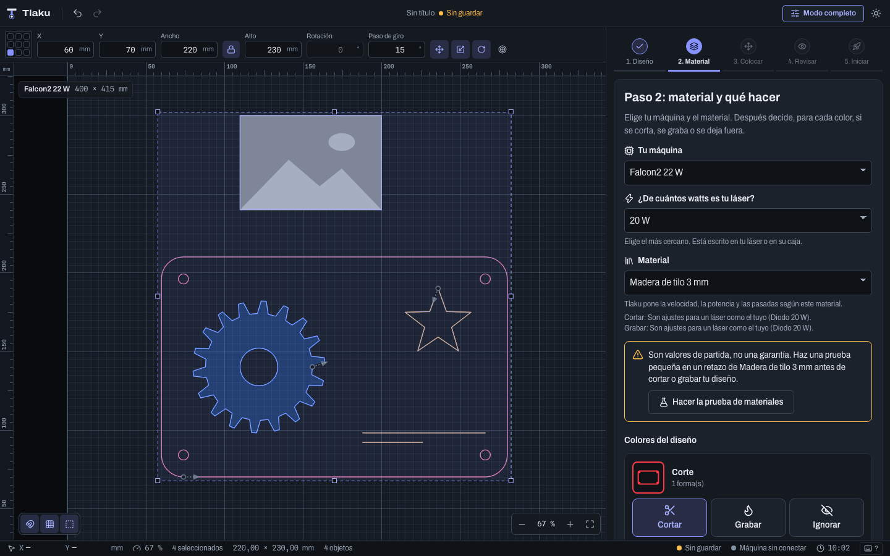
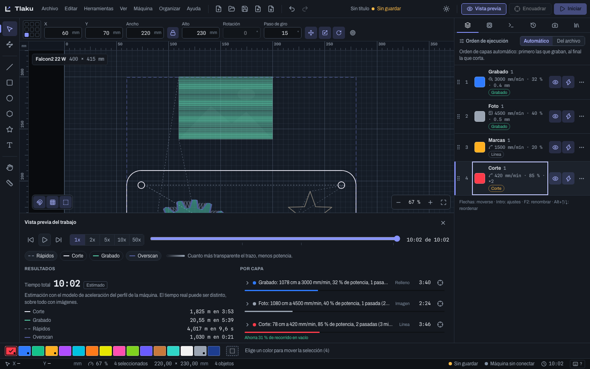
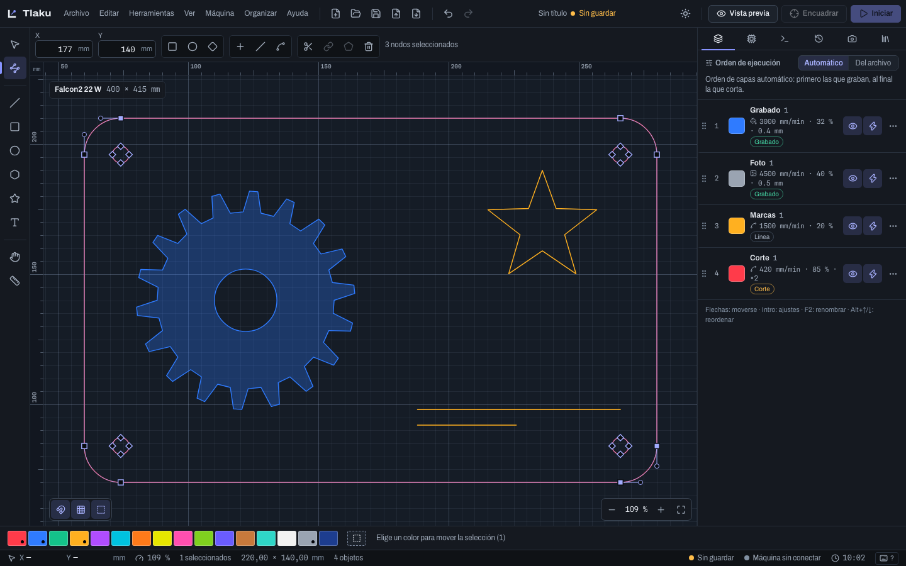
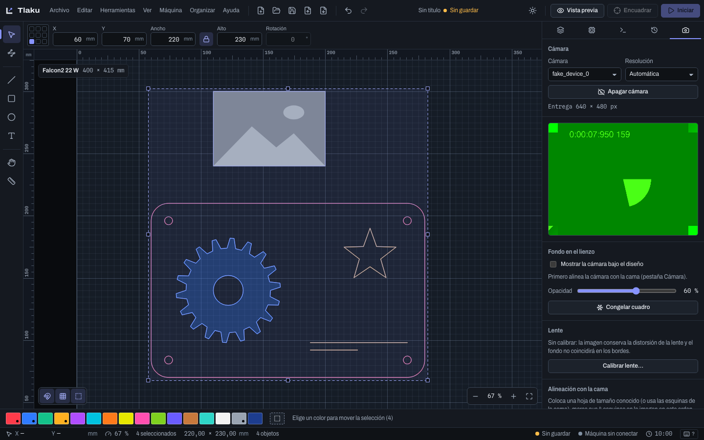
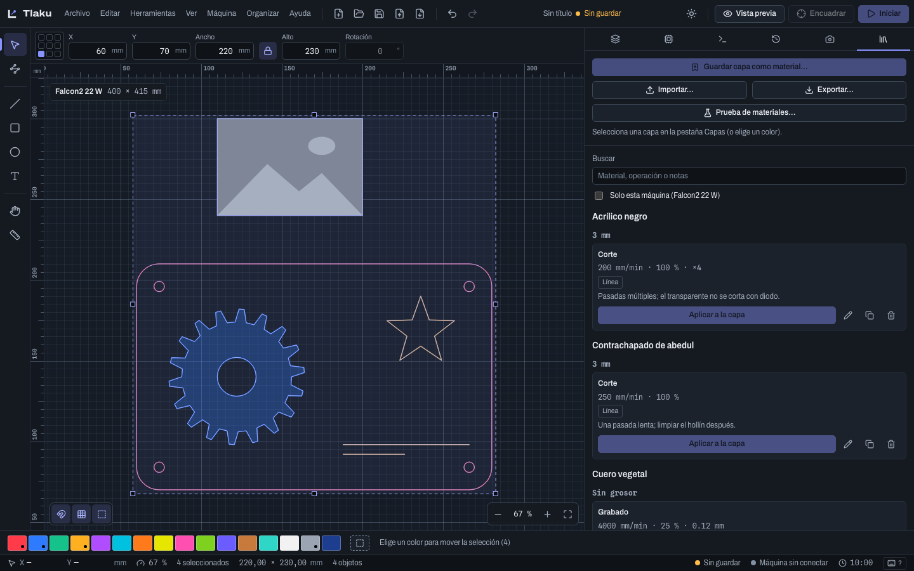

# Tlaku

[English](README.md) · Español

[](https://github.com/jahziel1/tlaku/actions/workflows/ci.yml)
[](LICENSE)
[](https://ko-fi.com/danielmartinez55371)

> **Tlaku es gratis y lo seguirá siendo.** Si te ahorra tiempo o dinero, puedes
> [invitarle un café al proyecto en Ko-fi](https://ko-fi.com/danielmartinez55371) ☕: paga máquinas de prueba y tiempo de desarrollo.
> Probarlo en tu máquina y [compartir los resultados](https://github.com/jahziel1/tlaku/issues/new?template=machine_report.yml) ayuda igual.

**Software libre para cortadoras y grabadoras láser.** Tlaku es una alternativa de código abierto
(licencia MIT) a los programas comerciales de control láser: diseñas o importas un trabajo, ajustas
las capas, ves cómo se va a cortar y lo envías a la máquina con revisiones de seguridad antes de
que se mueva nada.

El nombre viene del náhuatl *tlacuilo*: el pintor-escriba que dibujaba y escribía los códices. Un
tlacuilo convertía ideas en trazos sobre una superficie; Tlaku convierte un diseño en movimientos
de un láser.

**Para quién es:** personas con una cortadora o grabadora láser de diodo o CO2 que quieren un
programa abierto y que explique lo que hace, sobre todo quienes vienen de LightBurn y quienes
empiezan. Hay una guía específica para el cambio: [venir desde LightBurn](docs/manual/14-desde-lightburn.md).

> **Estado honesto:** Tlaku ya tiene aplicación de escritorio completa, pero **ninguna función de
> máquina se ha probado todavía con un láser real**. Todo se ha validado con un emulador de
> controladoras y con máquinas virtuales dentro de la app. Hasta que haya pruebas con hardware,
> trata cada trabajo como una prueba: empieza con poca potencia, material de desecho y la mano
> cerca del botón de paro. Detalle en [controladoras soportadas](#controladoras-soportadas).


## Ayúdanos a probar con máquinas reales

Tlaku se ha probado **solo con emuladores, máquinas virtuales y pruebas automáticas**. Ninguna función
de máquina se ha usado todavía con un láser real: la primera prueba será una Creality Falcon2 del
autor, y el resto depende de quien tenga otra máquina. Por eso lo más valioso que puedes hacer hoy es
probarlo con la tuya y contarnos qué pasó, **incluso si todo salió bien**.

- **Cuéntanos cómo te funciona en tu máquina:** abre el formulario
  [Reporte de prueba en una máquina real](https://github.com/jahziel1/tlaku/issues/new?template=machine_report.yml).
  Sigue la [lista de validación](docs/validacion-hardware.md) en orden, de lo más seguro (conectar y
  leer) a lo más arriesgado (un trabajo chico), y detente en el primer nivel que falle o te deje dudas.
- **Comparte tus ajustes de material:** el formulario
  [Compartir ajustes de material](https://github.com/jahziel1/tlaku/issues/new?template=material_settings.yml)
  recoge velocidad, potencia y resultado. Tras una revisión entran a la biblioteca como **datos de la
  comunidad sin verificar**, con licencia CC0 ([cómo funciona](community/materials/README.es.md)).
- **¿Tu controladora no está en la lista?** Pide soporte con
  [Soporte para una controladora nueva](https://github.com/jahziel1/tlaku/issues/new?template=new_controller.yml).
- **¿Algo falla?** [Reportar un error](https://github.com/jahziel1/tlaku/issues/new?template=bug_report.yml).

Desde la propia app, el menú **Ayuda** tiene «Reportar un problema…», «Compartir resultados de mi
máquina…» y «Compartir ajustes de material…»: abren tu navegador con el formulario ya prellenado
(versión, sistema, controladora, y la respuesta de `$I` si ya la tiene la consola). **Tlaku no envía
nada por su cuenta:** revisas el formulario y decides si lo publicas (hace falta una cuenta de GitHub).

**Seguridad:** usa protección ocular para la longitud de onda de tu láser, material de desecho, la
mano cerca del paro de emergencia y nunca dejes la máquina sola. Tlaku se ofrece sin garantía. Si
encuentras algo que pueda encender el láser donde no debe, no detenerlo o mover la máquina sin querer,
no abras un issue público: sigue [SECURITY.es.md](SECURITY.es.md).

## Funciones principales

- **Modo sencillo:** una versión guiada para quien empieza, en cinco pasos grandes (abrir, material,
  colocar, revisar, iniciar). Eliges el material y, por cada color del diseño, **Cortar**, **Grabar**
  o **Ignorar**; Tlaku pone velocidad, potencia y pasadas a partir de la biblioteca de materiales de
  fábrica y te pregunta de cuántos watts es tu láser. Se ajusta con palabras simples y se guarda
  como tu material. La primera vez pregunta si es tu primera vez con un láser, y un botón de la barra
  superior cambia de modo sin tocar el diseño. Los ajustes son puntos de partida, no una garantía.
  Mira [Modo sencillo](docs/manual/01b-modo-sencillo.md).

- **Diseño y edición:** lienzo con reglas y cama de la máquina, selección (con selecciones
  especiales), transformar con manijas o con valores exactos, voltear, espejo sobre una línea,
  giros rápidos y por dos puntos, orden de dibujo, bloquear, grupos anidados, igualar tamaños,
  rectángulos, elipses, polígonos, estrellas y líneas con curvas Bézier, medir, editor de nodos,
  ajuste magnético a nodos, puntos medios, centros e intersecciones, menú contextual, alinear y
  distribuir, arreglos en rejilla y circulares, copiar y pegar SVG entre programas y deshacer con
  historial. Las formas paramétricas (rectángulo, elipse, polígono y estrella) guardan sus
  parámetros en el proyecto y se siguen editando al reabrirlo.
- **Diseño avanzado:** recortar formas con un clic, separar subtrayectos, optimizar nodos, redondear
  esquinas (redondeada, chaflán o mordisco), cortar formas con una cuchilla, redimensionar ranuras
  de encastre al grosor real del material, deformar (arco, abombado, perspectiva y más), contorno
  de banda elástica, círculo tangente, asistente booleano con miniaturas, copiar a lo largo de un
  trazo, arreglo virtual (copias que no son objetos), acoplar y mover juntos, agrupar por
  contención y **nesting** para acomodar piezas en la cama o en un material irregular. Guías desde
  las reglas, puentes manuales, punto de inicio y sentido del corte, notas, plantillas, nueva
  ventana, pestañas reordenables y una biblioteca de arte con 41 dibujos.
- **Texto y códigos:** texto con fuentes del sistema (sobre un trayecto, curvado o con las letras
  soldadas), 15 fuentes de una línea (Hershey) y lector de fuentes SHX, y códigos QR, Data Matrix y
  de barras (Code 128, Code 39, EAN-13, EAN-8, UPC-A, ITF y Codabar). **Texto variable:** números de
  serie, datos de un CSV, fecha y hora, con avance tras cada trabajo y una copia por fila.
- **Operaciones de geometría:** unión, diferencia, intersección, soldar, offset, unir trazos,
  cerrar trayectos y quitar duplicados.
- **Importar:** proyectos de LightBurn (`.lbrn`, `.lbrn2`) con sus capas y ajustes, SVG (con
  recorte `clip-path` real), DXF, PDF y AI (los trayectos), HPGL, G-code,
  imágenes (PNG, JPG, BMP, WebP, TIFF, GIF y TGA) y vectorizar una imagen (o varias a la vez) con
  vista previa; con un diálogo de opciones (escala, DPI, unidad de un DXF, página de un PDF, capa
  destino). Los proyectos de LightBurn traen también el perforado, el modo de puntos, el relleno
  inundado, el sobrecorte, la rampa, las pausas, el corte pasante y las sub-capas.
- **Exportar e imprimir:** SVG, DXF, PNG y PDF vectorial a escala 1:1, del diseño completo o de la
  selección, e imprimir a tamaño real.
- **Preferencias y respaldo:** ventana de preferencias, atajos de teclado configurables, archivos
  `.tlakuprefs` para llevar la configuración a otro equipo, autoguardado y recuperación tras un
  cierre inesperado.
- **Capas de corte:** modos Línea, Relleno e Imagen; velocidad, potencia, pasadas, intervalo,
  ángulo, incremento de ángulo, bidireccional, overscan calculado con la física de la máquina,
  kerf, puentes (tabs), aire, eje Z por capa y por pasada, y relleno por barrido, por contornos o
  por regiones, con agrupación por forma o por grupo.
- **Corte avanzado (capas de línea):** perforación (corta y salta, para dobleces), entrada y
  salida del contorno (recta o en arco), sobrecorte, pausas al empezar y al terminar, corte
  pasante, modo punto y rampa de potencia.
- **Organización de las capas:** operaciones adicionales (sub-capas, por ejemplo rellenar y luego
  contornear), copiar y pegar ajustes, borrar una capa con sus objetos, valores por defecto
  propios para las capas nuevas y modo principiante. Cada objeto puede llevar su propia
  prioridad de corte y escala de potencia.
- **Imagen:** dithering (Floyd-Steinberg, Jarvis, Stucki, Atkinson, Bayer), semitono, periódico,
  boceto, umbral, escala de grises, ajustes de brillo, contraste y gamma, enviar sin tramar,
  realce de bordes y quitar motas, recortar con una forma (máscara), convertir vectores a mapa de
  bits y guardar la imagen procesada.
- **Vista previa:** reproducción del recorrido con tiempo estimado y desglose por capa, y una
  ventana de ajustes de optimización (respetar capas, grupos y prioridad, interiores primero,
  mejor punto de inicio, quitar tramos que se cortarían dos veces, esconder el juego mecánico).
- **Máquina:** asistente "Agregar máquina" con detección de solo lectura, conexión por puerto
  serie o **por red** (TCP/Telnet y WebSocket, con "Probar conexión"), mover el cabezal (pasos
  configurables, ejes Z y U, enfocar, posiciones guardadas, posicionar el láser con un clic,
  posición final), disparo de prueba con doble confirmación, origen y "Iniciar desde", origen del
  trabajo de 9 puntos, enviar solo la selección, encuadre de rectángulo o de contorno (también con
  el láser a baja potencia y en bucle), lista de comprobación antes de enviar, ajustes de velocidad
  y potencia en vivo (GRBL), pausa y paro, macros, consola con respuestas explicadas, ajustes `$$`
  de la controladora con respaldo, segundo láser, paquetes de configuración `.tlakubundle` y
  exportar G-code. Potencia de puente en las capas de línea.
- **Producción:** **Print & Cut** (marcas de registro impresas, medidas con el láser o con la
  cámara, ajuste sin escala, de escala uniforme o afín con el error de cada marca), **tiling**
  (dividir un trabajo más grande que la cama en tramos con solape, marcas de alineación, envío
  por tramos y retomar si se corta) y **alimentador automático** en el perfil de la máquina, que el
  tiling usa entre tramos. Las imágenes no giran con el registro de Print & Cut.
- **Control desde el celular:** ver el avance de un trabajo y **pausar o detener** desde el navegador
  del celular, escaneando un código QR en Preferencias (sin instalar nada). **Pausar y detener
  funcionan siempre**; **iniciar** exige el checklist de seguridad en el celular y que el trabajo se
  haya encuadrado en la computadora después del último cambio, y un láser galvo nunca se inicia desde
  el celular. Apagado de fábrica, solo en tu red local y con una clave que cambia cada vez que se
  abre la app. **No hay HTTPS: úsalo solo en una red de confianza.** Mira
  [Control desde el celular](docs/manual/09e-control-desde-el-celular.md).
- **Automatización:** servidor UDP local opcional (apagado de fábrica, solo `127.0.0.1`) para que
  otros programas manden `LOAD`, `START`, `STATUS` y `STOP`; `START` pide confirmación en la app.
- **Ruida y K40 (experimental):** controladoras Ruida (CO2) por red desde la app, y K40 con placa
  M2 Nano por USB, desde la app y desde la línea de comandos (`tlaku k40`); la potencia del K40 va con la perilla.
- **Galvo (experimental):** láseres de fibra, UV y CO2 galvo con la tarjeta LMCV4 de EZCAD2, por USB.
  Hoy se maneja desde la línea de comandos (`tlaku galvo list/status/light/mark`); la interfaz en la
  app está en camino. Probado solo contra una tarjeta simulada. Un láser de fibra es **clase 4 y su
  haz es invisible**: lee [Seguridad del galvo](docs/manual/13d-galvo-seguridad.md) antes de conectar
  nada. En el motor también hay grabado 3D por cortes, corrección de cilindro y de cono, bamboleo y
  la secuencia del marcado dividido, repetido y rotativo.
- **Taller:** biblioteca de materiales con **134 ajustes de fábrica** (cada uno con su fuente y su nivel de confianza, por clase de máquina: diodo, CO2 y fibra; son puntos de partida), ajustes de la comunidad (CC0, sin verificar), prueba de materiales, rotativo (rodillo o mandril),
  corrección de barrido (scanning offset), cámara con calibración de lente (incluido el modelo de
  ojo de pez), alineación y marcas grabadas, captura y vectorizado de la cama, cámara en el cabezal
  con mosaico y buscador de centro. Pulgadas en la interfaz.
- **Idiomas:** español e inglés, con cambio en vivo.
- **Ayuda:** manual de usuario de 34 páginas, en español y en inglés, dentro de la aplicación (menú Ayuda, con buscador) y en
  [docs/manual](docs/manual/00-indice.md) ([English](docs/manual/en/00-indice.md)), atajos con `F1`, novedades y "Acerca de".





## Lo que lo distingue

- **Planificador de corte explicable.** Cada paso del orden de corte indica qué regla lo decidió
  (capa, interior antes que contenedor, solape, cercanía) y los conflictos se avisan en vez de
  resolverse en silencio. Se ve en la vista previa y con `tlaku plan`; respeta el punto de inicio y
  el sentido que fijas a mano.
- **Nesting integrado.** Acomoda piezas en la cama o dentro de un material irregular con polígonos
  de no-ajuste y búsqueda con tope de tiempo, con rotaciones, espejo y piezas dentro de los huecos
  de otras; corre en segundo plano con progreso y se puede detener (`tlaku-nest`).
- **Tiling (dividir trabajos grandes).** LightBurn no lo tiene: un trabajo más grande que la cama se
  parte en tramos con solape y marcas de alineación en los empalmes, se envía tramo a tramo (tú
  mueves el material, o lo hace un alimentador automático) y se puede retomar tras un cierre.
  Experimental: se probó con la máquina virtual, no con un láser real
  ([manual](docs/manual/09d-tiling-y-alimentador.md)).
- **Máquina virtual.** Puedes conectar la app a una máquina simulada (Falcon2 Pro, GRBL, grblHAL,
  FluidNC, Marlin, Ruida y otras), también detrás de un socket TCP local para probar la conexión
  por red, y provocar fallas a propósito: llama, inclinación, alarma, desconexión. Sirve para
  aprender, probar un flujo completo y reportar errores sin tocar un láser.
- **Revisión de seguridad antes de enviar.** Antes de mover la máquina se consulta su estado y no
  se transmite nada si está en alarma, en pausa, con la puerta abierta o en marcha. Se avisa antes
  de empezar, no a mitad del trabajo, si el overscan se sale de la cama. La app nunca desbloquea
  ni hace *homing* por su cuenta, y la consola pide confirmación y explica cada `ALARM:N` y
  `error:N`.
- **Importadores que avisan.** Unidades ausentes en un DXF, SVG a 96 o a 72 DPI, texto sin contorno,
  recortes y máscaras, lo que un PDF trae y no es un trayecto, la escala de un HPGL: nada se pierde
  en silencio, cada omisión sale como advertencia.
- **Código abierto y formatos abiertos.** Licencia MIT; proyecto `.tlaku` en JSON versionado,
  materiales `.tlakumat`, y todo lo que hace la app se puede ejecutar desde la línea de comandos
  (`tlaku`) y comprobar con pruebas.
- **Una interfaz que explica.** Un comando no disponible dice por qué, en vez de quedar en gris
  sin motivo.


| | | |
|---|---|---|
|  |  |  |
| Editor de nodos | Cámara | Materiales |

### En camino

Estas funciones siguen pendientes; ninguna bloquea la beta. El criterio completo está en la sección 2
de [docs/spec/cobertura/auditoria.md](docs/spec/cobertura/auditoria.md) y el plan en
[docs/plan-completo.md](docs/plan-completo.md).

- **Antes de la beta:** actualización automática, el sitio con donaciones y publicar los instaladores
  (en curso), y probar «Nueva ventana» en una ventana real.
- **Diseño y capas:** el Modo principiante completo (ocultar herramientas y menús; el modo sencillo
  cubre gran parte), las propiedades de imagen y de texto en la misma ventana, el ajuste magnético
  de las manijas de deformar, revertir un chaflán (hoy se usa Deshacer), valores por defecto de capa
  por color y por máquina, las pulgadas en las capas, las máquinas y la cámara, y autoenfoque.
- **Ruida:** elegir el nombre del documento y sobrescribir, borrar y ejecutar documentos de la
  memoria de la controladora, escribir sus ajustes (con respaldo automático y `.lbset`) y el
  rotativo. Todo esto espera una máquina de pruebas.
- **Galvo:** un editor propio del rotativo en el perfil, partir formas enteras y marcar al vuelo, el
  asistente de nueve puntos y aplicar un `.cor` de EZCAD, y la vista previa de la deformación de
  cilindro y cono. Esperan una tarjeta real.
- **Otras máquinas:** el offset de U por capa y el láser 2 con Ruida, el alimentador nativo de una
  controladora DSP con tiling en varias columnas, y encontrar el centro tocando tres puntos con el
  cabezal. Preferencias de cámara y los formatos `.sc` y `.mage`
  (sin especificación pública) quedan para después.
- **Pruebas con una máquina real:** el corte avanzado, los ajustes en vivo, la conexión por red,
  Ruida, el K40, el galvo y el resto de las funciones de máquina solo se han validado con
  emuladores. La lista para hacerlo está en [docs/validacion-hardware.md](docs/validacion-hardware.md).

El estado real, función por función (213 de las 217 funciones del inventario están hechas; las otras 4 necesitan hardware o documentación que no es pública), está en
[docs/spec/cobertura/README.md](docs/spec/cobertura/README.md) y el plan en
[docs/plan-completo.md](docs/plan-completo.md).

## Controladoras soportadas

Ninguna se ha probado con una máquina real; "estable" significa que funciona de punta a punta
contra el emulador y las máquinas virtuales de la app, con pruebas automáticas. La primera prueba
con hardware real será una Creality Falcon2. Guía completa:
[docs/manual/13-controladoras.md](docs/manual/13-controladoras.md).

| Controladora o firmware | Estado | Notas |
|---|---|---|
| GRBL 1.1 (M4) y GRBL-M3, por USB serie | Estable en emulador; **por validar con máquina real** | La mayoría de los láseres de diodo (Creality Falcon2 incluida). Catálogo de 21 modelos con fuentes. |
| grblHAL y FluidNC | Estable en emulador; **por validar con máquina real** | Dialecto de G-code propio y máquina virtual. Por USB, y por red (TCP/Telnet y WebSocket, probados contra el emulador por sockets de verdad). |
| Marlin y Smoothie | Estable en emulador (básico); **por validar con máquina real** | Envío línea a línea, aviso de posición perdida y máquina virtual. |
| GRBL antiguo (sin M4), GRBL-LPC y G-code personalizado | **Por validar con máquina real** | Dialecto propio; sin máquina virtual dedicada. El tipo personalizado trae un editor de dialecto. |
| Ruida (CO2) | **Experimental**, en la app y por línea de comandos | Por red (UDP): conectar, enviar (por defecto guarda el trabajo en la controladora y no lo arranca), pausa, detener, saltos, encuadre, información y lista de documentos. Probado solo contra un emulador; no escribe ajustes. |
| K40 con placa M2 Nano | **Experimental**, en la app y por línea de comandos | Protocolo LHYMICRO-GL por USB directo (no por puerto serie), probado solo contra una placa simulada. LightBurn no la soporta. **La potencia va con la perilla de la máquina**, no por software; los grises se binarizan y no hay Z, aire, consola ni overrides. La posición se cuenta desde el home. |
| Galvo de fibra, UV o CO2 (tarjeta JCZ/BJJCZ LMCV4, EZCAD2) | **Experimental**, por línea de comandos (`tlaku galvo`); la interfaz en la app está en camino | USB directo, solo la tarjeta `9588:9899`; probado solo contra una tarjeta simulada. Sin pausa (solo detener). **Haz invisible de clase 4**: [lee la seguridad](docs/manual/13d-galvo-seguridad.md) antes de conectar. |
| Galvo EZCAD3/DLC y BSL, Trocen, TopWisdom | No soportado | Un K40 con la placa cambiada a GRBL-LPC o Smoothie sí puede funcionar. |

## Instalación

### Descargar la aplicación

Los instaladores están en la página de **Releases** del repositorio (la versión más reciente,
sección "Assets"):

| Sistema | Archivo |
|---|---|
| macOS 11 o posterior (Apple Silicon e Intel) | `.dmg`: ábrelo y arrastra Tlaku a Aplicaciones |
| Windows 10 o posterior | `.exe` (instalador NSIS) o `.msi` |
| Linux x86_64 | `.deb` (`sudo apt install ./Tlaku_*_amd64.deb`) o `.AppImage` (`chmod +x` y ejecútalo) |
| Linux ARM64 / Raspberry Pi 4 y 5 con sistema de 64 bits (experimental) | `.deb` (`sudo apt install ./Tlaku_*_arm64.deb`) o `*_aarch64.AppImage` |
| Linux, cualquier distribución (Flatpak, **sin probar**) | `Tlaku_*_x86_64.flatpak` o `Tlaku_*_aarch64.flatpak`: `flatpak install --user ./Tlaku_*_x86_64.flatpak` |

**Aplicación sin firmar.** Mientras el proyecto no tenga certificados de firma, el sistema avisará
la primera vez que abras el instalador:

- **macOS:** clic derecho sobre Tlaku > Abrir, o Ajustes del Sistema > Privacidad y seguridad >
  "Abrir de todos modos". Si dice que la app está dañada:
  `xattr -dr com.apple.quarantine /Applications/Tlaku.app`.
- **Windows (SmartScreen):** "Más información" y luego "Ejecutar de todas formas".
- **Linux:** sin avisos. Para usar el puerto serie del láser, añade tu usuario al grupo
  `dialout` (`sudo usermod -aG dialout "$USER"`) y vuelve a iniciar sesión.

**Flatpak (sin probar).** El paquete se arma en la CI a partir del `.deb`, pero **todavía nadie lo ha
ejecutado en un Linux real** (tampoco está en Flathub). Se ejecuta con `flatpak run org.tlaku.app`. Para el
puerto serie sigue haciendo falta estar en el grupo `dialout` **del sistema**, y las actualizaciones las da
Flatpak (la app no se actualiza sola). Tiene acceso a dispositivos (`--device=all`) por el puerto serie y
el USB. Detalles y permisos en [docs/publicar.md](docs/publicar.md#flatpak-y-flathub).

**Raspberry Pi (experimental).** Hace falta un sistema de **64 bits** (`uname -m` debe decir `aarch64`):
Raspberry Pi OS de 64 bits (Debian 12 «bookworm» o posterior) o Ubuntu ARM en una Pi 4 o 5 (se recomiendan
4 GB de RAM o más). No sirve el sistema de 32 bits ni la Pi 3 o anteriores. La ventana usa WebKitGTK con
aceleración gráfica; si sale en blanco o rota, prueba `WEBKIT_DISABLE_COMPOSITING_MODE=1 tlaku`. Se
compila y se prueba en la CI sobre una máquina ARM64, pero **aún no en una Raspberry Pi real**: si la
pruebas, cuéntanos cómo te fue con el
[reporte de máquina](https://github.com/jahziel1/tlaku/issues/new?template=machine_report.yml). Detalles
en [docs/publicar.md](docs/publicar.md#linux-arm64-y-raspberry-pi).

Más detalle, y cómo se publica cada versión, en [docs/publicar.md](docs/publicar.md). Los instaladores todavía no se han publicado: hasta la primera versión, compila desde el código fuente.

### Compilar desde el código fuente

Requiere Rust estable reciente (edition 2024). En Linux, `serialport` necesita
`libudev-dev` y `pkg-config`.

```sh
git clone https://github.com/jahziel1/tlaku.git && cd tlaku
cargo build --release
# el binario del CLI queda en target/release/tlaku
```

Para compilar la aplicación de escritorio hace falta además Node 22.13 o superior y las
dependencias de Tauri de tu sistema (en Linux, `libwebkit2gtk-4.1-dev` y otras; ver la
[guía de Tauri](https://v2.tauri.app/start/prerequisites/)):

```sh
cd apps/desktop
npm ci
npm run tauri build     # instaladores en target/release/bundle/
```

Para desarrollar, `npm run tauri dev`. Detalles en [apps/desktop/README.es.md](apps/desktop/README.es.md).

## Contribuir

Tlaku es de todos y lo hace posible quien lo prueba, lo mejora y lo difunde.

- **Probar con una máquina real** y contar qué pasó es hoy la ayuda más valiosa (ver
  [Ayúdanos a probar con máquinas reales](#ayúdanos-a-probar-con-máquinas-reales)).
- **Compartir ajustes de material** de tu máquina: [community/materials](community/materials/README.es.md).
- **Reportar un problema:** [abre un issue](https://github.com/jahziel1/tlaku/issues/new/choose) con el
  formulario que corresponda. Preguntas e ideas: [Discusiones](https://github.com/jahziel1/tlaku/discussions).
  Más en [SUPPORT.es.md](SUPPORT.es.md).
- **Código, documentación y traducciones:** lee [CONTRIBUTING.es.md](CONTRIBUTING.es.md). El proyecto
  es de sala limpia: no se copia código, textos ni capturas de programas comerciales.
- Todos los espacios del proyecto siguen el [Código de conducta](CODE_OF_CONDUCT.es.md).

## Apoyar el proyecto

El proyecto no tiene empresa detrás. Las donaciones, si las hay, pagan las pruebas con máquinas
reales, la firma de los instaladores y tiempo de desarrollo. Donar es voluntario: el programa es el
mismo con o sin donación. Dentro de la app: menú Ayuda > "Donar al proyecto".

<!-- Este bloque lo regenera `node scripts/build-site.mjs --readme` con site/config.json
     (ver docs/publicar.md). No lo edites a mano. -->
<!-- support:start -->
- Ko-fi: https://ko-fi.com/danielmartinez55371
<!-- support:end -->

## Documentación

- [Manual de usuario](docs/manual/00-indice.md): de los primeros pasos a la solución de problemas (también [en inglés](docs/manual/en/00-indice.md)).
- [docs/arquitectura.md](docs/arquitectura.md): pipeline, responsabilidad de cada crate y convenciones.
- [docs/app-api/README.md](docs/app-api/README.md): contrato entre la interfaz y el motor.
- [docs/spec/00-resumen.md](docs/spec/00-resumen.md) y [cobertura](docs/spec/cobertura/README.md): inventario funcional y estado real.
- [docs/plan-completo.md](docs/plan-completo.md): plan por olas.
- [docs/hardware/](docs/hardware/): investigación de controladoras y máquinas, con fuentes.
- [docs/publicar.md](docs/publicar.md): cómo se publica una versión.
- [docs/validacion-hardware.md](docs/validacion-hardware.md): lista de pruebas con máquinas reales.
- [apps/desktop/README.es.md](apps/desktop/README.es.md): la aplicación de escritorio y sus atajos.
- [SECURITY.es.md](SECURITY.es.md), [SUPPORT.es.md](SUPPORT.es.md) y [CODE_OF_CONDUCT.es.md](CODE_OF_CONDUCT.es.md).
- [docs/ideas-mejoras.md](docs/ideas-mejoras.md): ideas por investigar.
- [THIRD_PARTY.md](THIRD_PARTY.md): código de terceros.

## El motor

El motor es una biblioteca en Rust organizada en crates pequeños que no conocen la interfaz;
la aplicación (`apps/desktop`, Tauri 2 y React) y el CLI usan los mismos.

| Crate | Qué hace |
|---|---|
| `tlaku-core` | Modelo del trabajo (puntos, polilíneas, capas, ajustes de corte), orden de corte básico y `Toolpath`, la representación común que consumen los drivers. |
| `tlaku-svg`, `tlaku-dxf` | Importan SVG y DXF a polilíneas en mm, una capa por color, y avisan de lo que no pueden importar. |
| `tlaku-lbrn` | Lee proyectos de LightBurn (`.lbrn`, `.lbrn2`) a un modelo neutro: formas, grupos, texto, imágenes y capas. |
| `tlaku-geom` | Booleanas, soldar, offset, compensación de kerf, auto-join, cierre de trayectos, quitar duplicados y puentes; recortar, separar, optimizar nodos, redondear esquinas, cortar con cuchilla, ranuras, deformar, casco y círculo tangente. |
| `tlaku-nest` | Nesting: acomoda piezas en la cama o en un material irregular (polígonos de no-ajuste, colocación voraz y recocido simulado con tope de tiempo). |
| `tlaku-plan` | Planificador del orden de corte explicable. |
| `tlaku-fill`, `tlaku-raster` | Relleno por barrido, por contornos o por regiones; imágenes con dithering, máscara con forma y barrido de bitmaps. |
| `tlaku-trace` | Vectorizado de imágenes. |
| `tlaku-text` | Texto a contornos con fuentes del sistema, kerning, texto sobre trayecto, curvado y soldado; fuentes de una línea (Hershey incluidas y lector SHX). |
| `tlaku-codes` | Códigos QR, Data Matrix y de barras como formas vectoriales. |
| `tlaku-export` | Exporta el diseño a SVG, DXF, PNG y PDF a escala 1:1. |
| `tlaku-sim` | Estimación de tiempo con aceleración por eje y cálculo físico del overscan. |
| `tlaku-grbl` | G-code por dialecto, puertos serie, envío con conteo de caracteres y revisión previa. |
| `tlaku-ruida` | Experimental: archivos `.rd` y sesión por red para controladoras Ruida. |
| `tlaku-lhymicro` | Experimental: K40 con placa Lihuiyu M2 Nano (LHYMICRO-GL por USB) con placa simulada. |
| `tlaku-galvo` | Experimental: tarjetas galvo JCZ/BJJCZ LMC por USB: codec de 12 bytes, compilador con corrección de campo, lista blanca de comandos, apagado garantizado ante errores, encuadre con el puntero rojo y tarjeta simulada. |
| `tlaku-emu` | Emulador de controladoras (GRBL, Falcon2 Pro, grblHAL, FluidNC, GRBL-LPC, Marlin, Smoothie). |
| `tlaku-camera` | Calibración de lente, alineación y corrección por altura. |
| `tlaku-doc` | Tipos del contrato con la app, exportados a TypeScript. |
| `tlaku-pipeline` | Documento y máquina a `Toolpath`, estimaciones, límites de la cama y G-code; importadores de PDF y AI, HPGL, G-code y LightBurn. |
| `tlaku-cli` | Binario `tlaku`. |


## Línea de comandos

`tlaku <comando> --help` es la referencia completa de cada comando.

| Comando | Qué hace |
|---|---|
| `gcode` | Convierte un SVG, DXF o imagen (PNG, JPEG, BMP) en G-code para GRBL y muestra el resumen del trabajo (capas, tiempo estimado, área ocupada). El motor reconoce además como entrada PDF, AI, HPGL, G-code y LightBurn; la ayuda del CLI aún no los lista. |
| `plan` | Imprime el orden de capas y de corte con la razón de cada paso, sin generar nada. |
| `send` | Envía un archivo de G-code a la máquina con conteo de caracteres. Ctrl+C cancela con feed hold y soft reset. |
| `frame` | Recorre con el láser apagado el rectángulo que ocupa el diseño (incluido el overscan). |
| `cmd` | Envía comandos sueltos de GRBL (`$X`, `$H`, `$I`, G-code...) y muestra la respuesta completa, con errores y alarmas traducidos. |
| `ports` | Lista los puertos serie. |
| `info` | Lee la versión (`$I`) y la configuración (`$$`) de la máquina, sin moverla. |
| `ruida` | Experimental. `export-rd` escribe un archivo `.rd`; `send` lo manda por UDP a una controladora Ruida (guarda el trabajo, `--run` lo ejecuta); `status` lee su estado. |
| `k40` | Experimental. `list`, `status` (solo lectura), `send` (con `--dry-run` y `--emu`) y `export-egv` para un K40 con placa M2 Nano. La potencia se ajusta en la máquina. |
| `galvo` | Experimental. `list`, `status` (solo lectura), `light` (puntero rojo, nunca enciende el láser) y `mark` (con `--red-only`, `--dry-run`, `--dump` y `--emu`) para tarjetas galvo LMCV4. Con hardware real exige `--i-understand-laser-safety`. |

Ejemplos, ejecutados desde la raíz del repositorio (usan el diseño de prueba
`crates/tlaku-cli/tests/fixtures/design.svg`: un contorno rojo y un rectángulo azul):

```sh
# SVG -> G-code. Cada color del diseño es una capa: el contorno rojo se corta en dos
# pasadas a 300 mm/min y el rectángulo azul se rellena a 3000 mm/min.
target/release/tlaku gcode crates/tlaku-cli/tests/fixtures/design.svg -o trabajo.gcode \
  --layer "#ff0000:speed=300,power=100,passes=2,air" \
  --layer "#0000ff:mode=fill,interval=0.2,speed=3000,power=30"

# Orden de las capas y de las figuras, con la razón de cada paso (no escribe archivos)
target/release/tlaku plan crates/tlaku-cli/tests/fixtures/design.svg \
  --layer "#ff0000:kerf=0.1" --layer "#0000ff:mode=fill,interval=2"

# Con la máquina conectada: busca el puerto, encuádrala y envía el trabajo
target/release/tlaku ports
target/release/tlaku frame crates/tlaku-cli/tests/fixtures/design.svg --port /dev/cu.usbserial-XXXX
target/release/tlaku send trabajo.gcode --port /dev/cu.usbserial-XXXX

# Máquina en alarma: lee su versión (sin preguntar) y haz homing (pide confirmación)
target/release/tlaku cmd --port /dev/cu.usbserial-XXXX '$I' '$H'
```

**Orden de las capas.** Para que la pieza no se suelte antes de grabar, por defecto
(`--layer-order auto`) los rellenos e imágenes van primero, luego las líneas y al final los
cortes: las líneas con kerf, o con potencia de 80 % o más y varias pasadas. Dentro de cada grupo
se conserva el orden del archivo. `--layer-order file` respeta solo el orden del archivo, y
`order=N` dentro de `--layer` fija la posición de una capa (desde 1) por encima de lo anterior.
El resumen muestra el orden final y por qué.

**Antes de enviar.** `send` y `frame` abren el puerto, consultan el estado (`?`) y solo
transmiten si la máquina está en reposo (`Idle`). En alarma, pausa (`Hold`), puerta abierta o en
marcha (`Run`) no transmiten nada y explican qué hacer; `$X` (desbloquear) y `$H` (homing) los
sugieren con el comando exacto de `tlaku cmd` pero nunca los ejecutan. Ambos piden
confirmación antes de mover la máquina (`--yes` la omite).

**`cmd`.** Cada argumento es un comando, se envían en orden y se detiene en el primer error o
alarma. Escribe los `$` entre comillas simples. Los de solo lectura (`$I`, `$$`, `$#`, `$G`, `$N`,
`?`) se envían sin preguntar. `$X` (advierte que desbloquear sin hacer home puede dejar la
posición desconocida), `$H` (la máquina se moverá; espera hasta 60 s a que termine) y todo lo
demás (G0/G1/G2/G3, `$J=`, `M3`/`M4`, ajustes `$N=valor`) piden confirmación mostrando exactamente
qué se enviará; sin respuesta (stdin cerrado) se rechaza. `--yes` omite las preguntas. Tiempo
real por nombre: `status`, `hold`, `resume` y `reset`.

Otras opciones de `gcode`: `--speed`, `--power`, `--passes`, `--air`, `--mode line|fill`,
`--s-max` (`$30`), `--bed` (área de trabajo, `400x415` por defecto), `--tolerance`, `--no-flip`,
`--power-mode dynamic|constant` (M4 o M3), `--start-gcode` y `--end-gcode`. Las imágenes
necesitan `--image-size` y `--image-pos`. `plan` y `frame` aceptan las mismas opciones de diseño.

Los ajustes de optimización de la ventana de la app también son banderas: `--no-inner-first`,
`--no-reduce-travel`, `--no-best-start`, `--no-choose-direction`, `--mix-layers`,
`--remove-overlaps[=MM]` y `--hide-backlash`. El resumen y `tlaku plan` explican cuáles están
cambiadas. Los ajustes de corte avanzados (perforación, entradas, sub-capas...) se usan desde la app;
el CLI todavía no tiene opciones de `--layer` para ellos.

Sin instalar, se puede usar con `cargo run --bin tlaku -- <comando>`.

## Pruebas

```sh
cargo test --workspace
```

Varias pruebas comparan su salida con archivos dorados (`tests/fixtures` de cada crate:
`tlaku-grbl`, `tlaku-fill`, `tlaku-raster`). Si un cambio es intencional, regenéralos con
`UPDATE_GOLDEN=1 cargo test --workspace` y revisa el diff antes de confirmar. Más detalles en
[CONTRIBUTING.es.md](CONTRIBUTING.es.md).

## Licencia

[MIT](LICENSE). Las dependencias deben tener licencias permisivas; `cargo deny check` lo
verifica (ver [deny.toml](deny.toml)). El código de terceros que se adaptó está en
[THIRD_PARTY.md](THIRD_PARTY.md).
Los ajustes de material de la comunidad (`community/materials/`) los publican sus autores con
[CC0 1.0](https://creativecommons.org/publicdomain/zero/1.0/).
