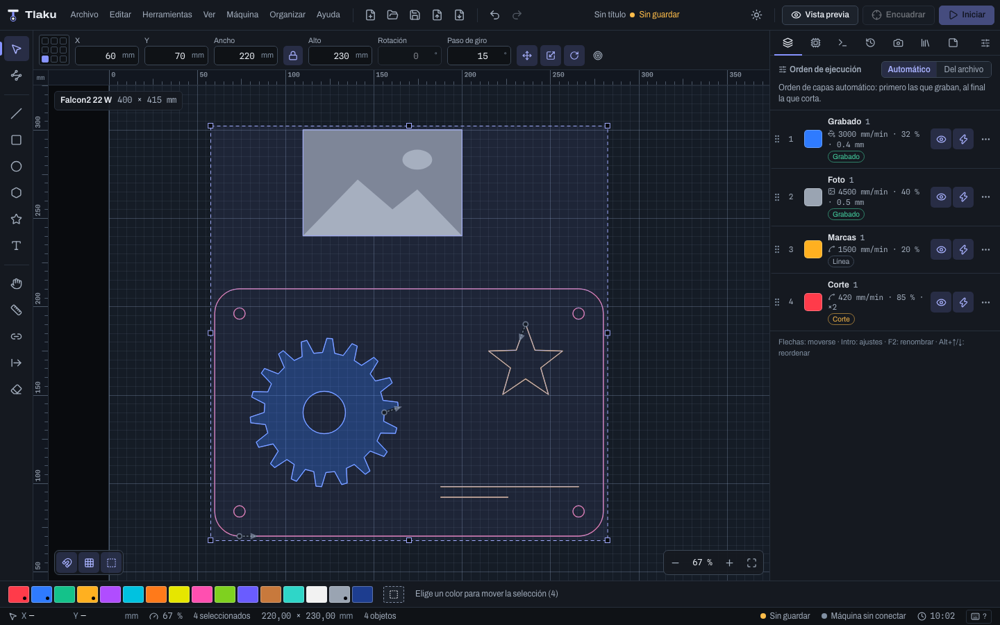

# Tlaku Desktop

English · [Español](README.es.md)

Tlaku's desktop app: **Tauri v2 + Vite + React 19 + TypeScript (strict) + zustand**.
The interface owns the document being edited; the engine (Rust) receives the whole document and
returns results. The contract is in [`docs/app-api/README.md`](../../docs/app-api/README.md) (Spanish).

Status: the complete interface works against a **simulated** machine and engine (mock) or against
the real engine: `src-tauri` implements every command and event of the contract on top of
`tlaku-pipeline` and `tlaku-grbl`. See "Status" at the end. Nothing has been tested with a real laser
yet.



More screenshots are in `docs/screenshots/` (regenerate them with `npm run screenshots`): layer
settings editor (`03`), preview with results (`04`), connected machine with the start dialog (`05`)
and the running job (`06`), console (`07`), history (`08`), shortcuts (`09`) and light theme (`10`).
From phase 3: node editor (`11`), text panel (`12`), difference A minus B (`13`), circular array
(`14`), tracing with preview (`15`), camera calibration wizard (`16`), camera panel (`17`) and docked
panel tabs with text (`18`; with little width they become icon-only).

## How to run it

Requirements: Node 22.13 or later, npm 11, stable Rust and, for the native app, the Tauri tooling
for your system (Xcode on macOS).

```bash
cd apps/desktop
npm install            # .npmrc turns on legacy-peer-deps (see "Dependency notes")
```

**Mock mode (browser, no Rust).** This is the default: the interface is developed with simulated
data (sample design, preview with moves, a machine that emits status and progress).

```bash
npm run dev            # http://localhost:1420
```

**Tauri mode (native app).** Uses the real `invoke`/`listen`: engine, files, device profiles
(`devices.json` in the config folder) and the GRBL connection. Design images are shown with
`imageUrl(path)` from `src/api` (the `asset://` protocol).

```bash
npm run tauri dev                              # native window with hot reload
npm run tauri build -- --debug --no-bundle     # builds the whole app without packaging
```

From the repository root, the crate is built with `cargo build -p tlaku-desktop`.

The API implementation is chosen with `VITE_API=mock|tauri` (default `mock`). The `dev:tauri` and
`build:tauri` scripts use `--mode tauri`, which loads `.env.tauri` with `VITE_API=tauri`. With
`VITE_DEMO=off` mock mode starts with an empty bed instead of the sample design.

| Script | What it does |
|---|---|
| `npm run dev` | Vite in mock mode |
| `npm run build` | `tsc --noEmit` and `vite build` |
| `npm run typecheck` | Strict TypeScript |
| `npm run lint` | ESLint |
| `npm test` | Vitest (command registry, store, mock, canvas, layers, machine, preview, history, shell) |
| `npm run readme` | Regenerates the shortcuts table of this README and of the Spanish one (`README.es.md`) from the command registry |
| `npm run screenshots` | Screenshots in `docs/screenshots/` (needs `npm run dev` in mock mode already running, the script does not start it, and Chrome; no extra dependencies) |

## Structure

```
apps/desktop/
  src-tauri/            Crate `tlaku-desktop` (member of the Cargo workspace)
    capabilities/       Minimal Tauri v2 permissions (events, dialogs, paths, window, opener)
    src/                engine (engine and files), machine (GRBL connection), commands (invoke)
  src/
    api/                Contract with the engine
      api.ts            `LaserApi` interface: ALL commands and events of docs/app-api/
      tauri.ts          Real implementation (invoke / listen)
      mock/             In-memory simulated implementation (+ tests)
      types.ts          Re-exports src/bindings/ and defines JobArgs and EventMap
      index.ts          getApi(): picks mock or tauri according to VITE_API
    bindings/           Types generated by ts-rs from tlaku-doc. DO NOT edit by hand
    store/              zustand in slices: document, selection, view, machine, preview, devices (+ notices)
    commands/           Central registry of commands, shortcuts and menus (id, label, shortcut, action)
      definitions/      One file per category
    i18n/               es/<area>.ts and en/<area>.ts (canvas, layers, machine, preview, history...) + t()
    lib/                Geometry, viewport (mm <-> px), device profile and coordinates
                        (`workToDoc`/`docToWork`), palette and layer settings, utilities
    ui/                 Reusable components (NumberField, Modal: the common accessible dialog)
    styles/             CSS tokens (dark and light theme) and global sheets; each area ships its own .css
    features/           One folder per area, each with an owner (see below)
  scripts/              Development utilities (screenshots)
  docs/screenshots/     Interface screenshots
```

Owners of each `src/features/` area (what is theirs and what they expose in their `index.ts`):

| Area | Owns | Exposes |
|---|---|---|
| `shell/` | Window layout, menu bar and top bar, tool palette, docked panel (tabs), status bar, notices, shortcuts dialog; mounts `MachineDialogHost` and the alarm banner exactly once | `AppShell` |
| `canvas/` | Canvas (`Renderer` interface, Canvas2D), rulers, zoom and pan, selection, transforms, drawing tools, node editing, snapping, drawing of the preview and of the head | `CanvasView`, `createRenderer` |
| `layers/` | Layer list, layer settings editor (mode, speed, power, fill, image), execution order and color strip | `LayersPanel`, `ColorPalette` |
| `machine/` | Connection, status, jogging, origin and "Start from", job, console, device manager, alarm and their dialogs | `MachinePanel`, `ConsolePanel`, `MachineDialogHost`, `AlarmBanner` |
| `preview/` | Toolpath preview, playback, per-layer results and debounced recalculation | `PreviewBar`, `usePreviewSync` |
| `history/` | History panel (undo/redo with labels), files (open, save, import, export, recent), drag and drop, unsaved-changes notice, window title | `HistoryPanel`, `PromptHost`, `DropOverlay` and window hooks |
| `text/` | Floating text panel over the canvas, font list, text outline kept in sync with the engine (`text_outline`) and convert to paths | `TextPanel`, `loadFonts`, `useFonts`, `convertTextToPaths` |
| `arrange/` | Arrange menu: booleans, offset, align and distribute, center and arrays (grid and circular) with their dialogs | `ArrangeDialogHost`, `useArrangeUi` |
| `trace/` | Image tracing dialog with preview and placement of the result | `TraceDialogHost` |
| `camera/` | Camera: video source, WebGL lens correction, calibration wizard, bed alignment and canvas backdrop | `CameraPanel`, `CameraDialogHost` |

The `store/*` slices are shared: each slice only writes to its own state. The texts of each area live
in `src/i18n/es/<area>.ts` and `src/i18n/en/<area>.ts`.

### Rules for whoever keeps working here

1. **Each folder of `src/features/` has an owner.** Whoever works on `canvas` does not edit
   `layers`, and so on. If you need something from another folder, use its `index.ts` or ask for the
   change.
2. **Do not write in `src/bindings/`**: the engine generates it. If a type is missing, define it
   temporarily in `src/api/types.ts` with a `TODO(bindings)`.
3. **Nothing calls `invoke` or `listen` directly.** Everything goes through `getApi()` (`src/api`).
   If you add a command to the contract, add it to `LaserApi`, to `COMMAND_NAMES`, to `tauri.ts` and
   to the mock.
4. **Shared state lives in `src/store/`**, one file per slice. A slice may read another with
   `get()`, but only writes to its own (actions of another slice are called, not reimplemented). In
   components, select primitive values or use `useShallow`: the cursor changes 60 times per second
   and must not repaint panels.
5. **Commands, menus, buttons and shortcuts come from `src/commands/`.** A new command goes in
   `definitions/<category>.ts`; the registry throws at startup if an id or a shortcut is repeated.
   Buttons use `useCommand(id)` or `<CommandButton id>`: label, shortcut and disabled reason come
   from there. An unavailable command returns the reason key
   (`enabled: (s) => true | 'reason.xxx'`): **never a gray button without an explanation**.
6. **All visible text comes from the dictionary** (`src/i18n/es/<area>.ts` and
   `src/i18n/en/<area>.ts`, always both) with `t('key')`. Keys are typed. Messages that come from the
   engine (warnings, summaries) arrive in the active language.
7. **Colors only with tokens** (`var(--accent)`, ...). No hex in components. The canvas reads the
   `--cv-*` ones with `readCanvasPalette()`. Every new control must look right in both themes and
   have a visible focus.
8. **Changing the renderer** (for example to WebGL) means implementing `Renderer`
   (`features/canvas/renderer.ts`) and returning it from `createRenderer()`. The scene (`Scene`)
   already carries everything needed; rulers and grid do not depend on the renderer.
9. **Units and coordinates:** mm, mm/min and %. The document has its origin at the bottom left and Y
   pointing up; only `lib/viewport.ts` converts to screen pixels (Y down). The head position
   (`work_pos`), `JobOptions.user_origin` and "go to origin" are in **machine** coordinates (the ones
   GRBL shows): the interface stores and sends them as they are, and only to draw them does it
   convert them to the document with `workToDoc` (`lib/device.ts`) according to
   `DeviceProfile.origin`. The engine does the inverse conversion when it computes the job.
10. Before handing in: `npm run typecheck && npm run lint && npm test && npm run build`.
    The tests of the simulated engine and of the store do not depend on the real clock except for
    short timers; if you add flows with time, use the options of `createMockApi({ ... })`.

## Keyboard shortcuts

They are defined once in `src/commands/definitions/` and shown in menus, tooltips and in the
shortcuts dialog (`F1`, `Ctrl+/` or `?`). `Cmd` on macOS, `Ctrl` on Windows and Linux. Shortcut
conflicts are a startup error and a test checks it.

Rules (a response to the forum complaint about contradictory shortcuts that "do nothing"):

- **They work in the whole window**, not only with the canvas focused. Single-letter keys are only
  ignored while typing in a text field.
- **One key, one meaning.** No letters change their function depending on what is under the cursor.
- **Cmd/Ctrl is reserved for file, edit and view actions.** It is not overloaded as a modifier for
  fine steps: the fine step uses `Alt`, the big one `Shift`.
- A shortcut of a disabled command does nothing, and the button's tooltip says why.

**Node editor (`N`).** With a vector object selected it shows its nodes and handles. Click picks a
node (Shift+click adds or removes; clicking a segment picks its two nodes; dragging over empty space
draws a node box). Dragging moves the picked nodes and the handles (Alt breaks the symmetry);
double-click on a segment adds a node without changing the shape. The node bar sets the exact X and Y
(in document mm) and gathers node type, segment and path. The object keeps its `transform`: points
are edited in local coordinates. **Undo and redo always work**, with nodes picked or not. With the
node tool, `Del`/`⌫` and the arrows act on the picked nodes (if there are none, they keep deleting
or moving the object); the other node keys (`I`, `B`, `J`, `O`, `Shift+L`, `Shift+U`, `Shift+E`,
`Shift+S`, `Shift+M`) only apply with that tool and each does a single thing, regardless of what is
under the cursor. `Esc` goes back to Select. A "corner" node requested by hand is remembered only for
the session (the document does not store the node type: on reopening, aligned handles are read as
smooth).

**Text (`T`).** Clicking on empty space creates a 10 mm "Text" on the active layer; clicking a text
selects it; double-clicking a text with Select switches to the text tool. The canvas raises
`textFocusToken` (`store/view.ts`) so the text panel takes focus.

**Camera image.** If `cameraBackdrop` exists, the canvas draws it under the grid and the objects,
projected onto its four corners (a triangle mesh with one affine per triangle; see
`features/canvas/backdrop.ts`). Without a camera it costs nothing.

The table comes from the command registry and a test (`src/features/shell/readme.test.ts`) fails if
it gets out of date; to regenerate it (in this file and in the Spanish one), run `npm run readme`.
Windows/Linux format (on macOS, `Ctrl` is `⌘`, `Alt` is `⌥` and `Shift` is `⇧`).

<!-- shortcuts:start (generado: npm run readme) -->

| Group | Command | Shortcut |
|---|---|---|
| File | New Project | `Ctrl+N` |
|  | Open Project… | `Ctrl+O` |
|  | Save | `Ctrl+S` |
|  | Save As… | `Ctrl+Shift+S` |
|  | Import Design… | `Ctrl+I` |
|  | Export G-code… | `Ctrl+Shift+E` |
|  | Print… | `Ctrl+P` |
|  | New tab | `Ctrl+T` |
|  | Close tab | `Ctrl+W` |
|  | New window | `Ctrl+Shift+N` |
| Edit | Undo | `Ctrl+Z` |
|  | Redo | `Ctrl+Shift+Z` or `Ctrl+Y` |
|  | Select All | `Ctrl+A` |
|  | Invert Selection | `Ctrl+Shift+I` |
|  | Duplicate | `Ctrl+D` |
|  | Delete | `Del` or `⌫` |
|  | Copy | `Ctrl+C` |
|  | Cut | `Ctrl+X` |
|  | Copy as SVG | `Ctrl+Alt+C` |
|  | Paste | `Ctrl+V` |
|  | Paste in Place | `Ctrl+Shift+V` |
|  | Group | `Ctrl+G` |
|  | Ungroup | `Ctrl+Shift+G` |
|  | Nudge Left (1 mm) | `←` |
|  | Nudge Left (10 mm) | `Shift+←` |
|  | Nudge Left (0.1 mm) | `Alt+←` |
|  | Nudge Right (1 mm) | `→` |
|  | Nudge Right (10 mm) | `Shift+→` |
|  | Nudge Right (0.1 mm) | `Alt+→` |
|  | Nudge Up (1 mm) | `↑` |
|  | Nudge Up (10 mm) | `Shift+↑` |
|  | Nudge Up (0.1 mm) | `Alt+↑` |
|  | Nudge Down (1 mm) | `↓` |
|  | Nudge Down (10 mm) | `Shift+↓` |
|  | Nudge Down (0.1 mm) | `Alt+↓` |
|  | Pick Layer from Palette | `Alt+1` |
|  | Pick Layer from Palette | `Alt+2` |
|  | Pick Layer from Palette | `Alt+3` |
|  | Pick Layer from Palette | `Alt+4` |
|  | Pick Layer from Palette | `Alt+5` |
|  | Pick Layer from Palette | `Alt+6` |
|  | Pick Layer from Palette | `Alt+7` |
|  | Pick Layer from Palette | `Alt+8` |
|  | Pick Layer from Palette | `Alt+9` |
|  | Pick Layer from Palette | `Alt+0` |
|  | Pick Layer from Palette | `Alt+G` |
|  | Active Layer Settings… | `Alt+Enter` |
|  | Preferences… | `Ctrl+,` |
| Tools | Select | `V` or `Esc` |
|  | Edit Nodes | `N` |
|  | Draw Line | `L` |
|  | Rectangle | `R` |
|  | Ellipse | `E` |
|  | Polygon | `G` |
|  | Star | `Shift+G` |
|  | Text | `T` |
|  | Pan (move the view) | `H` |
|  | Measure | `M` |
|  | Manual tabs | `U` |
|  | Start point | `Q` |
|  | Trim shapes | `X` |
|  | Warp on canvas | `Shift+W` |
|  | Fillet corner by click | `Shift+F` |
|  | Insert node at midpoint | `I` |
|  | Segment to line | `Shift+L` |
|  | Segment to curve | `Shift+U` |
|  | Corner node | `Shift+E` |
|  | Smooth node | `Shift+S` |
|  | Symmetric node | `Shift+M` |
|  | Break path at node | `B` |
|  | Join endpoints | `J` |
|  | Close path | `O` |
|  | Close polyline | `C` |
| Arrange | Union | `Alt+U` |
|  | Subtract (A minus B)… | `Alt+D` |
|  | Weld | `Alt+W` |
|  | Offset… | `Alt+O` |
|  | Center on bed | `Alt+C` |
|  | Flip Horizontal | `Alt+H` or `Ctrl+Shift+H` |
|  | Flip Vertical | `Alt+V` |
|  | Mirror Across a Line | `Alt+Shift+M` |
|  | Rotate and Scale by Two Points | `Alt+T` |
|  | Rotate 90° Counterclockwise | `[` |
|  | Rotate 90° Clockwise | `]` |
|  | Rotate One Step Counterclockwise | `Shift+[` |
|  | Rotate One Step Clockwise | `Shift+]` |
|  | Rotate 5° Counterclockwise | `Alt+[` |
|  | Rotate 5° Clockwise | `Alt+]` |
|  | Bring to Front | `Ctrl+PgUp` or `Ctrl+Shift+]` |
|  | Send to Back | `Ctrl+PgDn` or `Ctrl+Shift+[` |
|  | Bring Forward | `PgUp` or `Ctrl+]` |
|  | Send Backward | `PgDn` or `Ctrl+[` |
|  | Cut earlier (priority -1) | `Alt+Shift+[` |
|  | Cut later (priority +1) | `Alt+Shift+]` |
|  | Lock | `Ctrl+L` |
|  | Unlock All | `Ctrl+Shift+L` |
|  | Boolean assistant… | `Ctrl+B` |
|  | Trim at last click | `Ctrl+K` |
|  | Break apart subpaths… | `Alt+B` |
|  | Optimize shapes… | `Alt+Shift+O` |
|  | Cut shapes with a blade… | `Alt+Shift+C` |
| View | Next tab | `Ctrl+Tab` |
|  | Previous tab | `Ctrl+Shift+Tab` |
|  | Zoom In | `Ctrl+=` or `Ctrl+Shift+=` |
|  | Zoom Out | `Ctrl+-` |
|  | Fit to Bed | `Ctrl+0` |
|  | Fit to Design | `Ctrl+Shift+0` |
|  | Outlines Only | `W` |
|  | Snapping | `S` |
|  | Preview | `P` |
|  | Play the toolpath | `K` |
|  | Slower playback | `,` |
|  | Faster playback | `.` |
| Machine | Frame | `F` |
|  | Start | `Ctrl+Enter` |
|  | Pause | `Ctrl+Shift+P` |
|  | Stop | `Ctrl+.` |
|  | Jog left | `Ctrl+Alt+←` |
|  | Jog right | `Ctrl+Alt+→` |
|  | Jog up | `Ctrl+Alt+↑` |
|  | Jog down | `Ctrl+Alt+↓` |
|  | Review design… | `Ctrl+Alt+R` |
| Panels and help | Show History | `Ctrl+4` |
|  | Keyboard Shortcuts… | `Ctrl+/` or `F1` or `Shift+/` |
|  | Project notes | `Ctrl+7` |
|  | Show Layers | `Ctrl+1` |
|  | Show Machine | `Ctrl+2` |
|  | Show Console | `Ctrl+3` |
|  | Camera Panel | `Ctrl+5` |
|  | Materials Panel | `Ctrl+6` |
| Canvas (gestures) | Zoom at the cursor | `Mouse wheel` |
|  | Zoom with the trackpad | `Pinch` |
|  | Pan the view | `Middle button, Space + drag, or two fingers` |

<!-- shortcuts:end -->

## Visual design

Own "workbench" identity: precise instrumentation, not a copy of any other tool.

- **Dark theme by default** (workshops are often dimly lit) and a light theme. The theme is saved and
  applied before painting, with no flash. The tokens are in `src/styles/tokens.css`.
- **Palette:** bluish graphite (`#151920` panel, `#0e1115` background) and a single accent, the
  violet of a 450 nm diode (`#8793ff` in dark, `#4650e0` in light; at least 5:1 against its text).
  Green, amber and red only for status. Main text at least 12:1; secondary at least 7:1.
- **High-contrast canvas:** bed lighter than the work area, two-level grid that adapts to zoom (1/10
  mm, 1/10 cm...), registration marks at the corners and the machine origin in the accent color.
  Rulers in mm with a cursor.
- **Locally bundled typography** (no network): Archivo variable (width axis; the interface uses 94 %
  and the brand 118 %) and Spline Sans Mono for every number (coordinates, times, settings), with
  tabular figures so they do not jump when they change. OFL-1.1 license.
- Icons from `lucide-react` (ISC). Visible focus on every control; `prefers-reduced-motion` is
  respected.
- The color strip identifies each layer by its name (Red, Blue...) and marks the ones in use; the
  last swatch, dotted, is the guides layer, which is never sent to the machine.

## Dependency notes

- Everything in `package.json` is pinned without `^` and with versions published more than two weeks
  ago. Licenses MIT, ISC, Apache-2.0 and OFL-1.1 (fonts only).
- **TypeScript 6.0.3** and not 7.x: `typescript-eslint` 8.71 declares compatibility up to `<6.1`.
- **`.npmrc` with `legacy-peer-deps=true`**: with npm 11.4 the resolution of Vitest's optional peers
  fails (`Cannot read properties of null (reading 'edgesOut')`). Review when updating npm.

## Status

Done and covered by tests:

- Canvas: mouse selection, transforms, drawing tools, node editing, snapping, measuring, rulers,
  zoom and pan; toolpath preview with playback and results.
- Layers: list with execution order, full settings editor, color strip.
- Machine: connection, status, jogging, user origin with the 9 points, "Start from", framing,
  starting with a confirmation dialog, pause/stop, console with confirmation of dangerous commands,
  alarms with an explanation, device manager.
- Visible undo/redo history, cut/copy/paste, recent files and a shortcuts dialog generated from the
  registry.
- Document version 2 (phase 3): paths are Bézier curves (`BezPath`; ellipses and rounded corners are
  real cubics and the canvas draws them with `bezierCurveTo`, sharp at any zoom; imported SVG keeps
  its curves), flat groups (`group`: Ctrl+G / Ctrl+Shift+G; a click on an object of the group picks
  the whole group and Alt+click only that object) and text objects (their `outline` is drawn;
  without a generated outline a marker with the text in a system font is shown). Version 1 projects
  are migrated when opened.

Pending:

- WebGL renderer for the canvas (today Canvas2D; the `Renderer` interface already allows it).
- Isolate the preview calculation from the real engine so it only runs when needed (today it is
  recalculated, debounced, on any document change).
- More languages besides Spanish and English (the dictionary is already split by area).
- Packaging and signed installers (today `tauri build --no-bundle`).
