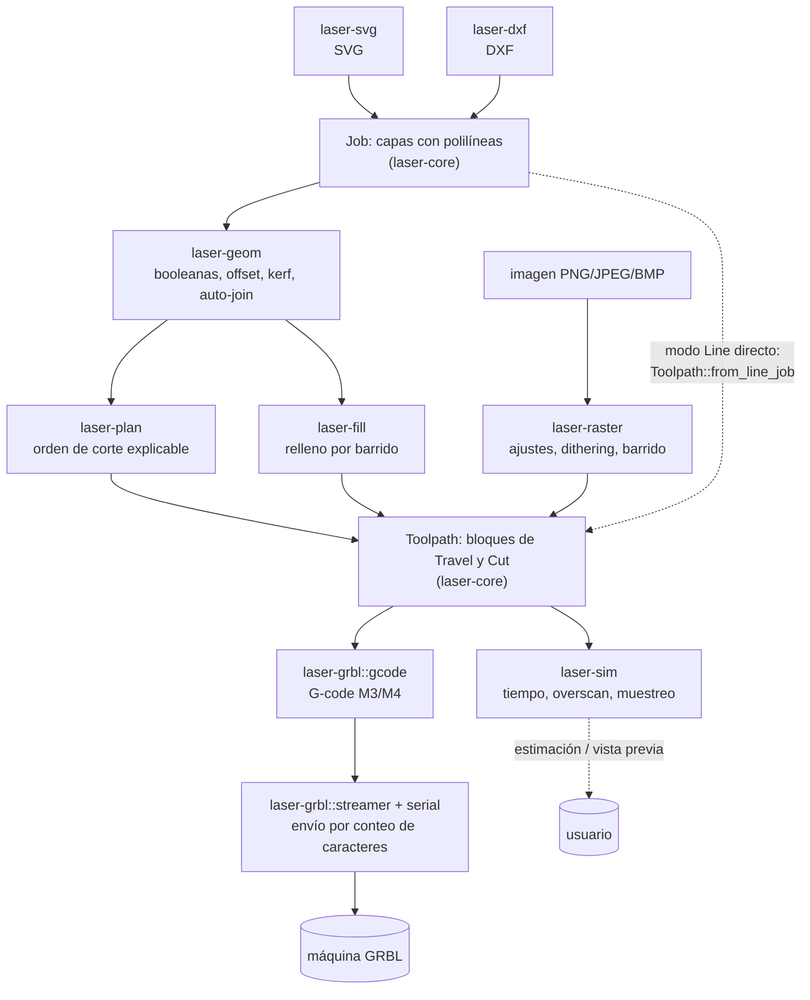

# Arquitectura

El motor es una biblioteca en Rust organizada en crates pequeños. Ninguno conoce la interfaz:
todo lo que haga la aplicación se puede ejecutar y probar desde la línea de comandos.
Los crates intermedios (`geom`, `plan`, `fill`, `raster`, `sim`) dependen solo de `laser-core`;
hoy el CLI conecta únicamente el camino SVG -> Line -> G-code, el resto se usa como biblioteca.

## Pipeline

Los drivers futuros (Ruida, galvo) también partirán de un `Toolpath`.

## Responsabilidad de cada crate

| Crate | Responsabilidad |
|---|---|
| `laser-core` | Tipos base (`Point`, `Polyline`, `Rgb`), capas, `CutSettings`, `Job`, orden de corte básico (`optimize`) y `Toolpath`. |
| `laser-svg` | SVG a polilíneas en mm (tolerancia configurable), una capa por color; voltea Y al convertir a `Job`. |
| `laser-dxf` | DXF a polilíneas en mm con color ACI/true color; no voltea Y; cada omisión genera una advertencia. |
| `laser-geom` | Booleanas y soldar, offset, compensación de kerf, auto-join, regla par-impar de anidamiento. Trabaja sobre polilíneas. |
| `laser-plan` | Decide el orden de las figuras (capa, grupo, prioridad, interior primero, recorrido corto) y explica cada paso con un `Reason`. Determinista. |
| `laser-fill` | Relleno vectorial por barrido con ángulo, serpentina, crosshatch y overscan; produce un `ToolpathBlock`. |
| `laser-raster` | Imagen a bitmap de potencia (ajustes, remuestreo, dithering/umbral) y barrido a `ToolpathBlock`. |
| `laser-sim` | Estima el tiempo con aceleración por eje y desviación de unión, calcula el overscan (`v²/2a`) y muestrea la trayectoria. |
| `laser-grbl` | G-code GRBL 1.1 a partir de un `Toolpath`, puertos serie y envío con conteo de caracteres, pausa y cancelación. |
| `laser-cli` | Binario `lasersoft`; solo orquesta los demás crates. |

## Contrato de `Toolpath`

`Toolpath` (en `laser-core/src/toolpath.rs`) es lo único que ven los drivers y el simulador:
una lista de `ToolpathBlock`. Cada bloque comparte velocidad (`speed_mm_min`), asistencia de aire
(`air_assist`) y modo de potencia (`PowerMode`), y contiene una lista de `Move`:

| Movimiento | Significado |
|---|---|
| `Move::Travel { to }` | Desplazamiento rápido con el láser apagado (G0 en GRBL). |
| `Move::Cut { to, power_pct }` | Movimiento a la velocidad del bloque con el láser a `power_pct` (0-100). |

- `Cut` con `power_pct == 0` es **overscan**: el cabezal acelera o frena sin disparar. En GRBL sale
  como G1 con `S0`; el muestreo del simulador lo marca con el láser apagado.
- Los movimientos son segmentos rectos desde la posición anterior.
- `PowerMode::Dynamic` (M4) deja que la controladora escale la potencia con la velocidad real;
  `Constant` (M3) la mantiene fija.
- Un driver solo traduce movimientos a su protocolo: no decide orden, relleno ni overscan.

## Convenciones

- **Unidades:** milímetros; velocidades en mm/min; potencia de 0 a 100 %; ángulos en grados en
  los ajustes y radianes en el cálculo interno.
- **Sistema de coordenadas:** el de la máquina, con origen abajo a la izquierda y Y hacia arriba.
- **SVG** tiene Y hacia abajo, por lo que se voltea al convertir a `Job` (`--no-flip` lo desactiva
  en el CLI). **DXF** ya es Y hacia arriba y no se voltea.
- **Imágenes:** la fila 0 de un bitmap es la de arriba; el barrido hace la conversión al sistema
  de la máquina.
- **Polilíneas cerradas** no repiten el primer punto al final. La pertenencia a una región sigue la
  regla par-impar: profundidad 0 = pieza, 1 = agujero, 2 = isla dentro del agujero.
- **Kerf:** `kerf_offset_mm` es cuánto se desplaza cada trayectoria (normalmente la mitad del ancho
  del corte). **Positivo = la pieza sale del tamaño dibujado**: los contornos exteriores se
  agrandan y los agujeros se encogen. Negativo es lo contrario; cero no cambia nada.
- **Errores:** las entradas degeneradas (vacías, con NaN, de área cero) se ignoran sin pánico y lo
  que no se puede importar se reporta con advertencias, nunca en silencio.
- **Pruebas:** la salida observable (G-code, rellenos, bitmaps) se verifica con archivos dorados;
  ver [CONTRIBUTING.md](../CONTRIBUTING.md).
