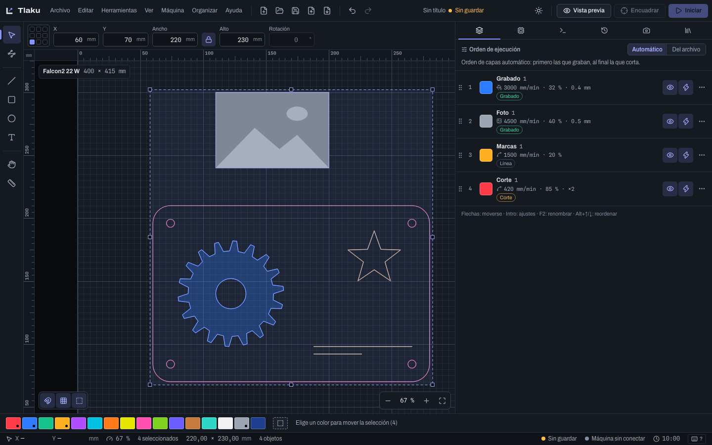
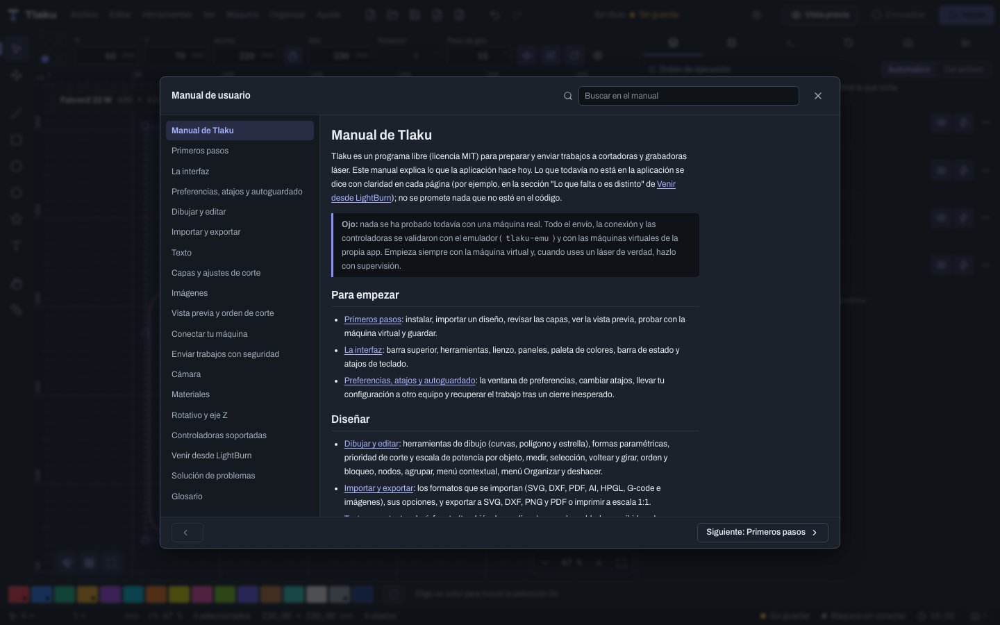

# La interfaz

Un recorrido por la ventana de Tlaku: qué hay en cada zona y qué atajos de teclado te ahorran tiempo. Los atajos se escriben con `Ctrl/Cmd`: `Cmd` en macOS, `Ctrl` en Windows y Linux.

## Barra superior

De izquierda a derecha:

- Los menús **Archivo**, **Editar**, **Herramientas**, **Ver**, **Máquina**, **Organizar** y **Ayuda**. Cada comando muestra su atajo; si no está disponible, explica por qué.
- Botones de archivo: nuevo, abrir, guardar, importar y exportar G-code. A su lado, **Deshacer** y **Rehacer**.
- El nombre del proyecto (**Sin título** hasta que lo guardas) y el aviso **Sin guardar** cuando hay cambios.
- El botón de tema (sol o luna) y, a la derecha, los tres botones del trabajo: **Vista previa**, **Encuadrar** e **Iniciar**. Encuadrar e Iniciar se activan solo con una máquina conectada y algo que enviar.

El menú **Ayuda** abre este **Manual de usuario** (con buscador), la lista de **Atajos de teclado…**, las **Novedades**, el **Registro de trabajos…** (los trabajos que enviaste a una máquina desde esta computadora, ver [Enviar trabajos con seguridad](09-enviar-con-seguridad.md#registro-de-trabajos)), **Reportar un problema…**, **Donar al proyecto…** y **Acerca de Tlaku**. Las preferencias están en **Editar > Preferencias…** (`Ctrl/Cmd+,`).

## Paleta de herramientas

La columna de la izquierda, de arriba abajo:

| Herramienta | Tecla |
|---|---|
| Seleccionar | `V` (también `Esc`) |
| Editar nodos | `N` |
| Dibujar línea | `L` |
| Rectángulo | `R` |
| Elipse | `E` |
| Polígono | `G` |
| Estrella | `Mayús+G` |
| Texto | `T` |
| Mano (mover la vista) | `H` |
| Medir | `M` |
| Puentes manuales | `U` |
| Punto de inicio | `Q` |
| Recortar formas | `X` |

Las teclas sueltas funcionan en toda la ventana, salvo mientras escribes en un campo. **Medir** muestra distancias, ángulos y datos de una forma. Cómo se usa cada herramienta está en [Dibujar y editar](03-dibujar-y-editar.md); las tres últimas, en [Guías, puentes, punto de inicio y proyecto](03e-guias-puentes-y-proyecto.md) y [Formas avanzadas y deformar](03c-formas-y-deformar.md).

## Lienzo y reglas

El lienzo muestra la cama de la máquina activa (arriba a la izquierda, su nombre y su tamaño en mm) con reglas en milímetros. El origen está abajo a la izquierda y Y crece hacia arriba.

- **Zoom:** rueda del ratón (centrado en el cursor), pellizco en el trackpad, o los botones de abajo a la derecha (alejar, acercar, ajustar a la cama). `Ctrl/Cmd+=` y `Ctrl/Cmd+-` acercan y alejan; `Ctrl/Cmd+0` ajusta a la cama y `Ctrl/Cmd+Shift+0` al diseño.
- **Mover la vista:** botón central, `Espacio` + arrastrar, dos dedos en el trackpad o la herramienta Mano.
- **Ajuste magnético:** tres interruptores abajo a la izquierda: **Ajuste magnético** (`S`), **Ajustar a la cuadrícula** y **Ajustar a objetos y cama** (nodos, puntos medios, centros e intersecciones). Mantén `Alt` mientras arrastras para suspenderlo solo en ese gesto.
- **Menú contextual:** clic derecho sobre el lienzo abre las acciones más usadas (ver [Dibujar y editar](03-dibujar-y-editar.md)).
- **Guías:** arrastra desde una regla para crear una guía que atrae los objetos (ver [Guías, puentes, punto de inicio y proyecto](03e-guias-puentes-y-proyecto.md)); doble clic en una regla las lista todas.
- **Fantasmas:** los objetos con **arreglo virtual** muestran sus copias como contornos tenues (ver [Copias, arreglo virtual y nesting](03d-copias-y-nesting.md)).
- **Solo contornos** (`W`) dibuja los objetos sin relleno.

## Barra numérica

Sobre el lienzo, con objetos seleccionados, escribe valores exactos: **X**, **Y**, **Ancho**, **Alto**, **Rotación** (en grados, antihorario) y el **Paso de giro** (el de `Mayús` al girar). La cuadrícula de nueve puntos de la izquierda elige el **punto de referencia**: el origen de X e Y, el ancla de la escala y el centro del giro. El candado mantiene la proporción. Los campos aceptan expresiones: `100/3`, `+5` (suma), `*2` (multiplica), `50 %`, `5in`. Con **Editar nodos** esta barra pasa a ser la barra de nodos (ver [Dibujar y editar](03-dibujar-y-editar.md)). Las imágenes no se pueden rotar.

## Panel acoplado

A la derecha hay un panel con pestañas. Arrastra su borde izquierdo para cambiar el ancho; si queda estrecho, las pestañas pasan a solo ícono.

| Pestaña | Atajo | Para qué |
|---|---|---|
| Capas | `Ctrl/Cmd+1` | ajustes de corte y orden de ejecución |
| Máquina | `Ctrl/Cmd+2` | conexión, estado, mover el cabezal, trabajo |
| Consola | `Ctrl/Cmd+3` | comandos y respuestas de la máquina |
| Historial | `Ctrl/Cmd+4` | pasos para deshacer y rehacer |
| Cámara | `Ctrl/Cmd+5` | ver [Cámara](10-camara.md) |
| Materiales | `Ctrl/Cmd+6` | ver [Materiales](11-materiales.md) |
| Notas | `Ctrl/Cmd+7` | cuaderno del proyecto; se guarda con él y no se envía a la máquina |

Puedes **reordenar** las pestañas arrastrándolas (o con `Alt+Mayús+←` y `→`), ocultar las que no uses y restaurar el orden con el botón **Personalizar pestañas**; el orden se recuerda. Más en [Guías, puentes, punto de inicio y proyecto](03e-guias-puentes-y-proyecto.md).

El panel **Historial** lista cada acción (hasta 200 pasos). Haz clic en un paso para volver a ese punto; lo deshecho se puede recuperar mientras no hagas otra acción. El botón de la papelera vacía el historial sin cambiar el diseño.

## Paleta de colores y barra de estado

Abajo, la franja de **colores de capa**: 16 colores y las **Guías**. Con objetos seleccionados, elegir un color los mueve a esa capa; sin selección, vuelve activa esa capa para lo que dibujes. `Alt+1` a `Alt+0` eligen los diez primeros y `Alt+G` las guías. Las guías nunca se envían a la máquina.

La barra de estado muestra la posición del cursor en mm, el zoom, la cantidad de objetos seleccionados y su tamaño, el total de objetos, si el proyecto está guardado, la máquina conectada (con la etiqueta **Virtual** si es un emulador) y el tiempo estimado del trabajo.

## Atajos de teclado

Pulsa `?`, `F1` o `Ctrl/Cmd+/` para abrir la lista completa, con buscador (muestra los atajos de fábrica). Todos se pueden cambiar: ver [Preferencias, atajos y autoguardado](02b-preferencias-y-atajos.md). Los más usados:

| Acción | Atajo |
|---|---|
| Nuevo, abrir, guardar | `Ctrl/Cmd+N`, `Ctrl/Cmd+O`, `Ctrl/Cmd+S` |
| Nueva ventana | `Ctrl/Cmd+Shift+N` |
| Importar diseño | `Ctrl/Cmd+I` |
| Deshacer, rehacer | `Ctrl/Cmd+Z`, `Ctrl/Cmd+Shift+Z` (o `Ctrl/Cmd+Y`) |
| Copiar, cortar, pegar | `Ctrl/Cmd+C`, `Ctrl/Cmd+X`, `Ctrl/Cmd+V` |
| Seleccionar todo, invertir | `Ctrl/Cmd+A`, `Ctrl/Cmd+Shift+I` |
| Duplicar, eliminar | `Ctrl/Cmd+D`, `Supr` o `Retroceso` |
| Agrupar, desagrupar | `Ctrl/Cmd+G`, `Ctrl/Cmd+Shift+G` |
| Bloquear, desbloquear todo | `Ctrl/Cmd+L`, `Ctrl/Cmd+Shift+L` |
| Voltear horizontal, vertical | `Alt+H`, `Alt+V` |
| Girar 90° a la izquierda, a la derecha | `[`, `]` |
| Traer al frente, enviar al fondo | `Ctrl/Cmd+RePág`, `Ctrl/Cmd+AvPág` |
| Asistente booleano, recortar en el último clic | `Ctrl/Cmd+B`, `Ctrl/Cmd+K` |
| Separar subtrayectos, optimizar formas, cortar con cuchilla | `Alt+B`, `Alt+Shift+O`, `Alt+Shift+C` |
| Preferencias | `Ctrl/Cmd+,` |
| Imprimir (PDF a escala 1:1) | `Ctrl/Cmd+P` |
| Mover la selección | flechas: 1 mm; con `Shift` 10 mm; con `Alt` 0,1 mm |
| Vista previa | `P` |
| Encuadrar, iniciar | `F`, `Ctrl/Cmd+Intro` |

## Accesibilidad

Tlaku se puede usar sin ratón y con lector de pantalla. El lienzo es gráfico, pero todo lo que lo rodea tiene teclado y nombre.

- **Saltar al lienzo.** Al empezar a tabular aparece el enlace **Saltar al lienzo**; con `Intro` lleva el foco al lienzo sin recorrer los menús y las barras.
- **Diálogos.** El foco entra al diálogo, `Tab` y `Shift+Tab` no se salen de él, `Esc` lo cierra y el foco vuelve al control que lo abrió. Los paneles que no son modales (revisar diseño, biblioteca de arte, imprimir y cortar, mosaico) también devuelven el foco al cerrarse.
- **Menús.** `F10` lleva el foco a la barra de menús; `↓` o `Intro` abre un menú, las flechas recorren las entradas y los menús vecinos, `Inicio` y `Fin` saltan a los extremos, escribir una letra salta a la entrada que empieza con ella y `Esc` cierra y devuelve el foco. El menú del botón derecho y el menú de cada capa funcionan igual.
- **Barras de herramientas.** La paleta de herramientas y las barras de la parte superior son una sola parada de `Tab`; dentro se avanza con las flechas.
- **Panel lateral.** Las pestañas son una lista de pestañas: `←`/`→`, `Inicio` y `Fin` cambian de pestaña; `Alt+Shift+←/→` las reordena. El botón de personalizar abre un menú que se cierra con `Esc`.
- **Paneles flotantes.** Enfoca la barra de título del panel: las flechas lo mueven y `Shift` + flechas cambian su tamaño. El asa de la esquina cambia el tamaño con las flechas.
- **Campos numéricos.** `↑` y `↓` suman y restan un paso; con `Shift` el paso es 10 veces mayor y con `Alt`, 10 veces menor. `Intro` confirma y `Esc` revierte.
- **Modo sencillo.** Al cambiar de paso el foco pasa al título del paso; los botones miden al menos 44 px.

**Lector de pantalla**

- Los botones de solo ícono tienen nombre, y las muestras de color de capa se anuncian por su nombre (también llevan su número a la vista, para no depender del color).
- El lienzo tiene una descripción (mesa, tamaño y cantidad de objetos) y, al seleccionar, se anuncia un resumen: cuántos objetos, tamaño y esquina inferior izquierda. Se actualiza unos instantes después de cada cambio para no leer cada paso de un arrastre.
- Los avisos se anuncian solos; las advertencias y los errores con prioridad alta. El trabajo anuncia cada cambio de estado (en marcha, pausa, terminado, cancelado, error) y su avance cada 25 %.
- Las listas y tablas (capas, máquinas, marcas, datos de variables) tienen nombre.

**Vista**

- Los textos cumplen contraste 4,5:1 y los bordes de los controles 3:1, en el tema claro y en el oscuro.
- El foco siempre se ve con un contorno.
- Con la opción del sistema «reducir movimiento» se apagan las animaciones.
- La página de control remoto del celular sigue las mismas reglas: botones grandes, estado y avance anunciados, y la barra de **Detener** fija.

## Tema claro u oscuro

El botón de sol o luna de la barra superior (o **Ver > Cambiar tema claro u oscuro**) alterna entre los dos temas. Tlaku recuerda tu elección; por defecto abre en oscuro. El mismo ajuste está en **Preferencias > Apariencia**, junto con la rejilla del lienzo.

Siguiente: [Preferencias, atajos y autoguardado](02b-preferencias-y-atajos.md)
