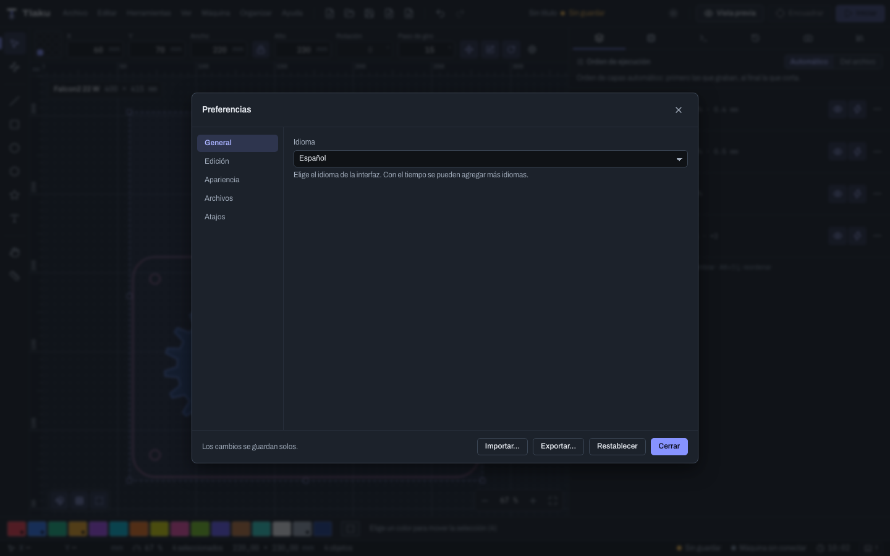
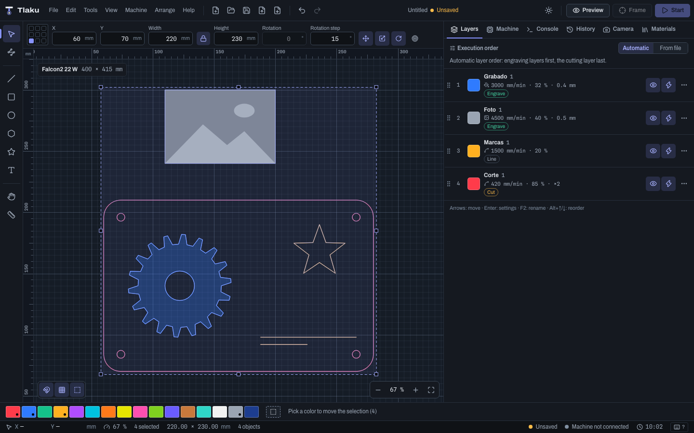
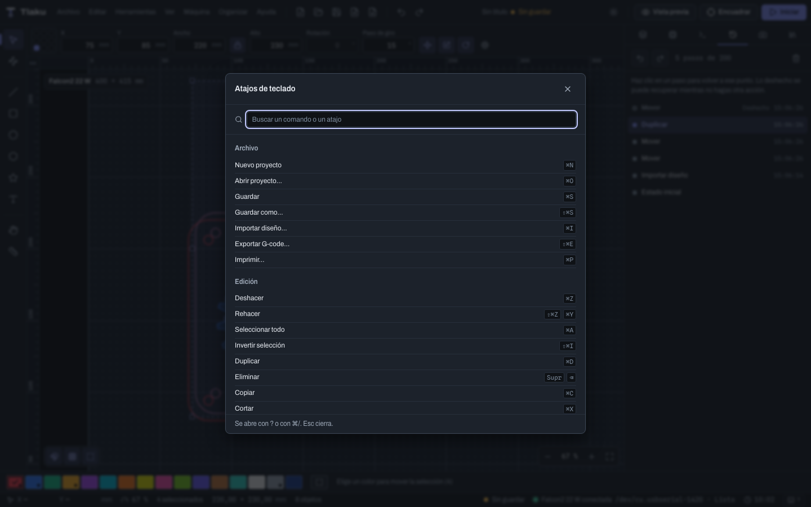

# Preferencias, atajos y autoguardado

Cómo ajustar Tlaku a tu manera: la ventana de **Preferencias**, el editor de **atajos de teclado**, los archivos `.tlakuprefs` para llevar tu configuración a otro equipo y las **copias de recuperación** que protegen tu trabajo si la aplicación se cierra de golpe. Los atajos se escriben con `Ctrl/Cmd`: `Cmd` en macOS, `Ctrl` en Windows y Linux.

## Abrir las preferencias

Elige **Editar > Preferencias…** o pulsa `Ctrl/Cmd+,`. La ventana tiene cinco secciones a la izquierda y **los cambios se guardan solos**: no hay botón de aceptar, solo **Cerrar**.

Abajo hay tres botones: **Importar…** y **Exportar…** (ver más abajo) y **Restablecer**, que devuelve todas las preferencias a su valor de fábrica tras pedir confirmación. Restablecer **no toca tus atajos de teclado**.

## Qué se puede ajustar

| Sección | Ajuste | De fábrica | Rango |
|---|---|---|---|
| General | **Idioma** | El del sistema (español o inglés) | Español o English; cambia al momento, sin perder el documento. Los mensajes del motor siguen en español |
| Edición | **Unidades de longitud** | Milímetros (mm) | mm o pulgadas (in) |
| Edición | **Paso normal** de las flechas | 1 mm | 0,001 a 100 mm |
| Edición | **Paso con Mayús** | 10 mm | 0,001 a 500 mm |
| Edición | **Paso con Alt** | 0,1 mm | 0,001 a 10 mm |
| Edición | **Paso de rotación con Mayús** | 15° | 1° a 180° |
| Edición | **Distancia del ajuste magnético** | 8 px | 1 a 40 px |
| Edición | **Desplazamiento al duplicar y pegar** | 5 mm | 0 a 200 mm |
| Apariencia | **Tema** | Oscuro | Oscuro o Claro |
| Apariencia | **Rejilla del lienzo** | Automática (según el zoom) | Automática o una medida fija de 1 a 100 mm |
| Archivos | **Guardar copias de recuperación automáticamente** | Sí | Sí o no |
| Archivos | **Intervalo entre copias** | 60 s | 10 a 3600 s |
| Archivos | **Archivos recientes que se recuerdan** | 10 | 0 a 30 |

Detalles que conviene saber:

- **Unidades.** El diseño se guarda siempre en milímetros; la unidad que eliges cambia cómo se muestran y se escriben las longitudes. Hoy se aplica en la herramienta **Medir** (ver [Dibujar y editar](03-dibujar-y-editar.md)) y en los campos de esta ventana. La barra numérica y los diálogos siguen en milímetros, aunque aceptan la unidad al escribir (`5in`, `50%`). Los campos de longitud de las preferencias aceptan «5 mm», «0,25 in» o «1/8"».
- **Pasos de las flechas.** Cambian los tres pasos de las flechas del teclado (ver [Dibujar y editar](03-dibujar-y-editar.md)).
- **Paso de rotación.** Es el que usan el giro con `Mayús` al arrastrar la perilla, los comandos **Girar un paso a la izquierda/derecha** y el campo **Paso de giro** de la barra numérica.
- **Rejilla.** Con una medida fija, la rejilla menor mide eso y la mayor diez veces más; con el zoom muy alejado se oculta para no saturar la vista.
- **Tema.** Es el mismo ajuste que el botón de sol o luna de la barra superior.
- **Archivos recientes.** El botón **Vaciar la lista de recientes** borra la lista de **Archivo > Abrir reciente**. Con 0 no se recuerda ninguno.

Las preferencias viven en un archivo `preferences.json` dentro de la carpeta de configuración de la aplicación, no en la ventana web, así que sobreviven a limpiar los datos del navegador integrado.

## Atajos de teclado

Los atajos de fábrica están en [La interfaz](02-interfaz.md) y en el diálogo que se abre con `F1`, `?` o `Ctrl/Cmd+/`. Para cambiarlos abre **Editar > Editar atajos de teclado…** o la sección **Atajos** de las Preferencias.

La lista agrupa los comandos por categoría y tiene un buscador (**Buscar un comando o un atajo**). Sobre cada comando:

1. Pulsa **Cambiar el atajo** (el lápiz) y, cuando diga **Pulsa la combinación…**, escribe la nueva. `Esc` cancela.
2. **Añadir otro atajo** (el signo más) deja a un comando varias combinaciones.
3. **Quitar el atajo** lo deja **Sin atajo**.
4. **Restaurar el de fábrica** vuelve a la combinación original de ese comando.

Un comando con atajo cambiado se marca como **Personalizado**, y arriba se cuenta cuántos tienes.

Si la combinación ya la usa otro comando, Tlaku no la pisa en silencio: dice «X» ya es el atajo de «Y» y te ofrece **Quitárselo y asignarlo aquí** o **Cancelar**.

Además:

- **Restaurar los de fábrica** (abajo del panel) quita todos tus cambios, tras confirmar.
- **Exportar atajos…** e **Importar atajos…** guardan y cargan solo los atajos, útiles como respaldo.
- Las teclas de herramienta son letras sueltas y no funcionan mientras escribes en un campo, igual que con los atajos de fábrica.
- El diálogo `F1` y las tablas de este manual muestran **siempre los atajos de fábrica**, no los que hayas cambiado.

## Llevar tu configuración a otro equipo

En la ventana de Preferencias, **Exportar…** guarda un archivo `.tlakuprefs` con todas tus preferencias **y** tus atajos. **Importar…** lo carga en otro equipo (o después de reinstalar). El archivo lleva también las preferencias que se cambian fuera de esta ventana: los **valores por defecto de las capas nuevas** y el **Modo principiante** (ver [Capas y ajustes de corte](05-capas-y-ajustes.md)) y la configuración de la lista **Antes de enviar** del diálogo de iniciar (ver [Enviar trabajos con seguridad](09-enviar-con-seguridad.md)). Los **Ajustes de optimización** y la **Posición final** se recuerdan entre sesiones, pero no viajan en este archivo.

Al importar, Tlaku dice cuántas preferencias y de cuántos comandos son los atajos que entraron. Si el archivo viene de otra versión:

- Las preferencias que esta versión no entiende se **ignoran** y se avisa cuántas fueron.
- Los atajos de comandos que no existen en esta versión **se conservan**, por si llegan después, y se avisa cuántos son.

Un archivo que no es un paquete de preferencias de Tlaku se rechaza con un mensaje claro. Los materiales tienen su propio archivo (`.tlakumat`, ver [Materiales](11-materiales.md)); los dispositivos y las cámaras todavía no se pueden exportar.

## Autoguardado y recuperación

Tlaku guarda, mientras trabajas, una **copia de recuperación** de tu documento. No sustituye a tu archivo `.tlaku`: **Guardar** sigue siendo lo que conserva tu trabajo, y la copia nunca sobrescribe tu proyecto.

- Cada 60 segundos por omisión (ajustable en **Preferencias > Archivos**, de 10 a 3600 s), y **solo si hay cambios sin guardar** desde la última copia.
- La copia está en la carpeta de datos de la aplicación, en una subcarpeta `recuperacion`. Se conservan como máximo 10 copias.
- Se borra sola cuando guardas el proyecto, abres otro o cierras la aplicación con normalidad.
- Se puede apagar con **Guardar copias de recuperación automáticamente**. Si no se puede escribir la copia, Tlaku lo avisa una vez.

Si Tlaku se cierra de golpe (un corte de luz, una falla, un cierre forzado), la próxima vez que lo abras aparece **Se encontró trabajo sin guardar**, con una fila por documento: su nombre, **Copia del** día y hora, y el proyecto de origen (o **Documento que nunca se guardó**). Para cada una:

- **Recuperar** abre la copia como tu documento actual, marcado como **Sin guardar** (si ya tenías algo con cambios, Tlaku pregunta antes). Después de recuperar, **guárdalo** para conservarlo.
- **Descartar** la borra.
- **Descartar todo** borra todas (pide confirmación; no se puede deshacer).
- **Decidir después** cierra la ventana sin tocar nada.

> **Consejo:** el autoguardado te salva de un cierre inesperado, no de un error tuyo. Para volver atrás un cambio, usa **Deshacer** y el panel **Historial** (ver [La interfaz](02-interfaz.md)).

Siguiente: [Dibujar y editar](03-dibujar-y-editar.md)
