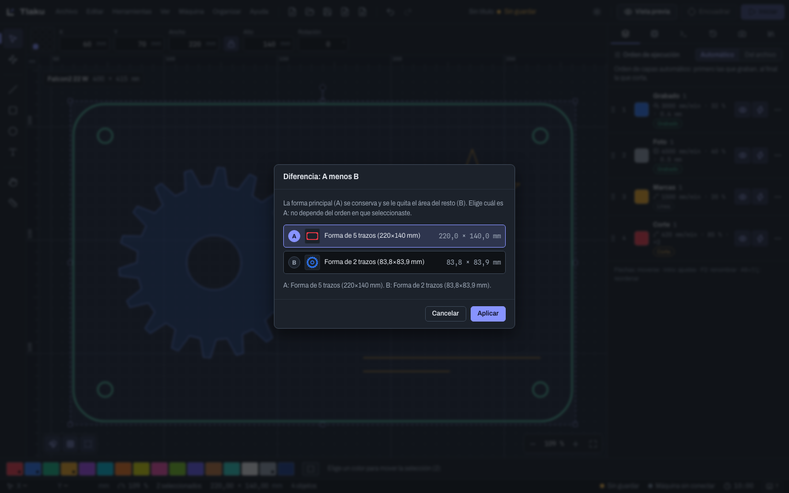
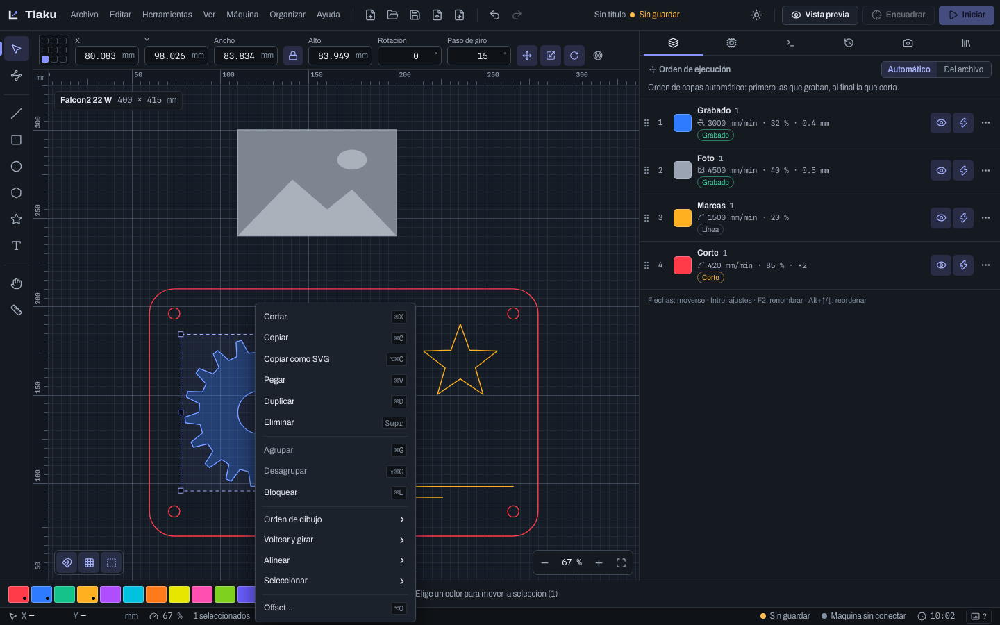

# Dibujar y editar

Cómo dibujar formas, seleccionarlas, transformarlas, medirlas y combinarlas. Todo lo que hagas se puede deshacer (`Ctrl/Cmd+Z`) y queda anotado en el panel **Historial**. Los atajos se escriben con `Ctrl/Cmd`: `Cmd` en macOS, `Ctrl` en Windows y Linux; todos se pueden cambiar (ver [Preferencias, atajos y autoguardado](02b-preferencias-y-atajos.md)).

## Herramientas de dibujo

Lo que dibujas va a la **capa activa** (la marcada en el panel Capas o en la franja de colores). Si la capa activa es de imagen, va a la primera capa de líneas o relleno. Mientras arrastras, una etiqueta muestra la medida en vivo.

| Herramienta | Tecla | Cómo se usa |
|---|---|---|
| Dibujar línea | `L` | Clic a clic para una polilínea. **Clic y arrastre** al poner un nodo saca sus manijas y el tramo siguiente sale curvo (ver "Curvas Bézier" abajo). Un clic sobre el primer nodo cierra la forma; `C` también. `Intro`, doble clic o clic derecho la dejan abierta; `Retroceso` quita el último punto; `Mayús` fija ángulos de 45°. |
| Rectángulo | `R` | Arrastra. `Mayús` hace un cuadrado. |
| Elipse | `E` | Arrastra. `Mayús` hace un círculo. |
| Polígono | `G` | Arrastra desde el centro. Ver "Polígono y estrella". |
| Estrella | `Mayús+G` | Arrastra desde el centro. Ver "Polígono y estrella". |
| Texto | `T` | Clic en un punto vacío crea un texto (ver [Texto](04-texto.md)). |
| Medir | `M` | Ver "Medir". |

Con **Rectángulo** activo aparece en la barra numérica el campo **Radio de esquinas** (en mm) para los rectángulos que dibujes a continuación.

### Curvas Bézier

La herramienta **Dibujar línea** también dibuja curvas, como la pluma de un editor vectorial:

- Un **clic** pone un nodo de esquina; el tramo que llega a él es recto.
- **Clic y arrastre** al poner un nodo saca sus manijas: la manija de salida sigue al puntero y la de entrada es su reflejo, así que el nodo queda suave y el tramo siguiente sale curvo. `Mayús` fija 45° también en las manijas.
- Al acercarte, el cursor se **pega** a nodos, puntos medios, centros e intersecciones de lo que ya hay (mantén `Alt` para suspenderlo).
- Después puedes afinar cualquier nodo con **Editar nodos** (ver abajo).

### Polígono y estrella

Elige **Polígono** (`G`) o **Estrella** (`Mayús+G`) en la paleta o en **Herramientas**, haz clic en el centro y arrastra: la distancia hasta el puntero marca el **radio** y su dirección el **giro** (con `Mayús`, la forma queda con una punta hacia arriba). Los parámetros aparecen en la barra numérica antes de dibujar y, una vez dibujada la forma, en la ventana **Propiedades de forma**:

| Forma | Parámetros |
|---|---|
| Polígono | **Lados** (3 a 100), **Radio**, **Redondeo** de las esquinas (mm) |
| Estrella | **Puntas** (3 a 100), radio exterior, radio interior como porcentaje del exterior y **Redondeo** |

Un triángulo, un pentágono o un octágono son un polígono de 3, 5 u 8 lados.

La ventana **Propiedades de forma** (**Ver > Propiedades de forma**) se aplica al rectángulo, la elipse, el polígono y la estrella seleccionados; con varias formas del mismo tipo, el cambio las afecta a todas. Mientras no edites los nodos de una forma, sigue siendo "una forma" con sus parámetros; al editar nodos, unir o recortar pasa a ser un trayecto cualquiera. **Los parámetros se guardan en el proyecto:** al reabrirlo, las formas siguen siendo editables. Escalar una forma cambia sus parámetros (un rectángulo escalado cambia su ancho y alto); si la escala no es proporcional y la figura deja de ser regular (polígono, estrella o rectángulo redondeado), pasa a ser un trayecto.

La misma ventana (**Propiedades del objeto**) tiene los campos **Prioridad de corte** (menor = se corta antes) y **Escala de potencia** (% de la potencia de la capa) para cualquier selección, también con varios objetos; vacío es automática y 100 %. La prioridad solo ordena dentro de la capa y solo cuenta si los Ajustes de optimización la respetan. **Ordenar > Cortar antes / Cortar después** (`Alt+Mayús+[` y `Alt+Mayús+]`) la restan o suman, y **Ver > Mostrar prioridad de corte** dibuja el número sobre cada objeto que la tiene.

## Medir

Con **Medir** (`M`):

- **Arrastra entre dos puntos** para ver la **distancia**, el **ángulo** y las diferencias **Δx** y **Δy**. `Mayús` fija el ángulo a 0°, 45° o 90°.
- **Haz clic sobre una forma** para ver sus datos: el **Contorno** (cerrado, abierto o mixto), los **Nodos**, los **Trazos** (cuántos rectos y cuántos curvos), el **Tamaño**, el **Perímetro** y el **Área** (con los huecos descontados). Si la forma es un círculo, también su **Diámetro** y su **Centro**.

Las medidas usan la unidad de las preferencias (mm o pulgadas). Medir no cambia nada en el diseño.

## Seleccionar

La herramienta **Seleccionar** (`V`) hace todo esto:

- Clic selecciona un objeto; `Mayús`+clic lo suma o lo quita de la selección.
- Arrastrar sobre un espacio vacío dibuja una caja. De izquierda a derecha (línea continua) selecciona solo lo que queda **completamente dentro**; de derecha a izquierda (línea discontinua), todo lo que **toque** la caja.
- `Ctrl/Cmd+A` selecciona todo; `Ctrl/Cmd+Shift+I` invierte la selección.
- `Esc` cancela el arrastre en curso; sin arrastre, quita la selección.

### Selecciones especiales

Están en el menú **Editar** (y varias en el menú contextual):

| Comando | Qué selecciona |
|---|---|
| **Seleccionar todo en la capa** | Todos los objetos de la capa activa (o la del objeto seleccionado). |
| **Seleccionar formas abiertas** | Los trayectos que no están cerrados. |
| **Seleccionar abiertas en capas de relleno** | Los abiertos que están en capas de relleno, donde no se pueden rellenar. |
| **Seleccionar formas dentro de la seleccionada** | Lo que queda dentro de la forma seleccionada. |
| **Seleccionar formas más chicas** | Lo que tiene menos área que la selección. |
| **Seleccionar círculos por tamaño…** | Los círculos cuyo diámetro cae en un rango; con el mismo valor en mínimo y máximo, un diámetro exacto (agujeros de tornillo, por ejemplo). |

Si no hay nada que coincida, Tlaku lo dice en un aviso. Los objetos bloqueados no se seleccionan.

## Mover, escalar y girar

- **Mover:** arrastra el objeto, usa las flechas (1 mm; `Mayús` 10 mm; `Alt` 0,1 mm, ajustables en Preferencias) o escribe **X** e **Y** en la barra numérica. `Mayús` al arrastrar limita el movimiento a horizontal o vertical. Si agarras cerca de un nodo, punto medio o centro de lo seleccionado, ese punto es el que se pega.
- **Escalar:** arrastra una manija. En las esquinas conserva la proporción; `Mayús` la suelta; `Alt` escala desde el centro. En la barra numérica, **Ancho** y **Alto** con el candado puesto escalan los dos.
- **Girar:** con un solo objeto seleccionado, un segundo clic sobre él cambia las manijas a modo giro. Arrastra la perilla superior; `Mayús` gira de 15° en 15° (el **Paso de giro** de la barra numérica, ajustable); `Alt` gira alrededor del punto de referencia en vez del centro. O escribe los grados en **Rotación**.

Las imágenes se mueven y se escalan, pero no se pueden girar (los comandos de giro se deshabilitan y dicen por qué): gira la imagen en un editor antes de importarla.

### Giros rápidos por teclado

Giran la selección alrededor de su centro, y se repiten si dejas la tecla pulsada:

| Comando | Tecla |
|---|---|
| Girar 90° a la izquierda / a la derecha | `[` / `]` |
| Girar un paso a la izquierda / a la derecha (15° de fábrica) | `Mayús+[` / `Mayús+]` |
| Girar 5° a la izquierda / a la derecha | `Alt+[` / `Alt+]` |

`[` gira en sentido antihorario y `]` en horario. No hay giros de 10° o 45° por teclado: `.` y `,` ya son la velocidad de la vista previa.

### Voltear, espejo y giro por dos puntos

Menú **Organizar**:

- **Voltear horizontal** (`Alt+H` o `Ctrl/Cmd+Shift+H`) y **Voltear vertical** (`Alt+V`): reflejan la selección sobre el centro de su caja. `Ctrl/Cmd+Shift+V` es **Pegar en el mismo lugar**, por eso el vertical usa `Alt`.
- **Espejo sobre una línea** (`Alt+Shift+M`): crea una **copia reflejada** sobre una línea que tú marcas, y deja el original. Hay dos formas: selecciona los objetos y, de último, una **recta de dos puntos** (que será el eje); o, con solo los objetos seleccionados, el comando te pide **hacer clic en dos puntos** (o arrastrar) para trazar la línea del espejo. `Esc` cancela.
- **Girar y escalar por dos puntos** (`Alt+T`): haz clic en el **pivote**, luego arrastra desde un **punto de referencia** hasta donde debe quedar. La selección gira para que el punto de referencia llegue ahí; con `Mayús` también se **escala**. Una etiqueta muestra los grados (y el porcentaje). `Esc` cancela.

### Interruptores de transformación

En **Organizar** hay interruptores para evitar accidentes: **Permitir mover**, **Permitir escalar** y **Permitir girar**. Apagados, arrastrar no hace nada y un aviso dice dónde reactivarlos. **Escalar desde el centro** y **Mantener proporción** fijan esos modos de las manijas sin tener que mantener una tecla.

## Orden de dibujo y bloqueo

- **Orden de dibujo** (menú **Organizar**): lo último de la lista se dibuja encima, y eso decide qué se ve cuando dos formas se tapan.

| Comando | Atajo |
|---|---|
| Traer al frente | `Ctrl/Cmd+RePág` o `Ctrl/Cmd+Shift+]` |
| Subir un nivel | `RePág` o `Ctrl/Cmd+]` |
| Bajar un nivel | `AvPág` o `Ctrl/Cmd+[` |
| Enviar al fondo | `Ctrl/Cmd+AvPág` o `Ctrl/Cmd+Shift+[` |

  Los comandos que no cambiarían nada (por ejemplo, subir lo que ya está arriba) están deshabilitados y dicen por qué.
- **Bloquear** (`Ctrl/Cmd+L`): el objeto no se puede seleccionar con el ratón ni mover, escalar, girar o borrar. **Desbloquear todo** (`Ctrl/Cmd+Shift+L`) libera todos los bloqueados y los deja seleccionados para que veas cuáles eran. Ocultar objetos sueltos todavía no se puede; para eso usa la visibilidad de la capa.

## Editar nodos

Elige **Editar nodos** (`N`) y haz clic en un trazo para ver sus nodos y manejadores.

- Clic elige un nodo; `Mayús`+clic suma o quita; clic en un segmento elige sus dos nodos; arrastrar sobre vacío elige con una caja.
- Arrastra para mover los nodos elegidos (`Mayús` en una sola dirección, `Alt` sin ajuste magnético). Las flechas también los mueven y `Supr` los borra. La barra fija **X** e **Y** exactas.
- Doble clic sobre un segmento agrega un nodo sin cambiar la forma.

Las teclas de nodos solo valen con esta herramienta y nodos elegidos:

| Acción | Tecla |
|---|---|
| Insertar nodo en el punto medio | `I` |
| Segmento a recta / a curva | `Mayús+L` / `Mayús+U` |
| Nodo en esquina / suave / simétrico | `Mayús+E` / `Mayús+S` / `Mayús+M` |
| Romper el trayecto en el nodo | `B` |
| Unir extremos | `J` |
| Cerrar trayecto | `O` |

Los textos y las imágenes no tienen nodos: convierte el texto a trayectos para editarlo así.

## Agrupar

`Ctrl/Cmd+G` agrupa dos o más objetos; `Ctrl/Cmd+Shift+G` desagrupa. Un grupo se mueve, escala y alinea como un solo objeto. Los grupos pueden **anidarse**: agrupar un grupo con otro objeto crea un grupo dentro de un grupo. Un clic elige siempre el grupo de más afuera, y **desagrupar quita un nivel cada vez**: para tocar un miembro, desagrupa hasta llegar a él.

## Menú Organizar

### Booleanas

Trabajan con **formas cerradas** de vectores (y textos con contorno); no con imágenes ni con trazos abiertos (ciérralos antes con `C` o con **Cerrar trayectos…**).

| Comando | Atajo | Resultado |
|---|---|---|
| Unión | `Alt+U` | Una sola forma con todo el área. |
| Diferencia (A menos B)… | `Alt+D` | A menos el área de las demás. Un diálogo te deja elegir cuál es A. |
| Intersección | | Solo lo que comparten. |
| Diferencia simétrica (XOR) | | Lo que está en una forma pero no en ambas. |
| Soldar | `Alt+W` | Funde en una región las formas que se solapan. Una forma que queda entera dentro de otra cuenta como agujero. |

Intersección y XOR con exactamente dos formas se aplican directo; con más, piden elegir A.

### Offset

**Offset…** (`Alt+O`) crea un contorno paralelo a distancia fija. Positivo crece hacia afuera (los agujeros se encogen); negativo hacia adentro. Elige las **Esquinas** (**Redondas**, **En ángulo**, **Biseladas**) y si **Conservar el original**. Hay vista previa en el diálogo.

### Unir, cerrar y quitar duplicados

Abren un diálogo con una **Tolerancia** en mm (valor inicial entre paréntesis). Solo trabajan con trayectos vectoriales: no con imágenes ni con textos sin convertir. Unir y cerrar piden además que haya algún trazo abierto.

- **Unir trazos…** (0,05): junta trazos abiertos cuyos extremos estén a esa distancia, aunque sean de objetos distintos (de la misma capa).
- **Cerrar trayectos…** (0,5): cierra cada trayecto abierto cuyo final esté cerca de su inicio.
- **Quitar duplicados…** (0,01): borra los tramos repetidos o superpuestos de cada capa, para que el láser no corte dos veces la misma línea.

### Alinear y distribuir

Los seis comandos de alinear (izquierda, centro horizontal, derecha, arriba, centro vertical, abajo) piden al menos dos objetos, o uno si la referencia es la cama. **Distribuir** con espacio igual pide tres. **Alinear respecto a** elige la referencia: la selección, un objeto o la cama. **Centrar en la cama** es `Alt+C`. **Alinear y distribuir…** abre todo en un diálogo.

### Igualar tamaños

**Igualar ancho** e **Igualar alto** dan a todos los objetos seleccionados el ancho o el alto del **primero** de la selección. Las variantes **(con proporción)** escalan también el otro lado para que no se deformen. Piden al menos dos objetos.

### Arreglos

- **Arreglo en rejilla…**: **Columnas** y **Filas**, con **Separación** medida entre bordes o entre centros.
- **Arreglo circular…**: **Piezas en total** (con la original), **Ángulo total**, **Radio** y centro; puede girar las copias hacia el centro.

Ambos muestran una vista previa y avisan si el arreglo se sale de la cama. El máximo es de 2000 piezas, y puedes **Agrupar el resultado**.

## Menú contextual

**Clic derecho** sobre el lienzo abre un menú con lo que más se usa, sin ir a la barra de menús. Cada entrada muestra su atajo y, si no está disponible, queda gris.

- **Sobre un objeto seleccionado:** **Cortar**, **Copiar**, **Copiar como SVG**, **Pegar**, **Duplicar**, **Eliminar**, **Agrupar**, **Desagrupar**, **Bloquear** y los submenús **Orden de dibujo**, **Voltear y girar**, **Alinear** y **Seleccionar**; con un solo objeto, también **Offset…**. Con un texto aparecen **Editar texto** y **Convertir en trayectos**; con una imagen, **Vectorizar imagen…**.
- **Sobre el fondo:** **Pegar**, **Pegar en el mismo lugar**, **Seleccionar todo**, **Invertir selección** y, si hay objetos bloqueados, **Desbloquear todo**, además de **Ajustar a la cama** y **Ajustar al diseño**.

Un clic derecho sobre un objeto que no estaba seleccionado lo selecciona antes de abrir el menú. El menú **no** se abre mientras dibujas una polilínea (ahí el clic derecho la termina), mientras arrastras (tampoco un nodo) ni durante el giro por dos puntos o el espejo. En la lista de capas, cada fila tiene su propio menú (el botón **…**).

## Ajuste magnético

`S` lo enciende o apaga. Atrae a la cuadrícula visible y a los **nodos, puntos medios, centros e intersecciones** de los demás objetos, y a los bordes y centros de la cama, dentro de la distancia que fijes en Preferencias (8 píxeles de pantalla de fábrica). Los interruptores **Ajustar a la cuadrícula** y **Ajustar a objetos y cama** (abajo a la izquierda del lienzo) eligen a qué, y un indicador distinto marca si el punto es un nodo, un punto medio, un centro o una intersección. `Alt` mientras arrastras lo suspende en ese gesto.

## Copiar, pegar y deshacer

`Ctrl/Cmd+C`, `X` y `V` copian, cortan y pegan; **Pegar en el mismo lugar** es `Ctrl/Cmd+Shift+V`; `Ctrl/Cmd+D` duplica. Lo pegado y lo duplicado salen desplazados (5 mm de fábrica, ajustable en Preferencias).

Copiar y pegar **entre Tlaku y otros programas** funciona con SVG: puedes pegar en Tlaku un dibujo copiado de Inkscape o Illustrator, y pegar en ellos lo que copies aquí. Los detalles están en [Importar y exportar](03b-importar-y-exportar.md). **Deshacer** y **Rehacer** recorren los últimos 200 pasos que guarda el **Historial**.

Siguiente: [Importar y exportar](03b-importar-y-exportar.md)
