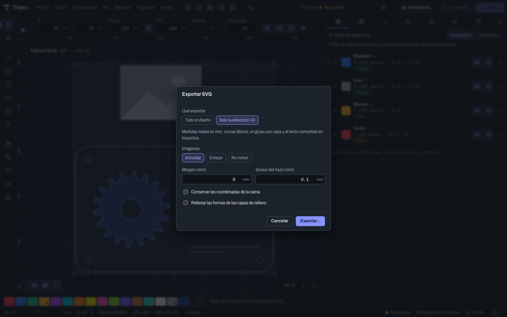

# Importar y exportar

Qué archivos entran a Tlaku, con qué opciones, y en qué formatos puedes sacar tu diseño para llevarlo a otro programa, compartirlo o imprimirlo a tamaño real. Los atajos se escriben con `Ctrl/Cmd`: `Cmd` en macOS, `Ctrl` en Windows y Linux.

## Importar

Hay dos caminos:

- **Archivo > Importar diseño…** (`Ctrl/Cmd+I`) o **arrastrar** el archivo sobre la ventana: importa **sin preguntar**, con las opciones automáticas. Crea una capa por cada color, selecciona lo importado y ajusta la vista.
- **Archivo > Importar con opciones…**: igual, pero abre antes un diálogo con las opciones de abajo. Puedes elegir **varios archivos** a la vez.

Si el importador no pudo traer algo, aparece un **aviso persistente** que dice qué faltó: léelo antes de enviar nada a la máquina. Tlaku prefiere avisar a perder algo en silencio.

**Si no entra nada, el mensaje dice por qué.** Cuando un archivo no tiene nada que importar, el error no se queda en «no contiene trayectorias»: conserva la causa que el importador ya conoce y dice qué hacer. Por ejemplo, **«se omitieron 3 HATCH y 12 TEXT»** en un DXF (conviértelos a contornos en tu programa de CAD y vuelve a exportar), o un SVG cuyo contenido es texto o formas sin contorno (conviértelos a trayectos en tu editor y guarda de nuevo), o un archivo con una imagen que se puede importar como imagen. Si tu archivo no entra, lee el mensaje completo antes de buscar otro formato.

### Formatos que se importan

| Formato | Extensiones | Qué trae |
|---|---|---|
| SVG | `.svg` | Curvas Bézier, grupos, recortes y texto (con las fuentes instaladas). Una capa por color. Un SVG que solo trae imágenes incrustadas se importa como imagen (ver abajo). |
| DXF | `.dxf` | Líneas, arcos, círculos, elipses, splines y bloques, con las unidades del archivo. El texto se ignora con aviso. |
| Imágenes | `.png`, `.jpg`, `.jpeg`, `.bmp`, `.webp`, `.tif`, `.tiff`, `.gif`, `.tga` | Una imagen en su propia capa de modo **Imagen** (ver [Imágenes](06-imagenes.md)). |
| PDF | `.pdf` | Los **trayectos** de una página, en milímetros, una capa por color. |
| Adobe Illustrator | `.ai` | Igual que un PDF, si se guardó con **Crear archivo compatible con PDF** (los `.ai` que exporta Tlaku ya lo son). |
| HPGL (plotters y cortadoras de vinilo) | `.plt`, `.hpgl`, `.hpg` | Los trazos, **una capa por pluma**. |
| G-code | `.nc`, `.gcode`, `.gc`, `.ngc` | Los trazos con el láser encendido, como geometría. |
| Ruida (CO2) | `.rd` | Los cortes de un trabajo guardado de una controladora Ruida, **una capa por capa del archivo**, con su velocidad, su potencia, su color y el aire. |
| K40 (M2 Nano) | `.egv` | Los movimientos con el láser encendido de un trabajo LHYMICRO-GL, **una capa por velocidad**. |

Notas por formato:

- **PDF y AI.** Solo se importan trayectos. **No** se importan el texto con fuentes (conviértelo a curvas en el programa de origen), las imágenes incrustadas, los degradados, los patrones ni los recortes; Tlaku lo avisa. Si el PDF tiene varias páginas, importa la primera y lo dice; elige otra en las opciones. Un AI antiguo (PostScript, anterior a Illustrator CS) no se puede leer: la app explica cómo convertirlo (guardarlo desde Illustrator con **Crear archivo compatible con PDF**, o exportarlo a PDF o SVG).
- **HPGL.** El formato no declara su escala; Tlaku supone **40 unidades por milímetro** (0,025 mm, lo habitual) y lo avisa. Si el tamaño no coincide, corrígelo con la **Escala** de las opciones de importación.
- **G-code.** Solo cuentan los movimientos que graban: `G1`, `G2` y `G3` con el láser encendido (`M3` o `M4` y `S` mayor que 0). Los viajes rápidos (`G0`) no se dibujan. De fábrica se hace **una capa por nivel de potencia** (hasta 8, de menor a mayor); elige **Una sola capa** en las opciones si prefieres una sola. Entiende `G90`/`G91`, `G20`/`G21` y arcos con `I J` o con `R`. Sirve para recuperar un diseño desde un G-code, no para reproducir los ajustes de velocidad del original.
- **SVG con solo imágenes.** Si el SVG no trae trayectos pero sí **imágenes incrustadas** (lo que hacen algunos programas al «exportar» una foto), Tlaku las extrae a archivos junto al SVG (`nombre.tlaku-img1.png`, `nombre.tlaku-img2.png`…) y las importa como **imágenes** en su posición y tamaño dentro del SVG, en una capa de modo **Imagen**. Lo avisa. Conserva esos archivos junto al proyecto; si la carpeta no se puede escribir, van a la carpeta temporal. Para cortar o grabar contornos hace falta un SVG con trayectos.
- **Imágenes.** La ventana no sabe mostrar TIFF ni TGA: Tlaku los convierte a un PNG (`nombre.tlaku.png`) junto al original y el diseño usa esa copia, que debes conservar junto al proyecto; si esa carpeta no se puede escribir, la copia va a la carpeta temporal y hay que volver a importar la imagen al reiniciar. En ambos casos lo avisa. El tamaño sale de la resolución (96 ppp por omisión, o la que pongas en **Preferencias** o en las opciones de importación).
- **Imágenes muy grandes.** Tlaku no carga la foto entera en memoria: la lee por filas (PNG) o por franjas (TIFF) y la reduce a la rejilla que el grabado necesita, así que un mapa de bits de 60 a 100 megapíxeles ya no agota la memoria. Los **TIFF grandes** (de 87 Mpx o más) y los **TIFF YCbCr** (el modo de color de muchos escáneres y de algunas cámaras) ahora cargan. Con los demás formatos (JPEG, BMP, WebP, GIF, TGA) hay un tope de memoria generoso; si una imagen lo supera, el mensaje sugiere guardarla como PNG desde tu editor e importarla de nuevo. Para ese orden de tamaño, mira [Rendimiento con diseños grandes](15b-rendimiento.md).
- **Ruida (`.rd`).** El archivo en disco va ofuscado y no dice de qué tarjeta es: Tlaku prueba las claves conocidas y se queda con la que da un trabajo válido (lo avisa si no es la habitual). Lo que **no** guarda el formato: el origen de la máquina (se supone **arriba a la izquierda con Y hacia abajo** y se invierte Y respecto a la cama del perfil por defecto; si tu máquina es distinta, el dibujo puede salir desplazado o reflejado: muévelo o refléjalo) y, en las capas de relleno o de imagen, la potencia que cambia dentro de la capa (se importa con la **potencia máxima** y sin los tramos de overscan). Los comandos que no reconoce se ignoran con aviso. Sirve para **recuperar un diseño** desde un `.rd`, no para reproducir el trabajo tal cual.
- **K40 (`.egv`).** Solo cuentan los movimientos con el láser encendido. El formato **no guarda la potencia** (las capas salen con la potencia por defecto: ajústala; en un K40 va con la perilla), ni el modelo de placa (se supone una **M2**, la más común, para convertir los códigos de velocidad) ni el origen (se supone el home arriba a la izquierda). Las filas de un grabado en modo trama no se importan como vectores y se avisa cuántas se omitieron.
- **G-code con potencia 0.** Si **todos** los avances del archivo llegan con potencia 0 (`M3 S0`), no hay nada que dibujar. En vez de fallar, Tlaku abre el diálogo **El G-code no tiene cortes con potencia**: pones el valor de **S** con el que se toman esos avances (500 de partida, en la escala habitual de GRBL donde 1000 es el 100 %) y pulsas **Importar con esa potencia**. Cuenta también los desplazamientos que el archivo hace con `G1 S0`, así que revisa el resultado.
- **Proyectos de LightBurn** (`.lbrn`, `.lbrn2`). Se importan con sus capas y ajustes. Lo que trae y lo que avisa está en [Venir desde LightBurn](14-desde-lightburn.md).

### Opciones de importación

El diálogo **Opciones de importación** muestra solo las que tienen sentido para los archivos elegidos:

| Opción | Qué hace |
|---|---|
| **Escala (%)** | Multiplica todo el diseño. 100 lo deja igual. Útil para corregir un HPGL o un SVG de otro tamaño. |
| **Resolución (ppp) de SVG sin unidades e imágenes** | Cuántos píxeles son una pulgada cuando el archivo no lo dice. Por omisión es la **Predeterminada** de [Preferencias](02b-preferencias-y-atajos.md) (96 de fábrica). Illustrator suele usar 72: si el tamaño sale distinto del original, prueba con 72. |
| **Unidad de un DXF sin unidades** | **Milímetros (aviso)**, **Pulgadas** o **Centímetros**. Solo cuenta si el DXF no declara sus unidades. |
| **Agrupar todo lo importado** | Une todo en un solo grupo para moverlo como una pieza. |
| **Agrupar por contención** | Agrupa cada pieza con sus huecos y grabados (lo que está dentro de su contorno). No se combina con la opción anterior. |
| **Capa destino de los vectores** | **Una capa por color (automático)** o una capa existente donde meter todos los vectores. |
| **Página del PDF o AI** | Qué página importar, desde 1. |
| **G-code** | **Una capa por potencia** o **Una sola capa**. |

**Importar** aplica las opciones a todos los archivos elegidos; **Cancelar** no importa nada.

**Opciones recordadas.** Por omisión, el diálogo arranca con lo que elegiste la vez anterior: resolución, unidad del DXF, agrupar y capa destino (la capa solo se conserva si el diseño todavía la tiene). La **escala** y la **página del PDF** siempre empiezan de cero, porque casi nunca se repiten. En **Editar > Preferencias… > Archivos** puedes cambiar la **Resolución por omisión**, apagar **Recordar las opciones del diálogo de importar** o pulsar **Olvidar las opciones recordadas**. La importación sin diálogo (`Ctrl/Cmd+I` o arrastrar) usa la resolución por omisión pero no las demás opciones.

## Exportar

Con algo visible en el diseño, el menú **Archivo** ofrece:

- **Exportar G-code…** (`Ctrl/Cmd+Shift+E`): el trabajo para la máquina. Ver [Enviar trabajos con seguridad](09-enviar-con-seguridad.md).
- **Exportar SVG…**, **Exportar DXF…**, **Exportar imagen PNG…**, **Exportar PDF…** y **Exportar AI…**: tu **diseño** en formatos que abren otros programas. Sin objetos visibles, estos comandos están deshabilitados y dicen **No hay objetos que exportar**.

Los cinco abren un diálogo; después **Exportar…** pide dónde guardar, y al terminar el aviso dice la ruta, el tamaño del dibujo en mm y el peso del archivo. Los objetos ocultos y los de capas ocultas **no** se exportan.

En todos, **Qué exportar** deja elegir **Todo el diseño** o **Solo la selección** (con cuántos objetos). Un texto sale como trayectos; si todavía no tiene contorno generado se omite y se avisa.

| Formato | Opciones | Lo que conviene saber |
|---|---|---|
| **SVG** | **Imágenes** (**Incrustar**, **Enlazar** o **No incluir**), **Margen**, **Grosor del trazo**, **Conservar las coordenadas de la cama**, **Rellenar las formas de las capas de relleno** | Medidas reales en mm (1 unidad = 1 mm), curvas Bézier tal cual y **un grupo por capa**, con el color de la capa. Por omisión la página mide lo que el diseño; con **Conservar las coordenadas de la cama**, el origen de la cama es la esquina del SVG. |
| **DXF** | **Curvas** (**Curvas exactas (SPLINE)** o **Aplanar a polilíneas**), **Tolerancia**, **Guardar el color exacto (DXF 2004)** | En mm, con **una capa por color**. Los trayectos de solo curvas salen como SPLINE exactos; los que mezclan rectas y curvas, como una polilínea aplanada. Sin el color exacto, queda el color ACI más cercano. |
| **PNG** | **Resolución (ppp)**, **Margen**, **Grosor del trazo**, **Fondo transparente**, **Rellenar las formas de las capas de relleno** | El diseño dibujado con el color de cada capa. 300 ppp por omisión; hay un tope de tamaño para no agotar la memoria con un valor absurdo. |
| **PDF** | **Hoja** (**Ajustar al diseño**, **A4**, **A3**, **Carta**, **Oficio**), **Margen**, **Grosor del trazo**, **Incluir las imágenes**, **Rellenar las formas de las capas de relleno** | PDF **vectorial a escala 1:1**: 1 mm del diseño es 1 mm en el papel. |
| **AI** | Las mismas del PDF | Un archivo `.ai` a escala 1:1 con **una capa por color**. **Es un PDF 1.5 con capas, no un documento nativo de Illustrator**: Illustrator lo abre y conserva las capas y los colores, pero no trae nada que sea propio de su formato (símbolos, efectos, pinceles). Para otros programas, el SVG sigue siendo la salida más segura. |

> **Consejo:** el SVG y el DXF son la salida para llevar piezas a otros programas o a otra cortadora, y la mejor forma de no depender de un solo programa. El PDF y el AI se abren en Illustrator y en casi cualquier editor vectorial; el AI añade las capas por color.

### Imprimir

**Archivo > Imprimir…** (`Ctrl/Cmd+P`) abre el mismo diálogo que **Exportar PDF…** y, al aceptar, genera el PDF a escala 1:1 y lo **abre en el visor del sistema**. Desde ahí imprímelo con **tamaño real (100 %)** y sin **ajustar a la página**; si no, la plantilla sale a otra escala. Tlaku no imprime directamente a la impresora.

### Copiar y pegar entre programas

**Copiar** y **Cortar** ponen la selección en el portapapeles del sistema como SVG; **Editar > Copiar como SVG** (`Ctrl/Cmd+Alt+C`) hace lo mismo y avisa que lo hizo. **Pegar** (`Ctrl/Cmd+V`) lee el portapapeles del sistema:

- Un **SVG** de otro programa (Inkscape, Illustrator y similares) entra como dibujo; se avisa si se omitieron elementos que no son formas (texto, imágenes, referencias).
- Un **texto** cualquiera entra como un objeto de texto.
- Lo que copió Tlaku mismo se pega desde su portapapeles interno y **conserva** capas, textos editables y formas.

Si el sistema bloquea el acceso al portapapeles, Tlaku lo dice y sigue funcionando con su portapapeles interno.

Siguiente: [Formas avanzadas y deformar](03c-formas-y-deformar.md)
