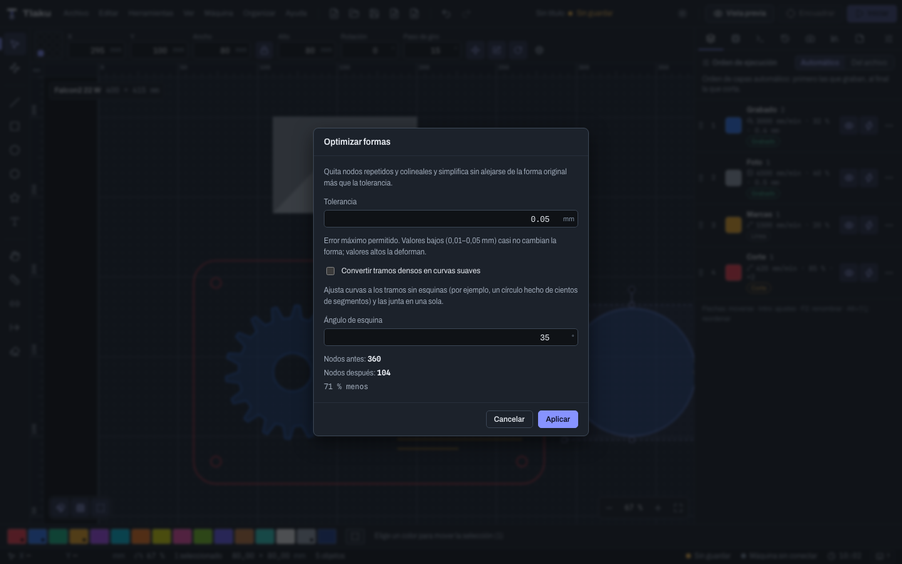
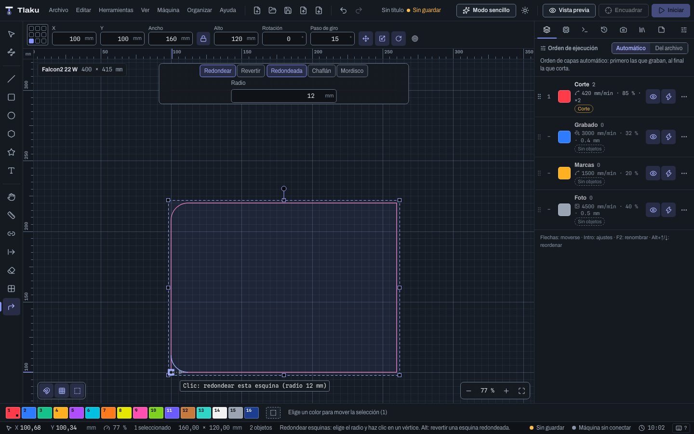
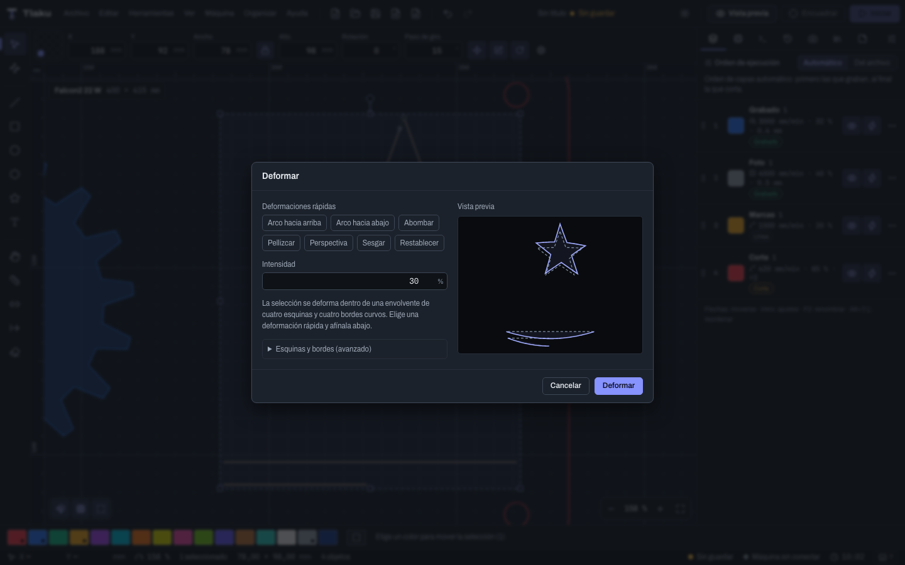
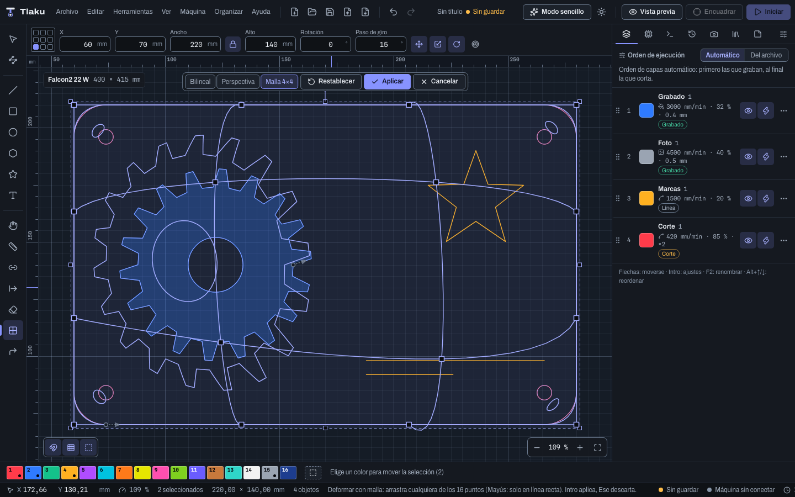
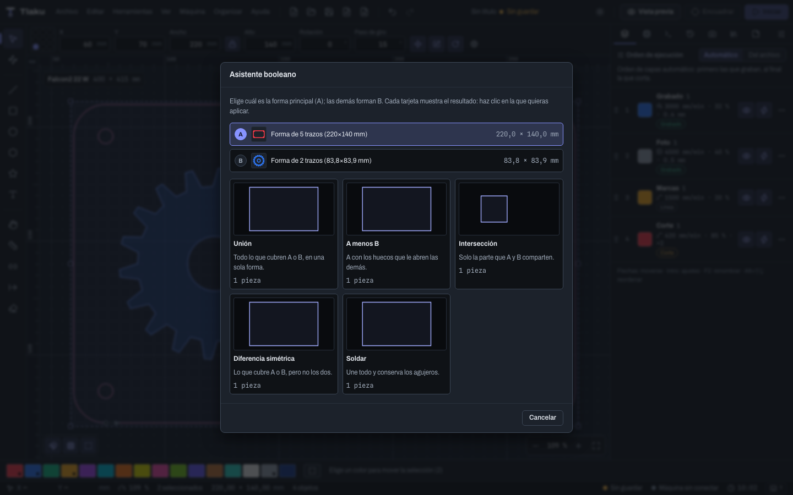

# Formas avanzadas y deformar

Herramientas para cambiar la forma de un dibujo ya hecho: recortar donde se cruzan, separar, simplificar nodos, redondear esquinas (también con un clic), partir con una cuchilla, ajustar ranuras de encastre, envolver con un contorno, deformar (también con manijas en el lienzo) y combinar con un asistente de operaciones booleanas. Todas están en el menú **Organizar** y cada una es un solo paso de **Deshacer** (`Ctrl/Cmd+Z`). Los atajos se escriben con `Ctrl/Cmd`: `Cmd` en macOS, `Ctrl` en Windows y Linux, y se pueden cambiar (ver [Preferencias, atajos y autoguardado](02b-preferencias-y-atajos.md)).

Lo básico de dibujar, alinear y las booleanas simples está en [Dibujar y editar](03-dibujar-y-editar.md).

> **Ojo:** las operaciones de esta página trabajan con **vectores** (no con imágenes) y no tocan objetos bloqueados. Un texto hay que convertirlo antes a trayectos (ver [Texto](04-texto.md)). Si un comando está gris, pasa el puntero: dice por qué.

## Recortar formas

Quita el tramo de un trazo que queda entre dos cruces, como borrar con la goma lo que sobra de una cruz.

1. Selecciona los objetos que se cruzan.
2. Elige la herramienta **Recortar formas** (`X`) en la paleta.
3. Pasa el puntero por el trazo: el tramo que se borraría se **resalta**.
4. Haz clic. El tramo desaparece. Con `Mayús`+clic el tramo se **conserva** como objeto aparte.

**Ejemplo: una cruz hecha con dos rectángulos.** Dibuja un rectángulo horizontal y otro vertical que se crucen y selecciónalos. Con `X`, haz clic en cada uno de los cuatro tramos que quedan dentro del otro rectángulo: queda solo el contorno de la cruz, sin líneas interiores que el láser cortaría de más. (Para unir formas enteras es más directo **Soldar**.)

El comando **Recortar en el último clic** (`Ctrl/Cmd+K`) repite el recorte en el último punto donde hiciste clic en el lienzo. Los extremos que se tocan cuentan como cruces. Las piezas que sobran no se unen solas entre objetos distintos; si las quieres unidas, usa **Unir trazos…**.

## Separar subtrayectos

**Separar subtrayectos…** (`Alt+B`) convierte un objeto que tiene varios contornos en un objeto por contorno. Las curvas no cambian.

- **Conservar los huecos con su contorno exterior:** un marco con su agujero sigue siendo un solo objeto; solo se separan las piezas sueltas. Úsalo cuando quieras mover cada pieza pero no desarmar los agujeros.

**Ejemplo: un DXF con todas las piezas en un solo trayecto.** Lo importas, ves que no puedes mover una pieza sin mover las demás. Selecciónalo, **Separar subtrayectos…** con los huecos conservados, y ahora cada pieza se mueve sola. La ventana te dice cuántos objetos pasaron a cuántos.

No separa en segmentos sueltos: la unidad es el contorno.

## Optimizar formas

**Optimizar formas…** (`Alt+Mayús+O`) reduce los nodos de un trayecto sin que se aleje de la forma original más que la **Tolerancia**.

| Ajuste | Qué hace |
|---|---|
| **Tolerancia** | Error máximo permitido, en mm (0,05 de fábrica). Entre 0,01 y 0,05 casi no cambia la forma; valores altos la deforman. |
| **Convertir tramos densos en curvas suaves** | Ajusta curvas a los tramos sin esquinas (un círculo hecho de cientos de segmentos) y los junta en una sola. |
| **Ángulo de esquina** | Un vértice cuyo giro supera este ángulo (35° de fábrica) se conserva como esquina viva. |

El diálogo muestra los **nodos antes y después** y el porcentaje que se ahorra. Es útil para trazos vectorizados de una foto o DXF exportados con miles de puntos: el archivo pesa menos, la vista previa va más rápida y el movimiento del láser sale más fluido.

> **Consejo:** empieza con 0,05 mm y mira la vista previa. Si el resultado se ve igual y los nodos bajan a la mitad o menos, aplícalo. Con **Convertir tramos densos en curvas suaves** una circunferencia de 400 segmentos se vuelve unas pocas curvas.

No ajusta a arcos circulares (usa curvas cúbicas) y no trata un grupo como una sola unidad.

## Redondear esquinas

**Redondear esquinas…** modifica las esquinas donde se unen **dos rectas**. Las curvas no se tocan.

| Tipo | Resultado |
|---|---|
| **Redondeada** | Un arco tangente a las dos rectas. El **Radio** (3 mm de fábrica) es el del arco. |
| **Chaflán** | Un corte recto a la **Distancia del corte** desde la esquina, medida sobre cada recta. |
| **Mordisco** | Un arco cóncavo centrado en la esquina, que la muerde hacia adentro. |

- Si dos esquinas se disputan la misma recta, el radio se **reduce** para que quepan; la ventana lo avisa. Si no caben con ningún radio, se dejan vivas.
- **Solo las esquinas de los nodos seleccionados:** con la herramienta **Editar nodos** (`N`) eliges algunos nodos y redondeas solo esas esquinas.

**Ejemplo: tarjeta con las esquinas redondeadas.** Dibuja un rectángulo de 85 × 55 mm, selecciónalo, **Redondear esquinas…** con 3 mm: las cuatro esquinas quedan con un arco exacto. (Para un solo rectángulo también existe el campo **Radio de esquinas** al dibujarlo.)

### Redondear con un clic (`Mayús+F`)

Para tocar **una sola esquina** sin seleccionar nodos, usa la herramienta **Redondear esquinas con clic** (`Mayús+F`, o **Herramientas**). Al activarla aparece una barra arriba del lienzo:

- **Redondear** o **Revertir** (el modo).
- El **tipo de esquina** (**Redondeada**, **Chaflán** o **Mordisco**) y su **Radio** (o **Distancia**, en el chaflán): son los mismos valores del diálogo de arriba.

Con el modo **Redondear**, pasa el puntero por un vértice de recta con recta: una vista previa muestra cómo quedará y un cartel dice **Clic: redondear esta esquina (radio 12 mm)**. **Un clic** redondea solo esa esquina, y es un solo paso de **Deshacer**. Si haces clic donde no hay una esquina de dos rectas, la herramienta lo dice (**Ahí no hay una esquina de recta con recta**).

**Revertir una esquina.** Con el modo **Revertir** (o **manteniendo `Alt`** al hacer clic), un clic sobre una esquina **redondeada** o **mordida** la devuelve a punta. Funciona si el arco es **exacto** (el que hizo esta herramienta o el diálogo). **El chaflán no se revierte**: es un tramo recto más y no hay forma de saber cuál era la esquina original; para eso, **Deshacer**. `Alt` también cambia de sentido en el otro modo: con **Revertir** activo, `Alt`+clic vuelve a redondear.

## Cortar formas con una cuchilla

**Cortar formas con una cuchilla…** (`Alt+Mayús+C`) parte las formas con otra forma cerrada que hace de cuchilla.

1. Selecciona la cuchilla y las formas que quieres partir.
2. En el diálogo eliges **cuál es la cuchilla** (la lista dice el papel de cada objeto: **Cuchilla** o **Forma**).
3. Decide si **Cerrar las piezas con la línea de corte** y si **Conservar la cuchilla**.
4. La ventana avisa cuántas formas se cortan y en cuántas piezas.

- **Cerradas** (de fábrica): cada pieza queda cerrada por la línea de corte. Es lo que quieres si las vas a **rellenar**.
- **Abiertas:** solo se parte el contorno, sin añadir la línea de corte. Es lo adecuado para capas de **Línea**, donde cortar la línea de la cuchilla dos veces la quemaría de más.

**Ejemplo: partir un círculo en dos mitades para un llavero.** Dibuja el círculo y un rectángulo que cubra su mitad derecha. Con el rectángulo como cuchilla, las piezas quedan: lo de dentro y lo de fuera. Las piezas salen como objetos sueltos, seleccionados; no se agrupan en dos grupos. No parte imágenes.

## Redimensionar ranuras

**Redimensionar ranuras…** cambia el ancho de las ranuras de encastre para que ajusten al grosor **real** del material. Cada tablero comprado mide un poco distinto de lo que dice la etiqueta.

| Ajuste | Qué hace |
|---|---|
| **Ancho actual de la ranura** | El ancho que tiene ahora (3 mm de fábrica). La ventana lista los **anchos encontrados** en la selección, con cuántas ranuras hay de cada uno. |
| **Tolerancia al buscar** | Cuánto se admite de diferencia al reconocer una ranura (0,15 mm de fábrica). |
| **Ancho nuevo** | A cuánto se cambia (3,2 mm de fábrica): normalmente el grosor medido más el juego que pida el encastre. |
| **Qué pared se queda quieta** | **Ninguna: crece desde el centro**, **La inicial** o **La final**. |
| **Muescas, agujeros, pestañas** | Qué patrones se reconocen: muescas en el borde de una pieza y agujeros rectangulares, y, si lo marcas, pestañas del mismo ancho. |

**Ejemplo: una caja de madera de 3 mm.** Descargaste un diseño con ranuras para 3 mm, pero tu tablero mide 3,2 mm con el calibrador. Selecciona todas las piezas, deja **Ancho actual** en 3, escribe **Ancho nuevo** 3,2 y aplica: las ranuras se ensanchan. Mira la vista previa del recuento ("Se cambiarían N ranuras").

Solo reconoce **esquinas vivas a 90°** y trabaja con polilíneas: las curvas del objeto se aplanan. Si el cambio dejaría un borde invertido en una pieza, esa pieza no se toca y se avisa.

## Contorno de banda elástica

**Contorno de banda elástica…** crea una forma cerrada nueva que envuelve la selección, como estirar una liga alrededor de las piezas. Queda en la capa activa.

- **Convexo (el más ajustado):** el casco convexo, sin entrar en los huecos.
- **Cóncavo (entra en los huecos):** el contorno se mete hacia adentro mientras sus aristas midan más que el **Largo máximo de arista** (20 mm de fábrica). Con un valor grande queda igual que el convexo.
- **Conservar los objetos originales** (encendida de fábrica).

**Ejemplo: un soporte para varias piezas sueltas.** Selecciona las piezas y crea el contorno convexo con un poco de **Offset…** después: obtienes la base de una placa que las envuelve. También sirve para dibujar el recuadro de una zona de corte.

## Círculo tangente

**Círculo tangente…** agrega círculos que tocan formas sin cruzarlas.

- Con **dos** formas (o líneas): escribe el **Radio** (10 mm de fábrica) y salen los círculos de ese radio que tocan las dos.
- Con **tres**: el radio sale de las formas (los círculos que tocan las tres).

El diálogo lista los **candidatos** con su radio y su centro, los muestra en la vista previa y agrega los que marques como círculos reales. Si no hay ninguno, prueba otro radio. Los círculos que contienen a una forma tocándola desde adentro no se calculan.

**Ejemplo: un orificio de desagüe que toque dos paredes.** Con las dos paredes como líneas, pide un radio de 6 mm y elige el candidato que cae en la esquina.

## Deformar

**Deformar…** mete la selección en una **envolvente** de cuatro esquinas y cuatro bordes curvos y la deforma de verdad: las curvas se recalculan, no solo se mueven sus puntos de control, con un error menor a 0,01 mm.

1. Selecciona uno o más objetos.
2. En **Deformaciones rápidas** elige un preset y ajusta la **Intensidad** (en %, 30 de fábrica): **Arco hacia arriba**, **Arco hacia abajo**, **Abombar**, **Pellizcar**, **Perspectiva** o **Sesgar**.
3. Si quieres afinar, abre **Esquinas y bordes (avanzado)**: cuánto se mueve cada esquina en mm (X hacia la derecha, Y hacia arriba) y cuánto se curva cada borde en su punto medio (positivo, hacia afuera).
4. Mira la **Vista previa** (la forma original punteada y la deformada continua) y pulsa **Deformar**. **Restablecer** devuelve todo a cero.

**Ejemplo: un rótulo en arco.** Escribe "CAFÉ", conviértelo a trayectos, y aplica **Arco hacia arriba** al 30 %: la palabra se curva como una sonrisa sin haberse desfigurado. Para texto que ya viene curvado sobre un círculo existe además la opción de **Curvatura** del panel de texto.

### Deformar con manijas en el lienzo (`Mayús+W`)

Para deformar a ojo, **Deformar en el lienzo** (`Mayús+W`, o el botón **Editar en el lienzo** del diálogo, que lo cierra y deja la malla sobre el diseño) pone una **malla de control** sobre la selección y deforma el diseño **en vivo** mientras arrastras. Primero selecciona objetos vectoriales; si no hay selección, la herramienta lo dice y espera.

Una barra arriba del lienzo elige el tipo:

| Tipo | Manijas | Qué hace |
|---|---|---|
| **Bilineal** | 4 esquinas | Mueve las esquinas; los bordes quedan rectos. Sirve para inclinar o estirar una forma. |
| **Perspectiva** | 4 esquinas | Como una foto de una hoja vista de lado: las rectas siguen rectas. Las cuatro esquinas deben formar un cuadrilátero convexo. |
| **Malla 4×4** | 16 puntos | La superficie pasa por cada punto: permite combar, ondular y torcer. |

- **Arrastrar una manija** deforma en vivo. **`Mayús`** mientras arrastras mueve solo en línea recta (horizontal o vertical). Cambiar de tipo conserva la forma que llevas.
- **Intro** o **Aplicar** escribe el resultado, con las curvas recalculadas con exactitud, en **un solo paso de Deshacer**. Mientras calcula, el botón dice **Calculando…**.
- **Restablecer** devuelve la malla a su sitio; **Cancelar** o **`Esc`** sale sin cambiar nada (a mitad de un arrastre, `Esc` devuelve la manija).
- Para trabajos de mucha precisión, el diálogo **Deformar…** de arriba, con milímetros exactos en cada esquina, sigue siendo la forma de escribir los números.

> **Ojo:** la vista previa en vivo es una aproximación rápida; el resultado final lo recalcula el motor al aplicar. El resultado **reemplaza** a los originales; si no te gusta, **Deshacer**. Una selección sin ancho o sin alto (una línea recta) no se puede deformar.

## Asistente booleano

El **Asistente booleano…** (`Ctrl/Cmd+B`) enseña **el resultado** de cada operación antes de aplicarla, en miniaturas.

1. Selecciona dos o más formas cerradas.
2. En el diálogo elige cuál es la forma principal (**A**); las demás forman **B**.
3. Cada tarjeta muestra el resultado de **Unión**, **A menos B**, **Intersección**, **Diferencia simétrica** y **Soldar**, con cuántas piezas salen (o **Sin resultado**).
4. Haz clic en la tarjeta que quieras aplicar.

**Ejemplo: una llave con ojal.** Dibuja el cuerpo de la llave (A) y un círculo en la punta (B). En las tarjetas ves de golpe qué pasa si los unes (la llave con un bulto), si restas el círculo (la llave con el ojal hecho) y si los intersectas (solo el trocito común). Haces clic en **A menos B**.

Los comandos sueltos (**Unión**, **Diferencia…**, etc.) siguen existiendo en el mismo menú y con sus atajos (ver [Dibujar y editar](03-dibujar-y-editar.md)).

Siguiente: [Copias, arreglo virtual y nesting](03d-copias-y-nesting.md)
