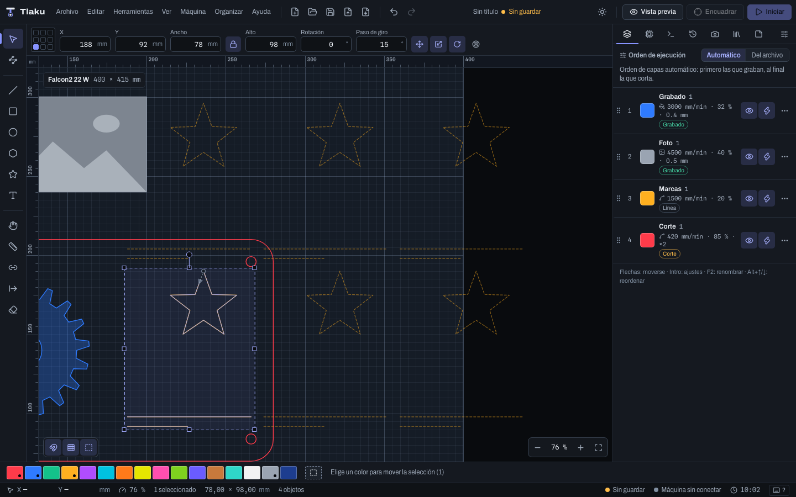
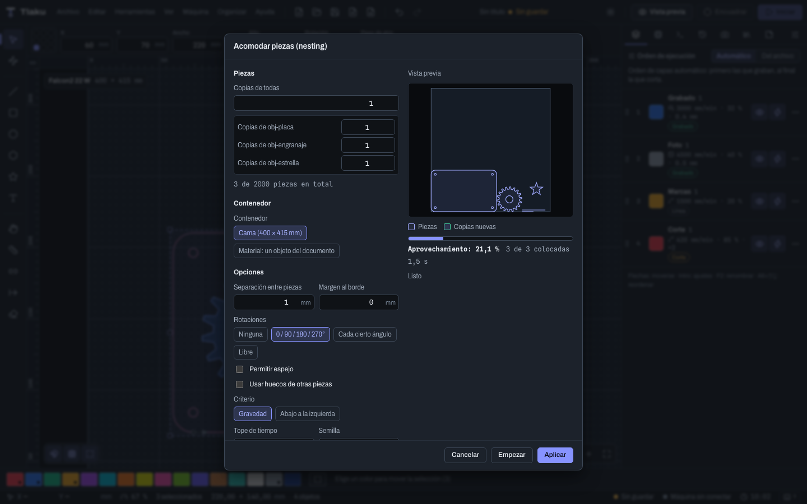

# Copias, arreglo virtual y nesting

Cómo repetir piezas y acomodarlas para aprovechar el material: copiar a lo largo de un trazo, el **arreglo virtual** (copias que no son objetos), acoplar piezas entre sí, agrupar automáticamente por contención y el **nesting** (acomodo automático). Los comandos están en el menú **Organizar** (el de agrupar, en **Editar**). Cada uno es un solo paso de **Deshacer**. Los arreglos en rejilla y circulares de siempre están en [Dibujar y editar](03-dibujar-y-editar.md).

## Copiar a lo largo de un trazo

**Copiar a lo largo de un trazo…** reparte copias de la selección sobre otro trazo, como cuentas en un collar.

1. Selecciona lo que quieres copiar **y** el trazo (puede ser abierto o cerrado).
2. En el diálogo, **Cuál es el trazo** dice qué objeto es la guía (la lista marca el papel de cada uno: **Trazo** o **Copiar**). De fábrica es el último de la selección.
3. Elige el **Reparto**:
   - **Por número de copias** (8 de fábrica), o
   - **Por distancia** entre copias (10 mm de fábrica); el diálogo muestra el **largo del trazo**.
4. **Girar según la tangente del trazo** apunta cada copia en la dirección del trazo; el **Giro adicional** se suma a esa dirección. Se toma la forma como orientada hacia la derecha.
5. **Conservar los originales** (apagado de fábrica): apagado, los originales se quitan y quedan solo las copias; encendido, se quedan donde estaban además de las copias.
6. La vista previa muestra las copias sobre el trazo. El máximo es de 2000 copias.

**Ejemplo: una guirnalda de estrellas sobre una curva.** Dibuja una estrella pequeña y una curva con la herramienta de línea. Selecciona las dos, abre el comando, pon **Por número de copias** en 12 y apaga el giro para que todas queden derechas (o enciéndelo para que sigan la curva). **Ejemplo: agujeros de ventilación en un arco**: un círculo de 4 mm, un arco de guía y **Por distancia** de 9 mm.

Las imágenes no se pueden girar: si las incluyes, apaga el giro o quítalas. No hay escala progresiva a lo largo del trazo.

## Arreglo virtual

Un **arreglo virtual** hace que un solo objeto se grabe o corte varias veces **sin crear los objetos**. El objeto se sigue editando como uno solo; las copias se ven como **fantasmas** tenues en el lienzo y se generan al enviar el trabajo.

1. Selecciona **un** objeto (si pertenece a un grupo, desagrúpalo o suéldalo antes).
2. **Arreglo virtual…**
3. Elige el tipo:
   - **Rejilla**: **Columnas**, **Filas** y el **Hueco horizontal** y **vertical** entre los bordes de cada copia (negativo = se solapan). 3 × 3 y 5 mm de fábrica.
   - **Circular (alrededor de un centro)**: copias en total, **Ángulo total** (360° de fábrica), centro X e Y y si las copias **giran** hacia el centro.
4. **Asignar arreglo.** Para cambiarlo después, ábrelo otra vez (**Actualizar arreglo**).

Para quitarlo o volverlo real hay dos comandos: **Quitar arreglo virtual** y **Convertir arreglo en objetos** (cada copia pasa a ser un objeto de verdad).

**Ejemplo: 40 posavasos en una lámina.** Dibuja un solo posavasos (un contorno, no un grupo), ponle un arreglo virtual de 5 columnas y 8 filas con 3 mm de hueco, y tendrás el trabajo completo sin 40 objetos en el documento. Si cambias la forma del original, las 40 copias cambian a la vez. Con **Convertir arreglo en objetos** podrás tocar una copia suelta.

> **Ojo:** el lienzo dibuja hasta 600 fantasmas a la vez, pero el trabajo lleva todas las copias (hasta 2000). **Ajustar al diseño**, el tamaño de la selección y el aviso de salirse de la cama **no cuentan las copias**: mira la [vista previa](07-vista-previa.md) para comprobar que todas caben en la cama. De una imagen se graban las copias, pero el lienzo no dibuja su fantasma.

## Acoplar y mover juntos

**Acoplar y mover juntos…** pega piezas entre sí sin medirlas a mano.

1. Selecciona la **forma de referencia** y las que se van a mover. En el diálogo, **Forma de referencia (no se mueve)** elige cuál se queda quieta (la primera de fábrica); la lista marca **Fija** y **Mueve**.
2. Elige el **Modo**:
   - **Deslizar hasta el borde**: cada forma se desliza en la **Dirección** elegida (izquierda, derecha, arriba o abajo) hasta tocar la referencia. Avanzan solo las que quedan frente a ella.
   - **Juntar hacia la referencia**: cada forma avanza en línea recta hacia el centro de la referencia hasta tocarla.
3. **Hueco**: separación que queda al tocar (puede ser negativa, para que se solapen).
4. **Mover todas juntas**: conservan su posición relativa y se mueven como un bloque.
5. La vista previa marca la referencia y las posiciones nuevas. Las formas que no llegan a tocar la referencia se quedan donde están y se avisa cuántas.

**Ejemplo: acercar piezas para ahorrar viajes.** Ves cuatro piezas sueltas a la izquierda de un panel. Con el panel como referencia, **Deslizar hasta el borde** hacia la derecha y 2 mm de hueco: quedan pegadas al panel con 2 mm de separación.

Trabaja con las **cajas envolventes** (no con el contorno real) y no acopla a los bordes de la cama (para eso están **Alinear respecto a** la cama y **Centrar en la cama**).

## Agrupar automáticamente por contención

**Editar > Agrupar automáticamente por contención** forma un grupo por cada pieza, con los huecos y grabados que quedan dentro de su contorno exterior, como lo entiende el motor (profundidad par-impar). Una isla dentro de un hueco es una pieza nueva.

**Ejemplo: un DXF con 30 piezas con sus agujeros.** Al importarlo, todo viene suelto: mover una pieza deja los agujeros atrás. Selecciónalo todo y usa el comando: cada pieza queda en su grupo con sus agujeros, y ya puedes moverla, alinearla o usar el relleno por grupos y **Terminar cada grupo antes del siguiente** (ver [Capas y ajustes de corte](05-capas-y-ajustes.md)). Si ya sabes que lo necesitas, activa **Agrupar por contención** en **Archivo > Importar con opciones…** y el archivo llega ya agrupado.

Pide al menos dos formas cerradas. Usa el contorno cerrado más grande de cada objeto; lo que ya está agrupado, las líneas abiertas, los textos y las imágenes no entran.

## Nesting: acomodar piezas

**Organizar > Acomodar piezas (nesting)…** coloca las piezas seleccionadas para desperdiciar lo menos posible: sirve para sacar muchas piezas de una lámina o ajustar el diseño a un trozo de material que ya está usado.

### Qué entra

- Cada **objeto suelto** o **grupo** completo cuenta como una pieza. Los objetos bloqueados u ocultos no se mueven.
- **Copias**: en la lista de piezas cada una tiene su número de copias (o **Copias de todas**). Hasta 2000 piezas en total.
- **Giros de cada pieza** (veta): bajo las copias, cada pieza tiene su selector: **Según las opciones** (lo que digan las rotaciones de abajo), **Sin giro** (la pieza se queda como está dibujada, útil para piezas con lado bueno o con rótulo) o **Veta (0° y 180°)** (solo derecha o volteada 180°, nunca de lado). Para madera con veta dibuja las piezas con la veta en horizontal y ponles **Veta**; **Giros de todas las piezas** cambia todas de una vez. Una pieza o un grupo es una sola unidad, así que la veta se decide por pieza o por grupo.
- **Contenedor**: **Cama** (con su tamaño) o **Material: un objeto del documento**. El objeto material tiene que ser una forma cerrada; no se mueve ni se acomoda, las piezas caben dentro de su contorno y esquivan sus huecos.

### Opciones

| Opción | Qué hace |
|---|---|
| **Separación entre piezas** | Distancia mínima entre piezas (1 mm de fábrica). Pon al menos el ancho de tu corte (kerf) más un poco de margen. |
| **Margen al borde** | Distancia mínima al borde del contenedor (0 de fábrica). |
| **Rotaciones** | **Ninguna**, **0 / 90 / 180 / 270°** (de fábrica), **Cada cierto ángulo** (**Paso de giro**, 15° de fábrica) o **Libre**. Más rotaciones aprovechan más y tardan más. |
| **Permitir espejo** | Las piezas se pueden voltear. Apágalo si la pieza tiene lado bueno. |
| **Usar huecos de otras piezas** | Piezas pequeñas pueden caer dentro de los agujeros de las grandes. |
| **Criterio** | **Gravedad** (compacta hacia una esquina) o **Abajo a la izquierda**. |
| **Tope de tiempo** | De 1 a 600 s (20 de fábrica). Es lo máximo que se dedica a buscar un acomodo mejor. Si el resultado deja de mejorar antes, termina antes. |
| **Semilla** | Otro número, otra variante del acomodo; útil para probar si sale mejor. |

### Varias hojas

Si las piezas no caben en una hoja, activa **Seguir en hojas nuevas si no caben** y elige el **Máximo de hojas nuevas** (hasta 50). Tlaku llena la primera hoja con la mayor área posible, sigue con las que no cupieron en una segunda hoja del mismo tamaño que el contenedor, y así hasta colocarlas todas (o hasta llegar al máximo; lo que sobre se lista en **No cupieron**). Respeta las copias de cada pieza, la separación y el margen.

El resumen de la ventana lista **cada hoja** con su aprovechamiento, sus piezas y, si sobra algo aprovechable, el **sobrante**. En la vista previa y al **Aplicar**, cada hoja queda como una **zona aparte del lienzo**, en fila hacia la derecha: la primera hoja se queda donde está (la cama o el material) y las demás van a 20 mm de la anterior. Cada hoja lleva un contorno `hoja-N` en la capa **Guías** (no se corta), que sirve de referencia. Para **enviar una hoja por separado**, selecciónala con un recuadro (o muévela a la cama) y usa **Enviar selección** o mueve su contenido sobre la cama; el acomodo no agrupa las piezas, para no deshacer los grupos que ya tenías (por ejemplo los de un generador, que conservan su **Regenerar**).

### Retazos: inventario de sobrantes

Un **retazo** es lo que sobra de una hoja, guardado con su **contorno real** (o rectángulo), el **material** y el **grosor**, en una biblioteca local de este equipo.

1. **Guardar el sobrante.** Escribe el **Material** y el **Grosor** en la sección **Hojas y retazos**. Al terminar un acomodo, cada hoja con sobrante muestra «Sobra 1 retazo: 420×180 mm» y el botón **Guardar el sobrante como retazo**. El sobrante es la hoja menos las piezas colocadas con un margen de seguridad (la separación, al menos 1 mm); las tiras y astillas más angostas que el **Ancho mínimo de un sobrante** (20 mm de fábrica) no se ofrecen.
2. **Usar primero los retazos.** Con **Usar antes los retazos guardados del mismo material y grosor**, el acomodo prueba los retazos que coinciden (los más chicos primero) antes de una hoja nueva. Un retazo donde no cabe ninguna pieza se salta. Los que se usan salen del inventario al aplicar (puedes dejarlo marcado o desmarcado con **Quitar del inventario los retazos usados**). El material se compara sin mayúsculas ni acentos; el grosor, con una tolerancia de 0,05 mm (si alguno de los dos no indica grosor, solo cuenta el material).
3. **Ver y borrar.** **Organizar > Retazos guardados…** (o el botón **Retazos guardados…** del diálogo) abre el inventario: miniatura del contorno, nombre, material, grosor, medidas y área. Puedes **renombrar**, corregir el material y el grosor, **borrar** uno (con confirmación) o **Borrar todos** los mostrados.

Un retazo que no es rectángulo funciona igual que cualquier otro material irregular: las piezas caben dentro de su contorno y esquivan sus huecos.

### Cómo se usa

1. Selecciona las piezas y abre el comando. La vista previa muestra cómo están ahora.
2. Elige el contenedor y las opciones. Pulsa **Empezar**.
3. Mientras calcula, la vista previa se actualiza y la ventana muestra el **aprovechamiento** (área de las piezas contra la del contenedor), cuántas piezas están **colocadas** y el tiempo. **Detener** corta la búsqueda y deja el mejor acomodo hasta ese momento; si llega al tope de tiempo, lo avisa.
4. Si alguna pieza no cupo, la ventana la lista (**No cupieron**). Cambia el contenedor, las rotaciones o la separación.
5. Cuando te guste, **Aplicar**: las piezas se mueven (y se crean las copias). Es un solo paso de **Deshacer**. **Cancelar** no cambia nada.

**Ejemplo: 24 llaveros de acrílico en una lámina de 300 × 200 mm.** Dibuja un llavero, selecciónalo, y en el diálogo pon **Copias** en 24, separación de 2 mm, rotaciones de 0 / 90 / 180 / 270° y **Empezar**. En unos segundos ves el aprovechamiento (por ejemplo, 71 %) y las piezas ordenadas; si dos no caben, cambia a rotaciones de 15° y vuelve a probar. **Aplicar** y revisa la [vista previa](07-vista-previa.md).

**Ejemplo: aprovechar un retazo irregular.** Importa o dibuja el contorno del retazo (por ejemplo, con huecos de los cortes anteriores) en una capa sin salida, elige **Material: un objeto del documento** y el nesting coloca las piezas dentro, esquivando los huecos. Si ya lo guardaste como retazo, ni siquiera hace falta dibujarlo: marca **Usar antes los retazos guardados** y escribe su material y grosor.

**Ejemplo: 60 piezas de triplay de 3 mm en láminas de 600 × 400.** Elige **Cama** (o el objeto que representa la lámina), activa **Seguir en hojas nuevas** con un máximo de 5, escribe **Material** «Triplay» y **Grosor** 3, y **Empezar**. El resumen dice, por ejemplo, «Hoja 1 · 82,4 % · 21 piezas», «Hoja 2 · 80,1 %», «Hoja 3 · 41,0 %» y «Sobra 1 retazo: 600×210 mm». Pulsa **Guardar el sobrante como retazo** en la última hoja, **Aplicar**, y el próximo trabajo en triplay de 3 mm empezará por ese retazo.

> **Consejo:** el motor trabaja con una versión ligeramente simplificada de cada contorno, pero siempre conservadora (nunca más chica que la pieza real), así que las piezas no se solapan y quedan al menos a la separación pedida. Deja una separación mayor que el kerf. Si el material tiene veta, ponle a las piezas **Veta (0° y 180°)** (o **Sin giro**) y apaga el espejo si la pieza tiene lado bueno: Tlaku no adivina la veta, tú dibujas la pieza con la veta en horizontal y decides qué giros acepta cada pieza.

> **Calidad medida:** en las instancias clásicas de la literatura (ESICUP) Tlaku llega a un aprovechamiento de 60 a 87 %, entre 4 y 20 puntos por debajo del mejor algoritmo de investigación (que tarda mucho más); en piezas de uso común (cajas con dientes, rectángulos, formas irregulares) queda en 73 a 87 %. Prueba otra **Semilla** o más **tiempo** si necesitas apretar el resultado. La comparación completa y cómo repetirla está en `crates/tlaku-nest/examples/nest_bench.rs`.

> **Ojo:** el acomodo no cambia el orden de corte; ese lo decide el [planificador](07-vista-previa.md) como siempre. El nesting coloca las piezas (en una o varias hojas), no decide en qué orden se cortan las hojas.

Siguiente: [Guías, puentes, punto de inicio y proyecto](03e-guias-puentes-y-proyecto.md)
