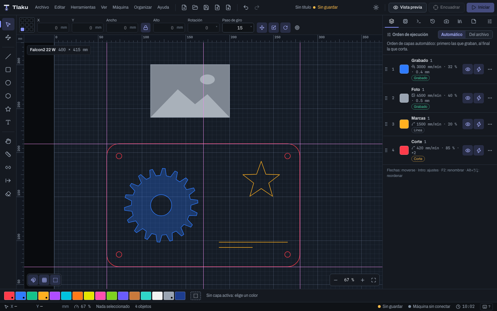
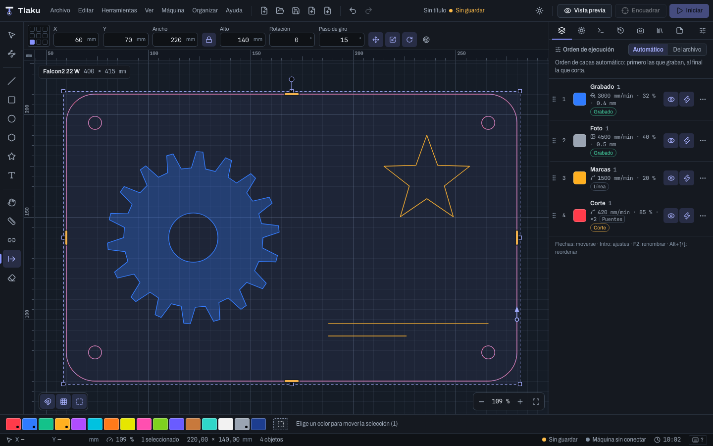
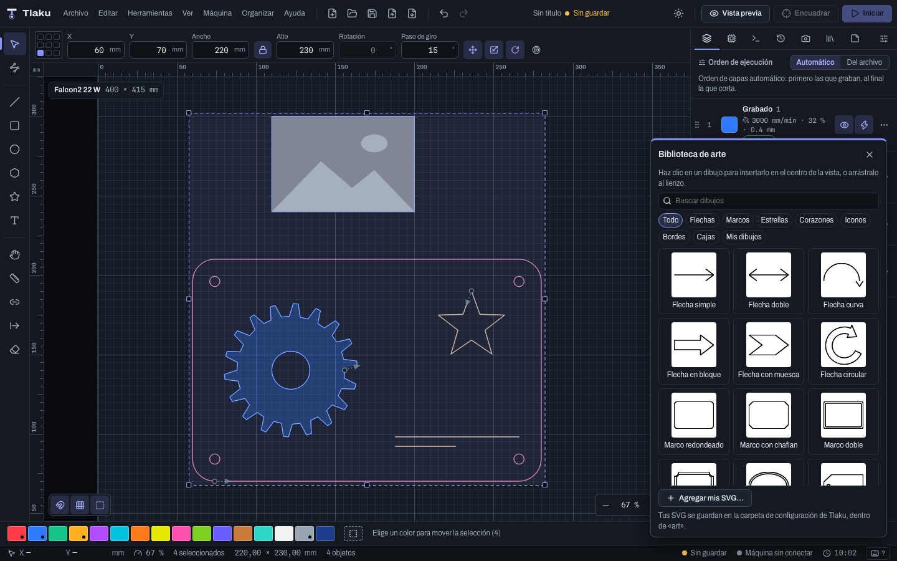

# Guías, puentes, punto de inicio y proyecto

Ayudas para colocar y cortar con más control: **guías** que atraen los objetos, **puentes manuales** que dejas donde tú quieres, el **punto de inicio y el sentido** de cada corte, las **notas** y **plantillas** del proyecto, una segunda **ventana**, las pestañas del panel derecho a tu gusto y la **biblioteca de arte** con dibujos listos. Todo lo que cambia el diseño es un paso de **Deshacer** (`Ctrl/Cmd+Z`). Los atajos se escriben con `Ctrl/Cmd`: `Cmd` en macOS, `Ctrl` en Windows y Linux.

## Guías

Las guías son líneas de referencia que no se graban ni se cortan.

- **Crear:** arrastra desde una regla hacia el lienzo. Desde la regla de arriba sale una guía **horizontal**; desde la de la izquierda, una **vertical**.
- **Mover:** arrastra la guía. Los objetos y el ajuste magnético se **pegan** a ella; mantén `Alt` para suspender el ajuste en ese gesto.
- **Borrar:** suéltala sobre la regla o fuera del lienzo (aparece el aviso "Suelta para borrar la guía").
- **Posición exacta:** **Ver > Guías…** (o doble clic en una regla) lista todas las guías con su **Posición X** o **Posición Y**; ahí también puedes **agregar** una vertical u horizontal, **borrar** una o **borrar todas**.
- **Mostrar u ocultar:** **Ver > Mostrar guías**.

Las guías se guardan en el proyecto y cada cambio se puede deshacer.

**Ejemplo: centrar un grabado en una tarjeta de 85 × 55 mm.** Crea una guía vertical en X = 42,5 y una horizontal en Y = 27,5 con el diálogo; el ajuste magnético pegará el centro del grabado a la cruz.

> **Consejo:** no confundas las guías con la **capa de Guías** de la paleta de colores (el último cuadro, punteado): esa es una capa más, para dibujar referencias que nunca salen a la máquina. Las guías de esta sección son líneas infinitas, no objetos. Todavía no hay guías temporales de alineación (las que aparecen solo mientras arrastras).

## Puentes manuales

Los **puentes** son tramos que el láser deja sin cortar para que la pieza no se suelte (ver [Capas y ajustes de corte](05-capas-y-ajustes.md)). Además de repartirse solos por capa, ahora puedes **ponerlos tú**.

1. Elige la herramienta **Puentes manuales** (`U`).
2. Haz clic sobre el **contorno** de un objeto: se pone un puente ahí. Un clic sobre un puente ya puesto lo **quita**. Al pasar el puntero, el cursor te dice qué pasará.
3. Para que el puente salga en el trabajo, la capa del objeto debe ser de **Línea** y tener encendido **Dejar puentes sin cortar**. Si no, un aviso lo dice y el puente se dibuja apagado.

Un objeto con puentes manuales **ignora los automáticos** de su capa: sus puentes son los que pusiste. El **ancho** del puente es el de la capa. Se ven en el lienzo y como huecos en la [vista previa](07-vista-previa.md). **Organizar > Quitar puentes manuales** los quita de los objetos seleccionados y vuelve a los automáticos.

**Ejemplo: una pieza que se mueve al cortar el último lado.** Pon dos puentes, uno en cada lado largo, justo donde la tabla se apoya sobre la rejilla. Al terminar, la pieza queda sujeta por dos puntos que rompes con la mano y lijas.

> **Ojo:** los puentes manuales usan la **Potencia en puentes** de su capa (ver [Capas y ajustes de corte](05-capas-y-ajustes.md)), igual que los automáticos; no tienen una potencia propia por puente. No se pueden arrastrar: se quitan y se vuelven a poner. Con kerf o con entrada y salida, recuerda que un contorno con puentes ya no es "entero" y no recibe entrada, salida ni sobrecorte.

## Punto de inicio y sentido

De fábrica el [planificador](07-vista-previa.md) decide por dónde empieza y en qué sentido corre cada contorno cerrado. Con la herramienta **Punto de inicio** (`Q`) lo decides tú.

| Gesto | Qué hace |
|---|---|
| **Clic** sobre un contorno cerrado | El corte empieza ahí. El punto se pega al **vértice** más cercano. |
| **Alt**+clic | Punto libre, sin pegarse a un vértice. |
| **Mayús**+clic | **Invierte** el sentido de ese objeto. |
| **Ctrl/Cmd**+clic | **Restablece**: quita el inicio y el sentido fijados. |

Una **flecha** sobre el contorno muestra el inicio y el sentido. **Ver > Mostrar inicio y sentido** la enciende o apaga. En **Organizar** están **Invertir sentido** (para toda la selección, también trazos abiertos) y **Quitar inicio y sentido fijados**.

El planificador **respeta lo que fijaste**: no cambia el punto de inicio ni el sentido de ese contorno, ni siquiera con kerf. Sigue decidiendo en qué orden se cortan las figuras, y los contornos sin fijar siguen optimizándose como siempre.

**Ejemplo: que la marca de entrada quede en una esquina escondida.** Un corte con láser de diodo deja una pequeña marca donde empieza y termina. Con `Q`, pon el inicio en una esquina trasera de la pieza para que la marca no se vea. Para evitar quemar de más el borde visible, combínalo con **Entrada al contorno** en el [corte avanzado](05-capas-y-ajustes.md).

Las imágenes no tienen sentido ni inicio.

## Notas del proyecto

La pestaña **Notas** del panel derecho (`Ctrl/Cmd+7`, o **Ver > Notas del proyecto**) es un cuaderno para el proyecto: material, espesor, ajustes que funcionaron, pendientes. Se **guarda con el proyecto** y **no se envía a la máquina**. Abajo se muestra el número de caracteres.

## Plantillas

Una **plantilla** es un punto de partida: guarda el diseño, las capas y los ajustes del proyecto actual.

- **Archivo > Guardar como plantilla…**: pide un nombre (si ya existe una con ese nombre, pregunta si quieres reemplazarla).
- **Archivo > Nuevo desde plantilla…**: lista las plantillas guardadas; al elegir una, se abre un proyecto nuevo con su diseño, sus capas y sus ajustes. Desde ahí puedes **borrar** una plantilla (los proyectos que hiciste con ella no cambian).

Las plantillas se guardan en la carpeta de configuración de Tlaku, no dentro de los proyectos.

**Ejemplo: tu mesa de trabajo de acrílico.** Configura las capas (por ejemplo, un corte rojo y un grabado azul con los valores que ya probaste), guarda la plantilla "Acrílico 3 mm" y cada trabajo nuevo empieza ya con tus valores.

## Nueva ventana

**Archivo > Nueva ventana** (`Ctrl/Cmd+Mayús+N`) abre otra ventana de Tlaku con un **documento independiente**: tiene su propio historial y selección. Lo que comparten es la máquina (la conexión y el trabajo en curso) y las preferencias. Sirve para copiar de un proyecto a otro o consultar un diseño mientras trabajas en otro.

> **Ojo:** la ventana nueva todavía no se ha probado en una ventana real. La recuperación se corrigió para que no mezcle ventanas: cada una marca su copia de autoguardado como viva y el aviso **Se encontró trabajo sin guardar** solo ofrece las copias huérfanas (las de ventanas ya cerradas). Pero esa corrección se comprobó leyendo el código y con pruebas del registro, no con ventanas reales; por prudencia, si el aviso muestra la copia de la otra ventana, elige **Decidir después** y **no** la recuperes ni la descartes mientras esa ventana siga abierta con cambios. El registro es de un solo programa: dos copias de Tlaku abiertas a la vez no se ven entre sí. Guarda tus proyectos con frecuencia.

## Pestañas del panel derecho a tu gusto

Las pestañas del panel derecho (**Capas**, **Máquina**, **Consola**, **Historial**, **Cámara**, **Materiales** y **Notas**) se pueden reordenar y ocultar:

- **Arrastra** una pestaña para cambiarla de lugar, o usa `Alt+Mayús+←` y `Alt+Mayús+→`.
- El botón **Personalizar pestañas** muestra cada una con **Mover antes** y **Mover después**, y deja **ocultar** las que no uses (siempre queda al menos una visible).
- **Restaurar orden y pestañas** vuelve al orden de fábrica.

El orden se guarda en las preferencias. Todavía no hay paneles flotantes ni se pueden mover las barras de herramientas.

## Biblioteca de arte

**Herramientas > Biblioteca de arte** abre un panel con **41 dibujos** listos para insertar, organizados por categoría: **Flechas**, **Marcos**, **Estrellas**, **Corazones**, **Iconos**, **Bordes** y **Cajas** (paneles de caja con encastre). Son dibujos propios de Tlaku (licencia MIT).

- **Un clic** en un dibujo lo inserta en el centro de lo que ves; también puedes **arrastrarlo** al lienzo y soltarlo donde quieras. Queda seleccionado, para moverlo o escalarlo.
- El **buscador** filtra por nombre, en español o en inglés, sin importar acentos.
- Va a la **capa activa** (si es de Imagen, a la que elija el importador). Es un dibujo vectorial normal: lo puedes ajustar, unir o editar nodos.
- **Agregar mis SVG…** copia tus archivos a la categoría **Mis dibujos**; se guardan en la carpeta `art` de la configuración de Tlaku. **Quitar de mi biblioteca** los borra de ahí.

**Ejemplo: una tarjeta con marco y un corazón.** Dibuja un rectángulo de 90 × 50 mm, abre la biblioteca, inserta un marco de la categoría **Marcos**, escálalo al tamaño de la tarjeta con el candado de proporción puesto, y arrastra un corazón a una esquina. Las cajas con encastre están pensadas para ajustar su ancho de ranura con **Redimensionar ranuras** ([Formas avanzadas y deformar](03c-formas-y-deformar.md)).

La biblioteca no tiene etiquetas ni subcarpetas por ahora.

Siguiente: [Texto](04-texto.md)
