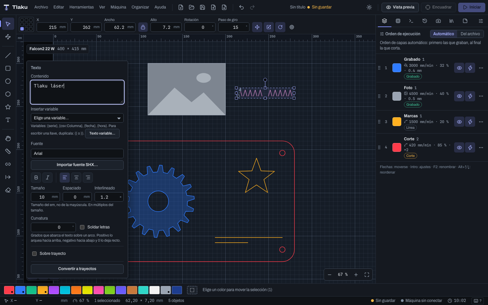
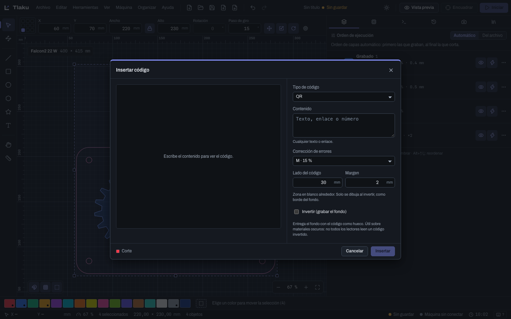

# Texto

Cómo crear texto, elegir su fuente (del sistema o de una sola línea), curvarlo, soldar sus letras, escribirlo sobre un trayecto y convertirlo en trayectos editables; y cómo insertar códigos QR y de barras. El texto de Tlaku se calcula a partir de las fuentes instaladas en tu sistema y de las fuentes de una línea que incluye.

## Crear un texto

1. Elige la herramienta **Texto** (`T`).
2. Haz clic en un punto vacío del lienzo. Aparece el texto "Texto" (10 mm, fuente Arial si está instalada; si no, la primera disponible) en la capa activa, ya seleccionado.
3. Escribe en el campo **Contenido** del panel que flota junto al texto. `Intro` agrega una línea.

Para editar un texto existente, haz doble clic sobre él con **Seleccionar**, o selecciónalo: el panel **Texto** aparece cada vez que la selección es un único texto. Puedes mover, escalar y girar un texto como cualquier objeto (ver [Dibujar y editar](03-dibujar-y-editar.md)).

> **Consejo:** el texto va a una capa como cualquier otro objeto. En una capa de **Línea** se recorre el contorno de las letras; en una de **Relleno** se graba su interior. En una capa de **Imagen** no se puede usar un texto (ver [Capas y ajustes de corte](05-capas-y-ajustes.md)).

## Opciones del panel

| Opción | Qué hace |
|---|---|
| **Contenido** | El texto, con varias líneas si quieres. |
| **Fuente** | Un buscador (**Buscar fuente…**) sobre las familias instaladas. Si hay muchas, escribe para acotar la lista. |
| **Negrita**, **Cursiva** | Piden esas variantes de la fuente. |
| **Alinear a la izquierda**, **Centrar**, **Alinear a la derecha** | Alineación de las líneas entre sí. |
| **Tamaño** | En mm. Es el tamaño del em, no la altura de la mayúscula: una "H" sale más baja que el valor que escribes. |
| **Espaciado** | Separación extra entre letras, en mm (admite valores negativos). |
| **Interlineado** | En múltiplos del tamaño; empieza en 1,2. |
| **Curvatura** | Grados que abarca el texto sobre un arco (ver "Texto curvado"). |
| **Soldar letras** | Une en un solo contorno las letras que se tocan (ver "Texto soldado"). |
| **Entre palabras** | Espacio extra en cada espacio entre palabras, en mm (negativo las acerca). |
| **Alineación vertical** | Dónde queda el ancla del texto: **Línea base** (de siempre), **Arriba**, **Centro** o **Abajo** del bloque. Sobre un trayecto decide de qué lado de la línea queda el texto. |
| **Mayúsculas** | Da forma al texto en mayúsculas sin cambiar lo que escribiste. |
| **Funciones y ejes de la fuente** | Ligaduras, alternativas, versalitas, números, fracciones, kerning y ejes de fuentes variables (ver "Texto avanzado"). |
| **Insertar variable** | Pone una variable entre llaves (número de serie, dato de un CSV, fecha u hora) donde está el cursor. Ver [Texto variable](04b-texto-variable.md). |

> **Ojo:** Tlaku nunca inventa una negrita o una cursiva. Si la familia no tiene esa variante, usa la más cercana que exista y lo dice en los **Avisos del contorno**. Si la fuente que elegiste no está instalada (por ejemplo, al abrir un proyecto en otro equipo), usa otra y avisa: "La fuente '...' no está instalada; se usa '...'". Revisa el aviso antes de enviar nada.

Mientras se calcula el contorno verás **Generando contorno…**. Si falla, el panel muestra el motivo.

## Texto sobre trayecto

Para que el texto siga una línea o una curva:

1. Dibuja primero el trazo guía (una línea, polilínea, elipse...). Sin un objeto vectorial en el diseño, la casilla no se puede marcar: "Dibuja una línea o una curva para poder escribir sobre ella".
2. Selecciona el texto y marca **Sobre trayecto**.
3. En **Objeto guía** elige el trazo.
4. Ajusta el **Desplazamiento** (en mm, a lo largo del trazo) y marca **Voltear** para escribir por el otro lado.

Si borras el objeto guía, el panel avisa: elige otro o desmarca **Sobre trayecto**. El trazo guía sigue siendo un objeto normal y se cortará o grabará según su capa; ponlo en una capa sin salida (o en **Guías**) si solo lo quieres de referencia.

## Convertir a trayectos

**Convertir a trayectos** reemplaza el texto por trayectos vectoriales. Úsalo cuando necesites editar los nodos de las letras, o cuando vayas a pasar el proyecto a otro equipo sin depender de la fuente.

- Después ya no puedes cambiar la fuente ni el contenido: es un paso con **Deshacer** si te arrepientes.
- Está deshabilitado mientras se genera el contorno, o si el texto no tiene contorno todavía (escribe algo con una fuente instalada).

Un texto con contorno ya sirve para las booleanas y el **Offset** del menú **Organizar**. En cambio, **Editar nodos** y **Unir trazos…**, **Cerrar trayectos…** y **Quitar duplicados…** solo trabajan con trayectos: convierte el texto antes.

## Texto curvado

El campo **Curvatura** del panel acomoda el texto sobre un **arco**, sin necesidad de dibujar un trayecto guía:

- Se escribe en grados y es **lo que abarca la línea más larga** sobre el arco. **Positivo** lo arquea hacia arriba (el centro del arco queda debajo, como un arcoíris); **negativo** hacia abajo (como una sonrisa); **0** lo deja recto.
- Admite hasta **360°** (una vuelta completa); si escribes más, lo limita y lo avisa.
- Con varias líneas, todas se curvan alrededor del mismo centro. Si la curvatura es tan cerrada que el radio queda menor que la altura del texto, las letras se aplastan y el panel lo avisa.
- Se ignora mientras el texto va **Sobre trayecto**: son dos formas de curvar y manda el trayecto. El panel lo dice.

Un texto curvado sigue siendo un texto: puedes cambiar su contenido o su curvatura después.

## Texto soldado

Las fuentes cursivas y de caligrafía tienen letras que se solapan: en una capa de **Línea** el láser recorre cada contorno completo y pasa dos veces por donde se cruzan. Marca **Soldar letras** y las letras que se tocan o se solapan se **funden en un solo contorno**.

- Solo funciona con fuentes de contorno (las del sistema). Con una fuente de una línea no hay contornos que unir y el panel lo avisa.
- Lo mismo se consigue a mano con **Convertir a trayectos** y luego **Soldar** (`Alt+W`), pero el texto deja de ser editable. Con la casilla, el texto sigue siendo texto.

## Texto avanzado: funciones de la fuente y fuentes variables

Abre **Funciones y ejes de la fuente** en el panel Texto. Tlaku lee la fuente elegida y muestra **solo lo que esa fuente realmente trae**; si no trae nada, lo dice. Todo se guarda en el texto, se aplica a todo su contenido y el contorno se vuelve a calcular al instante.

**Funciones OpenType.** Cada una es una casilla con su nombre y, a la derecha, una **vista previa apagada y encendida** con letras que sí cambian en esa fuente:

| Grupo | Funciones |
|---|---|
| Ligaduras y kerning | Ajuste de pares (kerning), ligaduras estándar, según contexto y discrecionales |
| Alternativas | Alternativas estilísticas (con el número de la alternativa), conjuntos estilísticos 1 a 20, variantes de carácter, remates (swash) |
| Mayúsculas | Versalitas y mayúsculas a versalitas |
| Números | De texto (old-style), alineados a la altura, de ancho fijo, proporcionales, cero tachado |
| Fracciones y posición | Fracciones, superíndices, subíndices, ordinales |

- Solo se guarda lo que **difiere de la fuente**: el kerning y las ligaduras estándar vienen encendidos y una función apagada no deja rastro. **Quitar cambios** vuelve a lo que trae la fuente.
- Si activas una función que la fuente no trae (por ejemplo, al abrir un proyecto en otro equipo con otra fuente), el panel avisa y la forma no cambia.
- El **Espaciado** entre letras apaga las ligaduras (una ligadura funde letras y no habría dónde separarlas); si aun así marcas una, se respeta tu elección.
- Si una función aparece con "Ninguna de las letras probadas cambia", la fuente la declara pero la muestra no usa ninguna letra con efecto; puede afectar a otras letras.

**Fuentes variables.** Si la fuente es variable aparece un **deslizador por eje** (**Peso**, **Ancho**, **Inclinación**, **Tamaño óptico** y los ejes propios de la fuente) y, si trae **estilos con nombre**, un selector. El contorno se calcula con la posición elegida, así que lo que ves es lo que se graba; **Restablecer ejes** vuelve a los valores de la fuente.

> **Ojo:** las funciones y los ejes dependen de la fuente instalada. Al abrir el proyecto en otro equipo sin esa fuente, se usa otra y el panel avisa. Las **fuentes de una línea** no tienen funciones ni ejes. Las casillas **Negrita** y **Cursiva** eligen una cara de la familia; con una fuente variable usa el deslizador de **Peso** para el grosor.

## Fuentes de una línea

Una fuente normal dibuja el **contorno** de cada letra; una fuente de **una línea** (de un solo trazo) dibuja solo el **trazo central**. Sirven para grabar texto fino y rápido, para que el láser pase una sola vez por letra, y para plotters y cortes de rotulación.

Tlaku incluye **15 fuentes Hershey** de una línea, sin instalar nada: Roman Simplex, Duplex y Triplex; Futura Light y Medium; Times Roman, Bold, Italic e Italic Bold; Script Simplex y Complex; Cursive; y Gothic English, German e Italian. En el selector de fuentes aparecen en su propia sección, **Fuentes de una línea**, debajo de **Fuentes del sistema**, y el panel recuerda para qué sirven.

Cómo usarlas:

1. Crea o selecciona un texto y elige una fuente de la sección **Fuentes de una línea**.
2. Pon el texto en una capa en modo **Línea**. El resultado son **trazos abiertos**: en una capa de Relleno no hay nada que rellenar.
3. **Tamaño**, **Espaciado**, **Interlineado**, la alineación y **Curvatura** funcionan igual. La mayúscula mide el 72 % del tamaño que escribes. Estas fuentes **no tienen negrita ni cursiva**, ni se pueden soldar.

### Importar fuentes SHX

Si ya tienes fuentes **SHX** de AutoCAD, elige **Herramientas > Importar fuente SHX…** (o el botón **Importar fuente SHX…** del panel Texto), marca uno o varios archivos `.shx` y quedan añadidas a la sección de una línea. Se guardan para las próximas sesiones; al terminar, un aviso lista los nombres añadidos y, si algo falla, dice por qué. Tlaku lee los formatos `shapes` (1.0 y 1.1) y `unifont`; las fuentes `bigfont` (chino, japonés, coreano) todavía no.

> **Ojo:** las fuentes SHX tienen su propia licencia. Usa solo las que tengas derecho a usar. Los datos Hershey que incluye Tlaku son de uso libre con sus reconocimientos, que se citan junto al selector y en **Ayuda > Acerca de Tlaku**.

## Códigos QR y códigos de barras

**Herramientas > Insertar código…** abre un diálogo que genera un código como **formas vectoriales** listas para grabar o cortar, con una vista previa en vivo.

### Tipos

| Grupo | Tipo | Qué admite |
|---|---|---|
| Dos dimensiones | **QR** | Cualquier texto o enlace. |
| Dos dimensiones | **Data Matrix** | Cualquier texto; sirve para marcar piezas pequeñas. |
| Códigos de barras | **Code 128** | Texto ASCII: letras, números y signos. |
| Códigos de barras | **Code 39** | Mayúsculas, números y `- . espacio $ / + %`. |
| Códigos de barras | **EAN-13** | 12 dígitos, o 13 con el dígito de control. |
| Códigos de barras | **EAN-8** | 7 dígitos, o 8 con el dígito de control. |
| Códigos de barras | **UPC-A** | 11 dígitos, o 12 con el dígito de control. |
| Códigos de barras | **ITF (2 de 5 intercalado)** | Solo dígitos; con cantidad impar se añade un dígito de control. |
| Códigos de barras | **Codabar** | Dígitos y `- $ / : . +`; empieza y termina con A, B, C o D. |

Si el contenido no es válido para el tipo, el diálogo lo explica y no deja insertar.

### Opciones

| Opción | Qué hace |
|---|---|
| **Contenido** | Lo que codifica el código. |
| **Corrección de errores** (solo QR) | **L** 7 %, **M** 15 % (de fábrica), **Q** 25 % o **H** 30 %: cuánto daño tolera y se sigue leyendo. Más corrección, código más denso. |
| **Lado del código** (QR y Data Matrix) | Tamaño del lado en mm. De fábrica, 30 mm. |
| **Ancho de las barras** y **Alto de las barras** (códigos de barras) | Tamaño del código en mm. |
| **Margen** | Zona en blanco alrededor; solo se dibuja al invertir, como borde del fondo. |
| **Texto legible debajo** (códigos de barras) | Añade los dígitos o caracteres debajo de las barras, con la **Fuente del texto** que elijas. |
| **Invertir (grabar el fondo)** | Entrega el fondo con el código como hueco. Útil sobre materiales oscuros; **no todos los lectores leen un código invertido**. |

La vista previa muestra los módulos y el tamaño final en mm. **Insertar** pone el código en el **centro de la vista** (o de la cama, si la vista queda fuera) y en la capa activa; el aviso dice las medidas. Abajo del diálogo se ve a qué capa irá.

> **Ojo:** el código es un conjunto de **trayectos ya generados**, no un código editable: para cambiar el contenido o el tipo, borra el insertado e inserta otro (o usa **Deshacer**). Tampoco es un código variable: las series y los datos de un CSV (ver [Texto variable](04b-texto-variable.md)) funcionan en los **textos**, no dentro de un QR o un código de barras. Comprueba **siempre con un lector real** que el código grabado se lee, con tu material y a tu tamaño: un módulo demasiado chico o poco contrastado no se lee aunque el diseño esté bien.

Siguiente: [Texto variable](04b-texto-variable.md)
