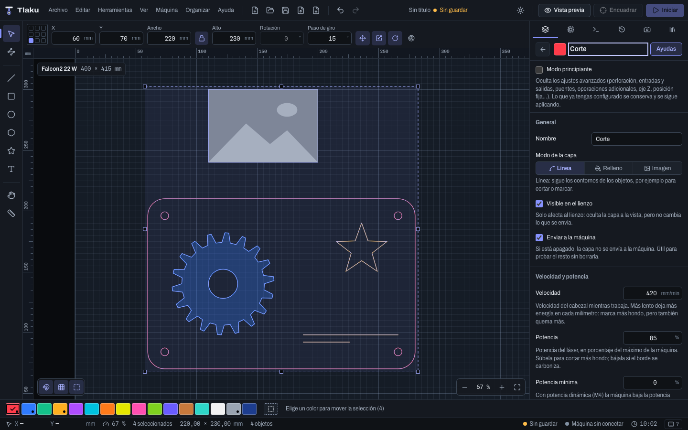
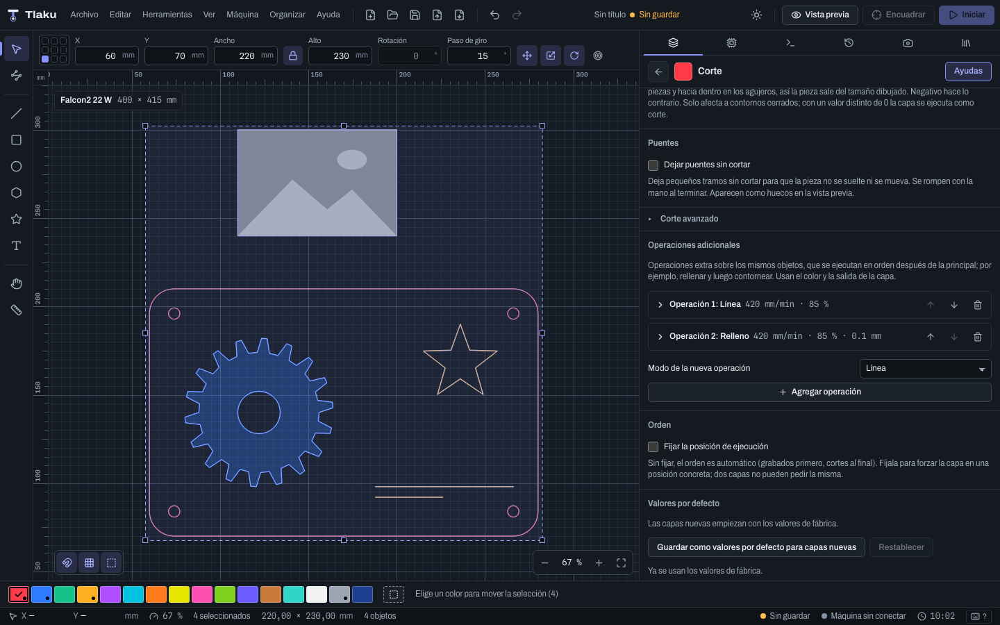

# Capas y ajustes de corte

En Tlaku cada color es una **capa**, y cada capa es una operación con sus propios ajustes: cuánto se mueve, con qué potencia y de qué manera. Esta página explica el panel **Capas**, el editor de ajustes (con sus secciones avanzadas), las operaciones adicionales y el orden en que se ejecutan.

> **Ojo:** una capa nueva nace con 1000 mm/min, 20 % de potencia y 1 pasada. Son valores de partida, no de ningún material. Prueba siempre en un retazo antes de cortar la pieza buena (la [prueba de materiales](11-materiales.md) ayuda a encontrar los valores).

## El panel Capas

Se abre con `Ctrl/Cmd+1`. Cada fila muestra el color y el nombre, cuántos objetos tiene, un resumen (velocidad, potencia, intervalo, pasadas) y una etiqueta: **Grabado**, **Línea** o **Corte**. Si la capa tiene operaciones adicionales verás además una insignia como **+2 op.**. A la derecha hay tres botones:

- El **ojo** muestra u oculta la capa en el lienzo. No cambia lo que se envía.
- El **rayo** decide si la capa se **envía a la máquina**. Apágalo para probar el resto sin borrarla.
- Los **tres puntos** abren un menú (también con clic derecho sobre la fila): **Ajustes de la capa…**, **Seleccionar todos los objetos de esta capa**, **Renombrar**, **Ejecutar antes**, **Ejecutar después**, **Fijar en esta posición**, **Copiar ajustes**, **Pegar ajustes** y **Borrar capa y sus objetos…**.

Con el teclado: flechas para moverte por la lista, `Intro` o doble clic para abrir los ajustes, `F2` para renombrar y `Alt+↑`/`Alt+↓` para reordenar. `Alt+Intro` abre los ajustes de la capa activa desde cualquier parte.

Para mover objetos a una capa, selecciónalos y elige un color de la franja de abajo. La capa de **Guías** (el último cuadro, punteado) sirve de referencia al diseñar y nunca se envía a la máquina; no tiene ajustes de corte, así que no se puede copiar ni pegar sobre ella.

### Copiar y pegar ajustes, y borrar una capa

- **Copiar ajustes** guarda todos los ajustes de la capa (incluidas sus operaciones adicionales) y **Pegar ajustes** los pone en otra capa en un solo paso de **Deshacer**. La capa de destino conserva su color, su nombre, si se ve, si sale a la máquina y su posición fija. Es la forma rápida de dar a diez capas de corte los mismos valores de partida. También existen como comandos (**Copiar ajustes de la capa activa**, **Pegar ajustes en la capa activa**, **Borrar la capa activa y sus objetos…**) que no están en los menús, pero aparecen en **Editar > Editar atajos de teclado…**, donde puedes asignarles una tecla.
- **Borrar capa y sus objetos…** pide confirmación y borra la capa junto con todo lo que tiene dentro (también es un paso de **Deshacer**). Si algún objeto de la capa está bloqueado, no se deja borrar y te lo dice: desbloquéalo antes.

## Editor de ajustes

Abre el editor con `Intro` en una fila. Arriba, el botón **Ayudas** muestra u oculta una explicación bajo cada parámetro. Los campos inválidos se marcan en rojo y no se aplican; cada cambio tiene su propio paso de **Deshacer**.

### Modo principiante

El interruptor **Modo principiante**, justo bajo el título del editor, oculta los ajustes avanzados (corte avanzado, puentes, incremento de ángulo, relleno por regiones y agrupación, imagen avanzada, operaciones adicionales, eje Z y posición fija) para que veas solo velocidad, potencia, pasadas, intervalo y poco más. **No borra nada:** lo que ya tenías configurado se sigue aplicando, y si la capa usa algo que el modo oculta, el editor lo avisa ("Esta capa usa ajustes avanzados que el modo principiante oculta"). Apágalo para verlos o cambiarlos. La elección se recuerda entre sesiones.

### Modo de la capa

| Modo | Qué hace |
|---|---|
| **Línea** | Sigue los contornos de los objetos: para cortar o marcar. |
| **Relleno** | Barre el interior de las formas cerradas con líneas paralelas: para grabar superficies. |
| **Imagen** | Graba fotos y mapas de bits variando la potencia punto a punto (ver [Imágenes](06-imagenes.md)). |

### Velocidad y potencia

| Ajuste | Rango y unidad | Notas |
|---|---|---|
| **Velocidad** | 1 a 60000 mm/min | Más lento deja más energía en cada milímetro. Avisa si supera el máximo de la máquina activa. |
| **Potencia** | 0 a 100 % | En modo Imagen se llama **Potencia máxima**. |
| **Potencia mínima** | 0 a 100 % | En Imagen es la potencia de los tonos más claros. No puede superar la máxima. En Línea el campo aparece solo si el perfil de la máquina usa potencia dinámica (M4). Ver la nota de abajo. |
| **Pasadas** | 1 a 1000 | Dos pasadas a media potencia suelen cortar más limpio que una a tope. |
| **Asistencia de aire** | sí o no | Enciende el aire de la máquina durante la capa. |

> **Ojo:** hoy la potencia mínima solo cambia el G-code en capas de **Imagen**. En una capa de Línea el campo se muestra, pero el motor todavía no lo usa para bajar la potencia en las esquinas; no cuentes con él para evitar las marcas más quemadas en las esquinas (para eso, mira la **Rampa de potencia** y la **Entrada al contorno** de más abajo).

### Contorno: kerf y puentes (modo Línea)

- **Kerf** (-5 a 5 mm): compensa lo que el haz se come del material. Con un valor positivo el recorrido se desplaza hacia fuera en las piezas y hacia dentro en los agujeros, para que la pieza salga del tamaño dibujado. Solo afecta a contornos cerrados.
- **Puentes**: con **Dejar puentes sin cortar** la capa deja pequeños tramos sin cortar para que la pieza no se suelte. Defines el **Ancho del puente**, la **Cantidad** por forma cerrada (o una **Separación** fija en mm; con 0 se usa la cantidad) y si se **Omiten formas interiores**. Los puentes aparecen como huecos en la vista previa. Se reparten solos: todavía no se pueden colocar a mano.

### Corte avanzado (modo Línea)

La sección plegable **Corte avanzado** reúne los ajustes que cambian *cómo* se recorre cada trazo. Se abre sola si la capa ya usa alguno (y entonces muestra la insignia **en uso**). Todos nacen apagados, así que no cambian nada hasta que los enciendas. Casi todos valen solo para **contornos cerrados**; los abiertos se cortan como siempre y la vista previa avisa cuántos se quedaron sin el ajuste.

**Orden en que se aplican.** Primero el kerf y el orden de corte; después los puentes; luego el modo punto o la perforación; después sobrecorte, salida y entrada; luego la rampa; y al final las pausas y el corte pasante. El trazo que sale es: entrada, contorno, sobrecorte, salida.

| Ajuste | Qué hace | Rangos |
|---|---|---|
| **Perforación (corta y salta)** | Corta un tramo (**Tramo cortado**), salta otro (**Tramo saltado**) y repite a lo largo del trazo. | 0,01 a 100 mm cada tramo. Nace en 1 mm y 1 mm. |
| **Entrada al contorno** / **Salida del contorno** | El láser empieza (o termina) fuera de la pieza, no en el borde. **Forma:** **Recta** o **Arco**; **Longitud**; **Ángulo** respecto al contorno (recta) o **Barrido del arco** (arco). | Longitud 0,01 a 50 mm. Nace en 1 mm y 45°. |
| **Sobrecorte** | Al cerrar un contorno, el láser sigue cortando este tramo más allá del punto de partida. | 0 a 50 mm. 0 = apagado. |
| **Pausa al empezar** / **Pausa al terminar** | Espera, con el láser encendido, al empezar o al terminar cada trazo. | 0 a 10 000 ms. 0 = sin pausa. |
| **Corte pasante** | Arranca cada contorno cerrado con potencia extra (**Potencia del arranque**) durante unos milisegundos (**Duración del arranque**). | Potencia 0 a 100 %; tiempo 0 a 10 000 ms. Nace en 100 % y 100 ms. |
| **Modo punto** | En lugar de una línea continua, dispara un punto cada cierta distancia: **Duración del disparo** y **Separación entre puntos**. | Disparo 0,01 a 1000 ms; separación 0,01 a 50 mm. Nace en 1 ms y 0,5 mm. |
| **Rampa de potencia** | La potencia sube al empezar cada trazo y baja al terminarlo: **Largo de la rampa**, **Potencia inicial** (% de la potencia de la capa) y **Solo contornos exteriores**. | Largo 0,01 a 50 mm; inicial 0 a 100 %. Nace en 1 mm y 0 %. |

**Ejemplos prácticos**

- **Perforación para dobleces en cartón o cartulina.** Dibuja la línea de doblez en una capa de Línea aparte, enciende **Perforación** y pon 2 mm cortados y 1 mm saltados (el resumen del campo dice "Patrón de 3 mm: 2 cortados y 1 saltados"). El papel queda unido por puentecitos y se dobla limpio sin partirse. Ajusta los largos con un retazo: más tramo saltado dobla más fácil pero resiste menos.
- **Entrada al contorno para que no quede marca en el borde.** Al arrancar, el láser deja un punto un poco más quemado (se queda un instante en el mismo lugar). Con una **Entrada** recta de 2 mm la marca queda en el sobrante, fuera de la pieza, y el láser "entra" ya en movimiento al borde. Si la pieza tiene una esquina muy cerrada, prueba la entrada en **Arco**, que llega tangente al contorno. En un agujero la entrada va hacia dentro del agujero, que es lo que se tira. Si la entrada no cabe sin cruzar la forma, Tlaku la acorta (a la mitad y luego a un cuarto) y, si ni así cabe, la omite y lo avisa.
- **Salida del contorno.** Es la misma idea al terminar: el láser se aleja hacia el sobrante en vez de apagarse sobre el borde. Combina entrada y salida para un corte sin marcas.
- **Sobrecorte para cerrar bien un corte.** En material grueso el punto donde el contorno se cierra a veces queda con un hilito sin cortar. Con **Sobrecorte** de 0,5 a 1 mm el láser pasa de largo sobre lo ya cortado y el cierre queda limpio. No puede pasar de una vuelta completa al perímetro.
- **Pausa al empezar y corte pasante en madera o acrílico gruesos.** El láser tarda en atravesar el material; si se mueve de inmediato, el arranque queda a medias. Una **Pausa al empezar** de 50 a 200 ms le da tiempo. El **Corte pasante** hace lo mismo con potencia extra y solo en contornos cerrados, para atravesar sin dejar un agujero quemado de más. Cuando hay las dos pausas, primero va la de inicio y luego el corte pasante. **Pausa al terminar** remata el último punto.
- **Modo punto para marcar o perforar punteado.** Sirve para líneas de puntos decorativas o para marcar el lugar de una perforación manual. El modo punto reemplaza al trazo: una línea de 20 mm con separación 0,5 mm dispara unos 40 puntos.
- **Rampa de potencia para sellos de goma y biselados.** En lugar de entrar de golpe a toda la potencia, la potencia sube poco a poco al empezar cada trazo y baja al terminarlo, en el largo que elijas. Con **Solo contornos exteriores** la rampa se aplica únicamente a los contornos de fuera, de modo que la pieza queda biselada hacia afuera y los agujeros no se tocan. Es el ajuste para sellos de goma y piezas con borde inclinado.

**Combinaciones que no valen.** Si dos ajustes se contradicen, gana el más específico y el otro se ignora con un aviso en la vista previa; el editor además marca el conflicto:

- **Modo punto** con **Perforación** (los puntos ya son intermitentes), con **Rampa** (cada punto dispara a la potencia de la capa), con entrada, salida o sobrecorte (no hay una línea que alargar) o con pausas y corte pasante (cada punto ya tiene su pausa). Si ya hay uno encendido, el editor bloquea el otro con el motivo.
- **Entrada, salida y sobrecorte** no se aplican a una forma con **puentes**, porque ya no es un contorno cerrado entero.

> **Consejo:** las pausas usan la instrucción `G4`. Si tu controladora cuenta el tiempo en milisegundos y no en segundos (Marlin, Smoothieware), cámbialo en el **Dialecto de G-code** del perfil de tu máquina ([Conectar tu máquina](08-conectar-maquina.md)); una unidad equivocada hace la pausa mil veces más larga o más corta. Con potencia dinámica (M4), Tlaku pasa a M3 solo durante la pausa, porque M4 apaga el láser cuando el cabezal está quieto.

### Barrido (Relleno e Imagen)

| Ajuste | Qué hace |
|---|---|
| **Intervalo** (0,01 a 5 mm) | Distancia entre líneas de barrido. Menos intervalo, más densidad y más tiempo. Debajo ves el equivalente en DPI y en líneas por cm: son el mismo dato (DPI = 25,4 / intervalo). |
| **Ángulo** | Dirección de las líneas, en grados antihorario (0 = horizontal). |
| **Trama cruzada** | Rellena dos veces, la segunda a 90°. Solo en Relleno. |
| **Bidireccional** | Graba de ida y de vuelta: casi el doble de rápido. Si la máquina tiene holgura, apágalo para que las líneas no se desalineen. |
| **Overscan automático** / **Overscan** (0 a 50 mm) | Distancia que el cabezal recorre fuera de la pieza, con el láser apagado, para llegar a velocidad antes de marcar. En automático se calcula con la velocidad y la aceleración. |
| **Incremento de ángulo** (-360 a 360°) | Grados que se suman al ángulo en cada pasada. Solo se nota con 2 o más pasadas; con relleno por contornos no se usa. |

**Ejemplo, incremento de ángulo.** Para grabar madera con mucho contraste, dos pasadas con **Incremento de ángulo** de 90° hacen que la segunda cruce la primera, como una trama cruzada pero repartiendo la energía en dos pasadas. Con incrementos pequeños (por ejemplo 15° con 3 pasadas) las rayas del barrido se reparten y se notan mucho menos en superficies lisas.

### Relleno: estilo y agrupación (modo Relleno)

La sección plegable **Relleno** tiene dos selectores:

- **Relleno:** **Barrido** (líneas paralelas), **Contornos** (anillos concéntricos hacia adentro; entonces no se usan ángulo, trama cruzada, bidireccional ni overscan) o **Por regiones**. *Por regiones* calcula una ruta que recorre cada región del dibujo por separado sin cruzar los espacios vacíos; ahorra mucho viaje en diseños con muchas islas separadas (letras sueltas, por ejemplo), pero es más sensible al juego mecánico de la máquina.
- **Agrupación:** **Todo junto** barre todas las formas de la capa de una vez (lo más rápido); **Forma por forma** termina cada forma antes de pasar a la siguiente (conviene con grabado lento, para ver una pieza completa antes de la siguiente, o en diseños dispersos); **Por grupos** rellena junto cada grupo del documento (los que haces con **Agrupar**).

### Imagen avanzada (modo Imagen)

La sección plegable **Imagen avanzada** tiene tres ajustes, que se explican con ejemplos en [Imágenes](06-imagenes.md): **Enviar sin tramar (pass-through)** (la imagen se envía tal cual, sin tramado ni ajustes de tono), **Realce de bordes** (radio y fuerza) y **Quitar motas**.

### Eje Z

El grupo **Eje Z** (**Desplazamiento Z** y **Bajada por pasada**, en mm) solo aparece si la máquina activa tiene eje Z motorizado, o si la capa ya trae valores de Z. Si no hay eje Z, esos valores se ignoran al enviar y el editor ofrece **Poner Z en 0**. Más en [Rotativo y eje Z](12-rotativo-y-eje-z.md).

## Operaciones adicionales (sub-capas)

A veces una misma forma necesita dos trabajos distintos: rellenarla y después cortar su contorno. En lugar de duplicar el dibujo en dos colores, la capa puede llevar **operaciones adicionales** (también llamadas sub-capas): ajustes extra que se ejecutan sobre **los mismos objetos**, en orden, justo después de la operación principal.

Se manejan en la sección **Operaciones adicionales** del editor:

1. Elige el **Modo de la nueva operación** (Línea, Relleno o Imagen) y pulsa **Agregar operación**. Nace con la velocidad, la potencia y el intervalo de la capa.
2. Pulsa su encabezado ("Operación 1: Línea") para editarla con los mismos campos que la capa.
3. Con las flechas la subes o bajas, y con la papelera la borras.

Hay un máximo de **10 operaciones adicionales** (11 con la principal). Las operaciones usan el color, el nombre, la visibilidad y el interruptor de salida de la capa: si la capa no sale a la máquina, ninguna de sus operaciones sale. Un objeto que una operación no admite por su modo (una imagen en una operación de Línea, por ejemplo) se ignora en esa operación y la vista previa lo avisa.

**Ejemplo: rellenar y luego contornear.** Dibuja un logotipo cerrado en una capa de **Relleno** (grabado a 3000 mm/min y 25 %). Agrega una operación de **Línea** a 400 mm/min y 80 %, con **Entrada al contorno**. La máquina primero graba el interior y después recorta el borde, sin que tengas que duplicar nada ni mantener dos copias del dibujo sincronizadas. Otro uso: una segunda operación de Línea a baja potencia que repasa el borde y lo oscurece.

En la vista previa cada operación aparece como su propio bloque, con un nombre como "#ff0000 · 2/3" (la posición entre las operaciones de esa capa). En la lista de capas, la insignia **+N op.** te recuerda que la capa tiene operaciones. Si el orden automático está activo, una operación se ordena por su propio rol (grabado o corte), pero nunca antes que su capa.

## Prioridad y potencia por objeto

Además de los ajustes de capa, cada objeto puede tener una **Prioridad de corte** y una **Escala de potencia** propias. Se editan en la ventana **Propiedades del objeto** (ver [Dibujar y editar](03-dibujar-y-editar.md)). La prioridad vale en capas de **Línea**; la escala de potencia, en capas de **Línea** y de **Relleno** (no en las de Imagen):

- **Prioridad de corte:** un número entero; menor se corta antes, dentro de su capa. Vacío es automática. Sirve para cortar primero lo pequeño y delicado, o para asegurar que un marco exterior sea lo último que se suelta.
- **Escala de potencia:** el porcentaje de la potencia de la capa que usa ese objeto (0 a 100; vacío = 100 %). Sirve, por ejemplo, para grabar una línea más suave dentro de una capa de corte, o un detalle más claro dentro de un relleno, sin crear otra capa. En un relleno, los objetos con escalas distintas se rellenan por separado (una vez por escala) y la vista previa lo avisa. Si el resultado pasara de 100 % se limita a 100 % y se avisa.

La prioridad solo se respeta si los **Ajustes de optimización** la tienen encendida (ver [Vista previa y orden de corte](07-vista-previa.md)).

## Valores por defecto de las capas nuevas

El grupo **Valores por defecto**, al final del editor, tiene dos botones:

- **Guardar como valores por defecto para capas nuevas** toma los ajustes de esta capa (menos el color, el nombre, la visibilidad, la salida y la posición) y hace que las capas que crees a partir de ahora empiecen con ellos. Las capas que ya existen no cambian. Es el modo de tener tus propios valores de partida en lugar de los de fábrica (1000 mm/min y 20 %). También hay comandos para esto (**Guardar la capa activa como valores por defecto**, **Restablecer los valores por defecto de las capas nuevas**) en **Editar > Editar atajos de teclado…**.
- **Restablecer** vuelve a los valores de fábrica.

Es un solo juego de valores para todas las capas nuevas, sin distinguir el color ni la máquina. Se guardan con las preferencias de la aplicación, no con el proyecto. Para llevar ajustes concretos de un material, usa la [biblioteca de materiales](11-materiales.md).

## Orden de ejecución

La propia lista de capas es el orden, de arriba (primero) a abajo (último). El número de cada fila es su posición.

- **Automático** (el modo por defecto): primero los grabados (Relleno e Imagen), luego las líneas y al final los cortes, para que la pieza no se mueva antes de terminar de grabar. Una capa de línea cuenta como **Corte** si tiene kerf distinto de 0, o potencia de 80 % o más con varias pasadas.
- **Del archivo**: respeta la lista tal como está.

Cambia entre los dos con el selector **Automático** / **Del archivo** del panel. Para reordenar, arrastra el asa de la fila, usa `Alt+↑`/`Alt+↓` o **Ejecutar antes** y **Ejecutar después**. **Fijar en esta posición** (o **Fijar la posición de ejecución** en el editor) obliga a una capa a ocupar un lugar; dos capas no pueden pedir el mismo.

Una capa sin posición no se ejecuta, y su etiqueta dice por qué: **Guía**, **Sin salida** o **Sin objetos**. Pasa el cursor sobre la etiqueta para ver la explicación. Cómo se ordena el recorrido *dentro* de cada capa, y las opciones que lo cambian (respetar capas, grupos y prioridad, quitar tramos repetidos, esconder el juego mecánico), está en [Vista previa y orden de corte](07-vista-previa.md).

Siguiente: [Imágenes](06-imagenes.md)
