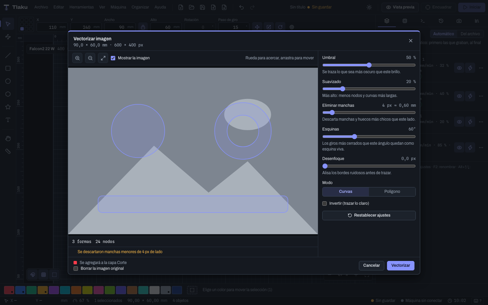

# Imágenes

Cómo grabar fotos y dibujos de mapa de bits: importarlos, elegir el tramado, ajustar los tonos y, si lo prefieres, convertirlos en vectores con **Vectorizar imagen**.

## Importar una imagen

1. **Archivo > Importar diseño…** (`Ctrl/Cmd+I`), o arrastra el archivo sobre la ventana.
2. Formatos de imagen: PNG, JPG, BMP, **WebP**, **TIFF**, **GIF** y **TGA**. Para elegir la resolución con la que se interpretan, usa **Archivo > Importar con opciones…** (ver [Importar y exportar](03b-importar-y-exportar.md)). Un TIFF o un TGA se convierte a un PNG junto al original, y Tlaku lo avisa.
3. La imagen aparece con su tamaño a 96 puntos por pulgada (un ancho de 600 px mide 158,75 mm) y va a una capa propia llamada **Imagen**, en modo **Imagen**, a 3000 mm/min.

Cambia el tamaño con **Ancho** y **Alto** de la barra numérica (el candado mantiene la proporción) o arrastrando las manijas. Las imágenes se mueven y se escalan, pero **no se pueden rotar**: gírala en un editor de imágenes antes de importarla.

> **Ojo:** el tamaño físico manda sobre los píxeles. Una imagen de pocos píxeles escalada a un tamaño grande saldrá pixelada por mucho que bajes el intervalo.

## Modo Imagen

Una capa en modo **Imagen** graba punto a punto, variando la potencia según el tono. Sus ajustes están en el editor de la capa (ver [Capas y ajustes de corte](05-capas-y-ajustes.md)):

| Ajuste | Qué hace |
|---|---|
| **Potencia máxima** | Potencia para los puntos más oscuros. |
| **Potencia mínima** | Potencia para los más claros. Con 0 % no marcan nada. |
| **Intervalo** y **Resolución equivalente** | Distancia entre líneas (0,1 mm = 254 DPI). Más fino, más detalle y más tiempo. Debe parecerse al ancho del punto del haz. |
| **Ángulo de barrido** | Con 90° la imagen se graba por columnas. |
| **Incremento de ángulo** | Grados que se suman al ángulo de barrido en cada pasada; solo se nota con 2 o más pasadas (ver [Capas y ajustes de corte](05-capas-y-ajustes.md)). |
| **Bidireccional**, **Overscan** | Igual que en Relleno. |

## Tramado

El **Tramado** (campo del grupo **Imagen** en el editor de la capa) convierte los tonos de la foto en puntos que el láser pueda grabar. Por defecto se usa **Stucki**.

| Tramado | Cuándo usarlo |
|---|---|
| **Umbral** | Logotipos y dibujos de línea: cada punto es negro o blanco según el **Umbral**. No sirve para fotos. |
| **Floyd–Steinberg** | Mucho detalle, algo de ruido. |
| **Jarvis** | Transiciones suaves, menos contraste, más lento. |
| **Stucki** | Parecido a Jarvis pero más nítido: una buena opción general para fotos. |
| **Atkinson** | Más contraste y zonas limpias; se pierden los extremos de luces y sombras. |
| **Trama ordenada 4×4** | Patrón regular, rápido y predecible; el patrón se nota. |
| **Escala de grises** | Sin trama: la potencia varía con el tono. Pide ajustar bien las potencias mínima y máxima al material. |
| **Semitono** | Puntos más grandes en las zonas oscuras, sobre una rejilla girada (como una revista impresa). Usa **Tamaño de celda** y **Ángulo de la rejilla**. |
| **Líneas de periódico** | Líneas más gruesas en las zonas oscuras. También usa celda y ángulo. |
| **Boceto** | Graba solo los bordes, como un dibujo a lápiz. |

## Ajustes de tono

Se aplican a la imagen antes del tramado:

- **Brillo** (-1 a 1): aclara u oscurece. 0 = sin cambio.
- **Contraste** (-1 a 1): separa o junta los tonos alrededor del gris medio.
- **Gamma** (0,1 a 5): curva de tonos. Mayor que 1 oscurece los medios tonos; menor que 1 los aclara.
- **Invertir**: intercambia claro y oscuro, útil con negativos o materiales que se aclaran al quemarse.
- **Ancho del punto** (0 a 1 mm): acorta cada tramo encendido para que las zonas oscuras no engorden. 0 = sin corrección.

## Imagen avanzada

En la sección plegable **Imagen avanzada** del editor de la capa (oculta en el **Modo principiante**) hay tres ajustes más. Se aplican antes del tramado, junto con los de tono.

| Ajuste | Qué hace | Rango |
|---|---|---|
| **Realce de bordes: radio** y **fuerza** | Acentúa los bordes (como el "enfoque" de un editor de fotos). El radio es el tamaño, en píxeles de la imagen, de lo que se considera un borde; la fuerza va de 0 (nada) a 1 (máximo). **Hacen falta los dos mayores que 0**; con uno en 0 no pasa nada y el editor lo avisa. | Radio 0 a 20 px; fuerza 0 a 1 |
| **Quitar motas** | Borra las motas aisladas de hasta ese tamaño, en píxeles, antes de tramar. 0 = apagado. | 0 a 20 px |
| **Enviar sin tramar (pass-through)** | Cada punto de la imagen ya es la potencia: se envía tal cual, sin tramado ni ajustes de tono. Con esta casilla el tramado, el umbral, el brillo, el contraste, el gamma, invertir, el realce y quitar motas quedan desactivados. | sí o no |

**Ejemplos prácticos**

- **Foto vieja o escaneada, con polvo y manchitas.** Antes de grabar sube **Quitar motas** a 2 o 3 px: las manchas aisladas desaparecen en lugar de salir como puntitos quemados en la madera. Los bloques grandes y los bordes rectos se conservan. Súbelo poco a poco: un valor alto empieza a borrar detalles reales.
- **Foto blanda o desenfocada.** Un **Realce de bordes** de radio 1 a 2 px y fuerza 0,5 devuelve definición a los contornos (ojos, letras, orillas). Si ves halos o bordes duros, baja la fuerza.
- **Imagen preparada en otro programa.** Si ya hiciste el tramado o las curvas de tono en un editor de fotos y la imagen en escala de grises es exactamente lo que quieres grabar, activa **Enviar sin tramar**: Tlaku no la toca. El negro se graba a la **Potencia máxima** y el blanco a la mínima. La imagen se sigue remuestreando al **Intervalo** de la capa.

La [vista previa](07-vista-previa.md) muestra las líneas de barrido y el tiempo estimado; con imágenes, el tiempo real puede diferir más que con vectores.

## Vectorizar una imagen

**Herramientas > Vectorizar imagen…** convierte una imagen en trazados que luego puedes cortar o editar con nodos. Solo está disponible con **una** imagen seleccionada.

1. Selecciona la imagen y abre el diálogo.
2. Ajusta los deslizadores; la vista previa se recalcula y muestra cuántas formas y nodos salen.
3. Decide si marcas **Borrar la imagen original** (apagado por defecto; no se puede si la imagen está bloqueada).
4. Pulsa **Vectorizar**. Es un solo paso de **Deshacer**.

| Ajuste | Qué hace |
|---|---|
| **Umbral** | Se traza lo que sea más oscuro que este brillo. |
| **Suavizado** | Más alto: menos nodos y curvas más largas. |
| **Eliminar manchas** | Descarta manchas y huecos más chicos que este lado (muestra el equivalente en mm). |
| **Esquinas** | Los giros más cerrados que este ángulo quedan como esquina viva. Solo en modo **Curvas**. |
| **Desenfoque** | Alisa los bordes ruidosos antes de trazar. |
| **Modo** | **Curvas** (Bézier) o **Polígono** (segmentos rectos). |
| **Invertir (trazar lo claro)** | Traza las zonas claras en vez de las oscuras. |

El resultado queda exactamente sobre la imagen, en la capa activa (o en la primera capa de líneas si la activa es de imagen). El diálogo te dice a qué capa se agregará. Si salen demasiadas formas pequeñas o el borde queda áspero, sube **Eliminar manchas** o el suavizado, o prueba con algo de **Desenfoque**. **Restablecer ajustes** vuelve a los valores iniciales, pensados para logotipos y dibujos.

Siguiente: [Vista previa y orden de corte](07-vista-previa.md)
