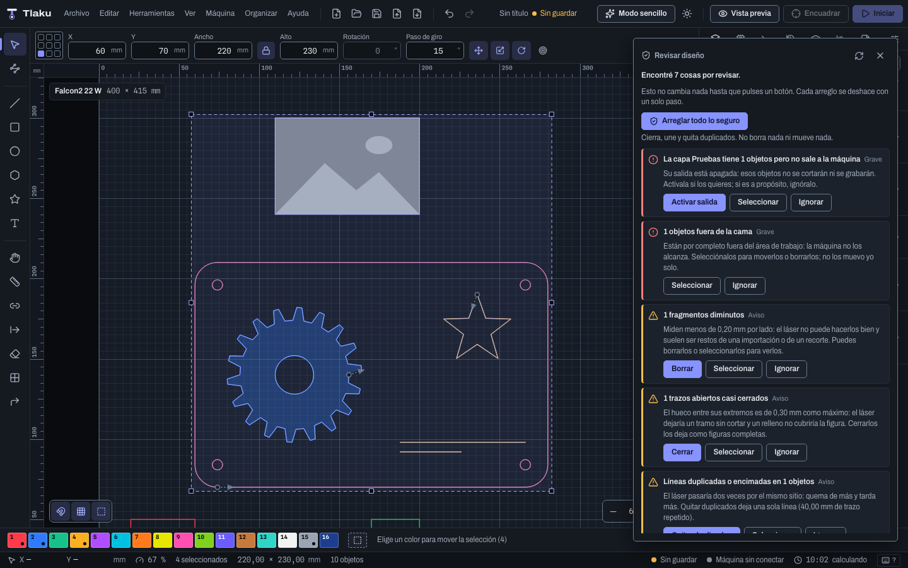
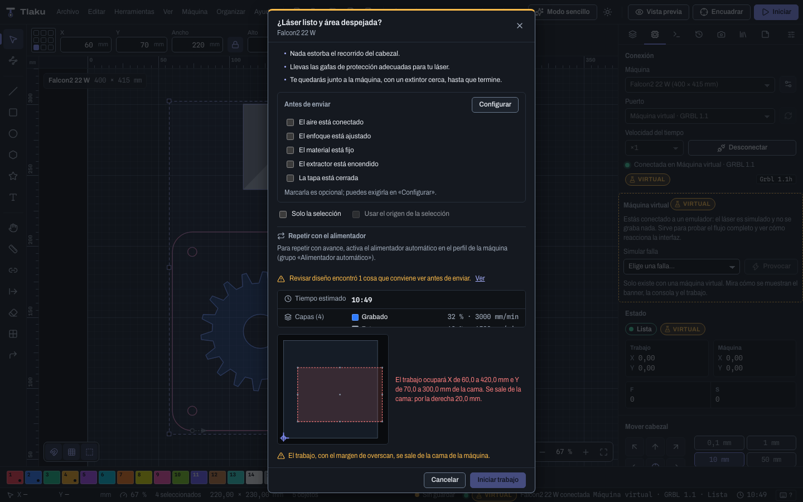

# Revisar diseño

Antes de enviar un trabajo conviene que alguien mire el diseño con calma: figuras que no cierran, líneas repetidas, cosas fuera de la cama. **Revisar diseño** hace esa lectura por ti y te dice qué encontró, **sin cambiar nada** hasta que pulses un botón. Es un análisis fijo (no usa inteligencia artificial), así que el mismo diseño da siempre la misma lista. Los atajos se escriben con `Ctrl/Cmd`: `Cmd` en macOS, `Ctrl` en Windows y Linux.

Se abre con **Máquina > Revisar diseño…** (`Ctrl/Cmd+Alt+R`). Está deshabilitado si el diseño no tiene objetos (**No hay objetos que revisar**).

## Cómo se lee el panel

Arriba dice cuántas cosas encontró (**Encontré 7 cosas por revisar**) o, si no hay nada, **Todo bien**. Cada hallazgo es una tarjeta con:

- Un **título** con la cantidad y la gravedad: **Grave** (conviene verlo antes de enviar), **Aviso** o **Detalle**. Los graves salen primero.
- Una **explicación** de por qué importa, con los números reales del diseño (el hueco, los milímetros repetidos, los nodos que sobran).
- Hasta tres botones: **el arreglo** (si lo hay), **Seleccionar** e **Ignorar**.

El panel **se mantiene al día solo**: cuando mueves, borras o arreglas algo, vuelve a leer el diseño unos instantes después. **Revisar de nuevo** (el botón de las flechas, arriba) fuerza una lectura nueva. Cada arreglo es **un solo paso de Deshacer** (`Ctrl/Cmd+Z`), y si el diseño cambió mientras se arreglaba, el panel lo dice (**El diseño cambió mientras se arreglaba. Revísalo de nuevo.**).

## Qué detecta

Son doce tipos de hallazgo. Los umbrales son los de fábrica y no se cambian desde la interfaz.

| Hallazgo | Qué significa | Arreglo |
|---|---|---|
| **Trazos abiertos casi cerrados** | Un contorno con un hueco de **0,5 mm o menos** entre sus extremos: el láser dejaría un tramo sin cortar y un relleno no cubriría la figura. | **Cerrar** |
| **Líneas duplicadas o encimadas** | Tramos repetidos o puestos uno sobre otro (tolerancia de 0,01 mm): el láser pasa dos veces, quema de más y tarda más. Dice cuántos milímetros de trazo sobran. | **Quitar duplicados** |
| **Uniones pendientes entre trazos** | Trazos cuyas extremos están a **0,1 mm o menos** pero no están unidos: el láser se apaga y se mueve entre uno y otro. | **Unir** |
| **Fragmentos diminutos** | Objetos que miden **menos de 0,2 mm** por lado: restos de una importación que el láser no hace bien. | **Borrar** |
| **Nodos de sobra** | Objetos a los que optimizar les quitaría **2 nodos o más** sin cambiar la forma (cambio máximo de 0,02 mm). | **Optimizar** |
| **Objetos fuera de la cama** (**Grave**) | Quedan **por completo** fuera del área de trabajo: la máquina no los alcanza. | Solo **Seleccionar** |
| **Objetos que pasan del borde de la cama** (**Grave**) | Una **parte** queda fuera del área de trabajo y no se haría bien. | Solo **Seleccionar** |
| **Textos sin convertir a trazos** | Mientras sean texto dependen de la fuente y no se pueden unir ni recortar; al llevarlos a otro programa pueden verse distintos. Si un texto aún no tiene contorno, avisa que no saldría a la máquina. | **Convertir a trazos** |
| **Capa sin salida con objetos** (**Grave**) | La capa tiene objetos pero su salida está apagada: no se cortarán ni se grabarán. | **Activar salida** |
| **Capa oculta con objetos** | No se ve en el lienzo, pero si su salida está activa igual se enviaría a la máquina. | **Mostrar capa** |
| **Imágenes con más resolución de la necesaria** | La imagen tiene más del **doble** de ppp de los que pide la capa: sobra detalle que no se nota y tarda más. Solo es un aviso. | Ninguno |
| **Imágenes con poca resolución** | La imagen tiene menos de la **mitad** de los ppp que pide la capa: se verá pixelada. Solo es un aviso. | Ninguno |

Algunas reglas que conviene saber:

- Los hallazgos de forma (cerrar, unir, duplicados, diminutos, nodos) se calculan **capa por capa**: dos capas distintas no se mezclan.
- Los **objetos ocultos**, las capas con la salida apagada y las **guías** no entran en el análisis geométrico, y los **objetos bloqueados** no se ofrecen para arreglos que cambian su trazo (no se pueden tocar).
- Los hallazgos que **solo se seleccionan** (fuera de la cama) no se arreglan solos a propósito: mover o borrar es decisión tuya. El panel lo dice: **Solo es un aviso: no hay botón de arreglo**.

## Arreglar, Seleccionar e Ignorar

- **El botón de arreglo** (**Cerrar**, **Unir**, **Quitar duplicados**, **Borrar**, **Optimizar**, **Convertir a trazos**, **Activar salida**, **Mostrar capa**) aplica ese arreglo a los objetos del hallazgo, con las mismas operaciones del menú **Organizar** (ver [Formas avanzadas y deformar](03c-formas-y-deformar.md)). Al terminar, un aviso dice qué hizo (**Listo: …**).
- **Seleccionar** selecciona en el lienzo los objetos del hallazgo para que los veas, los muevas o los borres tú. Avisa cuántos (**Seleccionados 3 objetos**).
- **Ignorar** esconde el hallazgo porque sabes que es a propósito (por ejemplo, una capa de pruebas apagada). Los ignorados quedan al final, en **Ignoradas (n)**, con **Volver a mostrar** para traerlos de vuelta. **Ignorar vale solo mientras la aplicación esté abierta**: al reiniciar, vuelven a aparecer.

Si solo quedan hallazgos ignorados, el panel dice **Todo bien** y recuerda que ignoraste algunos.

### Arreglar todo lo seguro

El botón **Arreglar todo lo seguro** hace en un solo paso los arreglos que **no borran ni mueven nada**: **cerrar** los trazos casi cerrados, **unir** los que casi se tocan y **quitar duplicados**. Es un solo paso de **Deshacer**. No toca los fragmentos diminutos, los nodos, los textos ni las capas: esos los eliges tú uno por uno. Si no hay nada de eso, dice **No hay nada que arreglar de forma segura**.

> **Ejemplo:** importas un DXF de una pieza y la vista previa tarda más de lo normal. **Revisar diseño** dice **Líneas duplicadas o encimadas en 14 objetos (320 mm de trazo repetido)** y **6 uniones pendientes**. **Arreglar todo lo seguro** deja una sola línea donde había dos y une los contornos; el tiempo estimado baja y el corte sale continuo. Si no te gusta, `Ctrl/Cmd+Z`.

## El aviso al iniciar un trabajo

Cuando abres el diálogo de **Iniciar**, Tlaku revisa el diseño en silencio. Si encuentra algo **grave** (objetos fuera de la cama, capas sin salida con objetos), añade una línea amarilla: **Revisar diseño encontró 1 cosa que conviene ver antes de enviar**, con un enlace **Ver** que cierra el diálogo y abre el panel. El aviso **no bloquea** el envío: es solo una pregunta para que no te enteres cuando ya cortó.

## En el modo sencillo

En el paso **Revisar** del [modo sencillo](01b-modo-sencillo.md), los mismos hallazgos salen escritos en palabras simples (**Hay líneas puestas una encima de otra. El láser pasaría dos veces y quemaría de más.**) con un botón de arreglo (**Cerrarlas**, **Quitar las repetidas**, **Unirlas**, **Borrarlos**, **Simplificarlas**, **Convertirlos**, **Mostrarlo**) y **Verlas** para seleccionarlas. Para no repetir, deja fuera las capas sin salida (en el modo sencillo apagar un color es una decisión tuya) y lo que ese modo ya avisa por su cuenta (textos sin convertir y objetos fuera de la cama).

## Lo que no hace

- **No es una garantía.** Que diga **Todo bien** no significa que el trabajo esté bien ajustado: no mira velocidad, potencia ni enfoque. Para eso están la [vista previa](07-vista-previa.md) y la lista de comprobación de [Enviar trabajos con seguridad](09-enviar-con-seguridad.md).
- No arregla solo lo que obliga a decidir (mover, borrar, apagar capas).
- No cambia los umbrales desde la interfaz.
- Mira el diseño tal como está **ahora**: no recuerda lo que viste antes, salvo lo que ignoraste en esta sesión.

Siguiente: [Costos y precio por pieza](07c-costos-y-precio.md)
