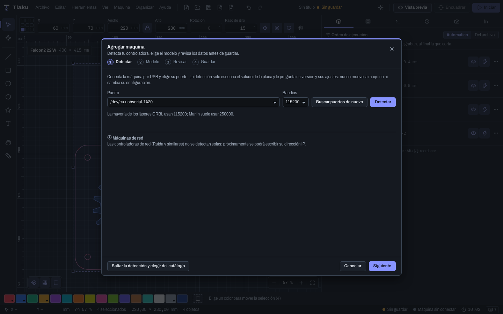

# Conectar tu máquina

Cómo darle a Tlaku el perfil de tu láser, abrir el puerto USB y probar todo primero con una máquina virtual. Esta página cubre la conexión; para enviar trabajos ve a [Enviar trabajos con seguridad](09-enviar-con-seguridad.md).

> **Ojo, honestidad:** Tlaku **todavía no se ha probado con ninguna máquina real**. Conectar, detectar y enviar se validaron con el emulador `tlaku-emu` y con las máquinas virtuales de la app. Haz tu primera prueba real con material de desecho, potencia baja y sin dejar la máquina sola. Qué controladoras funcionan y en qué estado: [Controladoras soportadas](13-controladoras.md).

## Dos conceptos: perfil y puerto

- El **perfil** (la lista **Máquina**) describe tu láser: tamaño de cama, origen, S máxima, velocidades, dialecto de G-code. El motor lo usa para calcular y generar el G-code.
- El **puerto** (la lista **Puerto**) es por donde se habla con la placa. Hoy la app solo conecta por puerto serie (USB) o con una máquina virtual. No hay conexión por red.

Todo esto vive en la pestaña **Máquina** (`Ctrl/Cmd+2`), sección **Conexión**.

## Opción 1: asistente Agregar máquina

La forma más cómoda de crear un perfil. Ábrelo desde el menú **Máquina**, **Agregar máquina…** (no está disponible con un trabajo en curso). Tiene cuatro pasos: **Detectar**, **Modelo**, **Revisar** y **Guardar**.

1. **Detectar.** Elige el **Puerto** y los **Baudios** (115200 para casi todos los GRBL; Marlin suele usar 250000) y pulsa **Detectar**. La detección solo escucha el saludo de la placa y le pide su versión y sus ajustes (`$I`, `$$`, `M115`). Nunca mueve la máquina ni cambia su configuración. Abrir el puerto puede reiniciar la placa y tarda unos segundos. Si no tienes la máquina a mano, elige **Saltar la detección y elegir del catálogo**.
2. **Modelo.** Busca tu marca o modelo en el catálogo (por ejemplo `falcon`, `S9`, `xTool`). Si la detección reconoció la familia, se filtran los modelos de esa familia; marca **Mostrar también modelos de otras familias de firmware** para ver todos. Si tu máquina no aparece, elige **Otro / genérico** y el tipo de firmware.
3. **Revisar.** Tlaku compara lo que dice el catálogo con lo que la máquina contestó a `$$` (S máxima, cama, velocidad máxima y aceleración). Donde difieren, tú eliges con **Usar lo de la máquina**; por defecto se propone lo de la máquina. Aquí también te avisa si el modo láser está apagado (`$32=0`) o si el GRBL es anterior a 1.1f.
4. **Guardar.** Ponle un **Nombre de la máquina** y pulsa **Guardar y activar**. El perfil queda como la máquina activa.

El catálogo trae 21 entradas: 18 modelos (Creality Falcon2, Sculpfun, Atomstack, Ortur, xTool, Longer, Neje, Two Trees, K40 con Cohesion3D) y 3 familias genéricas (GRBL, Marlin, Smoothieware). Cada dato dice de dónde sale (**Oficial**, **Tienda o reseña** o **Foro**), y los que ninguna fuente aporta se dejan sin dato para que los leas de tu máquina. Las cifras anunciadas pueden ser distintas en tu unidad: confía en lo que lea la máquina.

> **Consejo:** las máquinas de red (Ruida y similares) no se detectan. Ruida solo existe por línea de comandos y es experimental; K40 con placa M2 Nano, galvo y fibra no están soportados.

## Opción 2: perfil manual

Para crear o ajustar un perfil a mano: menú **Máquina**, **Gestionar dispositivos…** (o el icono de ajustes junto a la lista **Máquina**). Se abre **Dispositivos**.

- A la izquierda están tus perfiles. **Nuevo**, **Duplicar** y **Borrar** los administran; el que está activo dice "en uso". No se puede borrar la máquina conectada.
- A la derecha se edita el perfil por grupos. Nada se guarda hasta que pulses **Guardar cambios** (**Deshacer cambios** descarta).
- **Usar esta máquina** la deja como activa.

| Dato | Para qué sirve |
|---|---|
| **Tipo de controladora** | Define cómo se escribe el G-code y los valores de partida (S máxima, modo de potencia, baudios). Al cambiarlo, Tlaku te muestra qué se pisaría y puedes elegir **Aplicar los valores del tipo** o **Solo cambiar el tipo** |
| **Origen de la máquina** | Esquina donde está X0 Y0. Si es incorrecta, el trabajo sale espejado o invertido |
| **Área de trabajo** | Ancho y alto de la cama en mm ($130 y $131). El motor rechaza lo que no cabe |
| **S máxima** y **Modo de potencia** | S máxima debe coincidir con `$30`. **Dinámica (M4, recomendada)** exige GRBL 1.1f o posterior con `$32=1`; **Constante (M3)** sirve para firmware antiguo |
| **Velocidad máxima**, **Aceleración** | Por eje. Sirven para estimar tiempos y calcular el overscan automático |
| **Baudios**, **Búfer de recepción** | Deben coincidir con la placa (127 bytes en GRBL 1.1). Si la máquina se traba, baja el búfer |
| **G-code de inicio** y **de fin** | Líneas que se emiten al empezar y terminar cada trabajo. Conviene dejar `M5` al final |
| **Eje Z**, **Rotativo** | Ver [Rotativo y eje Z](12-rotativo-y-eje-z.md) |

Los tipos de controladora que ofrece la lista son: GRBL 1.1, grblHAL, FluidNC, GRBL-LPC / Cohesion3D, GRBL antiguo (sin M4), Smoothieware, Marlin y G-code personalizado.

El **Dialecto de G-code** muestra un resumen (por ejemplo "S 0-1000, M4 dinámico, S en cada G1, aire M8/M9") y una vista previa del G-code. Solo se edita con el tipo **G-code personalizado**; en los demás es de consulta. Entre sus datos está el **Tiempo de pausa (G4)**: la unidad con que se escriben las pausas de los ajustes de corte (**Pausa al empezar**, **Pausa al terminar**, **Corte pasante** y **Modo punto**, ver [Capas y ajustes de corte](05-capas-y-ajustes.md)). GRBL lee `G4 P` en segundos; Marlin y Smoothieware (en modo RepRap) lo leen en milisegundos, y Tlaku ya elige la unidad correcta según el tipo de controladora. Una unidad equivocada hace la pausa mil veces más larga o más corta, así que cámbiala solo si tu firmware es raro.

**Leer de la máquina** (con la máquina conectada) envía `$$`, que solo lee, y te propone valores para el perfil. Tú marcas cuáles aplicar; tampoco se guardan hasta **Guardar cambios**.

## Conectar

1. En la pestaña **Máquina**, elige tu perfil en **Máquina**.
2. Elige el **Puerto**. Si la lista está vacía, conecta el cable USB, instala el driver de la placa (CH340 o FTDI) y pulsa el botón de buscar puertos de nuevo.
3. Elige los **Baudios** (el perfil ya trae los suyos).
4. Pulsa **Conectar**. Tarda unos 2 segundos porque la placa se reinicia.

Si todo va bien ves "Conectada en ..." y la versión del firmware (por ejemplo `Grbl 1.1h`). Mientras estés conectado no puedes cambiar de perfil, puerto ni baudios: pulsa **Desconectar** primero.

Avisos que puede darte la sección:

- Firmware anterior a GRBL 1.1f: no soporta bien el modo láser (M4); usa potencia constante (M3) en el perfil.
- Modo láser desactivado (`$32=0`): el grabado saldría mal. El botón **Activar modo láser ($32=1)…** te pide confirmación antes de enviarlo.
- Si la conexión se pierde (cable, o la placa calla más de 5 segundos), la app lo avisa.

Si no encuentra el puerto o falla la conexión, mira [Solución de problemas](15-solucion-de-problemas.md).

Ya conectado, la pestaña **Máquina** ofrece también **Mover cabezal** (con pasos configurables, **Posicionar el láser** con un clic en el lienzo y **Posición final**), los botones de encuadre y los **Ajustes en vivo** de velocidad y potencia durante un trabajo. Todo eso está explicado en [Enviar trabajos con seguridad](09-enviar-con-seguridad.md). Los ajustes en vivo solo existen con controladoras de la familia GRBL (no con Marlin ni Smoothieware).

## Máquina virtual

Al final de la lista **Puerto** hay seis máquinas virtuales, que son un emulador dentro de la app: **Falcon2 Pro**, **GRBL 1.1**, **grblHAL**, **FluidNC**, **Marlin** y **Smoothieware**. Sirven para aprender el flujo completo sin riesgo: no hay láser ni hardware, no se graba nada.

- Arrancan referenciadas y sin alarma, listas para trabajar.
- **Velocidad del tiempo** (`×1`, `×5`, `×20`) acelera el trabajo simulado; con `×1` dura lo mismo que uno real.
- La insignia **VIRTUAL** aparece en el panel **Máquina** y en la barra de estado.
- La sección **Máquina virtual** tiene **Simular falla**: **Llama detectada (ERROR:05)**, **Inclinación anormal (ERROR:01)**, **Alarma 3 (reinicio en movimiento)** y **Cable desconectado**. Elige una y pulsa **Provocar** para ver cómo reaccionan el banner de alarma, la consola y el trabajo. Esa sección no existe con una máquina real.

Siguiente: [Enviar trabajos con seguridad](09-enviar-con-seguridad.md)
