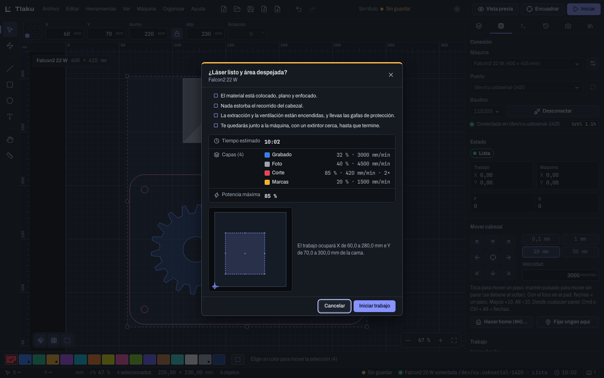
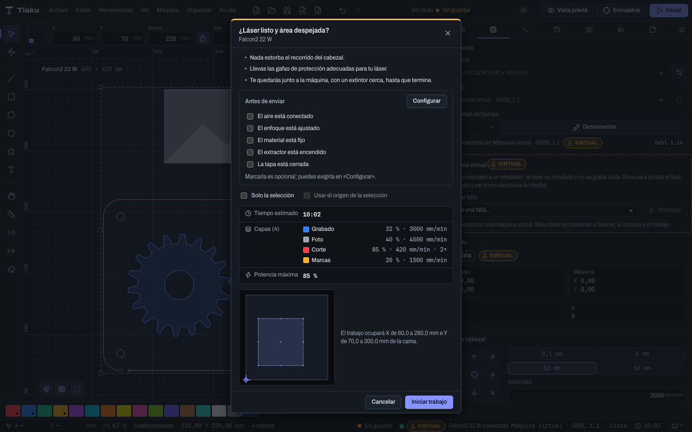
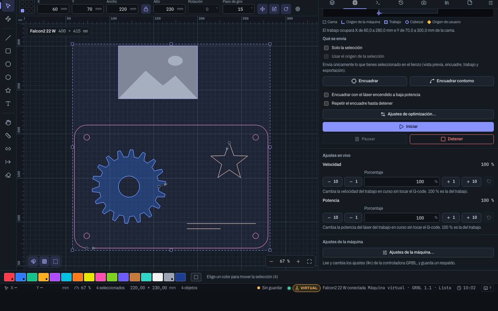
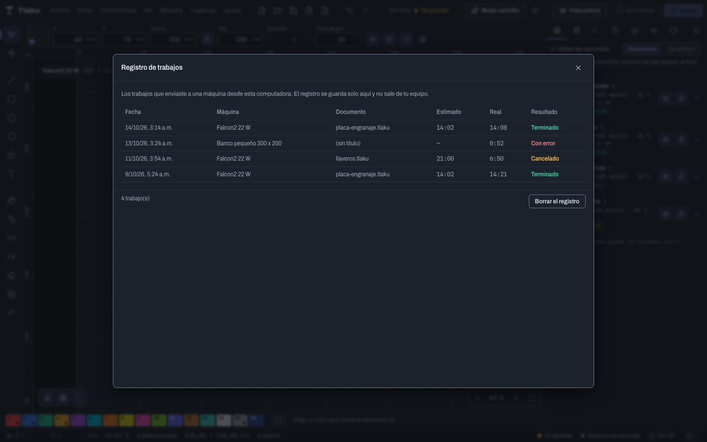

# Enviar trabajos con seguridad

El orden recomendado para mandar un diseño a la máquina: revisar la vista previa, elegir qué se envía, colocar el trabajo, encuadrar, confirmar y vigilar. Tlaku frena todo lo que puede mover el láser sin que tú lo pidas.

> **Ojo:** este flujo se probó con una máquina real, una Creality Falcon2 Pro de 22 W: encuadrar, iniciar, pausar, reanudar, detener, el aire asistido, continuar tras un corte de energía y la vista en vivo. Eso fue con trabajos cortos y potencias bajas o medias, con una sola máquina. **Falta** probar el corte con potencia alta, un trabajo largo y un corte de luz real a mitad de un grabado con material; las alarmas se validaron con el emulador y las máquinas virtuales de la app. Practica primero con una **máquina virtual** ([Conectar tu máquina](08-conectar-maquina.md)) y haz tu primer trabajo real con material de desecho. Mantén siempre a mano el paro de emergencia físico de tu máquina.

## Qué comprueba Tlaku antes de transmitir

Al iniciar o encuadrar, la app consulta el estado de la máquina (`?`) y **no transmite nada** si no está en reposo (**Lista**). En alarma, pausa, puerta abierta, en marcha o en cualquier otro estado, te explica por qué y qué hacer (aparece **La máquina no aceptó el trabajo** en la sección **Trabajo**, y el mensaje queda también en la consola). También verifica el G-code contra el búfer de la placa y te avisa si:

- el modo láser está apagado (`$32=0`): bloquea el envío de un trabajo, porque el láser quedaría encendido en los desplazamientos;
- la S máxima del perfil no coincide con `$30` de la máquina: aviso, la potencia saldría escalada;
- el firmware reporta valores `nan` en los desplazamientos de trabajo: aviso (Tlaku no usa G54 a G59).

La app **nunca** envía `$X`, `$H` ni `~` por su cuenta: cada uno se pide con un botón que explica el riesgo y pide confirmación.

## 1. Qué se envía

### Qué se envía: solo la selección

En la sección **Trabajo** (y también en el diálogo de iniciar y en la barra de la vista previa) están las casillas de **Qué se envía**:

- **Solo la selección:** la vista previa, el encuadre, el trabajo y la exportación de G-code llevan únicamente lo que tienes seleccionado en el lienzo. Sirve para repetir una sola pieza que salió mal sin volver a cortar todo, o para probar un detalle en un retazo. Muestra cuántos objetos hay seleccionados. Sin nada seleccionado la casilla se deshabilita y dice por qué (**Selecciona uno o más objetos en el lienzo para usar esta opción**). Lo oculto, lo que está en una capa sin salida y lo que la capa no admite por su modo tampoco sale.
- **Usar el origen de la selección:** necesita la anterior y solo cuenta con **Posición actual** o **Origen de usuario**. Apagada, el punto de anclaje del trabajo se toma de la caja de **todo el diseño**, y la pieza seleccionada se corta *en el lugar que le toca* respecto al resto (por ejemplo, para repetir la pieza 3 exactamente donde estaba). Encendida, el anclaje sale de la caja de la selección: la pieza seleccionada se coloca como si fuera todo el diseño (por ejemplo, para cortarla en otro retazo, empezando donde dejaste el cabezal).

> **Consejo:** si cambias la selección, la vista previa se recalcula sola. Antes de iniciar, mira en el diálogo de iniciar que el resumen (capas, tiempo, dónde queda) sea el de la pieza que quieres.

## 2. Colocar el trabajo: Iniciar desde

En la pestaña **Máquina**, sección **Trabajo**, **Iniciar desde** decide dónde cae el diseño sobre la cama. En la misma sección están el botón **Ajustes de optimización…** (cómo se ordena y recorre el trabajo; ver [Vista previa y orden de corte](07-vista-previa.md)) y los botones de encuadre.

| Modo | Qué hace |
|---|---|
| **Coordenadas absolutas** | El trabajo sale en el lugar de la cama donde lo ves en el lienzo |
| **Posición actual** | Se ancla donde esté el cabezal al iniciar (necesita la máquina conectada) |
| **Origen de usuario** | Se ancla en el punto que guardaste con **Fijar origen aquí** |

Con los dos últimos eliges además el **punto del trabajo que se ancla**, entre nueve (cuadrícula de 3 por 3): las cuatro esquinas, el centro de cada lado y el centro. Por ejemplo, con "centro" el centro del diseño queda sobre el cabezal.

Debajo ves una ilustración de la cama con el trabajo, el cabezal y los orígenes, y una frase con coordenadas: "El trabajo ocupará X de 60,0 a 280,0 mm e Y de 70,0 a 300,0 mm de la cama". Si algo se sale, dice por qué lado y cuántos milímetros ("Se sale de la cama: por la izquierda ...") y el diálogo de inicio no te dejará confirmar.

### Mover el cabezal y fijar el origen

1. En **Mover cabezal** usa el pad de flechas. Un clic mueve un paso (de fábrica `0,1`, `1`, `10` o `50 mm`); mantener pulsado mueve sin parar y se detiene al soltar. Con el foco en el pad, las flechas dan un paso, `Mayús` lo multiplica por 10 y `Alt` lo divide entre 10. Desde cualquier panel: `Ctrl/Cmd+Alt+flechas`.
2. Ajusta la **Velocidad** (en mm/min; no puede pasar de la velocidad máxima del perfil).
3. Cuando el cabezal esté donde quieres que empiece el trabajo, pulsa **Fijar origen aquí**. Solo lo guarda la app; no se envía nada a la máquina. **Borrar el origen de usuario** lo quita.
4. El botón central del pad, y el botón **Ir al origen de trabajo (X0 Y0)**, llevan el cabezal al cero de trabajo o, si hay origen de usuario, a ese origen (el botón entonces dice **Ir al origen de usuario**).

**Hacer home ($H)…** es para máquinas con finales de carrera; antes de moverse te recuerda despejar el área. Si el perfil tiene marcado **Ofrecer el homing ($H) al conectar** (ver [Conectar tu máquina](08-conectar-maquina.md#ajustes-del-perfil-que-conviene-conocer)), al conectar se abre esa misma confirmación: **nunca se envía solo**, y puedes cancelarla.

Debajo del pad, si el perfil tiene eje Z o eje U, aparecen sus botones **Subir** y **Bajar**; además están **Enfocar**, las **Posiciones guardadas** y el **Disparo de prueba** (que enciende el láser y pide doble confirmación). Todo eso, y las **Macros**, está en [Control avanzado de la máquina](09b-control-avanzado.md).

### Posicionar el láser con un clic

**Posicionar el láser** (botón en **Mover cabezal**, o menú **Máquina**) te evita hacer clic diez veces en el pad: mientras está activo, **un clic en la cama del lienzo manda el cabezal hasta ese punto**, con el láser apagado (`M5`), a la velocidad de **Mover cabezal**. El cursor cambia a una cruz. Sirve, por ejemplo, para llevar el cabezal sobre una esquina de la pieza y fijar ahí el origen, o para comprobar una marca de la cámara.

- Se apaga con `Esc`, volviendo a pulsar el botón o al desconectar la máquina; y se apaga solo cuando empieza un trabajo, para que un clic no mueva el cabezal a mitad del corte. Mientras está activo, el lienzo no selecciona ni arrastra nada y una etiqueta junto al cursor muestra las coordenadas del punto.
- Necesita la máquina conectada y en reposo, y una cama plana: **con el rotativo activo está deshabilitado**, porque la Y es el giro de la pieza y no un punto de la cama.
- Si haces clic fuera de la cama, avisa ("El punto X …, Y … queda fuera de la cama") y no se mueve.
- **Llevar el puntero rojo al punto.** Si el perfil de tu máquina tiene un **Desfase del puntero rojo** (el puntero no cae exactamente sobre el rayo; ver [Conectar tu máquina](08-conectar-maquina.md#ajustes-del-perfil-que-conviene-conocer)), junto al botón aparece la casilla **Llevar el puntero rojo al punto**. Con ella marcada, el clic manda allí el **puntero**, no el rayo: la cabeza va al punto menos el desfase. Es lo que quieres para poner el puntero sobre una esquina de la pieza. Con el desfase en 0 y 0, la casilla no aparece.

### Pasos de movimiento y posición final

- **Pasos del movimiento:** el campo bajo el pad guarda hasta seis valores entre 0,01 y 500 mm, separados por `;` o espacios (por ejemplo `0,05; 0,5; 5; 25`). Se recuerdan entre sesiones. El botón de la flecha circular vuelve a los pasos de fábrica. Útil si ajustas el foco con pasos de 0,1 mm o centras una pieza grande con pasos de 100 mm.
- **Posición final:** decide qué hace el cabezal cuando el trabajo **termina bien**: **Quedarse** (de fábrica) donde acabó, **Volver al origen** (al origen de usuario si hay uno; si no, al cero de trabajo) o **Ir a un punto** (X e Y en mm de la cama, como en el lienzo). **Ir ahora a la posición final** hace ese movimiento a mano, con el láser apagado. Si el trabajo se cancela o falla, el cabezal no se mueve solo. Si el perfil de tu máquina ya manda el cabezal al origen al terminar, la app lo recuerda: cámbialo en el gestor de dispositivos si prefieres que se quede. Ejemplo: **Ir a un punto** con X = 0 y Y = el alto de la cama deja el cabezal en la esquina, lejos de la pieza, para sacarla sin riesgo.

## 3. Encuadrar

**Encuadrar** (`F`, o el botón de la barra superior) recorre con el láser **apagado** el rectángulo que ocupa todo el trabajo, overscan incluido. Sirve para ver si el diseño cae donde quieres y dentro del material. Va a la velocidad que tengas en **Mover cabezal**, con `M5` y `S0`.

Si el perfil tiene un **Desfase del puntero rojo**, el encuadre con el láser **apagado** lo compensa solo: así es el **puntero**, y no el rayo, el que recorre el borde del trabajo. (El encuadre con el láser encendido a baja potencia no lo compensa, porque ahí lo que se ve es el rayo.)

**Encuadrar contorno** (botón junto a Encuadrar y menú **Máquina**) es el encuadre de "banda elástica": en lugar del rectángulo recorre el **contorno convexo** del trabajo, como una liga estirada alrededor de las piezas, también con el láser apagado y a la misma velocidad. Es mejor para piezas largas y en diagonal, donde el rectángulo recorre mucha cama vacía y no deja ver dónde caerá la pieza de verdad. Sigue contando el overscan y respeta **Solo la selección**, el origen del trabajo y el rotativo.

> **Consejo:** el rectángulo es el del conjunto, no el de cada pieza. Y aunque el láser vaya apagado, mantén las gafas puestas y las manos fuera. El encuadre también puede repetirse en bucle hasta que pulses **Detener** y, si el dialecto de tu máquina lo permite, recorrerse con el láser encendido a muy baja potencia (hasta 20 %) para verlo sobre el material: ver [Control avanzado de la máquina](09b-control-avanzado.md).

## 4. Iniciar

1. Pulsa **Iniciar** (`Ctrl/Cmd+Intro`). Nunca sale directo: se abre el diálogo **¿Láser listo y área despejada?**
2. Léelo con calma. Tres avisos fijos, para leer: nada estorba el recorrido del cabezal; llevas las gafas de protección adecuadas para tu láser; te quedarás junto a la máquina, con un extintor cerca, hasta que termine.
3. Debajo está la **lista de comprobación** **Antes de enviar**, con casillas que marcas tú: **El aire está conectado**, **El enfoque está ajustado**, **El material está fijo**, **El extractor está encendido** y **La tapa está cerrada**. Con **Configurar** eliges cuáles aparecen (te sirve para quitar "El aire está conectado" si tu máquina no lleva aire) y activas **Exigir tenerla marcada antes de enviar**: entonces **Iniciar trabajo** no se activa hasta que marques todas las casillas visibles y dice cuántas faltan. Sin esa opción (de fábrica) la lista es opcional. Las casillas se desmarcan en cada trabajo, para que no se marquen por costumbre; lo que eliges mostrar y exigir se recuerda. **Mostrar todas** las vuelve a poner.
4. El diálogo resume el **Tiempo estimado**, las **Capas** (potencia, velocidad y pasadas de cada una), la **Potencia máxima** y dónde quedará el trabajo, además de las advertencias del cálculo.
5. El diálogo repite **Solo la selección** y **Usar el origen de la selección**, por si quieres cambiarlas antes de empezar.
6. **Cancelar** es el botón con el foco. **Iniciar trabajo** se activa solo cuando el resumen ya está calculado y el trabajo cabe en la cama; si no, dice "Espera al resumen del trabajo y corrige lo marcado en rojo".

Entre las advertencias del cálculo pueden salir cuatro que conviene entender:

- **Revisar diseño encontró N cosas que conviene ver antes de enviar** (con un enlace **Ver**): algo grave en el diseño, como objetos fuera de la cama o una capa sin salida. No bloquea el envío. Ver [Revisar diseño](07b-revisar-diseno.md).
- **El enlace serie no da abasto.** Con USB serie (GRBL, Marlin, Smoothieware), el cable manda como máximo `baudios ÷ 10` bytes por segundo (a 115 200 baudios, unos 11 520). Si en su tramo más denso el trabajo pide más líneas por segundo de las que caben (curvas muy finas a mucha velocidad, o un mapa con millones de segmentos), la máquina **se queda sin líneas, hace pausas y puede dejar marcas** en el material. El aviso dice cuántas líneas por segundo pide, cuántas caben y a **qué fracción de la velocidad** habría que bajar esa capa. Qué hacer: baja la velocidad de las capas con más detalle, simplifica el diseño (**Optimizar formas**, [Revisar diseño](07b-revisar-diseno.md)) o usa un enlace más rápido (USB nativo, red o más baudios si tu firmware los admite). No bloquea el envío; también queda anotado en la consola. Tlaku además **fusiona los cortes casi alineados** del G-code (con una tolerancia de unos 6 µm) para escribir menos líneas sin cambiar el recorrido.
- **Capa más rápida que la máquina.** Si una capa pide, por ejemplo, 48 000 mm/min y la velocidad máxima del perfil es 12 000, el aviso dice que la máquina irá al máximo y el resultado saldrá **más oscuro o más quemado** de lo previsto. Baja la velocidad de la capa o corrige la velocidad máxima del perfil si está mal puesta. No cambia la salida: la controladora limita el avance por su cuenta.
- **Avisos de Ruida** (tope de 36 000 mm/min y más de 128 capas): ver [Ruida y K40](13b-ruida-y-k40.md).

Durante el trabajo ves el progreso (porcentaje, **Líneas**, **Transcurrido** y **Restante**) en la pestaña **Máquina**.

> **Con una controladora Ruida** (experimental) el diálogo es otro: dice si el trabajo se **guardará como documento** en la memoria de la controladora (lo normal, y **no arranca**: lo inicias desde su panel) o si **se ejecutará en cuanto llegue**. Ver [Ruida y K40](13b-ruida-y-k40.md).

> **Si el diseño lleva texto variable:** antes de enviar, Tlaku resuelve las variables con los valores de ese momento. Si alguna no se entiende, el trabajo **no sale** y el aviso dice cuál. Al terminar bien, la serie y la fila del CSV avanzan solas (si lo activaste); un trabajo cancelado o con error no avanza. Ver [Texto variable](04b-texto-variable.md).

### Modo producción: no repetir la lista si nada cambió

Si trabajas en serie (la misma pieza, el mismo material, uno tras otro), marcar cinco casillas en cada trabajo cansa y acaba haciéndose por costumbre. El **modo producción** deja saltar **solo la lista de comprobación** cuando es seguro hacerlo. Es una decisión de seguridad, así que:

- **Está apagado de fábrica.** Se enciende en **Editar > Preferencias… > General > Producción**: **Modo producción: no repetir la lista de comprobación si nada cambió**. Al encenderlo, Tlaku te pide confirmar con un texto que explica el riesgo: si algo físico cambió sin que la app lo sepa (cambiaste la hoja de material, tocaste el enfoque) no puede notarlo. Apagarlo es inmediato.
- **Un archivo ajeno nunca lo enciende.** Al importar un `.tlakuprefs` o restaurar un respaldo, esta preferencia se ignora: se activa a mano en cada equipo.
- **Solo se salta la lista**, y solo si se cumplen **todas** estas condiciones:
  1. es la misma máquina y la misma conexión, sin haber reconectado;
  2. en **esta sesión de la app** ya confirmaste un trabajo con el diálogo completo y **terminó bien** (uno cancelado o con error no vale, y si un trabajo falla después, vuelve a pedirse la lista);
  3. los ajustes de las capas con salida son los mismos;
  4. el origen del trabajo es el mismo (Iniciar desde, esquina, origen de usuario, **Solo la selección** y su origen);
  5. el material es el mismo (el de la biblioteca que reconocen las capas con salida; Tlaku no puede saber qué hoja pusiste en la cama: eso sigue siendo cosa tuya);
  6. la revisión previa no da ningún aviso: ni avisos del cálculo, ni enlace saturado, ni hallazgos graves de **Revisar diseño**, y el trabajo cabe en la cama.
- Si algo cambió o hay **cualquier** aviso, ves el diálogo completo de siempre. Con una máquina de galvo o un K40 el diálogo completo siempre se muestra, y también con **Repetir con el alimentador**.
- Aun saltando la lista queda **un paso de un clic**: **Iniciar (modo producción)**. Muestra el tiempo estimado y dónde queda el trabajo, el botón **Iniciar (Enter)** lleva el foco (Enter lo confirma; mantener Enter pulsado no cuenta) y **Ver la lista completa** abre el diálogo de siempre.
- **No cambia nada más:** **Detener** y la parada de emergencia funcionan igual; el control remoto desde el celular y la [cola guiada](09f-cola-e-historial-de-trabajos.md) siguen sus propias reglas y nunca usan este paso.
- La memoria de la sesión no se guarda en disco: al cerrar la app, el primer inicio vuelve a mostrar la lista completa.

**Iniciar la selección** (barra rápida del lienzo y menú **Máquina**) abre este mismo diálogo con **Solo la selección** ya marcada; no se salta ninguna comprobación, y pasar de todo el diseño a la selección cuenta como un cambio de origen. Ver [La interfaz](02-interfaz.md#barra-rapida-de-la-seleccion).

## Pausar y detener

| Acción | Qué hace |
|---|---|
| **Pausar** (`Ctrl/Cmd+Shift+P`) | Feed hold: detiene el movimiento. El mismo botón pasa a **Reanudar** |
| **Detener** (`Ctrl/Cmd+.`) | Feed hold, espera a que frene y reinicio suave de la controladora; el trabajo termina y el láser queda apagado |

La app indica que en pausa el láser está apagado. En la Falcon2 Pro se comprobó: en pausa el láser queda en 0 y al reanudar sigue donde iba. Con otra máquina no está comprobado, así que en una pausa larga no dejes un diodo enfocado sobre el material.

Si **Detener** ocurre con la máquina en movimiento, la posición puede haberse perdido. Aparece **La posición puede haberse perdido**: con finales de carrera haz **Hacer home ($H)…**; sin ellos, vuelve a fijar el origen a mano. Con Marlin y Smoothieware, cancelar siempre marca la posición como posiblemente perdida.

Si cierras la app con un trabajo en curso, se cancela de la misma forma, pero Tlaku conserva el punto de control y al abrirla de nuevo te ofrece continuar (ver [Continuar un trabajo interrumpido](#continuar-un-trabajo-interrumpido)).

## Vista en vivo del trabajo

Con un trabajo en curso, la casilla **Vista en vivo** (pestaña **Máquina**, sección **Trabajo**) abre una **ventana flotante** («imagen en imagen») dentro de la app que muestra lo que va haciendo la máquina, **sin cámara**: la **cama completa** con lo que ya se cortó o grabó en oscuro (con el color de su capa tostado), lo que falta tenue (los cortes con línea discontinua), el cabezal como una retícula y, cuando el láser está emitiendo, un punto rojo con brillo. **No tapa ni cambia tu diseño**: el lienzo sigue exactamente igual debajo (con las reglas de edición de siempre durante un trabajo). Abajo de la cama la ventana muestra el **porcentaje**, el **estado** (en marcha, en pausa, terminado; con el **láser encendido** o **apagado**) y los tiempos **transcurrido** y **restante**.

- **Muévela y ajústala.** Arrastra la **barra de título** a cualquier lugar de la ventana de la app (no se sale de ella) y cambia su tamaño desde la **esquina inferior derecha** (tiene un tamaño mínimo). **Agrandar** la lleva a casi toda el área del lienzo y **Restaurar tamaño** la devuelve a donde estaba; el doble clic en la barra hace lo mismo. Con el teclado, enfoca la barra y usa las **flechas** para moverla y **Mayús + flechas** para cambiar su tamaño. Recuerda su posición y tamaño entre sesiones y se reacomoda sola si achicas la ventana de la app.
- **Mira la cama a tu gusto.** La cama se encaja sola en el espacio de la ventana. Dentro de ella, la **rueda del ratón** acerca y aleja, **arrastrar** la desplaza y el botón **Encajar la cama** (o la tecla **0**) la devuelve completa; con el teclado: **+** y **-** para el zoom y las **flechas** para desplazar. Este zoom es solo de la ventana: no mueve el del diseño.
- **Cerrar** la ventana (la **X**) apaga la vista en vivo: es la misma casilla del panel **Trabajo**.
- **Abrir en ventana aparte.** El botón de la barra de título abre la vista en vivo en **otra ventana del sistema**, por ejemplo para ponerla en un segundo monitor, y la flotante se oculta mientras esté abierta. **Volver a la ventana flotante** (o cerrarla) la trae de vuelta si la vista sigue encendida. Solo hay una ventana aparte a la vez. Es de **solo lectura**: no tiene acceso a la máquina ni a tus archivos, solo recibe de la ventana principal el avance y la ruta.

- **Apagada de fábrica**, y se recuerda tu última elección. Apagada no ubica ni anima nada. Puedes encenderla y apagarla **en cualquier momento, también a mitad de un trabajo**: al encenderla muestra de una vez todo lo que ya se hizo.
- **Sigue a la máquina real, no al reloj.** Toma la posición que reporta la máquina (unas 4 a 5 veces por segundo), la busca sobre la ruta de la vista previa respetando el origen, el intercambio X/Y y el rotativo del perfil, y mueve el cabezal con fluidez entre reportes. Si la máquina va más lenta o más rápida que el estimado, se corrige sin saltar; en **pausa** la animación se detiene, y si el trabajo se **detiene o falla** queda congelada donde quedó. Al terminar muestra el 100 % con el cabezal en la última posición de la ruta.
- **Si la posición no encaja** con el recorrido (por ejemplo, un perfil con el rotativo reflejado) usa el progreso del envío; en máquinas que no reportan su posición mientras trabajan (K40, galvo) la vista es un **estimado por el tiempo** y el texto lo dice.
- **Solo mira.** No envía nada a la máquina: pausar y detener siguen donde siempre. Un trabajo que se **reanuda** desde un punto de control no tiene vista en vivo.
- **Accesibilidad:** la ventana es un diálogo no modal con nombre; la cama tiene una descripción en texto con el porcentaje y el estado, que se actualiza sin molestar al lector de pantalla (el estado se anuncia cada 10 %); todos los botones tienen nombre y se pueden usar con el teclado.
- Con trabajos de decenas de miles de movimientos (grabado de imágenes) va fluida: lo ya quemado se acumula en una capa y lo pendiente se dibuja una sola vez (las capas se rearman si acercas mucho la cama). En el celular tienes la misma vista; mira [Control desde el celular](09e-control-desde-el-celular.md#vista-en-vivo-en-el-celular).

## Ajustes en vivo: velocidad y potencia

La sección **Ajustes en vivo**, al final de la pestaña **Máquina**, cambia la **Velocidad** y la **Potencia** del trabajo en curso como un porcentaje de lo programado, **sin tocar el G-code ni volver a calcularlo**. Cada una tiene los botones **-10**, **-1**, **+1** y **+10**, un campo de porcentaje (de 10 % a 200 %) y un botón para **Volver al 100 %**. El valor vigente es el que informa la controladora; mientras no lo haya informado (lo manda de vez en cuando) se muestra "—".

Para qué sirve, con un ejemplo: empiezas a cortar contrachapado y ves que en una zona no atraviesa. En vez de detener todo y recalcular, bajas la **Velocidad** al 80 % mientras pasa esa zona (más energía por milímetro) y la vuelves al 100 % después. O notas que el grabado sale muy oscuro: baja la **Potencia** al 90 %. Los ajustes en vivo no cambian tus capas: si quieres que el cambio sea definitivo, ajusta la capa.

- **Solo GRBL y sus derivados** (GRBL 1.1, grblHAL, FluidNC, GRBL-LPC): usan comandos en tiempo real que Marlin y Smoothieware no tienen. Con esas controladoras los controles quedan deshabilitados y dicen por qué.
- Necesitan la máquina conectada. Valen con o sin trabajo en curso; el movimiento rápido (el de viaje) no se ajusta.
- Por encima del 100 % el láser trabaja con más energía de la que programaste. Sube de poco en poco y sin soltar la vigilancia de la máquina.

## Alarmas

Si la máquina entra en alarma, aparece un banner rojo en la pestaña **Máquina**: **La máquina está en alarma**, con el código (`ALARM:N`), su explicación y **Qué hacer**, según si tu máquina tiene homing activado (`$22`). Los botones son **Desbloquear ($X)…** y **Hacer home ($H)…**: cada uno abre un diálogo con su riesgo y una lista de comprobación, y solo envía al confirmar. `$X` desbloquea sin comprobar la posición; `$H` mueve el cabezal hasta los finales de carrera, así que úsalo solo si tu máquina los tiene. Las causas de cada código están en [Solución de problemas](15-solucion-de-problemas.md).

## Consola segura

La pestaña **Consola** (`Ctrl/Cmd+3`) es el registro de lo enviado y lo recibido, con una línea para escribir comandos.

- Los comandos de solo lectura (`$I`, `$$`, `$#`, `$G`, `$N`, `M5` y `status`) salen sin preguntar. Hay atajos a un clic: `$$`, `$I`, `$G`, `$#` y `status`.
- Todo lo demás (mover, encender el láser, cambiar un ajuste, `$X`, `$H`) abre **Confirmar comando**, que muestra "Se enviará exactamente:" la línea ya normalizada y el riesgo. Solo **Enviar a la máquina** la manda. `$RST` y `$SLP` llevan un aviso extra porque no se pueden deshacer.
- `?`, `!` y `~` se rechazan escritos a mano: usa los nombres `status`, `hold`, `resume` y `reset`.
- Durante un trabajo solo se aceptan `status`, `hold`, `resume` y `reset`.
- Con las flechas arriba y abajo recorres el historial; `Tab` completa el comando.
- Las respuestas `error:N` y `ALARM:N` llegan con su explicación. **Ocultar reportes de estado** limpia el ruido de los `?` periódicos, y puedes copiar o borrar el registro.

## Continuar un trabajo interrumpido

Si se va la luz, se cierra la app, se reinicia la computadora o se pierde la conexión a mitad de un grabado, no tienes que empezar de cero: Tlaku puede **continuar desde donde se quedó**. Funciona con GRBL, Marlin y Smoothieware (envían el G-code línea por línea). Otras controladoras tienen sus propias reglas, en la tabla de más abajo.

### Qué guarda la app mientras trabaja

- **Al iniciar un trabajo** guarda un *punto de control* en la carpeta de datos de la aplicación (subcarpeta `interrupted-job/`): el G-code exacto que se envió, el perfil de la máquina, la ruta del proyecto y el origen del trabajo.
- **Mientras envía**, cada segundo más o menos anota la última línea que la máquina confirmó con `ok`, la posición del cabezal del último reporte de estado y el estado de la máquina en ese momento (modo absoluto o relativo, unidades, `M3` o `M4`, última potencia `S` y velocidad `F`, Z y aire). Lo hace en otro hilo y de forma atómica, así que no frena el envío y un corte a mitad de la escritura no deja un archivo roto.
- **Se borra** cuando el trabajo termina bien, cuando lo cancelas a propósito con **Detener** o cuando conectas otra máquina.
- **Se conserva** si hay un error o una alarma, si se pierde la conexión, si cierras la app o si se va la luz.

### Cuándo ofrece continuar

Al abrir la app, y también cuando la conexión se pierde a mitad de un trabajo, aparece un aviso: **El último trabajo se interrumpió al N %. ¿Continuar?** El porcentaje sale de **dónde está la cabeza sobre el recorrido** (el trayecto de grabado hecho hasta ese punto entre el total), no de las líneas que la máquina confirmó: con líneas largas casi todas se confirman al principio, porque entran a su memoria, y no dirían nada del avance real. Tiene tres botones:

| Botón | Qué hace |
|---|---|
| **Continuar** | Abre el diálogo de reanudación con el punto de reinicio que Tlaku calculó |
| **Elegir el punto** | Abre el mismo diálogo para que muevas tú el punto de reinicio |
| **Descartar** | Borra el punto de control; ya no podrás continuar ese trabajo |

Si lo dejas para después, el [Historial de trabajos](#historial-de-trabajos) (**Ayuda > Historial de trabajos…**) marca los trabajos interrumpidos con su porcentaje y trae un botón **Continuar** mientras siga existiendo el punto de control.

### Si la máquina siguió sola

Aquí está el límite más importante: **la máquina puede seguir ejecutando lo que tiene en su memoria** después de que Tlaku se cierre. Un trabajo de líneas largas (un cuadrado de 80 mm, por ejemplo) cabe entero en su búfer: si la app muere a los 4 segundos, la placa termina el trabajo sola. Si Tlaku ofreciera continuar desde la posición guardada, volvería a pasar sobre lo ya hecho.

Por eso el punto de control guarda también la última línea **enviada** (no solo la confirmada con `ok`) y, al reconectar, Tlaku compara la posición de la máquina de ahora con la que guardó:

- **Si la máquina quedó donde estaba**, no hay nada que avisar.
- **Si se movió y quedó al final del trabajo**, el aviso dice que la máquina siguió ejecutando lo que tenía en su memoria y parece haber terminado. **Descartar** pasa a ser el botón principal: revisa la pieza antes, porque continuar repetiría lo hecho.
- **Si se movió y quedó a mitad**, propone continuar desde donde está ahora (no desde donde estaba al guardarse el punto), con el aviso de que la máquina siguió sola y cuánto fue (líneas y milímetros).
- **Si no se puede saber** (hubo alarma, la placa se reinició o se fue la luz, y su posición no es fiable) o no hay máquina conectada, se conserva el comportamiento de siempre pero con el aviso de que la máquina pudo seguir ejecutando hasta N líneas (unos M mm) que ya tenía. Revisa la pieza antes de continuar.

Esa comparación solo vale en el caso para el que existe: **la app murió y la máquina siguió sola**. Por eso Tlaku solo compara la posición de ahora si se cumplen las dos cosas: el punto de control es **reciente** (se guardó hace menos de 10 minutos) y, desde que se abrió la conexión, **no se hizo nada que mueva la cabeza** (homing, mover con las flechas, ir a una posición, encuadrar, otro trabajo o una línea de G-code a mano). Si el punto es de otra sesión (de ayer, por ejemplo) o ya movió la cabeza, la posición de ahora no dice nada del trabajo: por ejemplo, una máquina que hoy se usó y volvió a (0, 0) parecería «haber terminado». En ese caso no se compara, el aviso es el de «no se puede saber» y se propone el punto a partir de la **posición guardada**; nunca se recomienda descartar por eso. La decisión se toma una vez, al abrir el aviso, y no cambia por hacer el homing o el encuadre que la reanudación te pide después: la sugerencia es la misma en el aviso, en el diálogo y al continuar.

Una placa que se reinicia queda en (0, 0) y con la velocidad `F` del intérprete en cero; una que terminó sola conserva la `F` del G-code. Tlaku usa esa diferencia (`$G`) para no confundir un corte de luz con un trabajo terminado.

Si al **conectar** la máquina sigue ejecutando el trabajo, no acepta comandos: Tlaku lo dice (**La máquina está ejecutando un trabajo (estado Run)…**) en lugar de culpar al puerto. Espera a que termine, o detenla con su propio botón, y vuelve a conectar.

### Dónde reiniciar

En GRBL, el `ok` solo significa que la línea entró al búfer de la placa, no que ya se ejecutó: la placa puede tener por delante hasta 127 bytes o 15 bloques (la Falcon2 acepta 127 bloques). Por eso la última línea confirmada casi nunca es la última que se grabó.

- **GRBL.** Tlaku compara la última posición guardada con la geometría de las líneas confirmadas, localiza la línea que el cabezal estaba ejecutando y **retrocede con prudencia**: por omisión 3 líneas o 1,5 mm, lo que quede más atrás (se puede cambiar en el diálogo); la regla de las líneas solo cuenta con tramos cortos (cada línea vale como mucho 2 mm), así que en un lado largo de 80 mm el retroceso es de 1,5 mm y no de todo el lado. Nunca retrocede más allá de un desplazamiento `G0`. En un grabado de imagen retrocede al inicio de la **fila de barrido** en curso.
- **Marlin y Smoothieware.** No tienen `?`, así que no se sondea la posición durante el trabajo. El punto se estima solo con las líneas confirmadas y retrocede un tramo fijo (unas 24 líneas de movimiento).

En el diálogo de reanudación la vista previa pinta **lo ya hecho** con una línea continua de un color y **lo que falta** con una línea discontinua de otro. Una barra permite mover el punto de reinicio: hacia atrás para repetir un tramo más largo, hacia adelante para repetir menos.

### Pasos obligatorios para reanudar

Todo lo siguiente es obligatorio, y lo exige el motor de la app, no solo la interfaz: sin cumplirlo, el botón de reanudar no se activa.

1. **Home, o confirmar que nada se movió.**
   - Si la máquina tiene homing (`$22=1`), hay que referenciar con **Hacer home ($H)…**. Una placa que se reinició (al cerrar y abrir el puerto, o por el corte de luz) o que perdió la posición ya no sabe dónde está; sin homing hecho no se reanuda.
   - Si la placa **no tiene homing**, Tlaku te pide confirmar que la cabeza y el material no se movieron y que el origen es el mismo. La advertencia es clara: si no es así, el resultado saldrá corrido. Marlin y Smoothieware no contestan `$$`, así que con ellos siempre se pide esta confirmación.
2. **Encuadre del trabajo completo.** Tlaku recorre con el láser apagado el rectángulo de la **pieza** (lo que graba o corta el G-code guardado, sin contar los desplazamientos desde y hacia el origen) y te pide confirmar que el material sigue en su lugar. Mientras el encuadre o cualquier movimiento sigue en curso, la máquina está **ocupada**: continuar dice «La máquina está ocupada…» y espera a que quede en reposo; no te pide confirmar que «nada se movió», y si la máquina no contesta a `$$` lo dice con otro mensaje.
3. **La lista de comprobación de siempre**, la misma del diálogo de [Iniciar](#4-iniciar).
4. **Preámbulo generado.** Antes de las líneas del trabajo, Tlaku genera un arranque seguro, en este orden: `M5` (láser apagado), `G90` y `G21`, aire asistido, ajuste de Z si hace falta (solo con eje Z), `G0` hasta el punto de inicio **con el láser apagado** y, solo entonces, el modo `M3` o `M4` con su `S` y su `F` restaurados. Después siguen las líneas del trabajo desde el punto elegido. Sobre ese G-code corre el mismo preflight de siempre, y el motor verifica que el preámbulo no contenga ningún movimiento con el láser encendido.

### Qué pasa según la máquina

| Máquina | Continuar |
|---|---|
| **GRBL, Marlin, Smoothieware** | Completo. Requiere que el perfil ponga la potencia `S` dentro de las líneas de movimiento y que `G0` apague el láser. El perfil **GRBL-M3** sin modo láser no lo cumple |
| **K40** (M2 Nano, LHYMICRO-GL) | **No se puede continuar.** La placa recibe el trabajo en paquetes de 30 bytes y no informa en qué punto va, así que no hay forma segura de saber dónde se cortó. Hay que volver a enviar el trabajo; la app solo avisa |
| **Ruida** | El trabajo vive en la controladora. Si la app se reinicia, el aviso explica que la máquina sigue sola y que puedes consultar su estado conectándote |
| **Galvo** | Todavía no aplica; la app solo avisa |

### Límites que conviene conocer

- **El material y la cabeza no deben moverse**, y el origen debe ser el mismo. Si algo se movió, el resultado saldrá corrido.
- **La máquina puede seguir ejecutando lo que tiene en su memoria.** Si la app muere, lo que ya entregó a la placa sigue corriendo hasta vaciarse. Tlaku lo detecta al reconectar si puede comparar posiciones (ver [Si la máquina siguió sola](#si-la-máquina-siguió-sola)); si no puede, te lo avisa. Revisa siempre la pieza antes de continuar.
- **El reinicio repite un tramo corto.** La posición guardada tiene hasta unos 1,2 segundos de antigüedad (200 ms del sondeo `?` más el intervalo de guardado), así que se repite hasta cerca de 1 segundo de recorrido más el retroceso que hayas configurado. Ese tramo queda grabado dos veces y se ve como una **marca levemente más oscura**; en imágenes puede quedar una **marca leve en la unión**.
- **Un corte de luz puede hacer que los motores pierdan pasos.** Por eso hacer home y encuadrar no es un trámite: compruébalo a ojo antes de aceptar.
- **Si el G-code usa `G92`, `G10` o `G28`** no se puede reanudar a mitad, porque cambian el origen o la posición de referencia.
- **Un trabajo reanudado también deja punto de control**, así que se puede interrumpir y continuar varias veces.
- **El aire asistido y la Z se restauran**, pero comprueba el enfoque antes de continuar.

> **Consejo:** la primera vez, pruébalo con material de desecho y una máquina virtual ([Conectar tu máquina](08-conectar-maquina.md)). Con la Falcon2 Pro ya se probó continuar tras cortar la energía con el paro de emergencia, pero un corte de luz real a mitad de un grabado con material todavía está en la lista de validación con hardware.

## Historial de trabajos

**Ayuda > Historial de trabajos…** (antes «Registro de trabajos») muestra los trabajos que **enviaste a una máquina desde esta computadora**: **Fecha**, **Máquina**, **Documento**, **Material**, **Estimado** (el tiempo que calculó la vista previa al empezar; **—** si no había una al día), **Real** (el tiempo trabajando, sin contar las pausas) y **Resultado**: **Terminado**, **Cancelado**, **Con error**, **Interrumpido** o **En curso**. Sirve para comparar cuánto tardó de verdad con lo estimado, para acordarte de qué se cortó y con qué ajustes, y para **repetirlo**.

- Un trabajo se anota **al empezar** y se completa **cuando termina, se cancela o falla**; si la aplicación se cierra a mitad de un trabajo queda como **Interrumpido**. Una pausa y su reanudación no cuentan como trabajos nuevos.
- Guarda también las **capas con sus ajustes**, el **material**, el **área**, una **miniatura**, la **pestaña** de origen y tus **notas**; permite **buscar y filtrar**, **Repetir con estos ajustes** y **exportar a CSV**. Todo eso, y dónde se guarda (solo en esta computadora, en la carpeta de datos de la aplicación, hasta 1000 trabajos por omisión), está en [Cola e historial de trabajos](09f-cola-e-historial-de-trabajos.md).
- **Borrar el registro** lo vacía (pide confirmación y no se puede deshacer).
- Un trabajo que se interrumpió (corte de luz, app cerrada, conexión perdida) se marca como interrumpido con su porcentaje y trae el botón **Continuar** mientras exista el punto de control. Ver [Continuar un trabajo interrumpido](#continuar-un-trabajo-interrumpido).
- No registra la exportación de G-code ni lo que mandas desde la consola.

Para varios documentos seguidos, la [cola de trabajos](09f-cola-e-historial-de-trabajos.md) te guía de uno al siguiente y **nunca envía el siguiente sola**.

## Exportar G-code

Si prefieres enviar con otro programa, **Archivo > Exportar G-code…** (`Ctrl/Cmd+Shift+E`) guarda un archivo `.gcode` con el mismo cálculo y las mismas opciones del trabajo (incluidos **Solo la selección**, el origen y los [Ajustes de optimización](07-vista-previa.md)). (Para sacar el **diseño** en SVG, DXF, PNG o PDF, ver [Importar y exportar](03b-importar-y-exportar.md).) Al terminar muestra las líneas y el tiempo estimado. Está desactivado si ninguna capa con objetos tiene la salida activada. Si usas **Posición actual**, necesitas la máquina conectada para exportar; sin ella usa **Coordenadas absolutas**.

Por línea de comandos, el programa `tlaku` hace lo mismo y más: `tlaku send` (con las mismas comprobaciones), `tlaku frame`, `tlaku cmd` y `tlaku plan`. Ver el README del proyecto.

Siguiente: [Control avanzado de la máquina](09b-control-avanzado.md)
