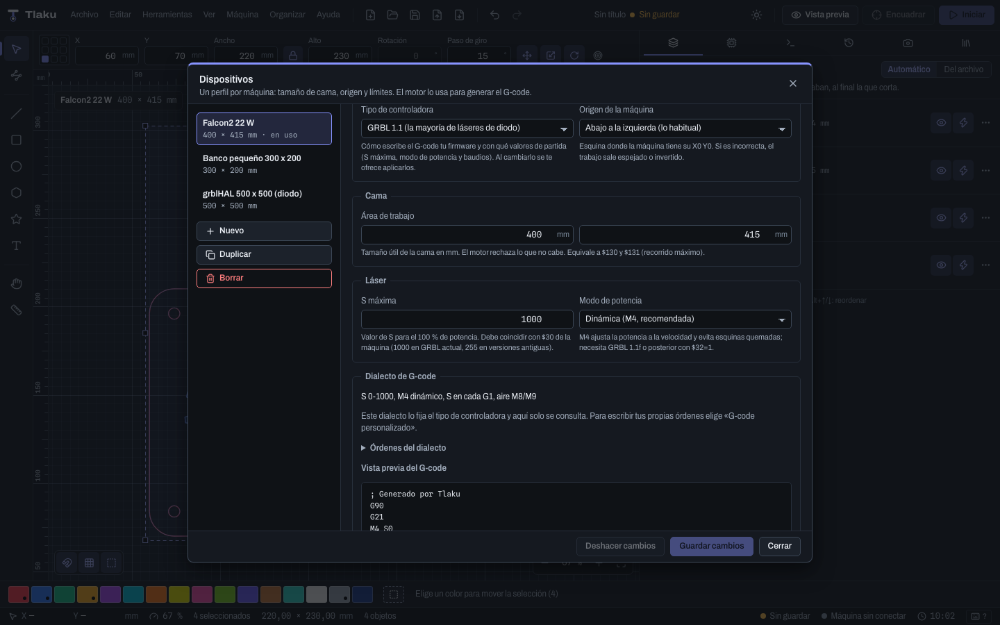

# Controladoras soportadas

Qué firmware entiende Tlaku, en qué estado está cada uno y qué dialecto de G-code usa. Léela antes de conectar una máquina real.

> **Ojo, lo más importante:** Tlaku **nunca se ha probado con una máquina real**. Todo se validó con el emulador (`tlaku-emu`), con las máquinas virtuales de la app y con pruebas automáticas. Cuando esta página dice "estable en emulador" significa exactamente eso: el flujo funciona contra un láser simulado, no contra el tuyo. Haz tu primera prueba con el láser a potencia baja, material de desecho, sin dejar la máquina sola y con el paro de emergencia a mano.

## Estados que usa esta página

| Estado | Qué significa |
|---|---|
| **Estable en emulador** | Conecta, mueve, encuadra, envía, pausa, detiene y maneja alarmas contra un emulador. Falta probarlo con hardware. |
| **Por validar con máquina real** | Existe en la app o en el motor, pero con menos cobertura o sin máquina virtual propia. |
| **Experimental** | Existe solo en el motor o en la línea de comandos y está marcado así. No está en la app. |
| **No soportada** | No hay código. |

## Tabla de controladoras

| Familia | Tipo en el perfil | Estado | Notas |
|---|---|---|---|
| GRBL 1.1f o posterior (la mayoría de los diodos) | GRBL 1.1 | Estable en emulador | Usa `M4` (potencia dinámica) con `$32=1`, S de 0 a 1000. |
| grblHAL | grblHAL | Estable en emulador | Hay máquina virtual **grblHAL**. Ej.: Ortur Laser Master 3. |
| FluidNC | FluidNC | Estable en emulador | Hay máquina virtual **FluidNC**. Solo por USB; el Wi-Fi no existe en la app. |
| Marlin 2.x con láser | Marlin | Estable en emulador | Hay máquina virtual **Marlin**. Envío línea a línea, arranque lento al abrir el puerto. |
| Smoothieware | Smoothieware | Estable en emulador | Hay máquina virtual **Smoothieware**. S de 0 a 1 por defecto. |
| GRBL antiguo (1.1e o anterior, solo `M3`) | GRBL antiguo (sin M4) | Por validar con máquina real | Sin máquina virtual propia. Potencia constante; `G0` no apaga el rayo, así que Tlaku escribe `S0` en los desplazamientos. |
| GRBL-LPC (Cohesion3D) | GRBL-LPC / Cohesion3D | Por validar con máquina real | Sin máquina virtual propia en la lista de la app. S de 0 a 1. |
| G-code propio | G-code personalizado | Por validar con máquina real | Tú escribes el dialecto; parte del de GRBL 1.1. |
| Ruida (CO2 de caja con pantalla) | Ruida (CO2, por red; experimental) | **Experimental, sin máquina real** | Por red (UDP) con la IP en el perfil. Hay máquina virtual **Ruida (CO2)**. Ver más abajo. |
| K40 con placa M2 Nano | — | **No soportada** | Con la placa cambiada a GRBL-LPC o Smoothie sí funciona como esas familias. |
| Galvo (fibra, UV, CO2 galvo; EZCAD) | — | **No soportada** | |
| Trocen, TopWisdom | — | **No soportada** | |
| Máquinas de red (Wi-Fi, Ethernet) | — | **No soportada** en la app | La app solo conecta por puerto serie (USB) o máquina virtual. xTool por red tampoco. |

Las máquinas virtuales que ofrece la app son seis: **Falcon2 Pro**, **GRBL 1.1**, **grblHAL**, **FluidNC**, **Marlin** y **Smoothieware**. Ver [Conectar tu máquina](08-conectar-maquina.md).

## Ruida: experimental

Tlaku habla con una controladora Ruida por red desde la app y desde el programa `tlaku`. Está marcado **EXPERIMENTAL**: se probó contra un emulador, **no con una máquina real**. Pruébalo primero con el láser deshabilitado o a potencia 0.

- **Perfil.** En el gestor de máquinas elige el tipo **Ruida (CO2, por red; experimental)** (o ofrécelo desde **Agregar máquina** ▸ «Otro / genérico»). Escribe la **IP** de la controladora (tu equipo debe estar en la misma red /24 y ningún otro programa de láser puede tener abierto el puerto UDP 40200). El **magic** es automático, o lo fijas a mano (0x88 en casi todas). En **Origen** elige la esquina donde la máquina hace su home.
- **Ejecutar al subir.** Apagado (lo recomendado): el trabajo se **guarda como documento** en la memoria de la controladora y lo inicias desde su panel. Encendido: empieza a ejecutarse en cuanto llega y el láser puede dispararse. El diálogo **Iniciar** dice cuál de los dos pasa.
- **Conectar** hace una lectura de solo lectura (modelo, tarjeta, magic, cama). Si la cama del perfil no coincide con la de la máquina, no se envía nada hasta corregirla.
- **Panel Máquina.** Estado y posición, mover el cabezal con el láser apagado, encuadre (siempre con el láser apagado), pausa, reanudar y detener. La sección **Controladora Ruida** lee la información de la máquina (velocidades, aceleración, horas, trabajos, recorrido) y la lista de documentos guardados. Todo es de solo lectura.
- **Lo que no aplica** (se oculta con el motivo): la consola de G-code, los ajustes en vivo de velocidad y potencia, los ajustes `$` y las macros.
- **Pendiente a propósito:** escribir ajustes de la controladora, y borrar o ejecutar documentos de su memoria (es riesgoso sin una máquina de pruebas). El rotativo de Ruida se activa en los ajustes de la propia controladora; Tlaku envía la Y en mm de superficie sin escalarla.
- **Máquina virtual.** **Ruida (CO2)**, al final de la lista de puertos con un perfil Ruida, arranca el emulador y te deja ensayar todo el flujo sin riesgo.
- Desde la línea de comandos siguen existiendo `tlaku ruida export-rd`, `tlaku ruida send` y `tlaku ruida status`.

## Marcas del catálogo

El asistente **Agregar máquina** trae un catálogo de 21 entradas: 18 modelos concretos y 3 familias genéricas (GRBL, Marlin y Smoothie).

| Marca | Modelos del catálogo |
|---|---|
| Creality | Falcon2 22 W, Falcon2 40 W, Falcon2 Pro (22 / 40 W) |
| Sculpfun | S9, S30 / S30 Pro / S30 Pro Max |
| Atomstack | A5 Pro, A10 Pro, X20 Pro |
| Ortur | Laser Master 2 Pro, Laser Master 3 |
| xTool | D1, D1 Pro, S1 |
| Longer | Ray5 (5 / 10 / 20 W) |
| Neje | Master 2S / 2S Plus |
| Two Trees | TTS-10 Pro, TTS-20 Pro |
| K40 | K40 con Cohesion3D (GRBL-LPC) |

Cómo leer el catálogo con honestidad:

- Que un modelo esté en la lista **no** significa que esté probado. Solo significa que Tlaku conoce su firmware y algunos datos.
- Cada dato (cama, velocidad, S máxima, baudios...) cita su fuente: **Oficial**, **Tienda o reseña** o **Foro**. Los de tienda y foro pueden diferir de tu unidad.
- Lo que no tiene fuente queda en blanco y el asistente te pide leerlo de la máquina (`$$`).
- La Falcon2 es la única máquina con una investigación a fondo (sus alarmas propias `ERROR:NN` están en la [solución de problemas](15-solucion-de-problemas.md)). Aun así, su mayor parte sale de reportes públicos de la Pro; nadie la ha conectado todavía.
- xTool usa un GRBL con extensiones propias: si el G-code falla, prueba primero con el perfil genérico. Solo por USB.

## Dialectos de G-code

El **tipo de controladora** del perfil decide el dialecto de partida: cómo se enciende el láser, qué rango tiene `S`, si hay `M4`, cómo se apaga y cómo se manda el aire. Se cambia en **Gestionar dispositivos**, campo "Tipo de controladora"; al cambiarlo, la app te ofrece aplicar los valores de partida del tipo o solo cambiar el tipo.

| Tipo | S máxima de partida | Potencia dinámica |
|---|---|---|
| GRBL 1.1, grblHAL, FluidNC | 1000 | `M4` |
| GRBL-LPC / Cohesion3D | 1 | `M4` (mismo dialecto que GRBL 1.1) |
| GRBL antiguo (sin M4) | 255 | No, solo `M3` |
| Smoothieware | 1 | No, encendido constante |
| Marlin | 255 | No, encendido constante con potencia en cada `G1` (`M3 S0 I`) |

Para ver o editar las órdenes, abre el grupo **Dialecto de G-code** del perfil. Solo el tipo **G-code personalizado** deja editarlas; en los demás el dialecto es de consulta. Allí hay una vista previa del G-code que se generará.

Campos del dialecto que conviene entender:

- **Escribir S en cada G1**: la potencia va dentro del movimiento (lo habitual). Si no, va en una línea aparte y la máquina frena en cada cambio.
- **El firmware tiene potencia dinámica (M4)**: sin ella, las capas dinámicas usan encendido constante.
- **G0 apaga el láser por sí solo**: márcalo solo si tu firmware lo hace. Si no, Tlaku apaga el rayo antes de cada desplazamiento.

> **Consejo:** si tu máquina no está en ninguna fila, elige **Otro / genérico** en el asistente, parte del tipo que más se parezca y ajusta `$30` (S máxima) con lo que lea tu máquina.

Siguiente: [Venir desde LightBurn](14-desde-lightburn.md)
