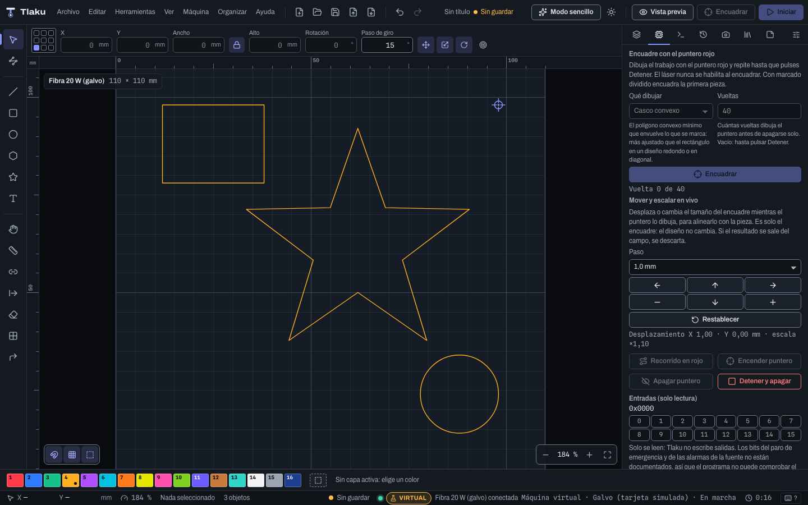

# Galvo (experimental)

Un láser **galvo** mueve el haz con dos espejos giratorios en vez de mover un cabezal: es el que usan los marcadores de **fibra**, **UV** y **CO2 galvo** para grabar metales, plásticos y vidrio a gran velocidad. Lo controla una tarjeta (la más común es la **LMCV4-FIBER-M**, que se maneja con el programa EZCAD2) conectada por USB.

> **Lee primero [Seguridad del galvo](13d-galvo-seguridad.md).** Un láser de fibra es **clase 4** y su haz es **invisible**: puede dañar la vista de forma permanente, incluso por una reflexión difusa, y quemar lo que haya detrás. Esta página explica qué hace Tlaku; esa explica cómo no hacerte daño.

> **Estado: experimental y sin probar con una tarjeta real.** Todo el soporte galvo se validó contra una **tarjeta simulada** que escribimos nosotros: eso prueba que nuestro código es coherente con lo que *creemos* que dice el protocolo, no que una tarjeta de verdad lo interprete igual. Las unidades de la velocidad, la frecuencia, la potencia y los retardos vienen del código de otros proyectos de código abierto y **no están verificadas con hardware**.

> **Dónde se maneja:** el galvo se maneja **desde la app** (esta página, en «El galvo en la app») y **desde la línea de comandos** (`tlaku galvo`, más abajo). Las dos usan el mismo motor y las mismas reglas de seguridad. (La línea de comandos usa el idioma de `TLAKU_LANG` o `LANG`; sin ninguno, español. Los mensajes citados en esta página están en español.)

## Qué puede hacer hoy

- **Listar** las tarjetas conectadas y decir si son compatibles, sin abrir nada (`tlaku galvo list`).
- **Leer el estado** de la tarjeta, sin mover ni encender nada (`tlaku galvo status`).
- **Encuadrar con el puntero rojo**: dibuja el rectángulo del diseño (o su contorno) en bucle, **sin habilitar nunca el láser** (`tlaku galvo light`).
- **Marcar** el diseño, o recorrerlo entero con el láser deshabilitado y el puntero rojo (`tlaku galvo mark`, con `--red-only`).
- **Compilar y revisar** el trabajo sin conectar con nada (`--dry-run`), volcar la lista de comandos a un archivo (`--dump`) y probar todo contra la tarjeta simulada (`--emu`).

También hay: parámetros por capa (frecuencia, ancho de pulso, retardos, saltos, repeticiones), bamboleo, [grabado 3D por cortes y corrección de cilindro y cono](12b-grabado-3d-y-cilindro.md), y la secuencia del marcado dividido, repetido y rotativo.

## Qué tarjetas se aceptan

Solo la **`9588:9899`** ("BJJCZ USBLMCV4", la LMCV4-FIBER-M de EZCAD2). Cualquier otro identificador USB se **rechaza**, con el motivo: los clones `9588:9980`, `9588:9990` y `9588:9999` (no se sabe si usan el mismo protocolo) y la tarjeta sin firmware `9588:9880` (necesita cargar el firmware del FPGA, y Tlaku no escribe en la tarjeta). Las tarjetas **EZCAD3 / DLC** y las **BSL** quedan fuera de alcance: no hay documentación pública de su protocolo.

Ver cuáles hay y si valen:

```
tlaku galvo list
```

Sin tarjetas conectadas dice «No hay dispositivos BJJCZ (USB 9588:xxxx) conectados».

## El galvo en la app



### Dar de alta la máquina, con verificación sin láser

**Máquina > Agregar máquina…** ofrece **Galvo (fibra o UV, EZCAD2) por USB**, que busca tarjetas BJJCZ por USB (no usa puerto serie). Si no hay ninguna, puedes agregar la máquina igual y probar con la **tarjeta simulada**. El alta es un asistente de cuatro pasos:

1. **Lente y fuente.** Elige la fuente (**Fibra Q-switched**, **Fibra MOPA**, **UV** o **CO2 galvo**). Una lente F-theta se fabrica para una longitud de onda: una lente de otra longitud enfoca mal y puede dañarse con la potencia de la fuente.
2. **Campo.** El lado del campo de tu lente (110, 150, 200, 300 mm u **Otro tamaño**). Se usa como cama de la máquina.
3. **Tarjeta.** La tarjeta a verificar, o **Tarjeta simulada (sin hardware)**. Solo se acepta la LMCV4-FIBER-M (USB `9588:9899`).
4. **Verificación sin láser.** **Verificar sin láser** lee la tarjeta (serie, versión, estado y entradas) y comprueba cuatro cosas: **Tarjeta reconocida**, **Tarjeta en reposo**, **Encuadre del campo** (que el perfil se compila) y **Enclavamiento por entrada**. **No mueve los espejos, no enciende el puntero ni la fuente.** Con una tarjeta USB real pide antes la confirmación de seguridad (gafas, recinto, paro de emergencia); si no la das, no se abre la tarjeta. Si algo falla, lo dice antes de que conectes.

Las frecuencias, los anchos de pulso, los retardos y la corrección que trae el perfil son **valores de partida**: complétalos con el manual de tu fuente. Una fuente **MOPA** necesita la lista de anchos de pulso en el perfil antes de conectar.

### El perfil galvo

En **Gestionar dispositivos…**, un perfil galvo tiene su propio grupo **Galvo (JCZ/BJJCZ, EZCAD2)** y oculta lo que no aplica (G-code, S máxima, baudios, macros, aceleración, ejes Z y U). La «cama» es el campo de la lente, con el origen abajo a la izquierda (es el único origen válido). Ahí están:

- **Lente y fuente**: campo, fuente, potencia de la fuente (solo informativa, sale en el aviso de seguridad), **potencia máxima permitida** (una capa que la supere se rechaza), **rango de frecuencia** y **anchos de pulso**.
- **Retardos y saltos** por defecto (cada capa puede usar los suyos con **Sobrescribir retardos**) y la velocidad del **puntero rojo**.
- **Desfase del puntero rojo** (**X** e **Y**, de −50 a 50 mm): dónde cae el puntero respecto al haz. El encuadre y el recorrido en rojo lo **compensan**, para que el puntero pase por donde marcará el láser. **Una marca real nunca lo usa.** Para medirlo, marca un punto de prueba a baja potencia y mide a qué distancia cae el puntero.
- **Overscan de rellenos e imágenes** (0 a 20 mm; de fábrica 0). Ver abajo.
- **Corrección del campo**: escala, desplazamiento y giro, montaje del cabezal (invertir ejes o intercambiar X e Y) y barril, trapecio y sesgo, además de la anotación del archivo `.cor` (solo informativa). Un **asistente de calibración del campo** (en tres pasos: marca una rejilla de dos cuadrados, mídela con una regla y calcula la escala y el barril) afina esos valores; lo que mide es el error que **queda** con la corrección actual, así que repítelo hasta que el error sea pequeño. Es un modelo propio de Tlaku, no verificado con una lente real.
- **Cilindro y cono**, **marcado dividido y repetido** y **Entradas requeridas** (abajo).

### Conectar y marcar

Con una tarjeta USB real, cada conexión abre **Seguridad láser antes de conectar** y pide marcar **las tres** confirmaciones (gafas con la densidad óptica correcta para la longitud de onda y la potencia, láser dentro de un recinto cerrado, y paro de emergencia al alcance). **Se pide en cada conexión; Tlaku no lo recuerda.** Con la tarjeta simulada no hace falta.

Al **Iniciar**, el diálogo dice **Galvo: el láser disparará**, repite el aviso del haz invisible y que **no hay pausa**, y resume el campo, el tiempo estimado y la potencia máxima. Con marcado dividido o repetido dice en cuántos pasos se marca y cuántas veces tendrás que **mover el material** y pulsar **Ya moví el material: continuar** (la tarjeta no mueve la mesa: Tlaku se detiene y espera). **Detener** apaga la fuente y vacía la lista de la tarjeta; si la tarjeta no confirma apagar la fuente, un aviso rojo (**La fuente pudo quedar ENCENDIDA**) dice que cortes la energía **ya**.

### Encuadre con el puntero rojo

En el panel **Máquina**, **Encuadre con el puntero rojo** dibuja el trabajo con el puntero **sin habilitar nunca el láser**:

- **Qué dibujar**: **Rectángulo** (el que ocupa el trabajo), **Contorno** (los trazos del trabajo), **Casco convexo** (el polígono convexo mínimo que envuelve lo que se marca: más ajustado que el rectángulo en un diseño redondo o en diagonal) u **Objetos sueltos** (un rectángulo por cada objeto separado, para ver dónde caerá cada pieza).
- **Vueltas**: cuántas vueltas dibuja antes de apagarse solo. Vacío (**∞**) repite hasta que pulses **Detener y apagar**. Mientras corre, un **contador** dice **Vuelta 3 de 5** (o **Vuelta 3** si no pusiste un número).
- **Mover y escalar en vivo**: mientras el puntero dibuja, las flechas y los botones **Más grande** y **Más chico** (con el **Paso** que elijas) desplazan o cambian el tamaño del encuadre para alinearlo con la pieza, y debajo ves el desplazamiento y la escala (`Desplazamiento X 1,00 · Y 0,00 mm · escala ×1,10`). **Restablecer** lo deja como estaba. **Es solo el encuadre: el diseño no cambia.** Si el resultado se saldría del campo, el ajuste se descarta (**Ese ajuste dejaba el encuadre fuera del campo**). Los botones solo se activan mientras hay un encuadre en curso.
- **Recorrido en rojo** recorre **todo** el trabajo con el láser deshabilitado y el puntero rojo; **Encender puntero** y **Apagar puntero** lo manejan a mano.

### Overscan

Un galvo tiene poca inercia, así que **de fábrica no usa overscan** (0 mm). Si lo necesitas, en el perfil puedes poner **Overscan de rellenos e imágenes**: milímetros extra al principio y al final de cada línea, que los espejos recorren **con el láser apagado**, a la velocidad de marcado y sin retardo de salto, para que el trazo empiece a velocidad constante. Una capa puede fijar el suyo. **El diseño más el overscan debe caber en el campo.** No se ha verificado con hardware.

### Entradas requeridas (enclavamiento por entrada)

Si la tapa o el paro de emergencia de tu máquina llegan a una entrada de la tarjeta, en el perfil, **Enclavamiento por entrada**, eliges para cada una de las 16 entradas si **No importa**, **Debe estar alta** o **Debe estar baja**. **Antes de cada trabajo y de cada encuadre** Tlaku lee las entradas y exige ese estado; si no se cumple, **no hace nada**, y el panel dice **ABIERTO: no se marca ni se encuadra**. Cuando se cumple, dice **Cumplido**.

> **Ojo:** los bits del paro de emergencia y de las alarmas de tu fuente **no están documentados**. En el panel, **Entradas (solo lectura)** muestra las 16 entradas en vivo: acciona el paro de emergencia o abre la tapa, mira qué entrada cambia y ponla en el perfil. **Mientras no lo midas y lo fijes, Tlaku no puede comprobar el enclavamiento por ti.** Solo se leen entradas: Tlaku no escribe salidas.

## Probar sin máquina: la tarjeta simulada

Todo lo siguiente se puede hacer sin comprar nada. Con un diseño de ejemplo (`cuadro.svg`, un cuadrado de 30 mm):

```
tlaku galvo mark cuadro.svg --emu --frequency 30 --power 5
```

Tlaku compila el trabajo, lo manda a la tarjeta simulada y resume lo que ocurrió: cuántas tandas y comandos, que «la fuente estuvo armada durante el trabajo» y que «la fuente se apagó y la lista se vació», y lo que vio el emulador (tramos con el haz saliendo, que la fuente terminó apagada y 0 violaciones del protocolo).

Para ver el encuadre con el puntero rojo (dos vueltas y termina):

```
tlaku galvo light cuadro.svg --emu --loops 2
```

Y para solo compilar y revisar, sin conectar con nada:

```
tlaku galvo mark cuadro.svg --dry-run --frequency 30
```

que imprime algo como «Lista de la tarjeta: 18 comandos en 1 tandas de 256; 4 marcas (120.0 mm), 1 saltos (70.7 mm) …» y termina con «Simulacro (--dry-run): no se conectó con la tarjeta».

## El perfil de la máquina: banderas

Desde la línea de comandos, el perfil de tu máquina se escribe en cada comando:

| Bandera | Qué es | De fábrica |
|---|---|---|
| `--field` | Lado del campo de la lente F-theta, en mm (110, 150, 200, 300…) | 110 |
| `--source` | `fiber-q` (fibra Q-switched), `fiber-mopa`, `co2` o `uv` | `fiber-q` |
| `--freq-range MIN-MAX` | Rango de frecuencia de **tu fuente**, en kHz. Fuera de él no se envía nada | `20-80` |
| `--pulse-widths` | Anchos de pulso permitidos en ns, separados por comas (obligatorio con `fiber-mopa`) | — |
| `--max-power` | Potencia máxima del perfil, en %. Una capa que la supere es un error | 100 |
| `--light-speed` | Velocidad del puntero rojo, en mm/s | 2000 |
| `--jump-speed` | Velocidad de los saltos, en mm/s | 4000 |
| `--invert-x`, `--invert-y`, `--swap-xy`, `--rotate` | Cómo está montado el cabezal: negar un eje, intercambiarlos o girar el campo (grados, antihorario) | — |
| `--require-input MASK=VALOR` | Enclavamiento por software (ver [Seguridad del galvo](13d-galvo-seguridad.md)) | — |

Y los parámetros del marcado (`mark`):

| Bandera | Qué es | De fábrica |
|---|---|---|
| `--frequency` | Frecuencia en kHz. **Obligatoria** y dentro del rango del perfil | — |
| `--pulse-width` | Ancho de pulso en ns (fuentes MOPA y UV; tiene que estar en `--pulse-widths`) | — |
| `--mark-speed` | Velocidad de marcado, en **mm/s** | 1000 |
| `--power` | Potencia en % | **10** (baja a propósito) |
| `--laser-on`, `--laser-off`, `--polygon`, `--end-delay` | Retardos del láser en microsegundos (pueden ser negativos los de encendido y apagado) | los del perfil |
| `--repeat` | Veces que la tarjeta repite el trabajo | 1 |

Los demás argumentos del diseño (`--layer`, `--mode`, `--interval`, `--image-size`…) son los mismos que `tlaku gcode`; `tlaku galvo mark --help` los lista.

Un ejemplo con una fibra MOPA de campo 150 mm:

```
tlaku galvo mark logo.svg --dry-run --source fiber-mopa --pulse-widths 4,50,200 \
  --pulse-width 50 --frequency 40 --power 15 --field 150
```

Los anchos de pulso del ejemplo son inventados: escribe los que admite **tu** fuente según su manual. Tlaku rechaza un ancho que no esté en la lista y una frecuencia fuera del rango, con un mensaje claro («frecuencia 5 kHz fuera del rango del perfil (20 a 80 kHz)»).

## Cómo se coloca el diseño

El campo de la lente es un **cuadrado centrado**. En la línea de comandos el diseño se coloca con el origen (abajo a la izquierda) en la esquina inferior izquierda del campo y la Y hacia arriba. Un diseño que se sale del campo **no se marca** (`mark` falla); el encuadre te dice el rectángulo exacto («Encuadre: X 5.00 a 35.00 mm, Y 5.00 a 35.00 mm (campo de 110 mm)»).

De fábrica un galvo **no usa overscan**: los espejos tienen poca inercia, así que los rellenos y las imágenes salen sin el margen que sí necesita un láser de pórtico. Si lo necesitas, el perfil tiene un **Overscan de rellenos e imágenes** (ver «El galvo en la app»).

## Un flujo seguro: del emulador a la fuente

1. **Sin máquina.** `--emu` y `--dry-run` hasta que entiendas la salida.
2. **Tarjeta conectada, sin fuente láser** (el cable de la fuente desconectado). Es la prueba de [Seguridad del galvo](13d-galvo-seguridad.md): identificar la tarjeta y mover los espejos sin que nada pueda emitir.
3. **Con la fuente, `--red-only`**: recorre todo el trabajo con el **láser deshabilitado** y el puntero rojo, para ver el recorrido real.
4. **Marcar de verdad**, con la potencia mínima, sobre un material de desecho, con gafas, recinto y paro de emergencia.

Con hardware real, **todo menos `list`** exige la bandera `--i-understand-laser-safety`; sin ella ni siquiera se abre el USB. `mark` además pregunta «El láser DISPARARÁ. ¿Gafas puestas, recinto cerrado, obturador y paro de emergencia listos, y el material correcto bajo el haz? [s/N]»; `--yes` omite la pregunta, y **no deberías usarlo** en tus primeras pruebas. **Ctrl+C** detiene el trabajo y apaga la fuente.

## Lo que Tlaku no hace (a propósito)

- **No hay pausa**: solo se puede detener. Ver [por qué](13d-galvo-seguridad.md).
- No escribe la **EEPROM**, el firmware, la **tabla de corrección** ni la configuración de la tarjeta. Si tu tarjeta necesita inicializarse, hazlo antes con EZCAD2.
- No aplica los archivos de corrección **`.cor`** de EZCAD (se lee su estructura, pero no se sabe qué significan los números). La corrección del campo (escala, giro, barril, trapecio, sesgo) la calcula Tlaku en el equipo con un modelo propio, y supone que la tabla de la tarjeta es la identidad.
- No marca **al vuelo**, no maneja ejes Z ni mesas, y no escribe salidas arbitrarias.
- No calibra la lente con los **9 puntos** ni los archivos `.cor` de EZCAD (el asistente de la app mide dos cuadrados y calcula escala y barril con un modelo propio), y no importa archivos de configuración de EZCAD.

Siguiente: [Seguridad del galvo](13d-galvo-seguridad.md)
