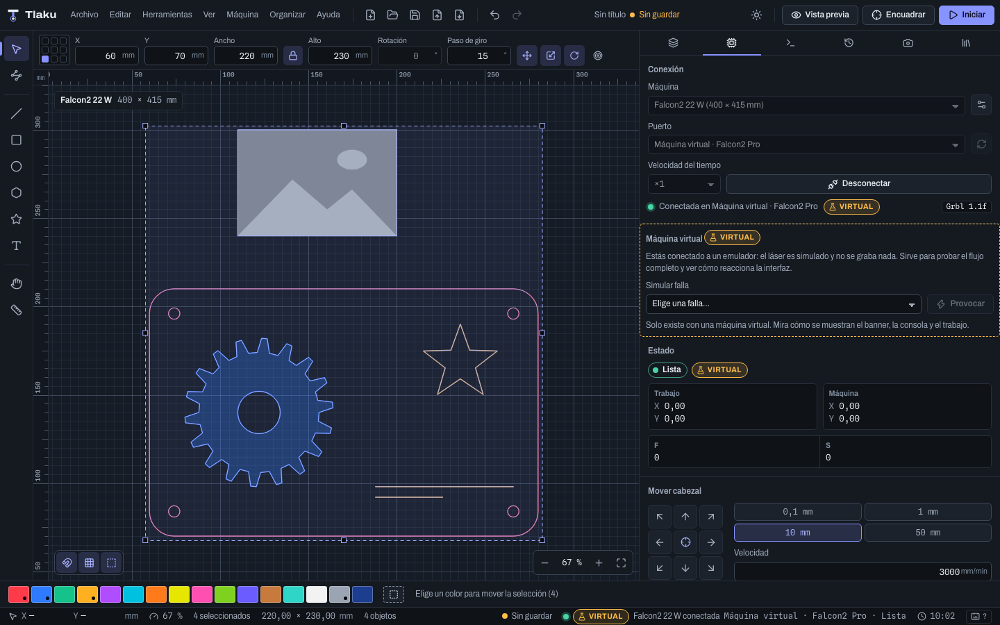

# Getting started

On this page you go from zero to a ready job: you install Tlaku, import a design, check its layers, look at the preview, test it with a virtual machine and save the project. You do not need a laser to follow along.

> **Heads up:** Tlaku is a beta. It has been tested on a real Creality Falcon2 Pro 22 W (line engraving, fills, images, pause, stop, resuming after a power cut, live view, and phone control). Cutting at high power has not been tested yet, and other machines have only been tested with emulators. When you connect a real laser, start with low power and under supervision. Details in [Supported controllers](13-controladoras.md).

## 1. Install

Tlaku is in beta. The latest version is 0.1.2, and you download it from the repository's [Releases](https://github.com/jahziel1/tlaku/releases/latest) page:

| System | File |
|---|---|
| macOS 11 or later (Apple Silicon and Intel) | Universal `.dmg`: open it and drag Tlaku to Applications |
| Windows 10 or later | `x64-setup.exe` (installer) or `.msi` (English or Spanish) |
| Linux x86_64 | `.deb` or `.AppImage` |
| Linux ARM64 (Raspberry Pi 4 and 5 with a 64-bit system; experimental) | `.deb` (`_arm64`) or `.AppImage` (`_aarch64`) |
| Linux with Flatpak (x86_64 and aarch64) | `.flatpak`. **Untested** so far |

**With Homebrew (macOS):** `brew install --cask jahziel1/tlaku/tlaku`.

**winget (Windows):** the package has been submitted to Microsoft and is under review; you cannot install it that way yet. For now, use the installer from the table.

The application is not signed with a paid certificate, so the system will warn you the first time:

- **macOS.** Tlaku is not notarized by Apple. The first time, macOS warns that it cannot check the app: open Tlaku once, go to **System Settings > Privacy & Security**, and click **Open Anyway** (on macOS 14 or earlier, right-clicking Tlaku and choosing **Open** also works). If it still says the app is **damaged**, see [Troubleshooting](15-solucion-de-problemas.md#macos-says-the-app-is-damaged).
- **Windows.** SmartScreen may show **Windows protected your PC**: choose **More info** and then **Run anyway**.
- **Linux.** To use the serial port, add your user to the `dialout` group (see [Troubleshooting](15-solucion-de-problemas.md)).

After installing, Tlaku can check for new versions by itself: see [Updates](02b-preferencias-y-atajos.md#updates).

**Raspberry Pi (experimental).** You need a **64-bit** system (in a terminal, `uname -m` must say `aarch64`), for example 64-bit Raspberry Pi OS or Ubuntu ARM, on a Pi 4 or 5 with 4 GB of RAM or more. The Pi 3 or earlier and 32-bit systems do not work. If the window comes up blank or garbled, start Tlaku like this: `WEBKIT_DISABLE_COMPOSITING_MODE=1 tlaku`. It has not been tested on a real Raspberry Pi yet; if you try it, share your experience in a machine report.

## 2. Open it and get to know the window

When you open Tlaku you will see the machine bed empty, with the message **The bed is empty**. At the top are the menus and buttons, on the left the tools, on the right the tabbed panel, and at the bottom the strip of layer colors. The details are in [The interface](02-interfaz.md).

## 3. Import a design

1. Choose **File > Import Design…** (`Ctrl/Cmd+I`), or drag the file onto the window.
2. Accepted formats: SVG, DXF, PDF, AI, HPGL (`.plt`), G-code, and the images PNG, JPG, BMP, WebP, TIFF, GIF and TGA.
3. Tlaku creates **one layer for each color** in the file. An image goes to its own gray layer, in **Image** mode.
4. If the importer warns about something (shapes it could not read, for example), a persistent notice appears: read it and check that the design is complete.

If you need to choose the scale, the DPI, the unit of a DXF or the page of a PDF, use **File > Import with options…**. All the formats and their options are in [Importing and exporting](03b-importar-y-exportar.md). LightBurn projects (`.lbrn`, `.lbrn2`) can also be imported: see [Coming from LightBurn](14-desde-lightburn.md). More about images in [Images](06-imagenes.md).

## 4. Check the layers

Open the **Layers** tab (`Ctrl/Cmd+1`). Each row is an operation: color, mode, speed, power and its label (**Engrave**, **Line** or **Cut**).

- Click a row: it becomes the active layer. `Enter` or double-click opens its settings.
- The eye hides the layer on the canvas only; the bolt decides whether it is **sent to the machine**.
- A new layer starts with cautious values: 1000 mm/min, 20 % power and 1 pass. They are not values for any particular material: adjust them yourself.

All the parameters are in [Layers and cut settings](05-capas-y-ajustes.md).

## 5. Place the design

Select with the **Select** tool (`V`) and move with the mouse, with the arrow keys (1 mm; `Shift` 10 mm; `Alt` 0.1 mm) or type exact values in the numeric bar at the top (X, Y, Width, Height, Rotation). Check that everything stays inside the bed: if something sticks out, the preview tells you.

## 6. See the preview

Press **Preview** (or `P`). Tlaku calculates the path, draws it on the canvas and shows the estimated time. Play back the path with the play button or with `K`. Details in [Preview and cut order](07-vista-previa.md).

## 7. Test with the virtual machine

This is how you go through the whole flow without hardware:

1. Open the **Machine** tab (`Ctrl/Cmd+2`).
2. Under **Port** choose **Virtual machine · Falcon2 Pro** (the virtual ones appear at the end of the list).
3. Press **Connect**. You will see the **Virtual** label in the panel and in the status bar.
4. Press **Frame** (`F`) and then **Start** (`Ctrl/Cmd+Enter`). Start never sends straight away: first **Laser ready and area clear?** appears with a checklist; only **Start job** sends it.

Nothing is engraved: the laser is simulated. To connect a real machine, see [Connecting your machine](08-conectar-maquina.md) and [Sending jobs safely](09-enviar-con-seguridad.md).

## 8. Save

- **File > Save** (`Ctrl/Cmd+S`) saves the project as `.tlaku`. **Save As…** is `Ctrl/Cmd+Shift+S`.
- **File > Export G-code…** (`Ctrl/Cmd+Shift+E`) writes the job as G-code, in case you want to send it with another program. It needs at least one layer with output and objects.
- To take your **design** to another program, use **File > Export SVG…**, **DXF…**, **PNG image…** or **PDF…** (see [Importing and exporting](03b-importar-y-exportar.md)).
- If you close with unsaved changes, Tlaku asks whether you want to save.
- **Autosave:** while you work, Tlaku saves a recovery copy every minute (if there are changes). If the application closes abruptly, it offers to **recover** your work the next time you open it. It does not replace saving: see [Preferences, shortcuts and autosave](02b-preferencias-y-atajos.md).

Next: [Simple mode](01b-modo-sencillo.md)
