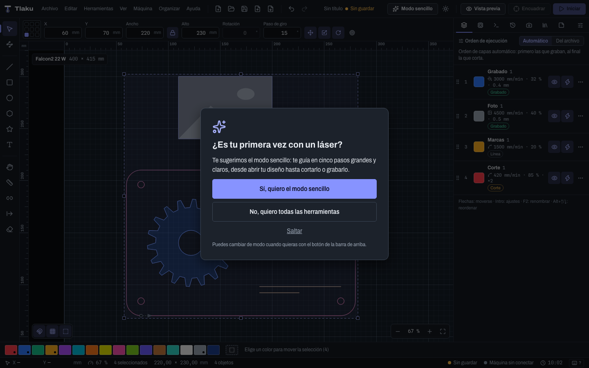
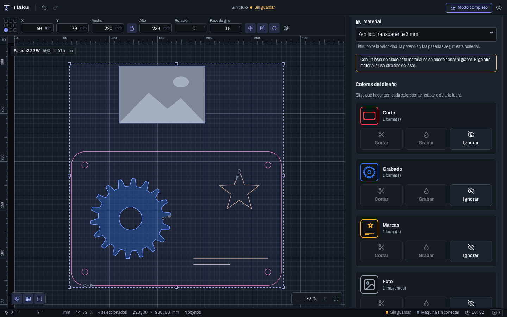
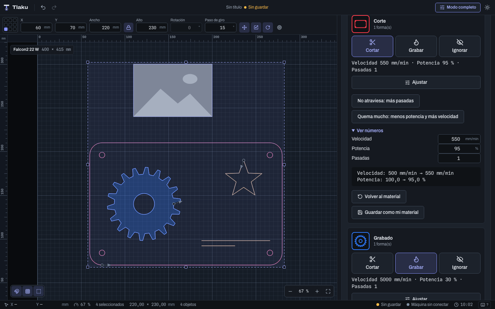
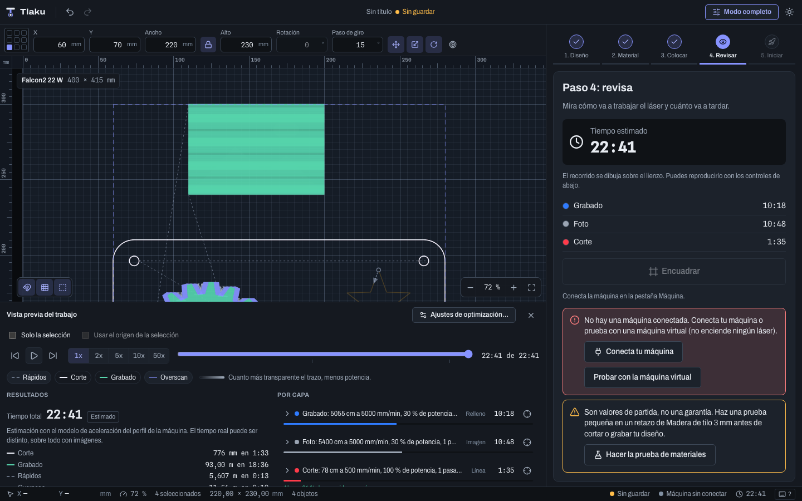
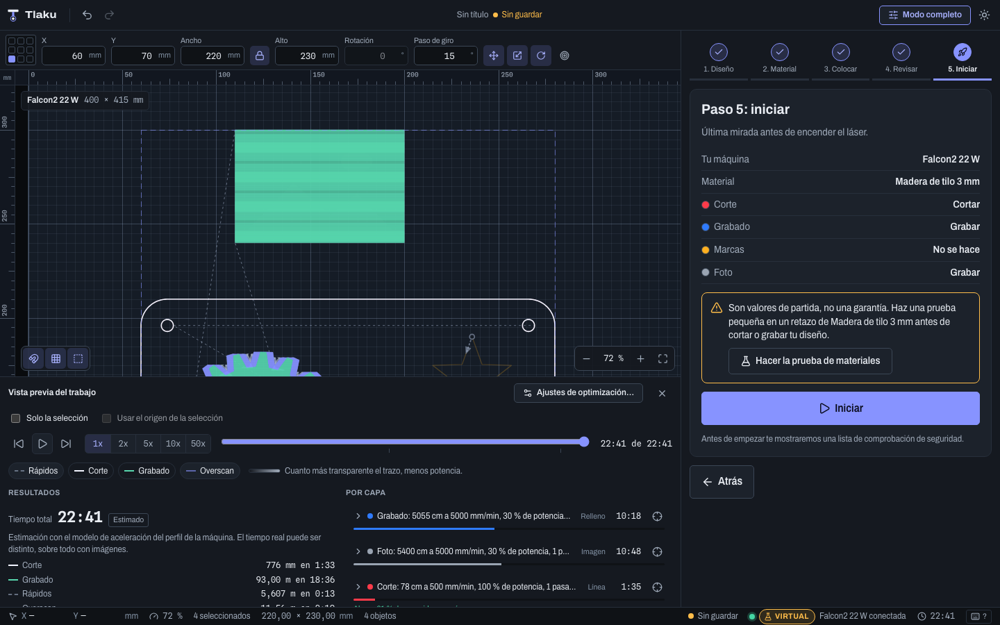

# Simple mode

Simple mode is a guided version of Tlaku for people who have never used a laser. Instead of panels, menus and tools, you see **one step at a time** with big buttons: open the design, choose the material, place it, review and start. Tlaku sets the speed, power and passes for you, based on the [material library](11-materiales.md).

> **Heads up:** the settings that simple mode picks are **starting points**, not a guarantee. They come from tables published by manufacturers and guides, not from your machine. Always do a small test on a scrap of the same material before cutting or engraving your design, and never leave the laser unattended. None of this has been tested with a real machine yet: start with the virtual machine.

## How to enter and leave

The first time you open Tlaku, the question **Is this your first time with a laser?** appears.

- **Yes, I want simple mode** enters simple mode.
- **No, I want all the tools** and **Skip** leave you in full mode, the usual one.

Your answer is saved and the question does not appear again. To switch modes whenever you like, use the button in the top bar: it says **Simple mode** when you are in full mode and **Full mode** when you are in simple mode. Switching **does not touch your design**: the document, the layers and the undo history are the same in both modes; only what is shown changes. You can do part of the work in one mode and continue in the other.

In simple mode the menus, the side tools, the color palette and the docked panel are hidden; the canvas and the top bar stay, and the steps panel appears on the right.

## The five steps

At the top of the panel there is a bar with the five steps: **1. Design**, **2. Material**, **3. Place**, **4. Review** and **5. Start**. You move forward with **Next** and back with **Back**; you can also return to any step you have already been through by tapping it in the bar. **Next** is disabled and says why when something is missing (for example, "Pick a material to continue.").

### Step 1: your design

Three big cards: **Open a file** (SVG, DXF, PDF, images and more, as in [Importing and exporting](03b-importar-y-exportar.md)), **Art library** (hearts, frames, stars, boxes) and **Try an example**, a ready-made drawing to practice with. Once there is a design, the step tells you how many objects it has, in how many colors and how big it is.

### Step 2: material and what to do with each color

This is the heart of simple mode.

1. **Your machine**: choose the profile. You cannot change it while the machine is connected.
2. **How many watts is your laser?** Tlaku needs the power to choose the settings for the right class (for example, **Diode 20 W**). Choose the closest value; it is usually written on the laser or its box. It is remembered for that machine. If you choose **I don't know**, Tlaku uses the **most cautious** settings and says so in the notices. If there are no settings for your exact power, it uses those of the closest class and also warns you.
3. **Material**: the list comes from the built-in library and from your own materials (only those that have settings for your machine). Below it, it explains where each setting came from ("Cut: Setting for your machine class").
4. **Colors in the design**: one card for each color (each layer with objects). For each one you choose:
   - **Cut**: goes through the material following the path.
   - **Engrave**: marks the surface (fills and images).
   - **Ignore**: that color is not sent to the machine.

   Images can only be engraved or ignored. If an action is not possible, the button is disabled and below it says why: "This material has no cutting settings.", "This material only has settings for another machine or another power.", and so on.

While you decide, the panel shows **notices** in boxes: that these are starting values (with the **Run the material test** button), whether the source gives a range of values, and whether there is text not converted to curves or open paths in what you are about to cut.

**Clear acrylic with a diode.** A diode laser does not cut clear acrylic (the light passes through it). If you choose that material with a diode machine, **Cut** is disabled on all the cards, with the explanation "This material can't be cut with your type of laser." Use opaque or colored acrylic, or a CO2 laser.

#### Adjust, Show numbers and Save as my material

On each color that is cut or engraved, below the values (**Speed**, **Power**, **Passes**) there is an **Adjust** button with one-sentence controls:

- **Cut**: **Doesn't cut through: more passes** and **Burns too much: less power, more speed**.
- **Engrave**: a **Lighter or darker** control, from "Much lighter" to "Much darker", with "As the material says" in the middle.

**Show numbers** unfolds the exact values so you can type them by hand. Whatever you change is listed as "What you changed from the material" (for example, `Speed: 150 mm/min → 165 mm/min`). With **Back to the material** you return to the original values. And with **Save as my material**, what worked for you goes into your library (as "My cut" or "My engraving") to use later, also in full mode.

### Step 3: put it on the bed

It tells you how big your design is and how big the bed is. You can **drag the design on the canvas** or move it with the nine position buttons (corners, edges and **Center on the bed**). If the design goes beyond the bed, a notice appears with two ways out: **Shrink to fit** or **Split into tiles** (see [Tiling and auto feeder](09d-tiling-y-alimentador.md)). You cannot move on while it sticks out.

### Step 4: check it

It shows the **estimated time** and the time for each color, and draws the laser path on the canvas, with the usual preview so you can play it back (see [Preview](07-vista-previa.md)). With **Trace outline**, the laser traces the edge of the design with the beam off, so you can see where it is going to work.

### Step 5: start

A summary of what is going to happen (machine, material and what is done with each color), the machine's port and any notices still pending. If no machine is connected, the notice offers **Connect your machine** or **Try the virtual machine**, which does not turn on any laser.

**Start** does not fire the laser right away: first the usual **safety checklist** is shown, and the job goes through the same pre-flight check as in full mode. See [Sending jobs safely](09-enviar-con-seguridad.md).

## What simple mode does not do

- It does not replace the material test: the values are starting points. To find the ones for your machine, use **Run the material test** ([Materials](11-materiales.md)).
- It does not have every operation (offset, nesting, variable text, Print & Cut, galvo, camera...). For those, switch to full mode with the button in the top bar; your design follows you.
- If there are no materials with settings for your machine, the list comes up empty and the panel sends you to full mode: add one in the **Materials** tab.

Next: [The interface](02-interfaz.md)
