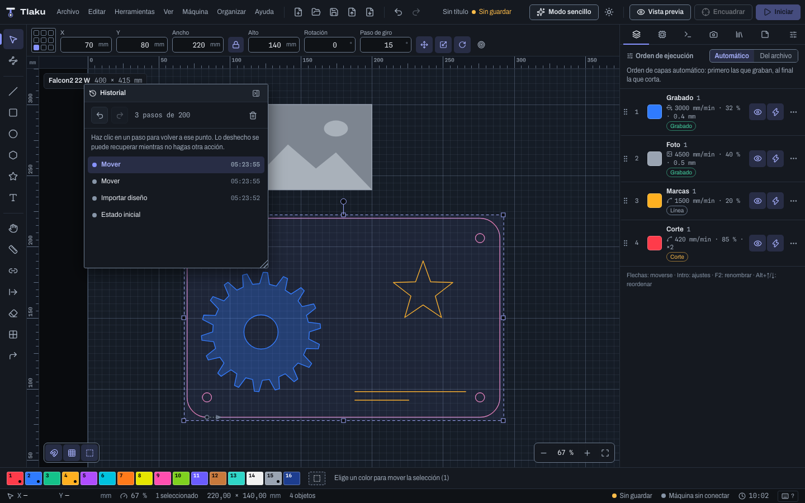

# Guides, tabs, start point and project

Aids for placing and cutting with more control: **guides** that attract objects, **manual tabs** that you leave wherever you want (the small uncut bridges that hold a part in place; in the Spanish manual they are called "puentes"), the **start point and direction** of each cut, the project's **notes** and **templates**, a second **window**, the right-hand panel's tabs arranged your way (also as floating panels) and the **art library** with ready-made drawings. Everything that changes the design is an **Undo** step (`Ctrl/Cmd+Z`). Shortcuts are written with `Ctrl/Cmd`: `Cmd` on macOS, `Ctrl` on Windows and Linux.

## Guides

Guides are reference lines that are not engraved or cut.

- **Create:** drag from a ruler toward the canvas. From the top ruler comes a **horizontal** guide; from the left one, a **vertical** one.
- **Move:** drag the guide. Objects and snapping **stick** to it; hold `Alt` to suspend snapping for that gesture.
- **Delete:** drop it onto the ruler or outside the canvas (the notice "Release to delete the guide" appears).
- **Exact position:** **View > Guides…** (or double-click a ruler) lists all the guides with their **X position** or **Y position**; there you can also **add** a vertical or horizontal one, **delete** one or **delete all**.
- **Show or hide:** **View > Show guides**.

Guides are saved in the project and every change can be undone.

**Example: centering an engraving on an 85 × 55 mm card.** Create a vertical guide at X = 42.5 and a horizontal one at Y = 27.5 with the dialog; snapping will stick the center of the engraving to the cross.

> **Tip:** do not confuse guides with the **Guides layer** in the color palette (the last, dotted square): that is one more layer, for drawing references that never go to the machine. The guides in this section are infinite lines, not objects. There are no temporary alignment guides yet (the ones that appear only while you drag).

## Manual tabs

**Tabs** are stretches that the laser leaves uncut so that the part does not come loose (see [Layers and cut settings](05-capas-y-ajustes.md)). Besides being spread automatically per layer, you can now **place them yourself**.

1. Choose the **Manual tabs** tool (`U`).
2. Click on an object's **outline**: a tab is placed there. A click on a tab already placed **removes** it. As you move the pointer, the cursor tells you what will happen.
3. For the tab to appear in the job, the object's layer must be a **Line** layer with **Leave tabs uncut** turned on. If not, a notice says so and the tab is drawn turned off.

An object with manual tabs **ignores the automatic ones** of its layer: its tabs are the ones you placed. The tab **width** is the layer's. They are visible on the canvas and as gaps in the [preview](07-vista-previa.md). **Arrange > Clear manual tabs** removes them from the selected objects and goes back to the automatic ones.

**Example: a part that shifts when the last side is cut.** Place two tabs, one on each long side, right where the board rests on the grid. When it finishes, the part is held by two points that you break by hand and sand.

> **Heads up:** manual tabs use their layer's **Tab power** (see [Layers and cut settings](05-capas-y-ajustes.md)), just like automatic ones; they do not have their own power per tab. They cannot be dragged: remove them and place them again. With kerf or with lead-in and lead-out, remember that an outline with tabs is no longer "whole" and does not receive lead-in, lead-out or overcut.

## Start point and direction

By default the [planner](07-vista-previa.md) decides where each closed outline starts and in which direction it runs. With the **Start point** tool (`Q`) you decide.

| Gesture | What it does |
|---|---|
| **Click** on a closed outline | The cut starts there. The point sticks to the nearest **vertex**. |
| **Alt**+click | Free point, without sticking to a vertex. |
| **Shift**+click | **Reverses** that object's direction. |
| **Ctrl/Cmd**+click | **Resets**: removes the fixed start and direction. |

An **arrow** on the outline shows the start and the direction. **View > Show start and direction** turns it on or off. In **Arrange** there are **Reverse direction** (for the whole selection, also open paths) and **Clear fixed start and direction**.

The planner **respects what you fixed**: it does not change that outline's start point or direction, even with kerf. It still decides the order in which the figures are cut, and the outlines you did not fix keep being optimized as usual.

**Example: putting the entry mark in a hidden corner.** A cut with a diode laser leaves a small mark where it starts and ends. With `Q`, set the start at a back corner of the part so the mark is not visible. To avoid over-burning the visible edge, combine it with **Lead-in to the contour** in [advanced cutting](05-capas-y-ajustes.md).

Images have no direction or start.

## Project notes

The **Notes** tab of the right-hand panel (`Ctrl/Cmd+7`, or **View > Project notes**) is a notebook for the project: material, thickness, settings that worked, to-dos. It is **saved with the project** and **is not sent to the machine**. The character count is shown at the bottom.

## Templates

A **template** is a starting point: it saves the design, layers and settings of the current project.

- **File > Save as template…**: asks for a name (if one with that name already exists, it asks whether you want to replace it).
- **File > New from template…**: lists the saved templates; when you pick one, a new project opens with its design, its layers and its settings. From there you can **delete** a template (the projects you made with it do not change).

Templates are saved in Tlaku's configuration folder, not inside projects.

**Example: your acrylic workbench.** Set up the layers (for example, a red cut and a blue engraving with the values you have already tested), save the template "Acrylic 3 mm" and every new job starts with your values.

## New window

**File > New window** (`Ctrl/Cmd+Shift+N`) opens another Tlaku window with an **independent document**: it has its own history and selection. What they share is the machine (the connection and the job in progress) and the preferences. It is useful for copying from one project to another or consulting a design while you work on another.

Recovery does not mix windows: each one marks its autosave copy as alive and the **Unsaved work found** notice only offers orphan copies (those of windows already closed). This is checked with real windows in the application's smoke test (`npm run smoke:tauri`): it opens a second window and checks that it exists and answers, that preferences are shared, that each window only sees the copy of its own document, that closing it leaves its copy available to recover, and that it closes cleanly. Limit: the registry belongs to a single program; two copies of Tlaku open at the same time do not see each other. Save your projects often.

## Right-hand panel tabs your way

The right-hand panel's tabs (**Layers**, **Machine**, **Console**, **History**, **Camera**, **Materials** and **Notes**) can be reordered and hidden:

- **Drag** a tab to move it, or use `Alt+Shift+←` and `Alt+Shift+→`.
- The **Customize tabs** button shows each one with **Move earlier** and **Move later**, and lets you **hide** the ones you do not use (at least one always stays visible).
- **Restore order and tabs** goes back to the factory order.

The order is saved in the preferences.

### Floating panels and window layout

Any tab can be **popped out into a floating window** that stays over the canvas, to keep, for example, the **History** or the **Console** in view while you draw:

- **Double-clicking the tab** pops it out into a floating window. In the **Customize tabs** button, each tab also has **Pop out into a floating window**. The last docked tab cannot be popped out: at least one always stays in the panel.
- **Drag the title bar** to move it and the bottom-right corner to resize it. With the keyboard: **arrows** to move and **Shift+arrows** to resize. The window always stays inside Tlaku's window.
- **Double-clicking the title bar**, or the **Dock back into the panel** button, returns it to its place in the tab order.
- You can have several floating at once; the last one you touch stays on top.

The tabbed panel and the tool palette can also switch sides. In **Edit > Preferences… > Appearance > Window layout** (and in the same **Customize tabs** button) you choose **Tabbed panel** and **Tools**: **Left** or **Right**. **Reset layout** (also a command, with the same name) returns everything to the factory setup: tabs in their order, the panel on the right, the tools on the left and no floating panel.

The layout is saved in the preferences, so it travels with your [settings bundle](09b-control-avanzado.md) and is shared between the open Tlaku windows. What you **cannot** move are the toolbars at the top.

## Art library

**Tools > Art library** opens a panel with **41 drawings** ready to insert, organized by category: **Arrows**, **Frames**, **Stars**, **Hearts**, **Icons**, **Borders** and **Boxes** (box panels with joints). They are Tlaku's own drawings (MIT license).

- **One click** on a drawing inserts it at the center of what you see; you can also **drag** it onto the canvas and drop it wherever you want. It stays selected, so you can move or scale it.
- The **search box** filters by name, in Spanish or English, regardless of accents.
- It goes to the **active layer** (if it is an Image layer, to the one the importer picks). It is an ordinary vector drawing: you can resize it, join it or edit nodes.
- **Add my SVGs…** copies your files into the **My designs** category; they are stored in the `art` folder of Tlaku's configuration. **Remove from my library** deletes them from there.

**Example: a card with a frame and a heart.** Draw a 90 × 50 mm rectangle, open the library, insert a frame from the **Frames** category, scale it to the card size with the proportion lock on, and drag a heart to a corner. The boxes with joints are designed so you can adjust their slot width with **Resize slots** ([Advanced shapes and warping](03c-formas-y-deformar.md)).

The library has no tags or subfolders for now.

Next: [Text](04-texto.md)
