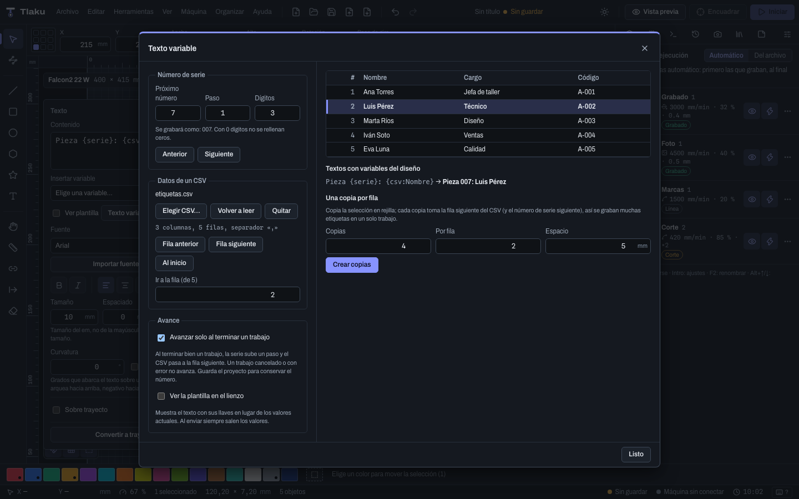

# Variable text

To engrave serial numbers, names from a list or today's date without typing each part by hand, a text can carry **variables** in braces. The text you save in the project is the **template** (`Part {serial:4}`); when previewing, sending or exporting, Tlaku replaces it with the values of that moment (`Part 0007`) and generates the outline of the letters with them. The saved project always keeps the template.

## Writing variables

Select a text and use the **Insert variable** menu in the text panel: it puts the variable where the cursor is. You can also type them by hand.

| Variable | What it puts |
|---|---|
| `{serial}` (or `{serie}`) | The current serial number. `{serial:6}` pads it with zeros to 6 digits; `{serial:hex}` and `{serial:HEX}` write it in hexadecimal (`{serial:hex4}` with 4 digits). |
| `{csv:Name}` | The data from the **Name** column in the current CSV row. The column number starting from 1 is also accepted: `{csv:2}`. |
| `{row}` (or `{fila}`) | The number of the current CSV row, starting from 1. |
| `{date}` (or `{fecha}`) | Today's date, `dd/MM/yyyy` by default. `{date:format}` writes it your way. |
| `{time}` (or `{hora}`) | The time, `HH:mm` by default. `{time:format}` changes the format. |
| `{copy}` (or `{copia}`) | The copy number, starting from 1. |

The names work in Spanish and in English, and capitalization does not matter.

**Offset.** Any serial, CSV, row or copy variable accepts `@N` at the end: `{csv:Name@2}` is the data from two rows ahead, `{serial@3}` the number three steps ahead. It is what **One copy per row** uses (below).

**Literal braces.** To write a brace, double it: `{{` gives `{` and `}}` gives `}`. So `{{serial}}` is engraved as `{serial}`.

**Date and time format.**

| Mark | Meaning |
|---|---|
| `d`, `dd`, `ddd`, `dddd` | Day (1 or 2 digits), abbreviated and full weekday name. |
| `M`, `MM`, `MMM`, `MMMM` | Month (1 or 2 digits), abbreviated and full. |
| `yy`, `yyyy` (or `aa`, `aaaa`) | Year with 2 or 4 digits. |
| `H`, `HH` / `h`, `hh` | Hour from 0 to 23 / from 1 to 12. |
| `m`, `mm` / `s`, `ss` | Minutes / seconds. |
| `AP` / `ap` | AM or PM / am or pm. |
| `'text'` | Text as is: `{date:'Made on' MMMM d, yyyy}` gives `Made on September 3, 2025`. |

A lowercase `m` means **minutes** if it sits next to an hour or to seconds (`HH:mm`, `mm:ss`) and **month** in all other cases: `{date:dd/mm/yyyy}` also works. Month and day names come out in the interface language.

**If something is not understood** (a name that does not exist, an unclosed brace, a column that is not in the CSV) that part is left written as is, the text panel warns you and **sending is blocked** until it is fixed: a half-written text is never engraved.

## The "Variable text" dialog

It opens from **Tools > Variable text…** or from the button in the text panel.

- **Serial number.** The **next number**, the **step** (how much it increases per job) and the minimum **digits** (pads with zeros). With **Previous** and **Next** you move the number one step.
- **Data from a CSV.** **Choose CSV…**, **Reload** and **Remove**. UTF-8 files are accepted (with or without BOM), with comma, semicolon or tab separator (detected automatically), fields in double quotes and line breaks inside a field. The first row is the headers. Up to 100,000 rows.
- **The table** shows the rows and highlights the current one, the one that will be engraved in the next job. A click on a row chooses it; you can also use **Previous row**, **Next row**, **To the start** or **Go to row**.
- **Advance.** With **Advance when a job finishes** on, when a job finishes successfully the serial goes up one step and the CSV moves to the next row. A canceled job or one with an error does not advance. The advance can be undone. If the job used N copies (see below) it advances N steps.
- **End of the CSV.** When the last row is engraved the app warns you. With the row already past the end, the next job does not go out (it would say there is no data) until you choose another row or go back to the start, so the last label is not repeated by mistake.
- **Show the template on the canvas.** By default the canvas shows the current values. This option (also in the text panel) shows the braces, so you can edit them. When sending, the values always go out.
- **Texts with variables in the design.** Lists each template with what would be engraved now and any problems it has.

> **Heads up:** the serial and the row live in the project. For the next number to survive closing the program, **save the project** after engraving (the advance marks the project as modified).

## One copy per row

With a label selected (for example the text and its frame), **One copy per row** creates the number of copies you indicate in a grid (by default, the rows remaining in the CSV). Each copy takes the next row: in the third one, `{csv:Name}` becomes `{csv:Name@2}`, and likewise with `{serial}`. That way you engrave many labels in **a single job**. It is a single undo step.

## Practical examples

**Twenty numbered labels in a single job.** Type `Part {serial:4}` inside a frame, select the text and the frame, and in the **Variable text** dialog set the **Next number** to 1. Use **One copy per row** with 20 copies and 5 **per row**: you get `Part 0001` through `Part 0020`. With **Advance when a job finishes**, when the job finishes successfully the next number becomes 21; save the project to keep it.

**One label per person.** In a spreadsheet make the columns **Name** and **Role**, save it as CSV, and in Tlaku choose that file with **Choose CSV…**. With the text `{csv:Name}` and, below it, `{csv:Role}`, each job engraves one person and moves to the next row. To engrave all of them at once, **One copy per row** with as many copies as rows (by default it proposes the ones remaining).

**Manufacturing date on each part.** `Made on {date:MMMM d, yyyy}` engraves, for example, "Made on October 13, 2026" with the date of the day you send the job, without touching anything.

**A brace that really is a brace.** `Code {{A}}` is engraved as `Code {A}`.

## What is missing or different

- Variables only work in **texts**. QR codes and barcodes are generated with their content already fixed and are not variables.
- There is no variable mode for layer settings (speed, power) and no "baking" the text into fixed values; to fix a text, convert it to paths.
- Tlaku's syntax is its own: LightBurn files with variable text are not translated automatically.
- None of this has been tested with a real machine yet; it was tested with the emulator and the virtual machine.

Next: [Layers and cut settings](05-capas-y-ajustes.md)
