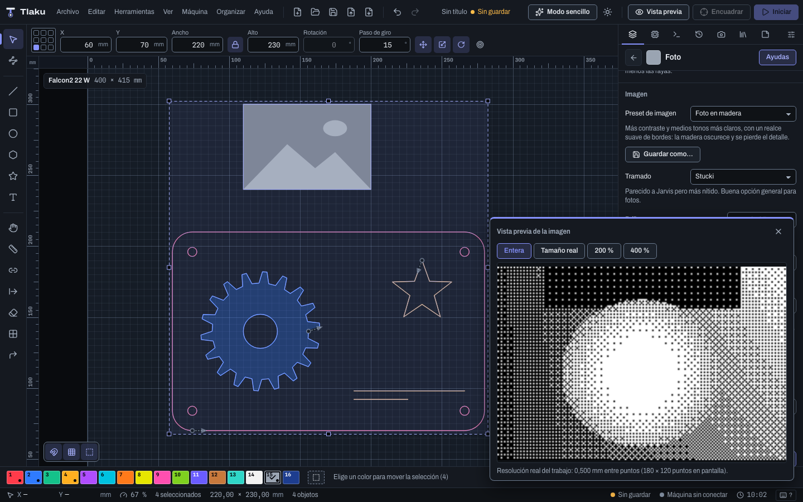

# Images

How to engrave photos and bitmap drawings: import them, choose the dithering, adjust the tones, crop them with a shape and, if you prefer, convert them to vectors with **Trace image** (or several at once). Also how to go the other way, from vectors to image.

## Importing an image

1. **File > Import Design…** (`Ctrl/Cmd+I`), or drag the file onto the window.
2. Image formats: PNG, JPG, BMP, **WebP**, **TIFF**, **GIF** and **TGA**. To choose the resolution used to interpret them, use **File > Import with options…** (see [Importing and exporting](03b-importar-y-exportar.md)). A TIFF or a TGA is converted to a PNG next to the original, and Tlaku tells you so.
3. The image appears at its size at 96 dots per inch (a width of 600 px measures 158.75 mm) and goes to its own layer called **Image**, in **Image** mode, at 3000 mm/min.

Change the size with **Width** and **Height** in the numeric bar (the lock keeps the proportion) or by dragging the handles. Images can be moved and scaled, but **cannot be rotated**: rotate it in an image editor before importing it.

> **Heads up:** physical size rules over pixels. An image with few pixels scaled to a large size will come out pixelated no matter how much you lower the interval.

## Image mode

A layer in **Image** mode engraves dot by dot, varying the power according to the tone. Its settings are in the layer editor (see [Layers and cut settings](05-capas-y-ajustes.md)):

| Setting | What it does |
|---|---|
| **Max power** | Power for the darkest dots. |
| **Min power** | Power for the lightest. At 0 % they do not mark anything. |
| **Interval** and **Equivalent resolution** | Distance between lines (0.1 mm = 254 DPI). Finer, more detail and more time. It should be close to the width of the beam's dot. |
| **Scan angle** | At 90° the image is engraved by columns. |
| **Angle increment** | Degrees added to the scan angle on each pass; it only shows with 2 or more passes (see [Layers and cut settings](05-capas-y-ajustes.md)). |
| **Bidirectional**, **Overscan** | Same as in Fill. |

## Dithering

**Dithering** (a field in the **Image** group of the layer editor) converts the photo's tones into dots the laser can engrave. **Stucki** is used by default.

| Dithering | When to use it |
|---|---|
| **Threshold** | Logos and line drawings: each dot is black or white depending on the **Threshold**. Not suitable for photos. |
| **Floyd–Steinberg** | A lot of detail, some noise. |
| **Jarvis** | Smooth transitions, less contrast, slower. |
| **Stucki** | Similar to Jarvis but sharper: a good general choice for photos. |
| **Atkinson** | More contrast and clean areas; the extremes of highlights and shadows are lost. |
| **Ordered dither 4×4** | Regular pattern, fast and predictable; the pattern is noticeable. |
| **Grayscale** | No screen: the power varies with the tone. It requires setting the min and max powers well for the material. |
| **Halftone** | Larger dots in the dark areas, on a rotated grid (like a printed magazine). It uses **Cell size** and **Grid angle**. |
| **Newsprint lines** | Thicker lines in the dark areas. It also uses cell and angle. |
| **Sketch** | Engraves only the edges, like a pencil drawing. |

## Tone adjustments

They are applied to the image before dithering:

- **Brightness** (-1 to 1): lightens or darkens. 0 = no change.
- **Contrast** (-1 to 1): separates or brings together the tones around middle gray.
- **Gamma** (0.1 to 5): tone curve. Greater than 1 darkens the midtones; less than 1 lightens them.
- **Invert**: swaps light and dark, useful with negatives or materials that lighten when burned.
- **Dot width** (0 to 1 mm): shortens each on-segment so the dark areas do not bloat. 0 = no correction.

## Image presets

Above the tone adjustments, the **Image preset** selector applies brightness, contrast, gamma, edge enhancement and remove specks all at once (a single undo step). It does not change the dithering or the interval: those depend on your machine and the material, not on the photo.

The factory ones are **No changes**, **Photo on wood**, **High-contrast logo**, **Soft portrait**, **Dark photo**, **Dirty scan** and **Fine detail**; each one explains below what it is for. They are starting points: try them with the preview and adjust by hand if needed, whereupon the selector switches to **Custom**.

With **Save as…** you save the current values under whatever name you like (up to 50; if you repeat a name, it replaces the previous one) and they appear under **Mine**. **Delete** removes the one you have chosen. Your presets are stored on this computer; they do not travel inside the project.

## Image preview

The **Image preview…** button, at the end of the image settings, opens a floating panel with what would be engraved from an image on the layer (the selected one or the first; if there are several, you choose which). It updates by itself when you change a setting, and it does not calculate the whole job.

- **Whole image** fits the image to the viewer. If the job's grid is finer than what fits on screen, the view uses a coarser one and says so: it is a quick approximation.
- **Actual size**, **200%** and **400%** show a piece with the job's exact grid (each dot is an engraved dot). Drag the image to move around.

> **Heads up:** the screenshot was taken with the application in demo mode, so the image and its dithering are samples; on your computer the preview shows your image with your dithering.

The preview does not include the machine's effect when scanning (overscan, offset compensation). For that there is the job preview.

## Advanced image

In the collapsible **Advanced image** section of the layer editor (it opens by itself if the layer already uses something from it) there are three more settings. They are applied before dithering, together with the tone ones.

| Setting | What it does | Range |
|---|---|---|
| **Edge enhance: radius** and **strength** | Accentuates edges (like the "sharpen" of a photo editor). The radius is the size, in image pixels, of what counts as an edge; the strength goes from 0 (nothing) to 1 (maximum). **Both must be greater than 0**; with one at 0 nothing happens and the editor warns you. | Radius 0 to 20 px; strength 0 to 1 |
| **Remove specks** | Erases isolated specks up to that size, in pixels, before dithering. 0 = off. | 0 to 20 px |
| **Send untouched (pass-through)** | Each dot of the image is already the power: it is sent as is, without dithering or tone adjustments. With this checkbox, dithering, threshold, brightness, contrast, gamma, invert, enhancement and remove specks are disabled. | yes or no |

**Practical examples**

- **Old or scanned photo, with dust and little stains.** Before engraving, raise **Remove specks** to 2 or 3 px: isolated spots disappear instead of coming out as little burned dots in the wood. Large blocks and straight edges are kept. Raise it gradually: a high value starts erasing real detail.
- **Soft or out-of-focus photo.** An **Edge enhance** of radius 1 to 2 px and strength 0.5 restores definition to the outlines (eyes, letters, edges). If you see halos or hard edges, lower the strength.
- **Image prepared in another program.** If you already did the dithering or the tone curves in a photo editor and the grayscale image is exactly what you want to engrave, turn on **Send untouched**: Tlaku does not touch it. Black is engraved at **Max power** and white at the minimum. The image is still resampled to the layer's **Interval**.

The [preview](07-vista-previa.md) shows the scan lines and the estimated time; with images, the real time can differ more than with vectors.

## Tracing an image

**Tools > Trace image…** converts an image into paths that you can then cut or edit with nodes. It is only available with **one** image selected.

1. Select the image and open the dialog.
2. Adjust the sliders; the preview recalculates and shows how many shapes and nodes come out.
3. Decide whether to tick **Delete the original image** (off by default; not possible if the image is locked).
4. Press **Trace**. It is a single **Undo** step.

| Setting | What it does |
|---|---|
| **Threshold** | What is darker than this brightness is traced. |
| **Smoothing** | Higher: fewer nodes and longer curves. |
| **Remove specks** | Discards specks and holes smaller than this side (shows the equivalent in mm). |
| **Corners** | Turns sharper than this angle stay as a sharp corner. Only in **Curves** mode. |
| **Blur** | Smooths noisy edges before tracing. |
| **Mode** | **Curves** (Bézier) or **Polygon** (straight segments). |
| **Invert (trace the light areas)** | Traces the light areas instead of the dark ones. |

The result sits exactly over the image, on the active layer (or on the first line layer if the active one is an image layer). The dialog tells you which layer it will be added to. If too many small shapes come out or the edge is rough, raise **Remove specks** or the smoothing, or try some **Blur**. **Reset settings** goes back to the initial values, designed for logos and drawings.

## Cropping an image with a shape

To engrave only a part of the image, with the silhouette you want, use a **mask**.

1. Draw the cropping shape (a circle, a heart, a text...) on top of the image.
2. Select **the image and the shape** (a single image; you can add several shapes).
3. **Tools > Crop image to shape.**

The image is engraved only inside the shape and the canvas crops it the same way. The shapes **are consumed** when applying it (they become the image's mask). To go back to the whole image, select it and use **Tools > Remove image mask**. It is one **Undo** step.

**Example: a portrait on a round coaster.** Import the photo, draw a circle the diameter of the coaster centered on the face, select both and apply the mask: only the circle is engraved.

The mask is always a **vector shape** (there is no brightness mask). A new mask replaces the previous one, and if you **replace the image** with another file the mask is discarded.

## Converting vectors to bitmap

The reverse of tracing: **Tools > Convert to bitmap…** draws the selected vector shapes into a PNG image that is engraved as an image. It is useful for engraving a vector drawing as an image (with dithering, for example) or for combining it with a photo before engraving.

| Setting | What it does |
|---|---|
| **Resolution** | In dots per inch; the dialog shows the size in mm and in pixels, and warns if the image would be too large. |
| **Drawing** | **Fill** (closed shapes come out solid) or **Outline** (only the edge, with its **Outline thickness**). |
| **Negative** | White shapes on black. |
| **Replace the vectors with the image** | Removes the original shapes (locked ones are not removed). |

The PNG is saved **next to the project**. If the project is not saved yet, it stays in the temporary folder and the app warns you: save the project first and convert again so the image ends up next to it. The PNG comes out black on white.

**Example: engraving a silhouette with dithering.** You draw a shape, convert it at 254 dpi and send the image to a layer in **Image** mode with the dithering you want.

## Saving the processed image and replacing the image

With **one** image selected there are two more commands under **Tools**:

- **Save processed image…**: writes a PNG with what would be engraved, with its layer's brightness, contrast and dithering settings and its mask. It requires the image to be on an **Image** mode layer. Useful for seeing the exact result or taking it to another program.
- **Replace image…**: swaps the image's file for another without moving anything: it keeps the **width** and the **position** and follows the new file's proportion, on the same layer. The mask is discarded. It is the way to fix a photo in an external editor and engrave it again without redoing the work. (The image is reread when replaced; there is no separate "refresh image" command.)

## Tracing multiple files

**Tools > Trace multiple files…** applies the **same settings** as **Tracing an image** (above, on this page) to many images at once. You do not need to have anything selected.

1. **Add images…** and choose the files; those that cannot be read as an image are flagged and do not go in.
2. The settings are those of **Trace image** (threshold, smoothing, specks, corners, blur, mode, invert), with a preview of the file you choose in the list. Below, the **Image resolution** (dpi) that defines their size.
3. The dialog tells you which layer they are added to. **Trace N image(s).**
4. A bar shows progress; **Stop** cuts the batch and adds nothing.

Each result is placed in a **row**: 10 mm of separation and up to 400 mm of width, before moving to the next row. Results are not scaled to the size of any image in the design. A file that fails does not stop the rest: at the end the ones that were not traced are listed. It is one **Undo** step.

**Example: 12 customer logos for a plaque.** Add the 12 PNGs, adjust the threshold while looking at one of them, and you get the 12 vectors in rows, ready to cut.

Next: [Preview and cut order](07-vista-previa.md)
