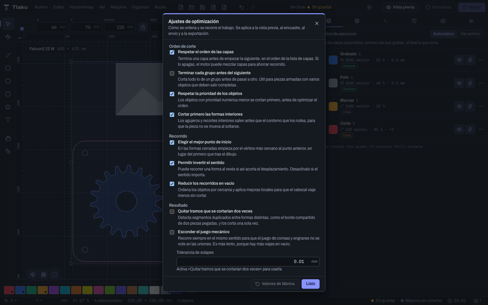

# Preview and cut order

The preview shows you the exact path the laser will follow before anything is sent: in what order it cuts, how much it moves with the laser off and how long it will take. It also explains why each shape goes where it goes.


## Opening it

- Press the **Preview** button in the top bar, use the **View** menu or the `P` key. The same key closes it.
- A panel appears under the canvas, **Job preview**, and the path is drawn on top of the design.
- It recalculates by itself when you change objects, layers, the active machine or the job options (with a short wait; meanwhile you see **Updating…**).
- If there is nothing to show you will see "Import a design to see the toolpath."
- In the panel's bar are the **Cost and price…** button (what the piece costs and what to sell it for: [Cost and price per piece](07c-costos-y-precio.md)), the **Optimization settings…** button (see below) and the **Selection only** and **Use the selection's origin** checkboxes (see [Sending jobs safely](09-enviar-con-seguridad.md)). With **Selection only** on, the preview shows only what you have selected and recalculates when the selection changes.

> **Tip:** if the calculation fails, the panel says **The preview could not be calculated** and gives the reason. Two cases the app recognizes and gives a hint for: the design goes beyond the bed (move it or reduce the overscan of the fill and image layers) and no layer with objects has output turned on. With **Retry** you calculate again.

## Playing back the path

| Control | What it does |
|---|---|
| Back to start / Go to end | Jump to the beginning or the end of the job |
| Play / Pause (`K`) | Animates the head following the job's real time |
| `1x` `2x` `5x` `10x` `50x` | Animation speed (`,` lowers it and `.` raises it) |
| **Position along the toolpath** bar | Drag it to go to any moment; the marks show where each layer starts |

To the right of the bar you see "current time of total", for example `10:02 of 10:02`. The shortcuts `K`, `,` and `.` only work with the preview open and already calculated.

## Legend and colors

Each type of movement has its color:

- **Rapid moves**: travel with the laser off (dashed line). You can hide them.
- **Cut** and **Engrave**: movements with the laser on.
- **Overscan**: extra stretches outside the part so the head reaches speed. You can hide them.

The more transparent a stroke is, the less power it carries.

## Results

- **Total time**, with the **Estimated** label. It is calculated with the acceleration of the machine profile. The real time can change, especially with images.
- If you see **approx.** or `≈`, the engine did not deliver the time of each movement and it was estimated by distance and speed. In that case layers cannot be highlighted.
- Distance and time by type: cut, engrave, rapid moves and overscan.

## By layer

The **By layer** section lists each layer in the order in which it will run, with its mode (**Line**, **Fill** or **Image**), its time and a bar with its share of the total.

- If the planner shortened the empty travel, you will see "Saves N % of empty travel."
- The crosshair icon (**Highlight on the canvas**) dims the rest and marks only that layer.
- With the row's arrow (**See how it was planned**) the detail opens: that layer's distances and the explanation of each shape.

A layer with several passes and Z step-down appears as one row per pass. If the layer has tabs or passes, the row's summary says so. A layer with [additional operations](05-capas-y-ajustes.md) appears as one block per operation, with the position among those of its layer (for example "2/3" in the name).

## Optimization settings

With **Optimization settings…** (in the preview bar, in the **Machine** panel and in the **Machine** menu) you decide how the job is ordered and traveled. Changes apply instantly (the preview recalculates by itself) and apply to the preview, framing, sending and G-code export, so that what you see is what is cut. They are remembered between sessions, but they are an application preference: **they are not saved in the project**. **Factory values** restores them. When something is not at its factory value, the **Layer order** part of the results summarizes it in a sentence that starts with "optimization:".



| Option | What it does and when to change it |
|---|---|
| **Respect layer order** (on) | Finishes one layer before starting the next. When off, the engine can **merge consecutive Line layers that have exactly the same settings** (and none with a pinned position) to save travel; layers with different settings are never merged, and the summary says which ones were joined. Useful if you have, for example, a red cut and a blue one with the same speed and power and parts spread across the whole bed. |
| **Finish each group before the next** (off) | Cuts everything in a group (the ones you make with **Group**) before moving to another. Useful for parts assembled from several objects that must come out complete, one by one. |
| **Respect object priority** (on) | Objects with lower priority are cut first, before optimizing the order. See [Drawing and editing](03-dibujar-y-editar.md). Turn it off if you imported a DXF with priorities you are not interested in. |
| **Cut inner shapes first** (on) | Holes come out before the contour that surrounds them, so the part does not move when it comes loose. Turn it off only if you know why. |
| **Pick the best starting point** (on) | On closed shapes it starts at the vertex nearest the previous point, instead of the first one the drawing carries. When off, each shape starts where it was drawn. Shapes with a start fixed by hand (**Start point** tool, `Q`) are not touched. |
| **Allow reversing direction** (on) | It can travel an open shape backward if that shortens the travel. Turn it off if direction matters. Shapes with a direction fixed by hand keep the one you chose. |
| **Reduce empty travel** (on) | Orders the shapes by proximity and applies local improvements so the head travels less without cutting. When off, the original order is kept. |
| **Remove segments that would be cut twice** (off), with its **Overlap tolerance** (0.001 to 1 mm; 0.01 by default) | Detects duplicate segments between different shapes and cuts them only once. Example: two parts stuck together with a shared edge, which without this gets burned twice; the second pass darkens and widens the cut. Only on Line layers and **not with kerf** (the compensation has already changed the shapes). The preview warns how many millimeters it removed. |
| **Hide mechanical backlash** (off) | Always travels closed shapes counterclockwise and engraves fills and images in one direction only, so the backlash of belts and gears is not noticeable at the joins and the lines do not misalign. It is **slower**, because there is more empty travel; the preview reminds you. Use it with machines with noticeable slack, where parts that "close" come out with a step. |

> **Tip:** if in doubt, leave everything at its factory value with **Factory values**: layer order, inner shapes first and short travel already come turned on.

## The explainable planner

Tlaku decides the order of the shapes on each **Line** layer with fixed rules, from strongest to weakest:

1. **Levels**: layers are cut in their order; one layer finishes before the next begins. If you ask for it in the optimization settings, within each layer one **group** is finished before the next and, within each group, each object's **priority** is respected (lower number, earlier). The precedence is always layer, group, priority.
2. **Inner shapes before the container**: a shape inside another is cut first (the hole before the contour), so the part does not come loose too early. This rule is not broken even to save travel. It also applies to shapes that mostly overlap.
3. **Short travel**: among the shapes that can already be cut, the nearest goes first, and then an improvement (2-opt and Or-opt) shortens the total.
4. **Start point and direction**: each closed shape starts where it is convenient and each open one is traveled in the convenient direction, except those you fixed with the **Start point** tool or **Reverse direction** (see [Guides, tabs, start point and project](03e-guias-puentes-y-proyecto.md)), which are respected. This never changes the order between shapes.

When you expand a layer, each shape comes with its reason in plain words. For example:

```
shape #3 (closed): goes before shape #1, which contains it: inner shapes first
shape #5 (open): the nearest (12.40 mm) among those that could be cut now
```

That way you know whether a shape came out in that position because it is inside another, because of proximity or because of the travel improvement. If a rule could not be met, it appears under **Warnings**.

> **Heads up:** per-shape explanations exist only for **Line** layers. On **Fill** and **Image** the detail shows distances, without reasons. Per-object priority and the option to remove repeated segments also apply only on Line layers (per-object power scale applies on Line and on Fill).

## Layer order and warnings

- **Layer order** explains why they run that way (for example, "engravings first, cuts last"). Change it in the **Layers** tab; see [Layers and cut settings](05-capas-y-ajustes.md).
- **Warnings** gathers notices from the calculation: tabs versus kerf, software limits with the rotary, settings the active machine ignores (such as Z without a Z axis), among others.

Before sending, use this view to check that what goes first is what you want to go first.

Next: [Review design](07b-revisar-diseno.md)
