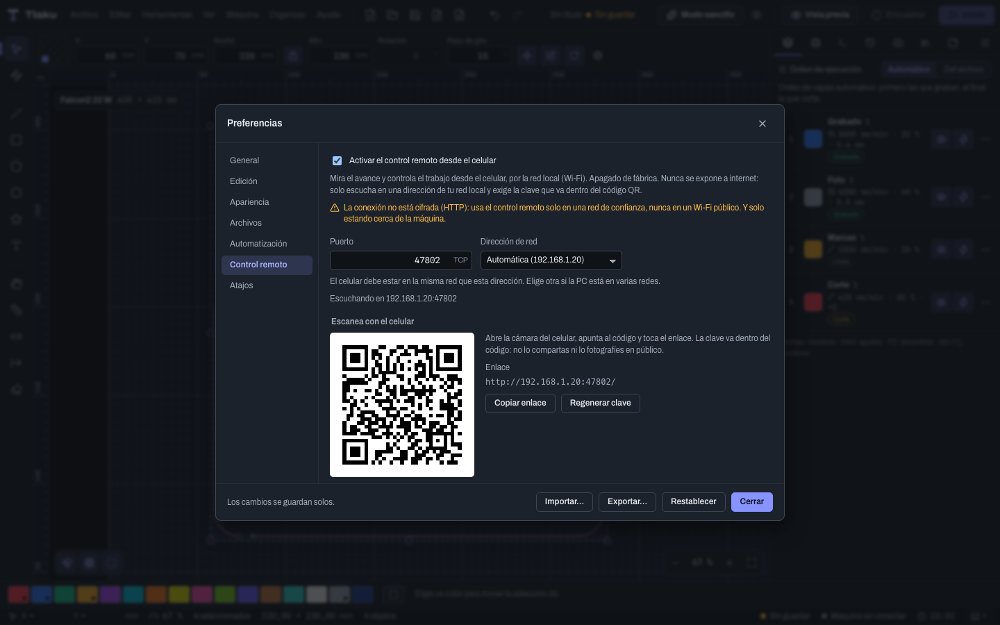
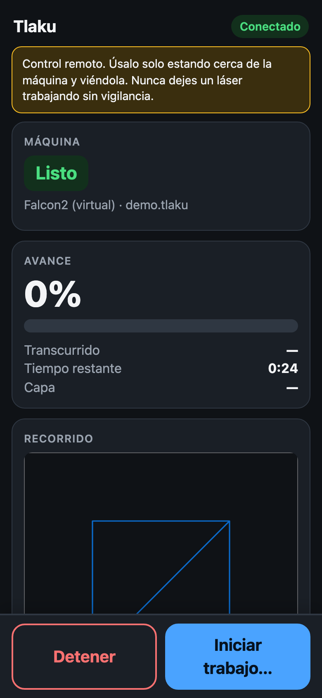
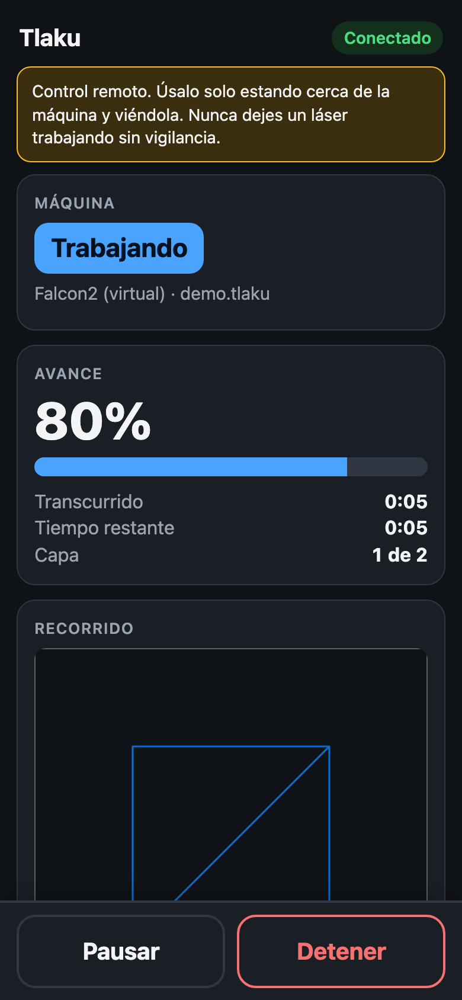
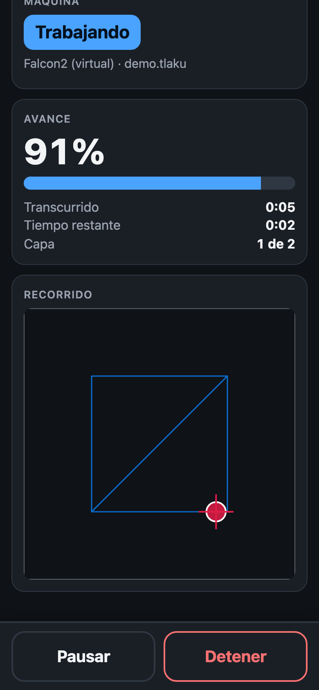
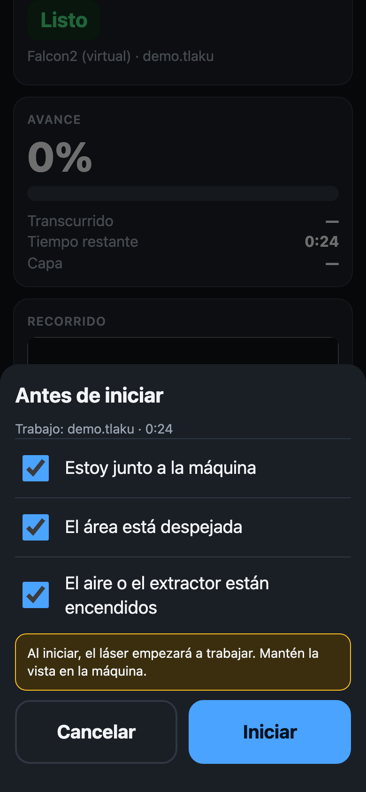
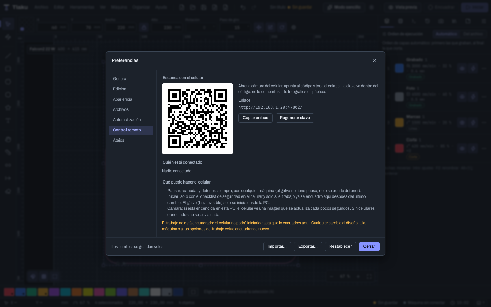

# Remote control from your phone

With remote control you can **see a job's progress and pause or stop it from your phone**, without installing anything: the phone opens a page in its browser. It is useful, for example, for keeping an eye on a long job from the other side of the shop, or for stopping it without running to the computer.

> **Warning:** it is an aid, not a replacement for being next to the machine. **Use it only on a trusted network and only while you are near the laser and can see it.** Never leave a laser working unattended. It has been tested on a real machine only once: the phone page followed a real engraving on a Falcon2 Pro. Long cuts and other machines are still untested, so start with a virtual machine.

## Before you start: two safety notices

- **There is no HTTPS.** The connection between the phone and the computer **is not encrypted**: on a local network you cannot get a trusted certificate for a private address. Anyone who can snoop on your local network (for example, an unencrypted or public Wi-Fi) could see what passes over it. Use it on your home or shop network, with a password, **never on public Wi-Fi**.
- **The key changes every time you open the app.** The QR code carries a random key that is generated anew every time Tlaku opens (and when you press **Regenerate key**). That is why yesterday's QR no longer works: scan today's. Nothing stays saved on the phone that would let it back in without scanning.

Remote control also comes **off by default**, listens only on one address of your **local network** (never on the internet), and requires the key. A preferences file or a `.tlakubundle` bundle that you import can never turn it on.

## Step by step

1. On the computer, open **Preferences** (the gear or `Ctrl/Cmd+,`) and go to **Remote control**.
2. Tick **Turn on remote control from the phone**. "Listening on 192.168.x.x:47802" should appear and, below it, a QR code.

   

   If the computer is on several networks, pick the right one in **Network address** (**Automatic** picks the most likely one, normally a 192.168.x.x). If the port is busy, change it in **Port**.
3. Connect the phone **to the same Wi-Fi network** as the computer.
4. Open the phone's camera, point it at the QR code, and tap the link. The Tlaku page opens. If you prefer not to use the camera, **Copy link** copies the address with the key so you can send it to yourself. The key is inside the code: do not share it or photograph it in public.
5. Below, the computer lists **Who is connected** (address and device). With **Disconnect** you remove one; with **Regenerate key** you invalidate the QR and remove everyone (the phone shows "You were disconnected" and has to scan again).

## What you see on the phone

- **Machine**: the status (**Ready**, **Working**, **Paused**, **Finished**, **Stopped**, **Failed**, **Alarm**...) and the name of the machine and of the document.
- **Progress**: the percentage, the elapsed time, the remaining time, and the layer it is on ("1 of 2").
- **Path**: the drawing of the job with a dot that follows the head.
- **Live view**: a switch that replaces the path with a simulation of the job (see below). Off by default.
- **PC camera**: if the camera is on at the computer, an image that refreshes every few seconds (with no phones connected nothing is sent).
- A **fixed bar at the bottom**, always in view without scrolling the page: with the job running or paused it carries **Pause** (which becomes **Resume**) and **Stop** (in red); when idle it carries **Stop** and **Start job…** (if it cannot be started, above the bar it says why). **Stop** asks for a second tap within 3 seconds and the bar shows a notice while it waits.

When the job finishes or fails, the page shows a full-screen notice (**Job finished!** or **The job failed**), a beep sounds, the tab title blinks, and the screen stays on while it works. The **phone also vibrates**, except in **Safari on iPhone and iPad (iOS)**, which does not allow a page to vibrate the device: there you will only see and hear the notice (the beep needs you to have tapped the page at least once).

### Live view on the phone

The **Live view of the job** switch on the page draws the same as the computer: what is already burned in dark, what is pending faint, and the head (crosshair, with a red dot when the laser emits), following the real position of the machine and moving smoothly between reports. It is **view only**: it adds no action and uses the same key and the same local-network rules as everything else.

- **Off by default.** Your choice is saved in that phone's browser. When off it downloads no route and animates nothing.
- **When you turn it on** (also in the middle of a job) the page downloads once a simplified version of the route (a few hundred KB at most; for fills and images the lines are grouped and drawn wider) and catches up with everything already done. After that it only receives the position.
- If the route is too large, or the machine does not report its position while working (K40, galvo), the page says so and you see the head on the path or a time estimate.
- It works in Safari on iPhone and iPad and in Chrome on Android. With **reduce motion** on in the system, the head jumps from report to report instead of animating. The drawing has a text description with the percentage and the state; the percentage and the state are also above, in **Progress** and **Machine**.
- The computer only follows the job for the phone while **a phone is connected**.

## What can and cannot be done

| Action | From the phone |
|---|---|
| **Pause and resume** | Always, with any machine that has pause. |
| **Stop** | **Always.** It goes straight to the machine, without passing through the computer's window: if Tlaku freezes, stopping still works. It does not look at the state, the framing, or the checklist. On the page it asks for a second tap ("Tap again to STOP") to avoid accidental taps. |
| **Start a job** | Only if **everything** below is met. |
| **See the job queue** | Yes, in a read-only card: status, progress, time left, the current job and the list. |
| **Confirm the next queue job** | Under the same rules as starting (below) plus one more box in the phone checklist: *I already changed the material or the workpiece*. The document the queue is waiting for must be **framed on the computer** and be the one in the active tab; otherwise it can only be confirmed from the computer. The queue never moves on by itself. See [Job queue and job history](09f-cola-e-historial-de-trabajos.md). |
| **See progress, path, live view, and camera** | Yes. |
| **Start a galvo laser** | **Never.** A galvo's beam is invisible: it can only be started from the computer. The galvo also has no pause, only stop. |
| **Change the design, the settings, or the machine** | No: that is done on the computer. |

### Starting from the phone

For **Start job…** to work, all of the following are needed at once:

1. **Tick the checklist on the phone**: *I am next to the machine*, *The area is clear*, and *The air assist or the extractor is on*.

   

2. **The job must have been framed on the computer after the last change.** Beforehand, on the computer, use **Machine > Frame** (see [Sending jobs safely](09-enviar-con-seguridad.md)). Any later change to the design, the machine, or the job options requires framing again, and reconnecting the machine as well. It is the safeguard that someone looked at where the laser is going to work.
3. Machine connected and idle, no other job running, something to send, and the Tlaku window open and responding.

The phone starts nothing on its own: it **asks Tlaku on the computer to start**, and Tlaku does its usual pre-check and verifies the framing again. If anything is not met, the phone states the reason clearly ("Frame the job on the PC first", "The machine is not idle", "The galvo can only be started from the PC"...). If Tlaku does not answer within a minute, it tells you to check the computer before trying again.

On the computer, the **Remote control** section of Preferences recalls these rules (**What the phone can do**) and says whether the job is framed or not.

## How it is protected

- It only listens on **one** private address of your local network (never on all interfaces) and rejects anyone who does not come from the local network.
- The key is random, 128 bits, and travels in the part of the link that the browser **does not send** to the server or save in the history; the page hands it over once and receives a session.
- Five wrong keys in a row block that address for two minutes. Sessions with no activity expire after 30 minutes, and there is a maximum of 8 devices.
- **Stop** and **Pause** never depend on the framing or the checklist: the safety principle is that it must always be possible to stop, while starting costs more.

The technical detail (routes, headers, limits) is in the repository, in the "Control remoto desde el celular" section of `docs/app-api/control-remoto.md` (the API docs are in Spanish).

## Troubleshooting

- **The phone does not open the page.** Check that they are on the same Wi-Fi network (not the guest network, which usually isolates devices from each other), that remote control says "Listening on…", and that the computer's firewall lets the port in. If the computer has several networks, pick the right one in **Network address**.
- **"Wrong or expired key".** Scan the current QR again: the key changes every time Tlaku is opened or **Regenerate key** is pressed.
- **"Too many attempts".** Wait a few minutes and scan again.
- **"The PC is not sending data".** Tlaku is closed or not responding. Stop still works, but starting is blocked.
- **Start job… cannot be pressed.** Below the button it says the reason; almost always it is that the job needs to be **framed** on the computer.

Next: [Camera](10-camara.md)
