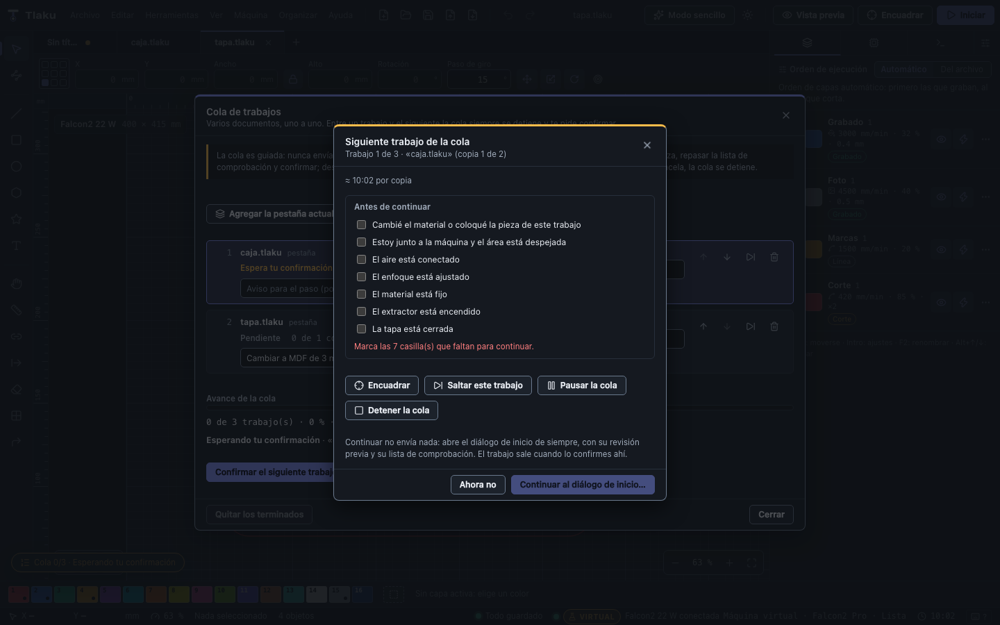
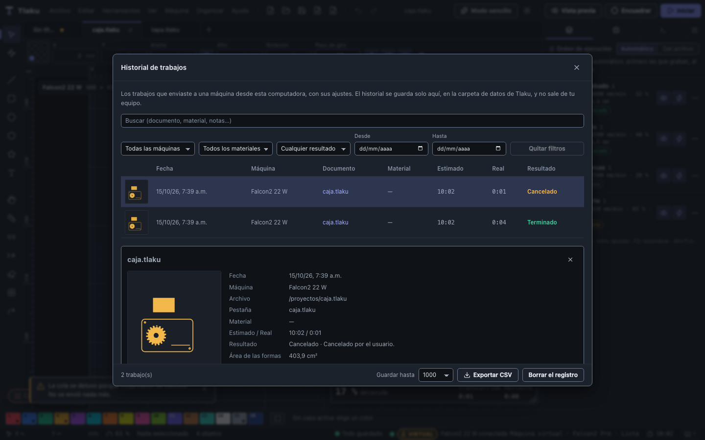

# Job queue and job history

Two tools for anyone who cuts or engraves several pieces in a row: the **job queue**, which walks you from one document to the next without ever leaving the machine on its own, and the **job history**, which remembers how each job turned out and with which settings.

## Job queue

**Machine > Job Queue…** opens the list of pending jobs. Each item is a **document open in a tab** or a **`.tlaku` file** (opened in a tab when its turn comes), with its **number of copies** and, if you want, a **step reminder** ("switch to 3 mm MDF") shown before that job starts.

### The rule that never changes: the queue never moves on by itself

A laser that nobody is watching is a fire hazard. That is why the queue is **guided**, not an unattended mode:

1. **Between one job and the next, the queue always stops** and opens **Next queue job**. This also applies to the copies of the same document: each copy asks for its own confirmation (useful to swap the workpiece).
2. There you must tick that you **changed the material or placed the workpiece**, that you are **next to the machine with the area clear**, and the boxes of your checklist (the one in the [start dialog](09-enviar-con-seguridad.md)). While one is missing, **Continue** stays disabled.
3. Optionally you can **Frame** the job to see where it will land, **skip it**, **pause** or **stop** the queue.
4. **Continue sends nothing**: it brings the document to the front and opens the **regular start dialog**, with its pre-flight review and its checklist. The job goes out when you confirm there.
5. If you close the step window with **Not now** (or `Esc`), the queue keeps waiting; the **Queue 2/5 · Waiting for your confirmation** pill (bottom left) reopens it.

If a job **fails or is cancelled**, the queue **stops** and does not offer the next one; when you retry it asks for confirmation again. Stopping the queue while a job is already on the machine **does not cancel it**: it runs to the end and the queue does not continue afterwards.

### What you can do with the list

- **Add** the current tab, all open tabs, or `.tlaku` files. Up to 50 jobs.
- **Reorder** with the arrows, **change the copies** (1 to 99), **skip** a job (it can be put back), **remove** it or **remove the finished ones**. What is on the machine cannot be removed or skipped.
- **Pause the queue**: while waiting for confirmation it stops asking until you **Resume**; with a job running, it pauses **when that job ends**. Pausing the queue does not pause the machine (that is the job's **Pause**).
- See the **overall progress** (jobs finished, bar and percentage) and the **estimated time left** (from each tab's preview, or how long that file took last time; if data is missing it says so).
- If a tab without a file is closed, its job can no longer be opened: the queue stops when it reaches it and tells you.
- The queue remembers **which files, how many copies and which reminders** it has between sessions, but it **always starts stopped with no copies done**: nothing is sent until you start it and confirm each step. Unsaved tabs are not remembered.

The **live view** shows in one line which step the queue is on ("Queue: job 2 of 5 · "lid.tlaku", copy 1 of 3").

### With the phone

The [phone remote control](09e-control-desde-el-celular.md) **shows the queue** (status, progress, time left, the current job and the list) in a read-only card. **Confirming the next job from the phone** follows the same rules as starting a job from it, plus one: tick the checklist on the phone (with a fourth box, *I already changed the material or the workpiece*) and the document the queue is waiting for must be **framed on the computer** and be the one in the active tab. If that is not met, the phone says why and it is done from the computer. The phone can never advance the queue any other way.

## Job history

**Help > Job History…** (formerly "Job Log") keeps, for every job you sent to a machine from this computer:

- **Date and time**, **machine**, **document** (name and path) and the **tab** it came from.
- **Estimated** and **actual time** (without pauses), and the **result**: **Finished**, **Cancelled**, **Failed**, **Interrupted** (with the percentage and **Continue** if a checkpoint remains; also if the app closed in the middle of a job) or **Running**.
- The **layers** that went out with their **speed, power, passes, mode and interval** (and angle, bidirectional, air assist and kerf), the **material** from your library whose settings match the layer's, the **area** of the shapes and the **cut length**.
- A **thumbnail** of the toolpath and your **notes** (edited in the detail and saved automatically).

### Search and filter

Above the table there is a search box (document, path, tab, machine, material, layers, message and notes; case and accent insensitive) and filters by **machine**, **material**, **result** and **dates** (from and to). **Clear filters** resets them.

### Repeat with these settings

In the detail, **Repeat with these settings** opens the job's document (if it is already open, its tab is activated; if the file no longer exists, it offers to use the active tab) and shows **which layer settings would change** (speed, power, passes...). On confirming they are applied as **one Undo step**. It **sends nothing to the machine**: you check the preview and send it with the regular start dialog.

### Export to CSV

**Export CSV** saves the rows you are looking at (with filters applied) to a `.csv` any spreadsheet opens: date, machine, document, path, tab, material, result, message, estimated and actual times, area, length, layer summary and notes. Cells that look like formulas are protected.

### Where it is stored

Only on this computer, in a file (`job-history.jsonl`, one job per line) inside the **application data folder**; it does not travel in the project or in bundles, it never leaves your computer, and Tlaku windows share it. It keeps **up to 1000 jobs** by default (**Keep up to**, at the bottom of the history, or **Preferences > Files**: 20 to 20,000); the oldest are dropped when exceeded. The previous version's log (200 jobs) is **migrated automatically** the first time. **Remove from the history** deletes one job and **Clear the log** deletes them all (both ask for confirmation). History jobs still feed the **calibrated estimate** in [Cost and price](07c-costos-y-precio.md).

It does not record G-code exports or what you send from the console.
