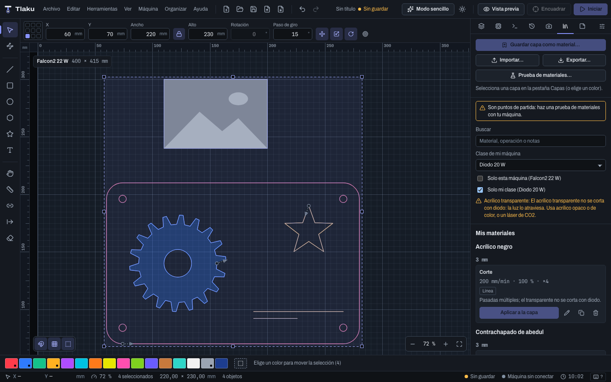
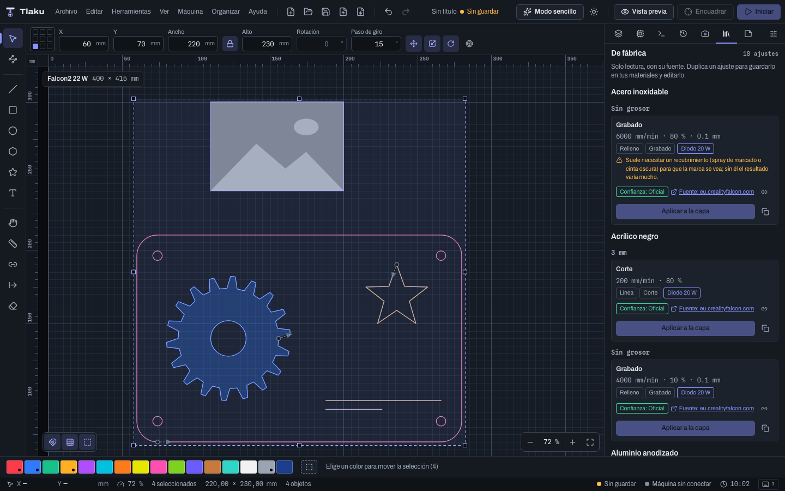
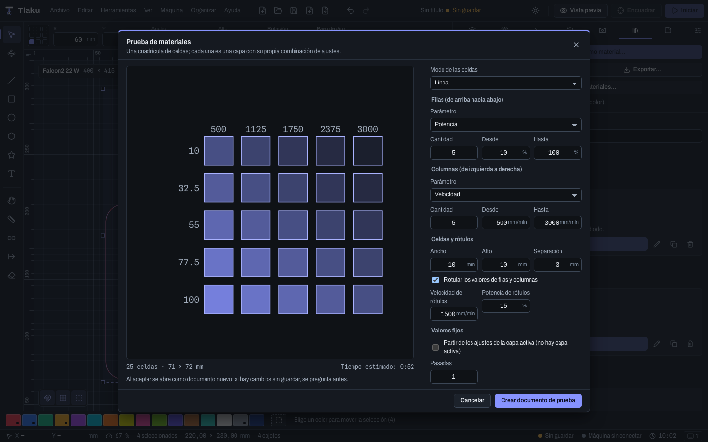

# Materials

The library stores the settings you already know work for each material, and the material test helps you discover them with a grid of cells. That way you do not have to guess speed and power every time.

> **Warning:** Tlaku ships with a **built-in** library of 134 settings published by manufacturers and guides, but they are **starting points, not a guarantee**: they are not from your machine and have not been tested with it. Real settings depend on your machine, your laser, its condition, and your material. Always run the test and save your own.

## The Materials tab

Open the **Materials** tab (`Ctrl/Cmd+6`). At the top are the actions (**Save layer as material…**, **Import…**, **Export…**, and **Material test…**) and below them the list, with a search box. The list has two sections: **My materials** (the ones you save, which you can edit and delete) and **Built-in** (read-only, see below). A fixed notice, **These are starting points: run a material test with your machine**, reminds you that no setting is a guarantee.

The list is grouped by material (ignoring case and accents) and, within that, by thickness, from smallest to largest; those with no thickness go at the end. Each setting shows its operation (for example "Cut"), a summary such as `250 mm/min · 100 %`, its mode (**Line**, **Fill**, or **Image**), its notes and tags:

- The machine it was tested on, if you indicated one.
- **In use: N**, if N layers in the document have exactly those settings.

The search box (**Search**) filters by material, operation, notes, or thickness. Tick **This machine only** to see the active machine's settings and those valid for any machine.

## The built-in library

The **Built-in** section gathers 134 cutting and engraving settings for common materials (wood, plywood, MDF, acrylic, leather, cardboard, paper, cork, glass, steel, and anodized aluminum, among others). **It is not an invented list**: each setting was copied from a published table or guide and **says where it came from**.

### Source and confidence

Each built-in setting shows two pieces of information:

- **Source:** the site it comes from (for example, a manufacturer's materials table). Click the link to open it in the browser, or the chain icon to copy the address. Read it: it holds the context (lens, optics, air) under which the value was obtained.
- **Confidence:** how reliable that source is.
  - **Official**: a table published by the laser's manufacturer.
  - **Guide**: a published guide or article; it is not from your machine and is not verified with it.
  - **Forum**: a figure from a forum or the community, unverified.

A value being **Official** means the manufacturer published it, **not that it works as is on your machine**.

### Machine classes

A 5 W diode laser and a 100 W CO2 laser are not set up the same way, so each built-in setting says which **machine class** it is for: **Diode 5, 10, 20, and 40 W**, **CO2 40, 60, 80, and 100 W**, and **Fiber 20, 30, and 50 W**. In **My machine class** you choose yours (only the classes for your laser type appear); Tlaku remembers it for that machine. If you do not choose one, all settings are shown. With **My class only** you hide those of other classes (those that do not say which machine they are for are still shown).

If you do not know the power, look at the laser's label or its box. In [simple mode](01b-modo-sencillo.md), Tlaku asks you ("How many watts is your laser?") and, if you answer **I don't know**, it uses the most careful settings.

### Warnings and restrictions

Some settings come with a warning (for example, that stainless steel usually needs a coating for the mark to show). And there are materials that **cannot be worked with certain lasers**: **clear acrylic cannot be cut with a diode** (the light goes through it); with a diode machine, the list warns you and simple mode does not let you choose **Cut**.

### Using them

- **Apply to layer** works the same as with your materials.
- Built-in ones **cannot be edited or deleted**. **Duplicate** (the copy icon) creates a copy in **My materials** that you can edit.
- **Export…** saves only **your** materials; the built-in ones come with the application.
- Built-in settings are a **reference to get started**: run a **material test** with your machine and your scrap material (see below) and save the result as your own.

## Saving a setting

1. In the **Layers** tab, leave the layer with the settings that worked for you and select it. With no active layer, the button warns "Select a layer in the Layers tab".
2. In **Materials**, press **Save layer as material…**.
3. Fill in **Material** (for example "Birch plywood"), **Operation** (for example "Cut"), **Thickness** (optional; empty for engravings), and **Notes**. In **Machine** you choose **Any machine** or a specific one.
4. **Save**. All the layer's settings are copied.

Each row has icons to **Edit**, **Duplicate**, and **Delete** (which asks for confirmation and cannot be undone). When editing you can update the settings with those of the active layer.

## Applying a setting

1. Select the layer in the **Layers** tab.
2. On the material's row, press **Apply to layer**.

All of the material's settings are copied to the layer, except its color, its name, whether it is visible, whether it has output, and its position in the order. It can be undone (it appears as **Apply material to layer** in the history). If the layer already has those settings, the button is disabled. If the material brings Z settings but your active machine has no Z axis, the app warns that the job will ignore them.

## Material test

A grid of squares where each cell is a layer with its own combination of settings. You engrave it on a scrap and pick the cell that came out best. Open it from **Tools > Material test…** or from the **Materials** tab.

1. **Cell mode**: **Line** or **Fill**.
2. In **Rows** and **Columns** choose which **Parameter** varies on each axis: **Speed**, **Power**, **Passes**, or **Interval**. They must be different parameters, and interval exists only in fill. Enter the **Count** (from 1 to 30) and the **From** and **To** range. By default, the rows vary the power (from 10 to 100 %) and the columns the speed (from 500 to 3000 mm/min).
3. In **Cells and labels** set the size (10 × 10 mm by default) and the **Gap** (3 mm). With **Label the row and column values** the numbers are engraved next to the grid, with their own **Label speed** and **Label power**.
4. In **Fixed values** you set what does not vary. Tick **Start from the layer settings** to inherit the rest (air, angle, overscan...) from the active layer.
5. Check the preview: below you see the number of cells, the total size, and the **Estimated time**. If the grid does not fit on the active machine's bed, the dialog says so.
6. Press **Create test document**. It opens as a new document (if you have unsaved changes, it asks first). Send it like any other job: [Sending jobs safely](09-enviar-con-seguridad.md).

> **Tip:** start with a wide range and few cells, and then repeat with a narrow range around the best cell. Record the result with **Save layer as material…**. Always run the test with your real machine and scrap material; nothing is engraved in the emulator.

### Calibrate the tone with the test

The [tonal view](07-vista-previa.md#tonal-view) starts from approximate values. With your burned test you can adjust the curve of **your** material:

1. In the preview choose **By tone** and the **Material** you used; press **Calibrate…**.
2. The dialog draws the grid from the last **Material test** form (by default, the 5 × 5 one), with the tone the curve predicts in each cell.
3. Look at your burned test. Click a cell and pick on the scale (0 % is the unburned material, 100 % the strongest tone) the tone that cell **looks most like** on your material. Mark two or three cells with different tones: with just one only the characteristic dose moves; with two or more the slope is fitted too.
4. If your material color is not the starting one, change **Unburned** and **Strongest burn** (for example, for a **Custom** material).
5. Below you see the fitted curve. **Save calibration** stores it in your local material library (`materials.json`, next to your settings) and the tonal view is redrawn. **Back to the starting values** removes that material's calibration.

It is a calibration **by eye**: it makes the simulated tone look like yours, it does not measure the laser. If you change lens, material or batch, repeat it.

## Import and export

Your library (**My materials**) is saved automatically on your computer, in a `materials.json` file inside the app's configuration folder. If the file is damaged, the app sets it aside (as `materials.json.dañado`) and saves nothing until you try again, so as not to overwrite it.

- **Export…** creates a `.tlakumat` file (by default `materiales.tlakumat`) with all your settings. It is disabled if the library is empty.
- **Import…** adds the settings from a `.tlakumat`. What you already have is not overwritten: a setting identical to an existing one is skipped, so importing the same file twice duplicates nothing; if the identifier clashes with a different setting, it comes in as a copy with a new identifier. When done it says how many came in, how many changed id, and how many were already there.

`.tlakumat` files are for sharing your settings with other people or moving them to another computer. Libraries from other programs are not imported.

## Browsing the community

The **Browse the community…** button (at the top of the Materials panel) opens a browser of settings that other people tested on their machines and that the project published on its site. You do not need a new app version to see new settings.

**When it uses the internet.** Only when you open that window (or press **Refresh**): the app downloads one read-only file from `jahziel1.github.io` and nothing else. The site only sees your IP address; your design, your machine and any identifier are not sent. It is never downloaded at startup or in the background. The last copy is saved on your computer with its date, so **offline you still see the last copy** (the status line tells you which day it is from and why it could not be refreshed).

**It is validated before it is shown.** The app checks the downloaded catalog (version, size, number of settings and that every value makes sense: power 0 to 100 %, positive speeds...). If something does not add up, it discards it, says so and keeps the last good copy. It is data only: nothing in the catalog is run or sent to the machine.

**What you see.**

- Filters: **Machine** (by default **My machine**, using the model from Tlaku's machine catalog and the power of your laser; also "Same laser type, any power" and "All"), **Material**, **Thickness**, **Operation** (cut, score, line engraving, fill, image), text search and **Only verified by other people**. If your machine has no class chosen, the note sends you to **My machine class** in the panel.
- The list puts what looks most like your machine first, and the most confirmed. Each setting says whether it is from the **same model**, the **same class**, **another power** or **another laser**, and whether it is **verified by N people**.
- The details show speed, power, passes, interval, the machine it was tested on, the contributor's notes, their GitHub alias, the date, the Tlaku version, the confirmations and the link to the original contribution (photo included).

> **"Same machine" is declared, not proven.** The contributor writes which machine they used and nobody checks it. A setting from another machine or another power is **only a rough guide**: it may burn too much or not cut. Even one from the same model depends on your lens, focus, air and material. Always test on a scrap, starting with less power.

**Using one.**

- **Use (copy to my library)** saves a copy in **My materials**, with its origin (the link to the contribution and the *Community (unverified)* tag), to edit or apply whenever you want. It changes no layer. If you already have it, it is not duplicated.
- **Apply to the selected layer…** asks first (with the values and, if the setting's machine is not yours, the "only a rough guide" warning) and only then copies the settings to the layer; it can be undone. It never sends anything to the machine: the job still goes through the preview, the review and the normal send.

If no settings are published yet, the window says so and invites you to share the first one.

## Sharing with the community

If one of your settings worked for you, use **Share this setting…** on that setting in the panel (or **Share a setting of mine…** in the community browser, which takes the values of the selected layer; or Help > "Share Material Settings…"). A dialog shows what will be put in the form and, expandable, the contribution as JSON (only the values, your machine, its class and the Tlaku version: no paths, no notes, nothing from your design). **Open the form on GitHub** opens your browser with the form already filled in; you review it, write the result and decide whether to post it. Tlaku sends nothing on its own and a GitHub account is required.

A person on the project reviews each contribution (values make sense, the result matches the photo, nothing unsafe) and, if approved, adds it with a pull request; it then appears in the catalog under the CC0 license. If another person tries the same values and tells it in the issue, the project adds them as a confirmation and the setting becomes "Verified by N people". Details for maintainers: `community/materials/README.md` in the project repository.

Next: [Rotary and Z axis](12-rotativo-y-eje-z.md)
