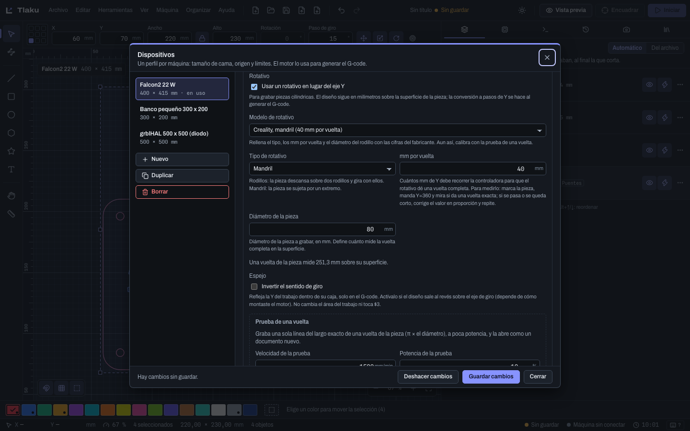

# Rotary and Z axis

Two accessories that change how the G-code is generated: the motorized Z axis (to focus per layer and step down on each pass) and the rotary (to engrave cylindrical pieces instead of flat ones). Both are turned on in the machine profile.

> **Warning:** neither the rotary nor the Z axis has been tested with a real machine (Tlaku was tested on a Falcon2 Pro, but without a rotary or Z axis); this was validated with the emulator and automated tests. The preloaded rotary models use manufacturer or review figures: always calibrate with the **One-rotation test** and start with low power and a scrap piece.

## Z axis

### Turning it on in the profile

1. Open the **Machine** menu, **Manage Devices…**, and choose your machine.
2. In the **Axes and accessories** group, tick **Motorized Z axis**. Do this only if your machine moves the focus with a motor.
3. **Invert Z** appears. Leave it off, unless on your machine +Z brings the head closer or raises the bed.
4. **Save changes**.

Without this checkbox, the layers' Z settings are ignored when sending, and the layer shows a warning.

### Using it on a layer

With the Z axis active, the layer editor has the **Z axis** group:

| Setting | What it does |
|---|---|
| **Z offset** | Moves the focus when the layer starts. Positive = the focus goes deeper into the material (the head goes down or the bed goes up). Negative, outward |
| **Step down per pass** | Extra millimeters the focus goes down on each pass after the first, for deep cuts. `0` = all passes at the same height |

If the layer has Z settings and the machine has no Z axis, you see a warning and the **Reset Z to 0** button.

### How it behaves

- Zero is **where you focused**: Tlaku does not know the machine's Z zero, so before starting, focus by hand on the surface of the material. The Z movement is sent **relative** to that height, and each layer returns to it when it finishes.
- The height of each pass is `Z offset + Step down per pass × (pass − 1)`. With a nonzero step down and several passes, the layer is split into one row per pass in the [preview](07-vista-previa.md) ("pass 2/3").
- **Direction test:** with a Z offset of 1 mm, the focus must go 1 mm into the material. If it goes the other way, turn on **Invert Z**. Do the test without material and with the laser off or at minimum power.
- Currently the estimated time does not add up how long Z takes to move. With the Z axis active, **Move the head** has the **Up** and **Down** buttons and **Focus** (takes Z to a saved focus height), explained in [Advanced machine control](09b-control-avanzado.md). There is no autofocus or Z optimization.

## Rotary

The rotary **replaces the Y axis**: the design is drawn in millimeters on the surface of the piece, with X along the piece and Y around it, and Tlaku converts that Y to the steps the controller must take when generating the G-code. It does not use a separate A or U axis. Each layer's speed is interpreted on the surface of the piece.

### Setting it up

In **Devices**, **Axes and accessories** group:

1. Tick **Use a rotary instead of the Y axis**.
2. If your accessory is on the list, choose the **Rotary model**. It fills in the type and measurements with the manufacturer's figures.

| Model | Type | mm per rotation | Roller |
|---|---|---|---|
| xTool RA2 Pro, roller | Roller | 32 | 17 mm |
| xTool RA2 Pro, chuck | Chuck | 128 | not applicable |
| Creality, chuck | Chuck | 40 | not applicable |

3. If it is not there, choose the **Rotary type** by hand: **Roller** (the piece rests on two rollers and turns with them) or **Chuck** (the piece is held at one end). The starting values are 32 mm per rotation for roller and 40 for chuck.
4. **mm per rotation**: how many mm of Y the controller must travel for the rotary to make one full rotation.
5. **Roller diameter** (roller only) and **Object diameter** in mm. With rollers, what moves the piece is the roller's diameter; the piece's diameter is only used for the circumference and the test. The profile tells you "One rotation of the workpiece measures X mm along its surface".
6. **Mirror** (**Reverse the rotation direction**): turn it on if the design comes out backwards around the piece, which depends on how you mounted the motor. It affects only the G-code, not the job's area.
7. **Save changes**.

### Calibrating with the one-rotation test

This is the step you must not skip. At the end of the rotary group is the **One-rotation test**.

1. Save the profile changes first and make sure that machine is the active one (the test is computed with the saved profile).
2. Adjust **Test speed** (1500 mm/min by default) and **Test power** (10 % by default): only the line should show, without burning the piece.
3. Press **Test one rotation**. A new document opens with a single line of the exact length of one rotation (π times the piece's diameter).
4. Mark the piece where the line starts, send it, and see where it ends. The end of the line must land on its start.
5. If the line falls short, increase **mm per rotation**; if it overshoots, decrease it. It is proportional: if the piece turned only 90 % of a rotation, divide the current value by 0.9. Repeat until it closes.

With rollers it is the drive roller that must make a full rotation; with a chuck, the piece.

### Software limits

The rotary has no limit switch, and its controller Y can exceed the bed's measurement. If the job goes beyond it, the preview warns in **Warnings** that, with software limits active (`$20=1`), the machine would raise `ALARM:2`. The solution the app proposes is to disable the limits (`$20=0`) while you use the rotary. You can send that setting with the console ([Sending jobs safely](09-enviar-con-seguridad.md)), which asks for confirmation.

### What changes in the Machine window

With the rotary active, **Position the laser** (a click on the bed) is disabled and says why: Y is the piece's rotation, not a point on the bed. Framing (the rectangle and **Frame outline**) does work and uses the rotary's scale, just like the job.

### What does not exist

A rotary for galvo (turning the piece between strips) exists only as a calculation in the engine; cylinder and cone correction is a galvo feature and is driven from a galvo machine's profile: see [3D slice engraving, cylinder, and cone](12b-grabado-3d-y-cilindro.md) and [Galvo (experimental)](13c-galvo.md). A separate A or U axis is moved by hand (the profile's **U axis** checkbox and the buttons in **Move the head**) and, if you want, also inside the job (see [The U axis in the job and per layer](#the-u-axis-in-the-job-and-per-layer)). With a Ruida controller the rotary is turned on in the machine's own settings: Tlaku sends Y in surface mm, without scaling it, and does not write those settings.

## The U axis in the job and per layer

If your machine has an extra axis (U) that answers to `G0 U..`, check **U axis** in the profile. There are two offsets, both relative and with the laser off (Tlaku does not know the zero of U):

- **Job U offset** (in the profile): the axis moves that distance when the job starts and returns when it finishes.
- Each **layer's** **U offset** (in the layer editor, main group): the U position that layer runs at, **added** to the job's and relative to where U was when the job started. Between two layers Tlaku sends only the difference, and at the end it undoes the total. It is useful, for example, to make each layer engrave at a different height or position of the axis. The field only appears with a machine that has a U axis (or if the layer already carries a value); if the machine has no U axis, the value is ignored and the preview warns about it.

With **0** in every layer the G-code is the usual one. The move is written as `G91`, `G0 U..`, `G90` when the layer starts, before engraving anything. *To be validated on a real machine with a U axis: only the G-code and the emulator were checked.* This is not the rotary: the rotary replaces the Y axis.

Next: [3D slice engraving, cylinder, and cone](12b-grabado-3d-y-cilindro.md)
